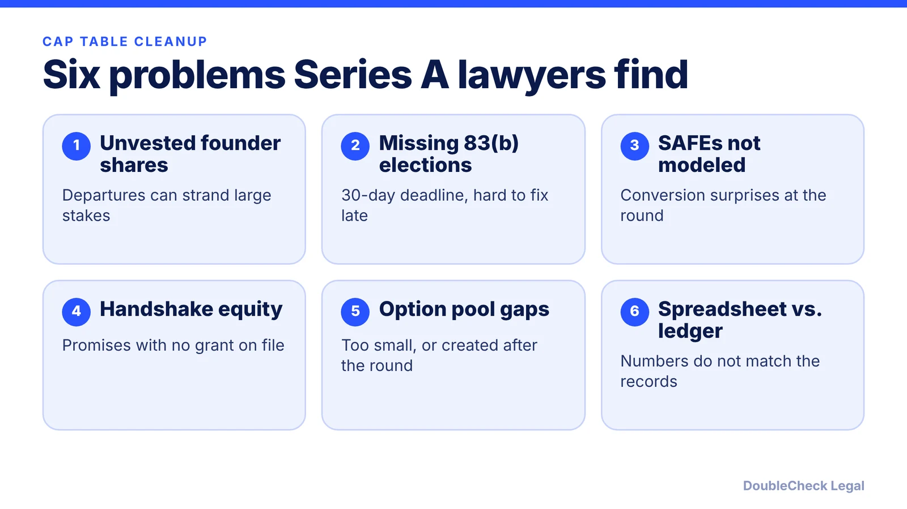
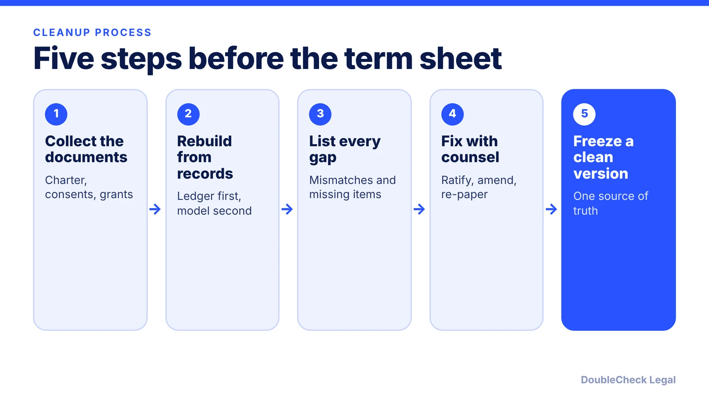

*Cap table cleanup before Series A is about matching your ownership model to your signed documents before an investor checks.*

**Key takeaways:**

- Reconcile your cap table to the stock ledger and signed documents, not the other way around.
- Common problems: no vesting, missing 83(b) elections, unmodeled SAFEs, informal equity promises and option pool gaps.
- Fix issues between financings, when you have leverage and time.
- Use an attorney for unapproved issuances, missed tax elections and disputed equity.

## 1. The quick answer

**Quick answer:** Cap table cleanup before Series A means making your ownership records match your legal paperwork, so an investor's lawyer finds no surprises. The most common problems are unvested or unpapered founder shares, missing 83(b) elections, SAFEs and notes left off the model, informal promises of equity, a missing or oversized option pool, and a spreadsheet that disagrees with the stock ledger. Fix them between financings, not after a term sheet arrives. This is general information as of November 2026, not legal advice.

## 2. Why investors check the cap table closely

A Series A investor is buying a percentage of a company, so they need to know exactly who owns what and what could still convert. Their counsel will compare your cap table to the certificate of incorporation, board consents, stock purchase agreements, option grants and any SAFEs or notes. Gaps slow the closing and can reduce your leverage.

Lowenstein Sandler, in its guide to [preparing for a pre-seed financing round](https://www.lowenstein.com/media/7578/preparing-for-a-pre-seed-financing-round.pdf), calls failing to set up and document founder equity early the most common pre-seed mistake, and notes that undocumented initial share issuances can create real tax problems if investors later offer a high valuation. Cleanup is cheaper and calmer before a deadline than during one.

If you are new to the vocabulary, start with [cap table basics for first-time founders](/blog/cap-table-basics-for-first-time-founders/), then read the [Series A legal due diligence checklist](/blog/series-a-legal-due-diligence-checklist/) to see what the other side will ask for.

## 3. The most common cap table problems and their usual fixes

The problems below are the ones that commonly come up in diligence. Rules differ by state and by the facts, so confirm specifics with counsel.

**1. No vesting, or vesting that was never papered.** Many startups put founders on a multi-year vesting schedule, often with a one-year cliff, though the terms are negotiable. If founders hold fully vested stock, a departing co-founder keeps all of it. Fixes often involve a restricted stock agreement or a vesting amendment that all holders sign. See [cofounder vesting and cliffs](/blog/cofounder-vesting-cliff-explained/) and the [founder stock purchase agreement](/blog/issue-founder-stock-purchase-agreement/).

**2. Missing 83(b) elections.** For restricted stock that vests over time, the election is due no later than 30 days after the property is transferred, per [Treasury Regulation 1.83-2](https://www.law.cornell.edu/cfr/text/26/1.83-2). The deadline is strict, and without a timely election the holder can owe ordinary income tax as shares vest. This is the problem that is hardest to repair, so confirm filings early. Details are in our [83(b) election guide](/blog/83b-election-startup-founders/).

**3. SAFEs and convertible notes missing from the model.** These instruments are not stock when issued, so founders sometimes leave them off and are surprised when they convert. Model every instrument, including valuation caps and discounts, and run conversion scenarios before the round. Compare [SAFE vs convertible note](/blog/safe-vs-convertible-note-startups/) mechanics and how a [valuation cap and discount work together](/blog/valuation-cap-vs-discount-safe-how-they-work-together/).

**4. Informal equity promises.** An email saying "you will get 1%" is not a grant. Lowenstein Sandler advises that advisors and consultants have written agreements, with vesting that generally tracks their expected term of service, and that equity for service providers typically comes through an equity incentive plan and option pool. Either paper the promise properly or resolve it in writing.

**5. A missing or badly timed option pool.** Creating or enlarging a pool around a round can dilute existing holders, and investors may ask for it before closing, so plan the pool early. Pool sizing is negotiated in the term sheet, so read [term sheet key terms](/blog/term-sheet-key-terms-explained/).

**6. Options granted without a valuation.** Option strike prices generally need to be supported by a [409A valuation](/blog/stock-options-409a-valuation-startups/). Grants made on a guess are a classic diligence finding.

**7. A cap table that disagrees with the legal records.** Keep the ledger updated after every issuance, consider cap table software over a loose spreadsheet, and have a finance expert or lawyer review before fundraising.

## 4. A step-by-step cleanup process

A workable order of operations, whatever tools you use:

**Collect the documents.** Gather the certificate of incorporation and amendments, bylaws, board and stockholder consents, founder stock purchase agreements, option grants, SAFEs and notes, advisor agreements and 83(b) filings.

**Rebuild from the records.** Start from the stock ledger and signed documents, then reconcile your model to them, not the reverse. Where they disagree, the signed documents generally control.

**List every gap.** Typical entries: shares issued without a board consent, options granted without approval, a SAFE missing a signature, an advisor who was promised equity verbally.

**Fix with counsel.** Many gaps can be repaired through ratification resolutions, amendments or corrective agreements (for Delaware corporations, Section 204 of the DGCL provides a formal process for [ratifying defective stock issuances](https://natlawreview.com/article/fixing-void-or-voidable-stock-issuances-section-204-delaware-general-corporation-law)), but whether a fix works depends on state law and the facts. An attorney should choose the method, especially for tax-sensitive items like 83(b) elections.

**Freeze a clean version.** Keep one dated cap table, with a log of changes. A [due diligence checklist for startup fundraising](/blog/due-diligence-checklist-for-startup-fundraising/) shows what will be requested.

## 5. What you can do yourself and when to bring in an attorney

Organizing documents, building the model and listing mismatches are tasks you can do yourself, and AI tools can help summarize agreements and flag inconsistencies. Treat that output as a draft to verify, not a conclusion, as in our guide to [verifying AI-generated legal documents](/blog/verify-ai-generated-legal-document/).

Bring in an attorney when you find any of the following:

- Shares or options that were issued without proper approval
- A missed 83(b) deadline
- A departed co-founder holding unvested or disputed equity (see [how to remove or buy out a co-founder](/blog/how-to-remove-or-buy-out-a-co-founder/))
- Equity promised to someone with no paperwork
- Conflicting versions of the same SAFE or grant

Also read [when to hire a lawyer for a small business](/blog/when-to-hire-lawyer-small-business/) and [how to choose a good lawyer](/blog/how-to-choose-good-lawyer/). Rules differ by state and by the facts, so an hour of review before the round is usually cheaper than a cleanup during it.

## Where DoubleCheck fits

[DoubleCheck](https://www.contactdoublecheck.com) helps businesses and founders start legal work with AI, verify it, and, when professional advice is warranted, connect with an independent attorney, including for immigration questions. Attorney availability and practice areas vary. Attorneys on DoubleCheck are independent professionals; an attorney-client relationship forms only if an attorney accepts your engagement.

**Sources:** [Lowenstein Sandler, Preparing for a Pre-Seed Financing Round](https://www.lowenstein.com/media/7578/preparing-for-a-pre-seed-financing-round.pdf); [Cornell LII, 26 CFR 1.83-2 (83(b) elections)](https://www.law.cornell.edu/cfr/text/26/1.83-2); [National Law Review, Fixing Void or Voidable Stock Issuances Under Section 204 of the Delaware General Corporation Law](https://natlawreview.com/article/fixing-void-or-voidable-stock-issuances-section-204-delaware-general-corporation-law). Carta and Breega pages did not load fully, so their claims were not used.

## FAQ

**What is a cap table cleanup before Series A?**

It is the process of reconciling your cap table with your legal records and fixing gaps such as missing approvals, unvested founder stock, unmodeled SAFEs and informal equity promises, so investor counsel finds no surprises.

**When should I clean up my cap table before Series A?**

Ideally early, between financings rather than after a term sheet arrives. Law firm guidance calls failing to document founder equity early the most common pre-seed mistake, and undocumented issuances can create tax problems later.

**What is the deadline for an 83(b) election?**

Per Treasury Regulation 1.83-2, the election must be filed no later than 30 days after the property was transferred. The deadline is strict, so ask a tax professional about your specific facts.

**Do SAFEs belong on the cap table?**

Yes, at least in your model. SAFEs and convertible notes are not stock when issued but can convert into stock later, so omitting them hides future dilution. Model caps, discounts and conversion scenarios.

**Can I fix cap table problems without a lawyer?**

You can organize records and find gaps yourself, but repairing unapproved issuances, missed tax elections or disputed equity generally needs an attorney because the right fix depends on state law and the facts.

---

*General information only. This article is not legal, tax, investment, or accounting advice.*

For a deeper breakdown of fundraising mechanics and legal diligence, review our detailed guide on [NVCA Series A Preferred Stock Purchase Agreements](/blog/series-a-nvca-preferred-stock-purchase-agreement-clauses).

For international founders transitioning overseas entities into US investment vehicles, see our comprehensive manual on [Foreign Founder US Holding Company Restructuring and the Delaware Flip](/blog/foreign-founder-us-holding-company-delaware-flip-tax-structure).