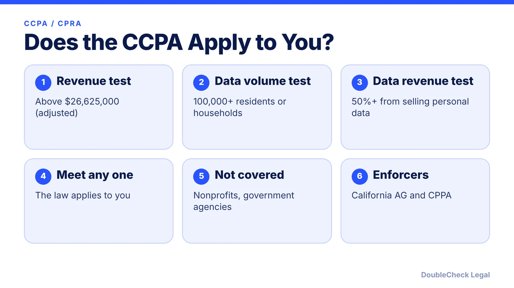
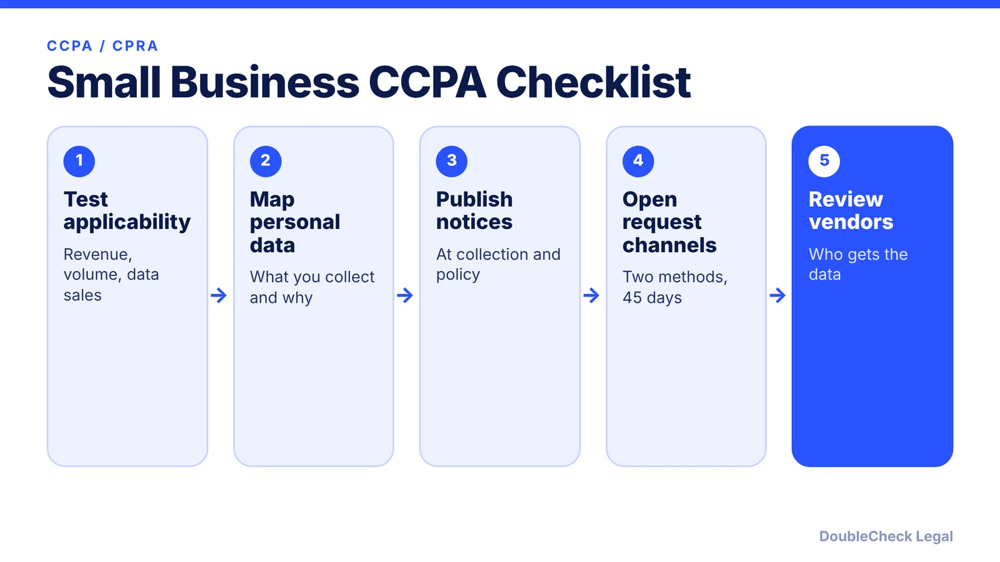

*Not every small business is covered by California's privacy law. Here are the tests, the rights, and the penalty amounts.*

**Key takeaways:**

- The CCPA applies if you do business in California and meet any one test: revenue above the adjusted $26,625,000, 100,000+ residents or households, or 50%+ of revenue from selling personal information.
- Consumers can know, delete, correct, opt out, and limit use of sensitive data.
- Requests to know, delete, or correct generally get 45 calendar days.
- Adjusted penalties: $2,663 per violation and $7,988 per intentional or minor-related violation (effective January 1, 2025).

## 1. The quick answer

**Quick answer:** The CCPA (as amended by the CPRA) applies to for-profit businesses that do business in California and meet at least one test, per the California Attorney General: annual gross revenue above $25 million (adjusted to $26,625,000 by the California Privacy Protection Agency effective January 1, 2025), buying, selling, or sharing the personal information of 100,000 or more California residents or households, or earning 50% or more of annual revenue from selling California residents' personal information. Many small businesses fall below all three, but a high-traffic website or app can reach the 100,000 mark.

## 2. Thresholds and the adjusted dollar figures

The AG's CCPA page states the $25 million figure. The California Privacy Protection Agency (CPPA) publishes the CPI-adjusted amounts under Civil Code 1798.185, and its notice, effective January 1, 2025, raises the revenue threshold to **$26,625,000**. The CPPA page I reviewed shows no later adjustment, so check cppa.ca.gov for any newer figure before relying on this number.

Two points that surprise small businesses:

- **Households count.** The 100,000 test counts California residents or households whose data you buy, sell, or share, which a consumer app or ecommerce store with national traffic can reach.
- **Do business in California.** The law covers businesses outside California that do business there. If you also sell into Europe, see [GDPR for US startups](/blog/gdpr-for-us-startups/).

Nonprofits and government agencies are generally not covered, per the AG.

## 3. Consumer rights and what you must publish

Per the California AG, consumers have the right to:

- know what personal information is collected, used, shared, or sold;
- delete personal information, subject to exceptions;
- opt out of sale or sharing, including through a global privacy control;
- correct inaccurate information;
- limit use and disclosure of sensitive personal information; and
- non-discrimination for exercising these rights.

**Your obligations.** Give a notice at or before collection that lists categories of information and purposes, and link your privacy policy. If you sell or share data, include a "Do Not Sell or Share" link. Offer at least two ways to submit requests (an online-only business may offer just an email address). Requests to know, delete, or correct must be answered within 45 calendar days, extendable by 45 more with notice, and opt-outs honored as soon as feasibly possible and no later than 15 business days.

## 4. Penalties and next steps

Per the CPPA's adjusted amounts (effective January 1, 2025):

- **Administrative fines and civil penalties:** $2,663 per violation, or $7,988 per intentional violation or violation involving consumers under 16.
- **Data breach private lawsuits:** $107 to $799 per consumer per incident, or actual damages if greater.

The AG notes that for most violations only the Attorney General or the CPPA can take action, and consumers can sue only after a qualifying data breach, after 30 days' written notice to cure. Because penalties are counted per violation, errors repeated across many consumers add up.

Next steps: confirm whether you meet a threshold, write a privacy policy that matches your practices ([AI privacy policy guide](/blog/ai-write-privacy-policy/), [privacy policy generators](/blog/privacy-policy-generator-small-business/)), review vendor and AI tool terms ([AI vendor contract checklist](/blog/ai-vendor-contract-checklist/)), and pair this with solid [website terms](/blog/website-terms-of-service-saas-startups/).

## Where DoubleCheck fits

[DoubleCheck](https://www.contactdoublecheck.com) helps businesses and founders start legal work with AI, verify it, and, when professional advice is warranted, connect with an independent attorney, including for immigration questions. Attorney availability and practice areas vary. Attorneys on DoubleCheck are independent professionals; an attorney-client relationship forms only if an attorney accepts your engagement.

**Sources:** [California Attorney General, CCPA](https://oag.ca.gov/ccpa); [CPPA, updated monetary thresholds](https://www.cppa.ca.gov/regulations/cpi_adjustment.html).

## FAQ

**What is the CCPA revenue threshold?**

The statute says $25 million, adjusted to $26,625,000 effective January 1, 2025, per the California Privacy Protection Agency.

**Does the CCPA apply to businesses outside California?**

Yes if they do business in California and meet a threshold, per the California Attorney General.

**What are the CCPA penalties per violation?**

$2,663 per violation and $7,988 per intentional violation or violation involving consumers under 16, per the CPPA's adjusted amounts effective January 1, 2025.

**Can consumers sue under the CCPA?**

Only after certain data breaches caused by inadequate security, with statutory damages of $107 to $799 per incident (adjusted) and a 30-day notice to cure, per the AG and CPPA.

---

*General information only. This article is not legal, tax, investment, or accounting advice.*
