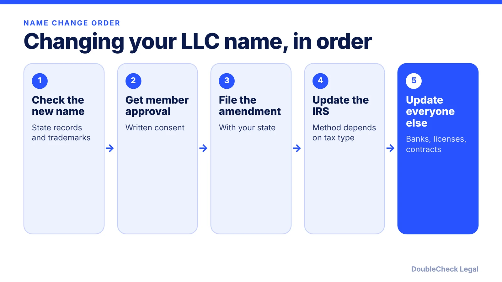
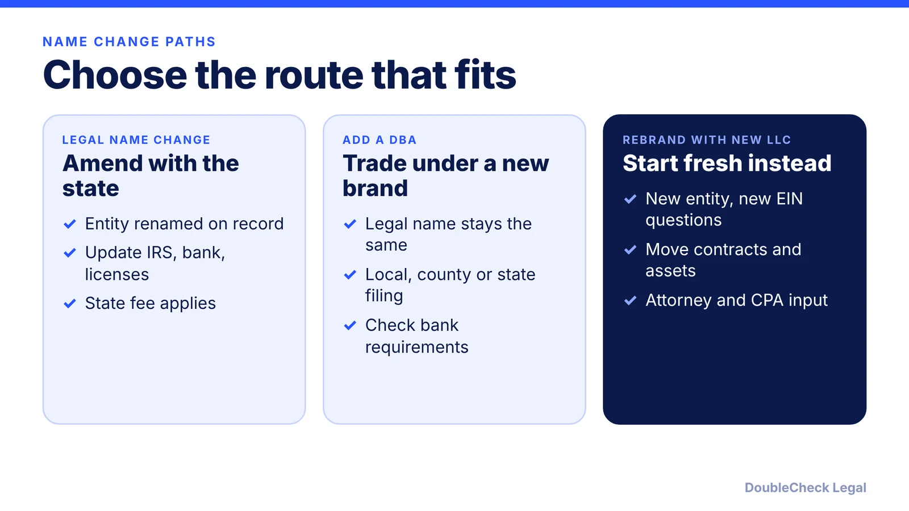

*A practical order of operations for renaming your LLC, with verified examples from the IRS, Texas and California.*

**Key takeaways:**

- Changing the legal name takes a state amendment; a DBA only adds a trade name.
- The IRS says you do not need a new EIN just because the name changed (page dated July 21, 2026).
- How you tell the IRS depends on whether the LLC is taxed as a sole proprietorship, partnership or corporation.
- Fees and forms differ by state; Texas lists $150 and California lists $30 for name-change filings.

## 1. The quick answer

**Quick answer:** To change your LLC name, you generally check that the new name is available, get the members to approve it, file an amendment with your state, then update the IRS, state agencies, banks, licenses and contracts. You usually do not need a new EIN: the IRS says on its page last reviewed July 21, 2026 that you do not need a new EIN if you just change your business name or address. If you only want to operate under a different brand, a DBA (fictitious or assumed name) may be a lighter option than changing the legal name. Filing fees and forms vary by state; this guide gives two verified examples, Texas and California, as of November 2026.

## 2. Legal name change or DBA: which one do you need?

Before filing anything, decide what actually changes.

- **Change the legal name** if the company itself is being renamed, for example after a rebrand, a new partner, or because the old name is unavailable or causing confusion. This requires a filing with the state where the LLC was formed.
- **Add a DBA** if the legal entity keeps its name but you want to trade under another name. Per Nolo, a fictitious name filing is made with a local, county or state agency, your legal name stays the same for the IRS and other agencies, and you still need to check with your bank and update branded materials.

A DBA does not replace the legal name on contracts or tax filings. For state-specific DBA rules see [the Texas DBA guide](/blog/dba-texas-complete-guide-sole-proprietor-llc-and-corporation/), [California fictitious business names](/blog/california-fictitious-business-name-dba/) and [Florida fictitious name registration](/blog/florida-fictitious-name-registration-dba/).

Also think about the name itself. A new name can conflict with another business's trademark even if the state accepts it. Per Nolo, search federal registrations, state records, social media and domain names; see [trademark business name check](/blog/trademark-business-name-check/) and [how to trademark a business name](/blog/how-to-trademark-a-business-name/).

## 3. File the amendment with your state

The state filing is what actually changes the legal name. Per Nolo (article updated April 25, 2023) and the state filing pages linked in Sources, the usual sequence is:

1. **Check name availability** in your state business records. Each entity generally must use a name that is distinguishable from others on file, and rules differ by state, so check with your Secretary of State.
2. **Get member approval.** Read your operating agreement for a name-change process. If the agreement is silent, the state LLC act sets the default, so check your state statute for the vote needed. Keep a signed written consent.
3. **File an amendment** to the articles of organization (some states call it a certificate of amendment). Many states take online filings and some require mail. The change generally becomes effective when the state approves it.
4. **Update the operating agreement** to show the new name.

Two verified state examples (confirm current fees on the agency page before you file):

- **Texas.** Per the Texas Secretary of State instructions, the form is Form 424, Certificate of Amendment, with a name-change-only option filed through SOSDirect. The page states the filing fee is $150 for most entities. The new name must contain an appropriate organizational identifier for the entity type, and cannot be the same as or deceptively similar to an existing entity. A name search is optional, and a search result alone does not guarantee approval.
- **California.** Per the California Secretary of State forms page, Form LLC-2-NA (Certificate of Amendment, name change only) is listed at $30.00 and can be filed online. Name reservations are listed at $10.00.

See also [how to start an LLC in Texas](/blog/how-to-start-an-llc-in-texas/) and [California LLC annual tax and fee](/blog/california-llc-annual-tax-and-fee/). Other states differ in forms, fees and notice rules, which we did not verify here, so check your own state.

## 4. Update the IRS, state tax agencies and your EIN

**You generally keep the same EIN.** The IRS says you do not need a new EIN if you just change your business name or address, and lists sole proprietors, corporations, partnerships and LLCs as not needing a new EIN for a name change (page last reviewed July 21, 2026). A new EIN is generally tied to ownership or structure changes, not renaming. See [how to get an EIN](/blog/how-to-get-an-ein-for-your-business-free/) for background.

**Telling the IRS depends on how the LLC is taxed.** The IRS business name change page (last reviewed February 22, 2026) lists these methods, and does not address LLCs by name:

- **Sole proprietorship:** write to the IRS address where you filed your return.
- **Corporation:** on the current-year return, check the name change box (Form 1120, page 1, line E, box 3; Form 1120-S, page 1, line H, box 2). If you already filed, write to the IRS address where you filed. A corporate officer signs.
- **Partnership:** check the name change box on Form 1065 (page 1, line G, box 3), or write to the IRS if already filed. A partner signs.

Per Nolo, an LLC follows the method for its tax classification: a single-member LLC owner writes to the IRS, a partnership-taxed LLC marks Form 1065, and a corporation-taxed LLC marks Form 1120 or 1120-S. If your structure changed along with the name, ask a tax professional, since the IRS page refers readers to Publication 1635 for new-EIN questions.

For state and local tax agencies, Nolo advises notifying them too and showing a copy of the amendment. Background: [single-member LLC taxes](/blog/single-member-llc-taxes-disregarded-entity/) and [multi-member LLC taxes](/blog/multi-member-llc-taxes-partnership-return-k-1-explained/).

**Beneficial ownership reports.** Per Ballard Spahr (August 2026), a FinCEN final rule issued August 11, 2026 and effective August 14, 2026 permanently exempts U.S.-formed entities from BOI reporting. Foreign reporting companies remain subject to BOI reporting for non-U.S. person beneficial owners and must file updates within 30 calendar days after a change. See [our BOI post](/blog/beneficial-ownership-report-boi-2026/) and check whether you are a foreign reporting company.

## 5. Update banks, licenses, contracts and your public name

Per Nolo, existing contracts, accounts and permits stay in effect after a name change, but you still need to update the paperwork so that everything matches. Work through this list in order:

- **Bank and payment accounts.** Banks usually want the state-stamped amendment and may ask for the operating agreement or an updated resolution. See [how to open a business bank account](/blog/how-to-open-a-business-bank-account-llc-corporation-documents/) and [bank account habits that protect liability](/blog/llc-startup-bank-account-commingling-liability-protection-habits/).
- **Registered agent.** Tell your registered agent and any service of process addresses. See [registered agent for an LLC](/blog/registered-agent-for-an-llc-who-can-serve-and-what-it-costs/).
- **Licenses and permits.** Local and state licenses often have their own name-change process. See [business license requirements](/blog/business-license-requirements-small-business/).
- **Insurance, leases and loans.** Ask each counterparty how it wants to document the change.
- **Customer and vendor contracts.** A name change on its own is usually not a new contract, but you may want an amendment or a notice letter. See [contract amendment vs. new contract](/blog/contract-amendment-vs-new-contract-how-to-change-a-signed-agreement/).
- **Public materials.** Website, invoices, email signatures, social profiles, domains, packaging and signage.

## 6. When to get a professional to check it

Many name changes are routine paperwork. Consider help when:

- Your operating agreement is unclear on who approves a name change.
- The new name could conflict with a trademark, especially if you have customers or investors tied to the old brand.
- The change comes with new owners, a new tax classification or a new state of formation.
- You are mid-fundraising or holding contracts with assignment or notice clauses. See [LLC operating agreement with AI](/blog/llc-operating-agreement-with-ai/) and [startup LLC operating agreement clauses](/blog/startup-llc-operating-agreement-clauses-investors-vesting-and-conversion/).

Per Nolo, a trademark attorney can run a name search and a business attorney can handle the filings and notifications. If you use AI to draft the consent, the amendment text or notice letters, treat the output as a draft and [verify AI-generated legal documents](/blog/verify-ai-generated-legal-document/) against your state forms. See also [the startup LLC first 30 days checklist](/blog/startup-llc-first-30-days-checklist-after-you-form/) and [when to hire a lawyer for a small business](/blog/when-to-hire-lawyer-small-business/).

## Where DoubleCheck fits

[DoubleCheck](https://www.contactdoublecheck.com) helps businesses and founders start legal work with AI, verify it, and, when professional advice is warranted, connect with an independent attorney, including for immigration questions. Attorney availability and practice areas vary. Attorneys on DoubleCheck are independent professionals; an attorney-client relationship forms only if an attorney accepts your engagement.

**Sources:** [IRS: Do you need a new EIN?](https://www.irs.gov/businesses/small-businesses-self-employed/do-you-need-a-new-ein) (last reviewed July 21, 2026); [IRS: Business name change](https://www.irs.gov/node/10373) (last reviewed February 22, 2026); [Texas Secretary of State: Form 424 instructions](https://direct.sos.state.tx.us/help/help-corp-filing-424.html); [California Secretary of State: LLC forms](https://sos.ca.gov/business-programs/business-entities/forms/limited-liability-companies-california-domestic); [Nolo: Can I change the name of my LLC?](https://www.nolo.com/legal-encyclopedia/can-i-change-my-llcs-name.html) (updated April 25, 2023); [Ballard Spahr: FinCEN BOI final rule](https://www.ballardspahr.com/insights/alerts-and-articles/2026/08/fincen-permanently-exempts-us-entities-and-persons-from-beneficial-ownership-reporting) (August 2026).

## FAQ

**How do I change my LLC name?**

Check that the new name is available, get member approval under your operating agreement, file an amendment (often called a certificate of amendment) with the state, then update the IRS, banks, licenses and contracts. Forms and fees vary by state.

**Do I need a new EIN if I change my LLC name?**

Generally no. The IRS says on its Do you need a new EIN page, last reviewed July 21, 2026, that you do not need a new EIN if you just change your business name or address. If ownership or structure also changes, ask a tax professional.

**How much does it cost to change an LLC name?**

It depends on the state. Per the Texas Secretary of State, a certificate of amendment is $150 for most entities, and per the California Secretary of State forms page the LLC-2-NA name change form is $30.00. Confirm the current fee on your state page.

**Is a DBA easier than changing my LLC name?**

Often it is lighter, because a DBA is a fictitious name filing with a local, county or state agency and your legal name stays the same, per Nolo. It does not rename the legal entity on contracts or tax filings.

**Do I need to update beneficial ownership reports after a name change?**

For U.S.-formed companies, a FinCEN final rule effective August 14, 2026 exempts them from BOI reporting, per Ballard Spahr. Foreign reporting companies must file updates within 30 calendar days after a change. Check which category applies to you.

---

*General information only. This article is not legal, tax, investment, or accounting advice.*
