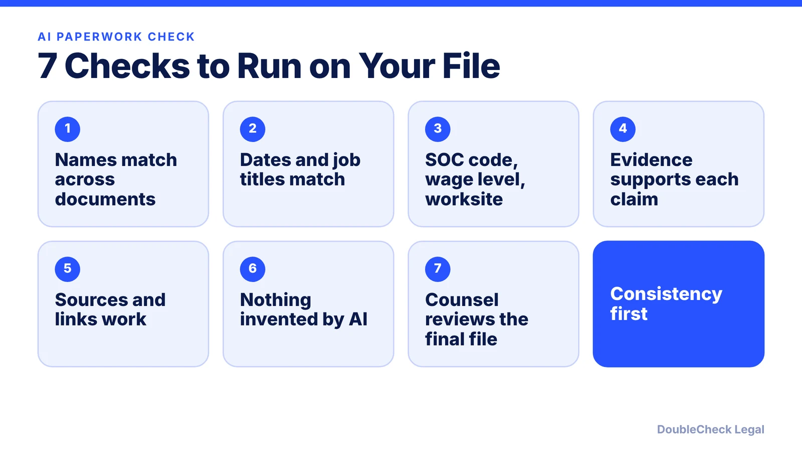
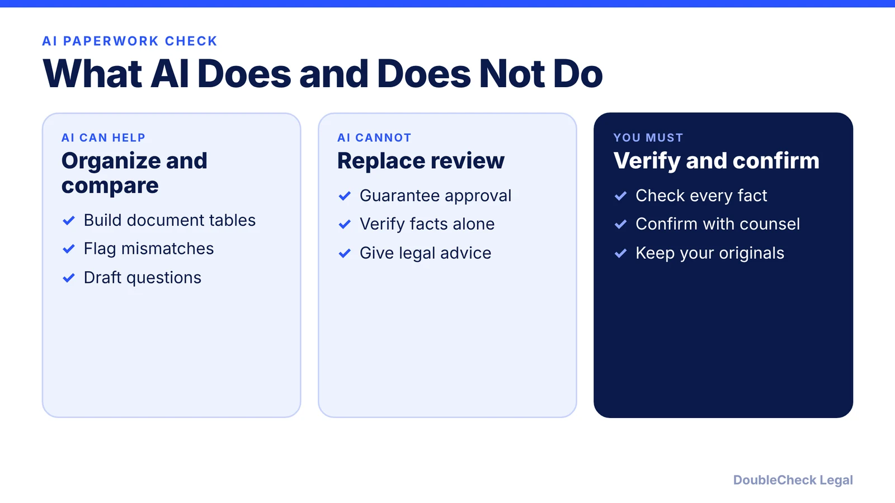

*Can AI check your immigration documents? It can help with consistency, but it should not be your last review. Here are seven checks.*

**Key takeaways:**

- AI helps organize files and spot mismatched names, dates, and details.
- Greenberg Traurig reports H-1B registration, LCA, and petition details must match.
- Treat every AI-written fact as unverified until checked against a source.
- Have a licensed attorney or accredited representative review the final file.

## 1. The quick answer

**Quick answer:** AI can help you organize an immigration file, spot inconsistent names and dates, and prepare questions for your lawyer, but it should not be the last check before filing. USCIS has said registration and petition details must be consistent, and it can deny or revoke H-1B petitions where information appears engineered to improve selection odds. Use AI to review for consistency, then have a licensed professional review the file.

## 2. What to ask AI to do

- Build a table of every document with its date, author, and claim.
- Compare the employer's registration details with the petition: SOC code, wage level, and worksite, which Greenberg Traurig reports must match across registration, LCA, and petition for H-1B.
- List the evidence you plan to use for each O-1 or EB-1A criterion and flag gaps.
- Draft questions for your lawyer.

## 3. Verify what AI wrote

AI can invent facts, citations, and quotes. Treat every AI-drafted sentence in a support letter, personal statement, or evidence summary as unverified until you check it against a source document. Read [how to verify an AI-generated legal document](/blog/verify-ai-generated-legal-document/), [AI hallucinated citations](/blog/ai-hallucinated-citations-business/), and [having a lawyer review ChatGPT contract work](/blog/lawyer-review-chatgpt-contract/). AI chats may also not be privileged, so avoid pasting sensitive identifiers; see [AI chats are not privileged](/blog/ai-chats-not-privileged-heppner/).

## 4. Then get a licensed professional

Before filing, have an attorney in good standing or an accredited representative review the final package. See [how to find a good immigration lawyer](/blog/how-to-find-good-immigration-lawyer-startup-founder/) and [how to avoid notario scams](/blog/immigration-notario-scam-how-to-avoid/). For specific forms, read the [O-1 documents checklist](/blog/o-1-visa-documents-checklist-founder/) and [H-1B weighted lottery explained](/blog/h1b-weighted-lottery-wage-levels-explained/).

## Where DoubleCheck fits

[DoubleCheck](https://www.contactdoublecheck.com) helps businesses and founders start legal work with AI, verify it, and, when professional advice is warranted, connect with an independent attorney, including for immigration questions. Attorney availability and practice areas vary. Attorneys on DoubleCheck are independent professionals; an attorney-client relationship forms only if an attorney accepts your engagement.

**Sources:** [Greenberg Traurig](https://www.gtlaw.com/en/insights/2026/2/uscis-finalizes-wage-weighted-h-1b-cap-selection-rule-effective-feb-27-2026); [USCIS: Find Legal Services](https://www.uscis.gov/avoid-scams/find-legal-services).

## FAQ

**Can I use AI to prepare my immigration application?**

AI can help organize documents and find inconsistencies, but you must verify every fact and have a licensed professional review before filing.

**What must match in an H-1B filing?**

Greenberg Traurig reports the SOC code, wage level, and worksite in registration must match the LCA and petition.

**Is it safe to paste my passport details into AI?**

Avoid sharing sensitive identifiers. AI chats may not be privileged, so keep personal data out unless you understand the tool's terms.

**Can AI make up immigration facts?**

Yes. AI can invent facts and citations, so check every statement against a source document.

---

*General information only. This article is not legal, tax, investment, or accounting advice.*
