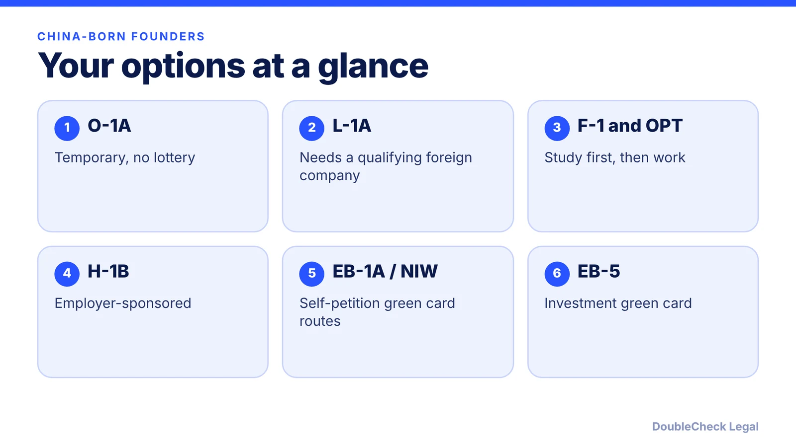
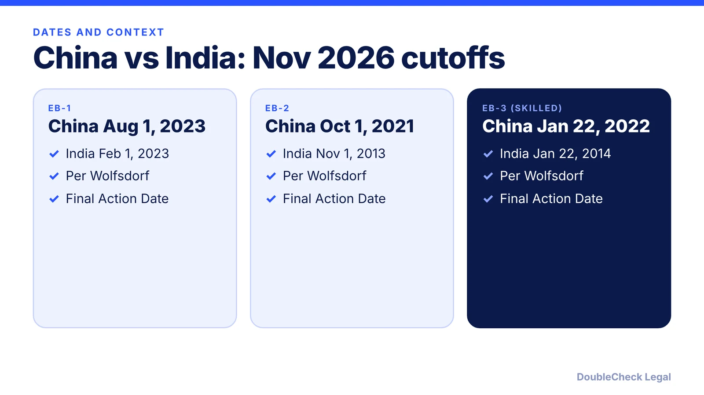

*China-born founders have no E-2 route, a different green card queue than India, and extra scrutiny to plan for.*

**Key takeaways:**

- Mainland China is not an E-2 treaty country, per Headman Law Group.
- November 2026 China Final Action Dates, per Wolfsdorf: EB-1 Aug 1, 2023; EB-2 Oct 1, 2021; EB-3 Jan 22, 2022.
- EB5Investors.com reported China unreserved EB-5 at Dec 1, 2016 for November 2026.
- Security scrutiny signaled in 2025 (per Fortune) is context: keep records, be consistent, and verify with counsel.

## 1. The quick answer

**Quick answer:** China-born founders can pursue O-1, L-1A, F-1 with OPT, H-1B, EB-1A, the national interest waiver (NIW) and EB-5, but not the E-2, because Headman Law Group states that mainland China is not an E-2 treaty country. Two things set China apart in 2026: the green card queue and the security context. As of November 2026, per Wolfsdorf, China Final Action Dates are EB-1 August 1, 2023, EB-2 October 1, 2021 and EB-3 January 22, 2022, shorter than India in EB-2 and EB-3. And since 2025 officials have publicly signaled closer scrutiny of some Chinese applicants. Plan for documents, timing and extra review, and verify your own case with counsel.

## 2. Route by route: what fits a founder

**No E-2.** Headman Law Group states that India and mainland China are not E-2 treaty countries. Our [E-2 guide](/blog/e-2-treaty-investor-visa-for-founders/) explains why treaty status follows nationality. Check the State Department treaty table, including how it treats Taiwan or Hong Kong passports if that applies to you.

**O-1A.** Listed by the State Department for extraordinary ability in business, science, education, art or athletics, with no lottery. Read the [O-1A evidence guide](/blog/o-1a-visa-for-startup-founders-evidence/).

**L-1A.** The State Department says L-1 requires one year of employment with the related company abroad within the prior three years. If you run an operating company in China, that can matter; read [L-1A for new offices](/blog/l-1a-visa-new-office-foreign-founders/) and [how to set up a U.S. company from China](/blog/set-up-us-company-from-china/).

**F-1 and OPT.** Many founders begin as students: see [OPT and STEM OPT for startups](/blog/f1-opt-stem-opt-start-your-own-startup/), [F-1 to O-1](/blog/f-1-to-o-1-change-of-status-founders/) and the [F-1 interview guide](/blog/f-1-visa-interview-questions-international-students-214b/).

**H-1B.** Employer-sponsored, for jobs that generally require a bachelor's degree. See the [H-1B $100,000 fee status](/blog/h1b-100000-fee-status-2026/) and [weighted lottery](/blog/h1b-weighted-lottery-wage-levels-explained/).

**Green cards.** Per CitizenPath, EB-1A and the NIW can be self-filed. Compare [EB-1A vs NIW](/blog/eb-1a-vs-niw-which-is-better-for-founders/) and see [the NIW](/blog/niw-eb-2-national-interest-waiver-founders/).

## 3. Backlog differences and EB-5

China and India each have their own column in the Visa Bulletin. Per Wolfsdorf's November 2026 summary, China is ahead of India in all three of EB-1, EB-2 and EB-3, with the biggest gap in EB-2 (October 1, 2021 against November 1, 2013). A visa number is available only to applicants whose priority date is earlier than the listed date, per UT Southwestern's summary. The State Department's own bulletin page did not load for me, so check travel.state.gov monthly.

For EB-5, EB5Investors.com reported on October 22, 2026 that China unreserved was December 1, 2016 as a Final Action Date and India unreserved was December 1, 2023, for November. It said the rural, high-unemployment and infrastructure set-asides remained current. Minimum investments are $800,000 in a targeted employment area or $1,050,000 elsewhere, per Legal Services Incorporated: see our [EB-5 guide](/blog/eb-5-investor-visa-requirements-2026/). Funds must be lawfully sourced and documented, a topic for counsel.

More on how the bulletin works: [Visa Bulletin explained](/blog/visa-bulletin-explained-priority-dates-eb-categories/) and [priority date retrogression](/blog/priority-date-retrogression-india-china-backlog/).

## 4. Security and travel vetting context

Fortune reported that on May 28, 2025, Secretary of State Marco Rubio announced that the State Department would work with DHS to revoke visas held by some Chinese students, aimed at those with connections to the Chinese Communist Party or studying in critical fields, and to revise visa criteria to enhance scrutiny of future applications from mainland China and Hong Kong. Since then, rules and practice have kept shifting, so treat this as context and not a prediction about any individual.

What founders can do, lawfully and plainly:

- **Be consistent and accurate** across forms, interviews and public profiles. See [social media vetting for visa applicants in 2026](/blog/social-media-vetting-visa-applicants-2026-what-to-know/).
- **Build time in** for [administrative processing](/blog/visa-221g-administrative-processing/) and for travel planning.
- **Keep records** of research, funding, affiliations and roles.
- **Know your options if a visa is revoked:** see [what to do if your visa is revoked](/blog/visa-revoked-what-to-do-if-your-us-visa-is-revoked-2026/).

**Self-handle vs. attorney.** Reading the categories and listing your facts is a reasonable start. Get an attorney when your field or past affiliations may draw extra review, before travel while a case is pending, and before filing for any green card route. See [how to find a good immigration lawyer](/blog/how-to-find-good-immigration-lawyer-startup-founder/) and [which visa is right for you](/blog/which-us-visa-is-right-for-you-by-situation-decision-guide/).

## Where DoubleCheck fits

[DoubleCheck](https://www.contactdoublecheck.com) helps businesses and founders start legal work with AI, verify it, and, when professional advice is warranted, connect with an independent attorney, including for immigration questions. Attorney availability and practice areas vary. Attorneys on DoubleCheck are independent professionals; an attorney-client relationship forms only if an attorney accepts your engagement.

**Sources:** [Wolfsdorf, November 2026 Visa Bulletin](https://wolfsdorf.com/november-2026-visa-bulletin-selected-employment-categories-make-gains-family-categories-advance/); [UT Southwestern, November 2026 Visa Bulletin](https://www.utsouthwestern.edu/about-us/administrative-offices/international-affairs/immigration-updates/november-2026-visa-bulletin.html); [EB5Investors.com](https://www.eb5investors.com/?p=41888); [Headman Law Group, E-2 countries](https://headmanlaw.com/insights/e-2-investor-visa-2026-treaty-countries-thresholds/); [Fortune, May 2025](https://fortune.com/2025/05/29/marco-rubio-state-department-aggressively-revoke-visas-chinese-students/); [CitizenPath, employment-based green cards](https://citizenpath.com/employment-based-green-card-process/); [State Department, temporary worker visas](https://adoption.state.gov/content/travel/en/us-visas/employment/temporary-worker-visas.html); [Legal Services Incorporated, EB-5](https://legalservicesincorporated.com/immigration-law/investor-visas/eb5-visa/eb-5-regional-center-program-shutdown-update/). The State Department November 2026 bulletin page did not load, so dates are attributed to secondary sources.

## FAQ

**Can a Chinese citizen get an E-2 visa?**

Not based on mainland Chinese citizenship. Headman Law Group states that mainland China is not an E-2 treaty country. Treaty status follows nationality, so check the State Department treaty table for your passport.

**What are the November 2026 green card cutoffs for China?**

Per Wolfsdorf, China Final Action Dates are EB-1 August 1, 2023, EB-2 October 1, 2021 and EB-3 (skilled workers and professionals) January 22, 2022. Confirm in the State Department bulletin.

**How is the China backlog different from India?**

Per Wolfsdorf, China cutoffs are later than India in EB-1, EB-2 and EB-3 for November 2026, with the largest gap in EB-2: October 1, 2021 for China and November 1, 2013 for India.

**Are Chinese applicants facing more visa scrutiny?**

Fortune reported that on May 28, 2025, Secretary of State Rubio announced revocations aimed at some Chinese students and enhanced scrutiny of future applications from mainland China and Hong Kong. Practice has continued to change, so confirm current rules with an immigration attorney.

---

*General information only. This article is not legal, tax, investment, or accounting advice.*
