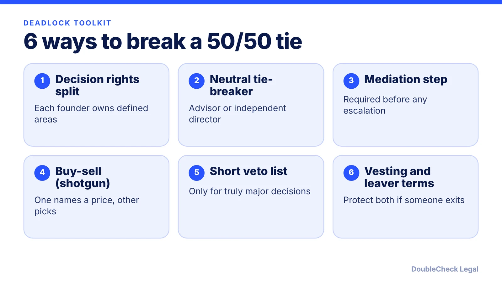
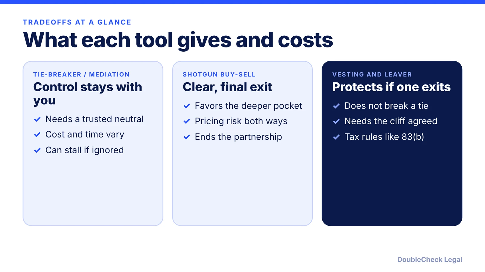

*A 50/50 split has no tie-breaker unless you write one. Here are the options, what each costs, and where they stop working.*

**Key takeaways:**

- Equal ownership with no tie-break rule can freeze a company; decide the rule while founders are aligned.
- Layer the tools: decision rights, short veto list, mediation, neutral tie-breaker, then buy-sell as last resort.
- Shotgun clauses favor the better-funded founder; vesting protects against a departure but does not break ties.
- Have an independent attorney fit the clauses to your entity and state.

## 1. The quick answer

**Quick answer:** In a 50/50 co-founder agreement, deadlock clauses are the written rules for what happens when two equal owners cannot agree. The common tools are a decision-rights split (who has the final say on which topics), a neutral tie-breaker such as an advisor or independent director, a required negotiation and mediation step, and, as a last resort, a buy-sell ("shotgun") clause that forces one founder to buy or sell. Vesting does not break a deadlock, but it protects both founders if one leaves. Without any mechanism, a court may be the only way out, and per a June 2026 National Law Review article by Bradley Arant Boult Cummings LLP, the remedies there are harsh and difficult to secure.

None of these is free. Each trades speed, cost, fairness and control differently, so the right mix depends on your company. This guide compares them as of November 2026. For the broader document, see our [co-founder agreement guide](/blog/co-founder-agreement-startups/).

## 2. Prevent the tie: decision rights and a short veto list

The cheapest deadlock is the one that never happens. Two prevention tools come up repeatedly in founder guides.

- **Split decision rights.** One founder has the final say on product and engineering, the other on sales, finance or hiring in their area. Ownership stays 50/50, but day-to-day calls do not need a vote.
- **Keep the list of shared decisions short.** An over-broad "reserved matters" list can turn minor disagreements into deadlock triggers. Reserve joint approval for things like selling the company, issuing new shares, taking on large debt or changing the founders' roles.

Another structure is a slightly unequal vote with equal economics. The Bradley Arant article (June 29, 2026) proposes 51% and 49% ownership with equal shares of distributions and pay, where the majority holder runs operations and the minority holder negotiates vetoes over major decisions such as admitting new owners or selling the business. The tradeoff is real: one founder now has control, and the article notes the majority owner may need to contribute more capital to justify it. Techstars (May 21, 2026) goes further and says not to default to 50/50 just because it feels fair. Our posts on [how co-founders split equity](/blog/how-co-founders-split-equity-data/) and the [co-founder agreement](/blog/co-founder-agreement-startups/) cover how to reach the split itself.

## 3. Tie-breakers and mediation: keep control, add a neutral

When founders still disagree on a shared decision, a pre-agreed path keeps the company moving.

- **Negotiation, then mediation.** Consider requiring good-faith negotiation or mediation before any other step, and spell out what happens if mediation fails.
- **A neutral tie-breaker.** One option is naming a neutral person to cast a tie-breaking vote without making them a member or director; arbitration, where an arbitrator issues a binding decision, is another route. Bradley Arant lists a board (limited to deadlocks or managing generally) and a single trusted arbiter, and recommends immunity, safe-harbor and legal-fee protections for whoever serves.
- **Chance or rotation.** Coin flips or rotating authority for set periods are mentioned by Bradley Arant.

The tradeoff: these keep control with the founders but depend on cooperation or on a neutral you both trust. You also need to decide who picks the neutral, who pays, what matters they can decide, and how long they have. A tie-breaker with unlimited power over the company is a third owner in disguise.

## 4. Shotgun clauses, vesting and the limits of both

A buy-sell clause is the exit valve. In the common "shotgun" or "Russian roulette" form, one founder names a price and the other must either sell at that price or buy the first founder out at it. It gives both sides an incentive to name a fair price because either could end up buyer or seller, but it works best when shareholdings and financial resources are roughly equal. A "Texas shoot-out" is a variant where each side submits a sealed all-cash bid and the higher bidder buys; the name is a label, not a Texas legal rule, and labels vary between precedents, so the wording controls.

The main weakness is money. The better-funded side holds the advantage in a shotgun, and a buyout the other side cannot fund can leave the seller with a claim against a buyer that cannot pay. Consider allowing cash plus financing. Tax treatment of the sale can also differ by seller. See [how to remove or buy out a co-founder](/blog/how-to-remove-or-buy-out-a-co-founder/) and [buy-sell agreements](/blog/buy-sell-agreement-small-business-partners/).

**Vesting** answers a different problem. Techstars says almost every founding team should vest its equity, typically over four years with a one-year cliff vesting 25%. If one founder leaves, unvested shares can return to the company instead of staying with someone who is gone. See [cofounder vesting and the cliff](/blog/cofounder-vesting-cliff-explained/), the [founder stock purchase agreement](/blog/issue-founder-stock-purchase-agreement/) and the [83(b) election](/blog/83b-election-startup-founders/).

**If there is no mechanism:** Bradley Arant says a partner misconduct claim often yields money damages, with receivership or dissolution available but hard to obtain. In Delaware, per a McCarter article (October 2017), the Court of Chancery dissolved a 50/50 LLC in the GR BURGR case where the managers were deadlocked and the operating agreement had no way past it. That was one set of facts under one state law; do not assume a court would reach the same result for your company.

## 5. When to DIY and when to get an attorney

You can draft a first-pass list yourselves: who decides what, how you escalate, who the neutral would be, and what happens to shares if someone leaves. Do that while you still like each other. Then have an independent attorney in your state check how it fits your entity, because LLC operating agreements, corporate bylaws and stockholder agreements work differently, and a tie-break right or buy-sell price formula can have tax and enforceability consequences. If your founders are in different states or countries, equity or IP is already contested, or a clause includes a forced sale, get a lawyer before signing. Also see [using AI on an operating agreement](/blog/llc-operating-agreement-with-ai/) and [how to know if your lawyer is good](/blog/how-do-i-know-if-my-lawyer-is-good/).

**Related reading:** [Co-founder agreement clauses checklist](/blog/co-founder-agreement-clauses-checklist-with-sample-language-and-common-mistakes/); [Shareholder Agreement for a Small Business: What to Include](/blog/shareholder-agreement-small-business-what-to-include/)

## Where DoubleCheck fits

[DoubleCheck](https://www.contactdoublecheck.com) helps businesses and founders start legal work with AI, verify it, and, when professional advice is warranted, connect with an independent attorney, including for immigration questions. Attorney availability and practice areas vary. Attorneys on DoubleCheck are independent professionals; an attorney-client relationship forms only if an attorney accepts your engagement.

**Sources:** [Techstars, How to Split Co-Founder Equity (May 21, 2026)](https://www.techstars.com/blog/founder-advice/how-to-split-co-founder-equity-the-right-way); [National Law Review, The 50-50 Owned Private Company (Bradley Arant, June 29, 2026)](https://natlawreview.com/article/50-50-owned-private-company-bad-idea-does-not-improve-time); [McCarter, GR BURGR (Oct 2017)](https://www.mccarter.com/insights/delaware-law-update-what-do-gordon-ramsay-and-burgers-have-to-do-with-section-18-802-of-the-delaware-llc-act/).

## FAQ

**What is a deadlock clause in a co-founder agreement?**

It is a written procedure for what happens when equal co-founders cannot agree on a decision. Typical steps are negotiation, mediation, a neutral tie-breaker and, as a last resort, a buy-sell clause. Wording and enforceability vary, so have counsel draft it.

**Is a 50/50 co-founder split a bad idea?**

It is risky without a tie-break rule. Techstars (May 21, 2026) says not to default to 50/50 because it feels fair, and a June 2026 Bradley Arant article says equal owners are likely to deadlock when a disagreement arises.

**How does a shotgun clause work?**

One founder names a price and the other must either sell at that price or buy the first founders shares at it. The better-funded founder usually holds the advantage.

**Does vesting solve deadlock between co-founders?**

No. Vesting controls how much equity each founder keeps if they leave. Techstars says typical vesting is four years with a one-year cliff, but you still need a separate tie-break or exit mechanism.

---

*General information only. This article is not legal, tax, investment, or accounting advice.*
