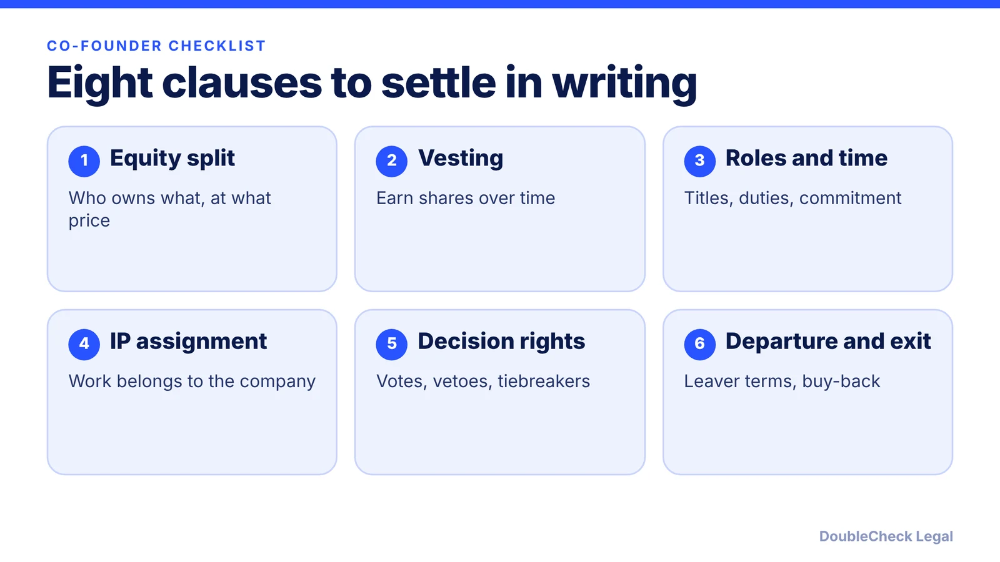
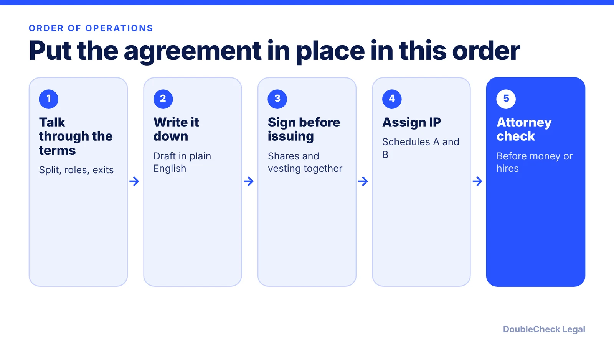

*A clause-by-clause checklist for co-founders: what to settle in writing, illustrative wording, and the mistakes to avoid.*

**Key takeaways:**

- Eight clauses to settle: equity, vesting, roles, IP assignment, decision rights, departure, non-compete limits, dispute resolution.
- Four-year vesting with a one-year cliff is a common structure, but your terms can differ.
- IP created by a founder is not automatically the company's; assign it expressly, including pre-incorporation work.
- Non-compete enforceability depends on state law; have an attorney review before you issue shares or take money.

## 1. The quick answer

**Quick answer:** A co-founder agreement clauses checklist with sample language should cover eight things: equity split, vesting, roles, IP assignment, decision rights, what happens when someone leaves, the limits of non-competes, and how disputes get resolved. A common vesting structure is four years with a one-year cliff, and IP created by a founder should be assigned to the company in writing rather than assumed to belong to it. Sign before shares are issued and before you build much together.

This guide goes clause by clause. Each section gives the point of the clause, a short plain-English example of wording (clearly marked as an illustration, not a template to paste), and the mistakes that cause real fights. For the basics first, see [co-founder agreements for startups](/blog/co-founder-agreement-startups/); for the 50/50 case, see [deadlock clauses that prevent a stalemate](/blog/co-founder-agreement-5050-deadlock-clauses-that-prevent-a-stalemate/).

## 2. Clauses 1 to 3: equity, vesting and roles

**Clause 1: Equity split.** Record each founder's share count and price per share. Later financings dilute these percentages, so it is worth stating how you will treat future issuances. How to arrive at the split is a separate question; see [how co-founders split equity](/blog/how-co-founders-split-equity-data/) and [founder equity split: how to divide](/blog/founder-equity-split-how-to-divide/).

**Clause 2: Vesting.** Vesting means a founder earns shares over time instead of owning them on day one. A common schedule is four years with a one-year cliff: nothing vests if a founder leaves before the first anniversary, then equity typically vests monthly or quarterly over the remaining three years. Vesting terms are also typically documented in a restricted stock purchase agreement when shares are issued, so the company has a right to repurchase unvested shares. Vesting is hard to add to shares already issued without every founder's consent, which is why timing matters. See [cofounder vesting and the cliff explained](/blog/cofounder-vesting-cliff-explained/) and [issuing founder stock](/blog/issue-founder-stock-purchase-agreement/). The IRS also sets a short deadline for an 83(b) election when stock is subject to vesting; read [the 83(b) election guide](/blog/83b-election-startup-founders/) before you issue shares.

*Illustration only, not a template:* "Each founder's shares vest over 48 months starting on the vesting start date, with no shares vesting before the first 12-month anniversary. If a founder stops providing services to the company for any reason, the company may repurchase that founder's unvested shares at the original purchase price."

**Clause 3: Roles and time commitment.** State each founder's title, main duties and expected time. A founder who goes part-time while the other stays full-time is a common source of resentment, and a written time commitment gives you something concrete to point to.

*Illustration only:* "Founder A leads product and engineering. Founder B leads sales and finance. Each founder will work on the company full time, and will tell the other in writing before taking any outside paid role."

## 3. Clauses 4 and 5: IP assignment and decision rights

**Clause 4: IP assignment.** Work a founder creates may belong to that founder personally unless it is assigned in writing, so use an express assignment covering both pre-incorporation and post-incorporation work: code, designs, inventions and trademarks should be addressed whether created before or during the startup. Missing assignments can also surface during diligence on your first term sheet. Pair this with a confidentiality clause; see [confidentiality and IP assignment agreements](/blog/confidentiality-ip-assignment-agreements-startups/).

*Illustration only:* "Each founder assigns to the company all rights in any code, designs, writing, inventions and trademarks created for the business, whether before or after the company was formed, listed on Schedule A. A founder keeps ownership of the items listed on Schedule B."

**Clause 5: Decision rights.** Day-to-day decisions in a founder's own area are often left to that founder, with "reserved matters" needing collective consent. Fundraising, adding co-founders and selling the company are typical unanimous-consent items, and a two-founder company may want to name a tiebreaker (an advisor, board member or designated person) for a two-founder company.

*Illustration only:* "The following need the written approval of both founders: issuing new shares, taking outside investment, selling the company, hiring or firing another founder, and spending above $10,000 that is not in the budget. If the founders cannot agree on a reserved matter within 30 days, they will ask the named advisor to decide."

The dollar and day figures above are made up for illustration; pick numbers that fit your company.

## 4. Clauses 6 and 7: departure and non-compete limits

**Clause 6: Departure and exit.** This is the clause people regret skipping. "Good leaver" and "bad leaver" are contract terms, not statutory US definitions, so the agreement must define them; typical good-leaver examples are death, permanent incapacity or termination without cause, and typical bad-leaver examples are termination for cause, resignation without adequate notice or breach. Many agreements let the company repurchase unvested shares at the original price and include buy-back rights at a predetermined price. For the mechanics, see [how to remove or buy out a co-founder](/blog/how-to-remove-or-buy-out-a-co-founder/) and [buy-sell agreements for partners](/blog/buy-sell-agreement-small-business-partners/).

*Illustration only:* "A founder who resigns with 60 days written notice keeps vested shares. A founder removed for a breach described in Section 9 that is not fixed within 30 days of written notice may be required to sell vested shares back to the company at a price set by an independent valuation."

**Clause 7: Non-compete limits.** Treat any non-compete cautiously. There is no federal non-compete ban in effect, and enforceability depends on the governing state; California generally prohibits post-employment non-competes under Business and Professions Code Section 16600. Rules differ widely by state and have shifted, so read [non-compete agreements by state](/blog/non-compete-agreements-by-state-2026/) and [the FTC non-compete rule status](/blog/ftc-noncompete-rule-status-2026-what-small-businesses-can-still-do/) before relying on one. Often a narrower tool does most of the work. See [non-compete vs non-solicit vs NDA](/blog/non-compete-vs-non-solicit-vs-nda-which-to-use-after-the-ftc-rule/).

*Illustration only:* "For 12 months after leaving, a founder will not use the company's confidential information and will not solicit the company's employees or customers on the company's behalf."

Whether wording like that is enforceable in your state is a question for a lawyer there, not a drafting tip.

## 5. Clause 8: dispute resolution and how to sign

**Clause 8: Dispute resolution.** Without a dispute resolution clause, an unresolved disagreement between co-founders defaults to litigation, so consider specifying arbitration rules, the seat and how arbitrators are appointed. Mediation and arbitration are often chosen as faster and more private, though they are not right for every dispute. A common structure is a ladder: talk, then mediate, then arbitrate.

*Illustration only:* "The founders will first meet to resolve any dispute in good faith within 14 days of written notice. If unresolved, they will try mediation. If mediation fails, the dispute will be decided by binding arbitration under the rules named in Section 12, in the state named in Section 12."

**Governing law.** Governing law is often the law of the state of incorporation and should be confirmed when drafting, not after a dispute. If you are weighing states, see [incorporating in Texas vs Delaware](/blog/incorporate-in-texas-vs-delaware-for-a-texas-based-startup/).

**Where the agreement lives.** A founders' agreement is not the same as an LLC operating agreement or a corporation's bylaws and stockholder documents. A shareholders' agreement is a separate document that typically comes with a financing. Make sure the documents do not contradict each other. For LLCs, see [LLC operating agreement with AI](/blog/llc-operating-agreement-with-ai/).

**When to sign.** Sign before writing meaningful code together or taking outside money, and before shares are issued.

## 6. Common mistakes and when to get an attorney

These mistakes come up often:

- **Relying on a handshake.** Friendship is not a substitute for paperwork.
- **No vesting schedule**, or vesting added after shares are issued.
- **Vague departure terms**, or "good leaver" and "bad leaver" used without definitions.
- **No express IP assignment**, especially for pre-incorporation work.
- **No tiebreaker or deadlock path** in a 50/50 company.
- **Leaning on a non-compete** without checking the governing state.
- **A generic template** with no state-specific customization.
- **Waiting too long** to formalize.

**What you can handle yourself and what to check.** Founders can usually agree on roles, time commitment and the business rules between themselves, and AI is useful for drafting plain-English first versions and for comparing your draft to this checklist. Equity, vesting, tax elections, IP assignment and non-compete wording interact with state law and tax rules, so have a startup attorney review the final documents before you issue shares or take money. Ask for a fee quote, since costs vary by lawyer and location. See [how to prepare for a first meeting with a startup lawyer](/blog/how-to-prepare-for-first-meeting-with-startup-lawyer/) and [the founder agreement overview](/blog/co-founder-agreement-startups/).

## Where DoubleCheck fits

[DoubleCheck](https://www.contactdoublecheck.com) helps businesses and founders start legal work with AI, verify it, and, when professional advice is warranted, connect with an independent attorney, including for immigration questions. Attorney availability and practice areas vary. Attorneys on DoubleCheck are independent professionals; an attorney-client relationship forms only if an attorney accepts your engagement.

**Sources:** General drafting guidance. State-law points (such as California Business and Professions Code Section 16600) should be checked against the current statute, and the FTC non-compete rule status against FTC announcements. Sample wording is illustrative only.

## FAQ

**What should a co-founder agreement include?**

At minimum: equity split, vesting, roles and time commitment, IP assignment, decision rights, departure and buy-back terms, confidentiality and any state-appropriate restrictive covenants, and a dispute resolution clause. These are the core elements this checklist covers.

**What is the standard vesting schedule for co-founders?**

A common founder structure is four years with a one-year cliff: nothing vests before the first anniversary, then equity vests monthly or quarterly over the remaining three years. Your own terms can differ.

**Do I need a co-founder agreement if we are friends?**

Yes, it is still worth writing down. Co-founder disputes often arise among friends who relied on a handshake. The agreement records expectations before conflict arises.

**Can a co-founder agreement include a non-compete?**

It can, but enforceability depends on state law. There is no federal non-compete ban in effect, and California generally prohibits post-employment non-competes under Business and Professions Code Section 16600. Check the governing state, and consider a narrower non-solicit or confidentiality clause.

**When should co-founders sign the agreement?**

Before shares are issued and before meaningful work or outside money. Vesting is hard to add to shares already issued without every founder consenting.

---

*General information only. This article is not legal, tax, investment, or accounting advice.*
