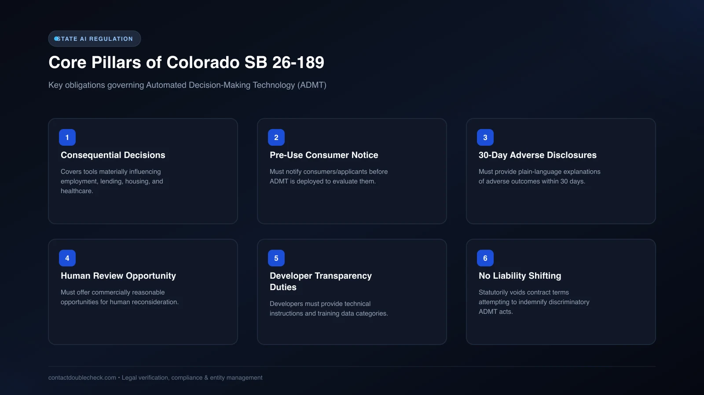
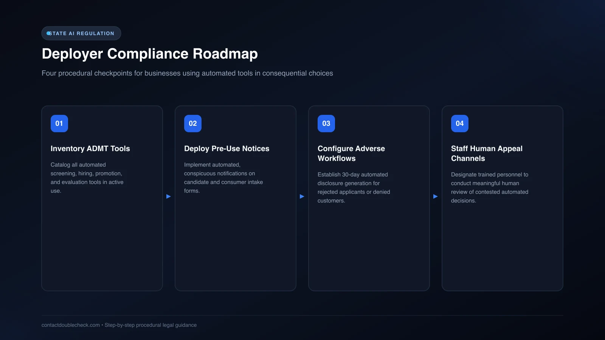

*A practical legal guide to navigating Colorado’s artificial intelligence regulatory framework under Senate Bill 26-189, Automated Decision-Making Technology rules, and employer obligations as of November 2026. General information, not legal advice.*

**Key takeaways:**

- Colorado SB 26-189 repealed and replaced the original SB 24-205 framework, eliminating formal "high-risk" tiers and mandatory impact assessments.
- The active framework focuses on transparency, pre-use notices, and consumer rights for Automated Decision-Making Technology (ADMT) that materially influences consequential decisions.
- Consequential decisions explicitly cover employment, hiring, promotion, lending, housing, insurance, and education.
- Deployers (employers and businesses) must provide pre-use notice and deliver plain-language explanations within 30 days of any adverse decision influenced by ADMT.
- The law statutorily voids contractual clauses that attempt to shift or indemnify liability for discriminatory algorithmic outcomes.

## 1. The quick answer

**Quick answer:** Colorado enacted **Senate Bill 26-189**, significantly overhauling the state's landmark artificial intelligence framework. The new statute eliminated the rigid "high-risk AI system" classification, mandatory annual algorithmic impact assessments, and cumbersome risk management programs previously mandated under the superseded SB 24-205.

Instead, Colorado enforces a streamlined **transparency-, notice-, and consumer-rights-based model** governing **Automated Decision-Making Technology (ADMT)** used to make or materially influence "consequential decisions." Businesses using AI tools to evaluate job candidates, evaluate employees, approve loans, or underwrite insurance must provide advance pre-use notice, deliver clear explanations within 30 days of adverse outcomes, offer an avenue for meaningful human review, and maintain compliance records for three years.

For employers managing multi-state workforce compliance, see our related analysis on [multi-state remote employee compliance](/blog/multi-state-remote-employees-compliance-startups/) and [drafting compliant independent contractor agreements](/blog/how-to-write-a-freelance-contract/).

## 2. The statutory shift from SB 205 to SB 26-189

To understand Colorado's current AI requirements, organizations must understand the legislative reset:

- **The Problem with SB 205:** The original 2024 legislation created an onerous compliance matrix for "high-risk AI systems," requiring exhaustive risk-management programs and annual algorithmic impact assessments that sparked severe legal challenges and federal preemption concerns.
- **The Legislative Fix (SB 26-189):** Signed into law in May 2026, SB 26-189 dismantled the "high-risk" terminology. In its place, Colorado aligned with pragmatic consumer protection principles: telling people when an automated system is judging them, explaining adverse results, and granting a right of human appeal.

## 3. Scope and consequential decisions defined

The law applies directly to **Developers** (who code or substantially modify ADMT) and **Deployers** (businesses and employers that use ADMT in commercial operations):

### What Is a Consequential Decision?
A consequential decision is any determination that materially affects access to, or the cost, terms, or availability of:
- **Employment and Workforce:** Recruitment, screening, hiring, promotion, termination, disciplinary actions, or performance evaluation.
- **Financial Services:** Lending, credit scoring, and debt collection.
- **Housing:** Rental screening, mortgage approvals, and tenant evaluation.
- **Healthcare & Insurance:** Health services access, insurance policy issuance, and premium pricing.
- **Education:** Admissions, academic evaluation, and accreditation.

## 4. Deployer obligations: pre-use notices and adverse outcomes

Businesses deploying automated decision systems face explicit operational deadlines:

1. **Mandatory Pre-Use Notice:** Before deploying ADMT to evaluate a candidate or consumer, the business must provide a clear, conspicuous notice explaining that an automated tool is being used, identifying the tool, and stating its specific evaluation purpose.
2. **The 30-Day Adverse Outcome Requirement:** If a candidate is rejected or a consumer denied a service, and ADMT materially influenced that choice, the deployer must provide a plain-language statement within **30 calendar days** detailing:
   - The specific purpose of the ADMT in the decision process.
   - The primary data factors utilized by the system.
   - Instructions on how the individual can access and correct their personal data.

## 5. Meaningful human review and contractual liability rules

Two unique statutory provisions heavily impact corporate risk and vendor contracts:

### Meaningful Human Review
Deployers must afford affected individuals an opportunity for human review and reconsideration of an adverse automated outcome, "to the extent commercially reasonable." This prevents organizations from setting up fully autonomous, unreviewable rejection pipelines.

### Voiding of Liability Indemnification
In a major disruption to traditional commercial SaaS contracts, SB 26-189 provides that **any contractual provision that purports to indemnify a developer or deployer against liability for their own discriminatory or unlawful acts involving ADMT is contrary to public policy and void.** Vendors and employers cannot contractually shift statutory anti-discrimination duties to one another.

## 6. Employer and deployer compliance checklist

Organizations utilizing AI in hiring, management, or consumer evaluations should implement the following four-step plan:

1. **Conduct an ADMT Screening Audit:** Inventory all HR tech, resume parsers, applicant tracking systems (ATS), and automated performance dashboards used across the company.
2. **Embed Front-End Transparency:** Update candidate application portals and job postings with conspicuous notices disclosing the presence and purpose of automated evaluation tools.
3. **Automate 30-Day Rejection Disclosures:** Integrate automated template workflows that trigger plain-language explanation letters whenever an applicant is screened out with ADMT assistance.
4. **Train Human Review Personnel:** Designate specific HR managers or compliance officers to handle requests for human reconsideration, documenting the reasons supporting the ultimate hiring decision.
5. **Review Vendor SaaS Agreements:** Strike unenforceable indemnification language in technology procurement contracts and replace it with explicit developer transparency covenants.

## Where DoubleCheck fits

[DoubleCheck](https://www.contactdoublecheck.com) provides businesses, general counsel, and enterprise teams with automated contract review, AI-assisted verification, and legal workflow assurance. DoubleCheck helps teams verify citations, audit regulatory compliance across California, Colorado, New York, and federal agencies, and connect with experienced attorneys to ensure compliance with emerging AI standards.

**Related reading:**
- [Multi-State Remote Employee Compliance for Startups](/blog/multi-state-remote-employees-compliance-startups/)
- [Illinois BIPA Biometric Privacy Small Business Compliance](/blog/illinois-bipa-biometric-privacy-small-business-compliance/)
- [Washington State Non-Compete Salary Thresholds](/blog/washington-state-non-compete-salary-thresholds-enforceability/)
- [How to Write a Freelance Contract: Clauses and Terms](/blog/how-to-write-a-freelance-contract/)

**Sources:** [Colorado General Assembly, Senate Bill 26-189 Concerning Automated Decision-Making Technology](https://leg.colorado.gov/); [Colorado Attorney General, Consumer Protection and AI Technology Oversight](https://coag.gov/); [National Institute of Standards and Technology, Artificial Intelligence Risk Management Framework (NIST AI 100-1)](https://www.nist.gov/itl/ai-risk-management-framework); [Cornell Legal Information Institute, Employment Discrimination Law Overview](https://www.law.cornell.edu/wex/employment_discrimination).

## FAQ

**What happened to Colorado SB 24-205?**

Colorado SB 24-205 was repealed and replaced by Senate Bill 26-189 in May 2026, which took effect January 1, 2027, eliminating the rigid "high-risk" classification in favor of a transparency and notice framework.

**What is a "consequential decision" under Colorado law?**

A consequential decision is a determination that materially impacts access to, or the cost or terms of, employment, housing, financial or lending services, healthcare, education, or essential government benefits.

**What notice must an employer provide before using an AI hiring tool?**

Employers must provide clear, conspicuous notice to job applicants before using Automated Decision-Making Technology, detailing what software is used and the specific purpose of the automated evaluation.

**How much time does an employer have to explain an adverse automated decision?**

Deployers must provide a plain-language explanation of the specific role ADMT played in an adverse outcome within 30 calendar days of the decision.

**Can a software vendor contractually indemnify a business for discriminatory AI?**

No. Colorado SB 26-189 explicitly voids any contractual clause attempting to indemnify a developer or deployer against liability for their own unlawful or discriminatory acts.

---

*General information only. This article is not legal, tax, investment, or accounting advice.*
