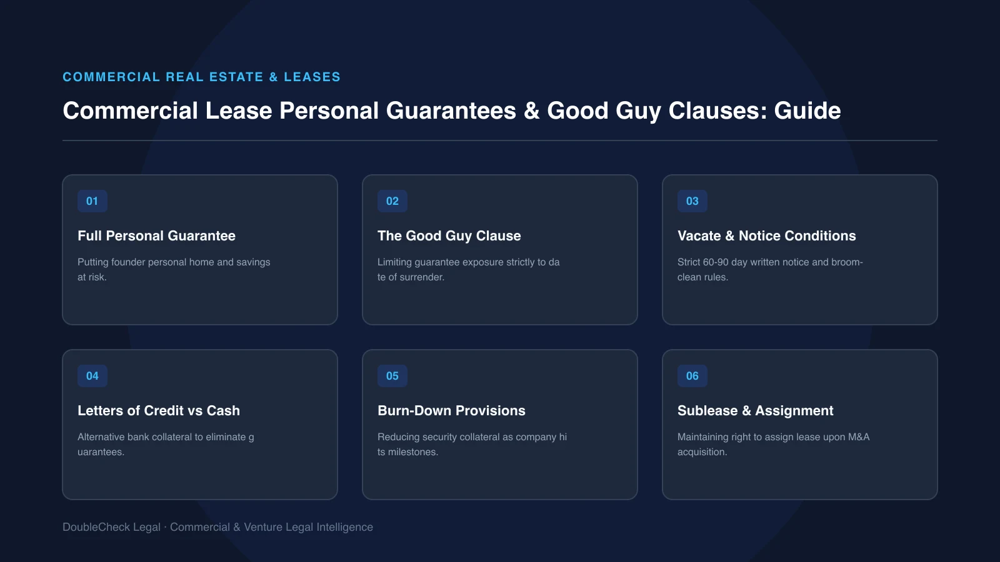
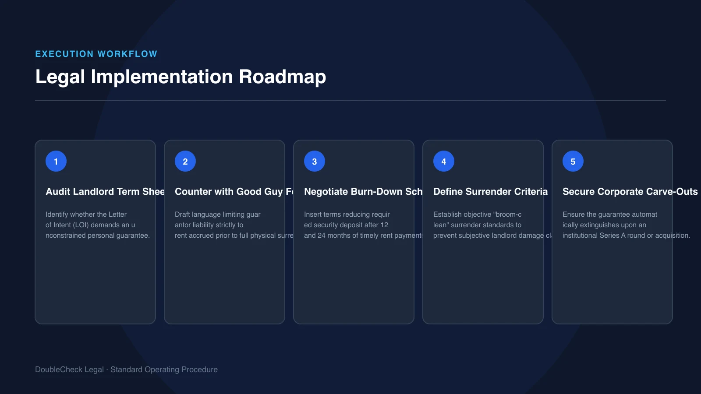

*A practical corporate and real estate legal guide for founders and CFOs, analyzing commercial lease personal guarantees, Good Guy limitation clauses, surrender notice protocols, letters of credit, and landlord negotiation tactics.*

**Key takeaways:**
- **The Founder Bankruptcy Hazard:** An unconstrained commercial lease personal guarantee leaves a founder personally liable for years of unamortized rent and landlord broker commissions if the startup fails.
- **The Good Guy Compromise:** A standard Good Guy clause satisfies landlord concerns regarding squatting while insulating founders from multi-year post-vacate acceleration liabilities.
- **Strict Notice and Surrender Rules:** Good Guy protections are voided if the tenant fails to deliver the required written notice (typically 60 to 120 days) or fails to leave the premises "broom clean."
- **Collateral Alternatives:** Well-funded venture-backed startups should replace personal guarantees entirely with Letters of Credit (LCs) tied to a scheduled burn-down timeline.

## 1. The quick answer: Personal guarantees vs Good Guy clauses

Commercial landlords routinely refuse to lease office or laboratory space to early-stage startups without credit enhancements:

1. **Full Personal Guarantee (The Danger):** The founder pledges personal bank accounts, home equity, and assets to guarantee all rent across the entire 3-to-5 year lease term. If the startup closes after 18 months, the founder is personally sued for the remaining 36 months of rent.
2. **Good Guy Guarantee (The Market Solution):** The founder guarantees rent **only while the company occupies the space**. If the startup fails, the founder gives 60-90 days notice, pays rent up to the exit date, surrenders the keys, and walks away with **zero personal liability** for future rent.



## 2. In-depth legal analysis: The mechanics of lease guarantees and Good Guy provisions

A commercial lease is often a startup's largest single fixed financial commitment. Understanding the exact contractual language prevents catastrophic personal exposure.

### A. Anatomizing the Standard Good Guy Clause
A properly drafted Good Guy clause contains three distinct operational pillars:

```
"Notwithstanding anything to the contrary herein, Guarantor's personal liability under this Lease shall terminate upon the occurrence of all of the following conditions:
(a) Tenant delivers not less than ninety (90) days' prior written notice to Landlord of its intention to vacate and surrender the Premises;
(b) Tenant is current on all Base Rent, Additional Rent, and operating expenses through the designated Surrender Date; and
(c) On or before the Surrender Date, Tenant vacates the Premises, removes all personal property, and delivers possession of the Premises to Landlord in broom-clean condition, ordinary wear and tear excepted."
```

If all three conditions are satisfied, the founder’s personal liability terminates on the surrender date.

### B. Guarantee Structures Compared

| Guarantee Model | Founder Exposure | Landlord Protection | Market Acceptance |
|---|---|---|---|
| Full Personal Guarantee | Unlimited; entire remaining lease term + legal fees | Maximum legal leverage over founder personal assets | Standard for uncapitalized sole proprietors |
| Good Guy Guarantee | Limited strictly to rent accrued prior to surrender date | Protects against tenant squatting without paying rent | Standard in NY, SF, and major tech markets |
| Rolling / Capped Guarantee | Limited to a fixed dollar amount (e.g., 6 months of rent) | Guaranteed recovery pool for landlord broker re-leasing costs | Common for Series Seed startups |
| Letter of Credit (No Guarantee) | Zero personal exposure; corporate cash locked in bank | Bank guarantee payable immediately upon lease default | Standard for institutional Series A/B companies |

### C. The Burn-Down Mechanism for Security Deposits
If a landlord demands an exorbitant cash security deposit or Letter of Credit in lieu of a personal guarantee, founders should negotiate a **Burn-Down Clause**:

```
"Provided that Tenant has not committed an uncured Event of Default, the required Letter of Credit amount shall burn down as follows: (a) after Month 12, reduced from $150,000 to $100,000; and (b) after Month 24, reduced to $50,000 for the remainder of the Lease Term."
```

## 3. Step-by-step: How to negotiate a commercial lease guarantee



Founding teams should execute lease negotiations through a structured tactical approach:

### Step 1: Address the Guarantee at the LOI Stage
Never wait until the formal 70-page lease draft to negotiate the guarantee. In the non-binding Letter of Intent (LOI), explicitly state: *"No personal guarantee; Tenant shall provide a 3-month security deposit in the form of an irrevocable Letter of Credit."*

### Step 2: Propose the Good Guy Compromise
If the landlord rejects a pure corporate lease due to thin balance-sheet history, counter immediately with a standardized Good Guy Guarantee. Clarify that the founder will never sign a multi-year rent acceleration pledge.

### Step 3: Define Objective Surrender Standards
Avoid ambiguous landlord lease language requiring the space to be restored to "original shell condition." Insist that surrender requires only "broom-clean condition, ordinary wear and tear and casualty excepted," with no obligation to remove landlord-approved tenant improvements.

### Step 4: Insert Automatic Extinguishment Triggers
Insert contractual triggers providing that the Good Guy Guarantee or personal guarantee automatically dissolves upon:
- The startup raising an institutional financing round of at least $5,000,000;
- The startup achieving $2,000,000 in trailing twelve-month (TTM) revenue;
- The passage of 24 consecutive months of timely rent payments.

### Step 5: Protect Assignment and Sublease Rights
Ensure the lease permits assignment without landlord consent to an acquiring entity in an M&A merger or consolidation, releasing the original guarantor from all liabilities.

## 4. Landlord traps: Hidden Restoration and Operating Expense Liabilities

- **Tenant Restoration Costs:** Landlords often bury clauses requiring the tenant to demolish interior walls, remove data cabling, and restore HVAC units at lease end (costing $50k-$100k). Good Guy clauses must specify that failure to complete restoration does not invalidate the guarantee release.
- **Operating Expense Audit Rights:** Commercial leases pass through proportionate shares of property taxes, building insurance, and management fees. Ensure the contract gives the company 60 days post-reconciliation to audit landlord expenses.

## 5. Due diligence checklist: Commercial lease review

1. **Verify Corporate Entity Execution:** Ensure the primary lease tenant is the Delaware C-Corporation, not the individual founder.
2. **Review Notice Window:** Confirm whether surrender notice requires 60, 90, or 120 days, and calendar the deadline.
3. **Audit Cross-Default Terms:** Ensure a default under an equipment lease or bank loan does not trigger a cross-default under the real estate lease.
4. **Confirm Subordination & Non-Disturbance (SNDA):** Secure an SNDA agreement from the landlord's mortgage lender to prevent eviction if the landlord enters foreclosure.

## Where DoubleCheck fits

[DoubleCheck](https://www.contactdoublecheck.com) gives startup founders, CFOs, and real estate legal teams AI-powered lease review tools. DoubleCheck scans commercial real estate leases, flags hidden personal guarantee provisions, analyzes Good Guy clause carve-outs, benchmarks restoration obligations, and ensures founders never sign contracts that place their personal finances at risk.

**Related reading:**
- [AI-Generated Commercial Lease Review: What to Check](/blog/ai-generated-commercial-lease-review/)
- [What Makes a Contract Legally Binding](/blog/what-makes-a-contract-legally-binding/)
- [Auto-Renewal Clauses Business Contracts](/blog/auto-renewal-clauses-business-contracts/)
- [Series A Legal Due Diligence Checklist](/blog/series-a-legal-due-diligence-checklist/)

**Sources:** [Uniform Commercial Code § 3-419 (Instruments Signed for Accommodation / Guarantees)](https://www.law.cornell.edu/ucc/3/3-419); [California Civil Code § 2787 et seq. (Suretyship and Guarantees)](https://leginfo.legislature.ca.gov/); [New York City Administrative Code § 22-1005 (Commercial Lease Personal Guaranties)](https://codelibrary.amlegal.com/); [Building Owners and Managers Association (BOMA) International, Standard Lease Guides](https://www.boma.org/).

## FAQ

**What is a personal guarantee in a commercial lease?**

A personal guarantee is a legally binding contract where an individual (typically a founder or corporate executive) personally guarantees the performance of the lease, agreeing to pay all rent, damages, and remaining lease term liabilities out of personal assets if the corporate entity defaults.

**What is a "Good Guy Guarantee" in commercial real estate?**

A Good Guy Guarantee is a limited personal guarantee where the individual guarantor is only liable for rent and property obligations up until the date the tenant vacates the premises, delivers the keys, and surrenders the space broom-clean, releasing the guarantor from future lease rent.

**How can a startup founder avoid signing a personal guarantee?**

Founders can avoid personal guarantees by offering a larger security deposit, providing an irrevocable Letter of Credit (LC) from a bank, demonstrating strong venture funding, or negotiating a "burn-down" clause that eliminates the guarantee after 12 months.

**What happens if a startup defaults on a commercial lease with a Good Guy clause?**

If the startup gives the required notice (e.g., 60-90 days), pays all rent through the vacate date, and surrenders the space in broom-clean condition, the founder owes zero personal money for the remaining lease term, though the corporate entity remains technically liable.

**How can AI contract tools assist with commercial lease negotiations?**

AI tools analyze dense 80-page commercial leases, extracting personal guarantee triggers, identifying hidden restoration indemnities, and benchmarking surrender notice windows against standard market terms.

---

*General information only. This article is not legal, tax, investment, or accounting advice.*
