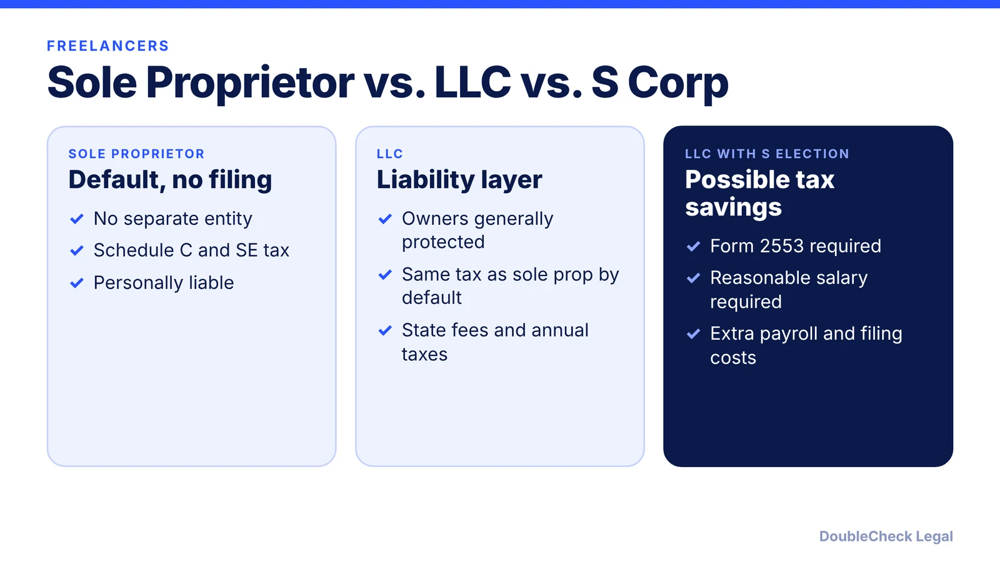
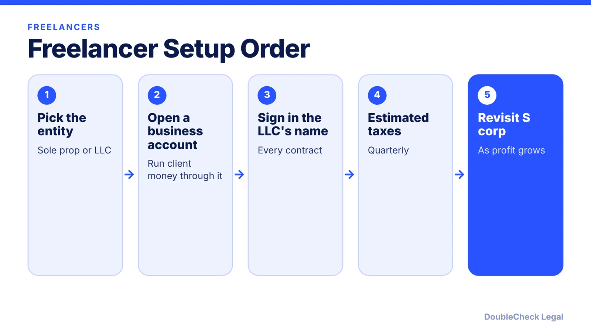

*Freelancing or consulting? An LLC protects you, but it does not lower your tax by itself. Here is when the S corp starts to matter.*

**Key takeaways:**

- A single-member LLC is taxed like a sole proprietor by default.
- Tax savings come only from an S election, which adds payroll and filing costs.
- Form 2553 is due within two months and 15 days of the tax year start, per the IRS.
- Claims over your own professional mistakes can still reach you; consider E&O insurance.

## 1. The quick answer

**Quick answer:** For a consultant or freelancer, an LLC adds liability protection, but an LLC alone does not cut self-employment tax. A single-member LLC is taxed like a sole proprietor by default (Schedule C plus SE tax), so savings come only from an S corporation election, which Fastlancer estimates costs about $2,000 to $4,000 a year in payroll, bookkeeping, and returns. Claims over your own professional mistakes can still reach you.

## 2. The tax math

The IRS says self-employment tax is 12.4% Social Security plus 2.9% Medicare (15.3%) applied to 92.35% of net earnings, required at $400 or more in net self-employment earnings, with Additional Medicare thresholds of $200,000 for most single filers, $250,000 for joint filers, and $125,000 for married filing separately. Self-employed people pay quarterly estimated tax via Form 1040-ES. Fastlancer's example: $120,000 profit with a $70,000 salary leaves about $50,000 of distributions that skip SE tax, but S-corp costs may not pay off at modest profit. See [self-employment tax](/blog/self-employment-tax-solo-business-owner-2026/) and [quarterly estimated taxes](/blog/quarterly-estimated-taxes-solo-business-owner/).

## 3. The S election rules

Per the IRS, Form 2553 is due no more than two months and 15 days after the start of the tax year the election takes effect, and late relief exists under Rev. Proc. 2013-30 within three years and 75 days. An S corp must be domestic, with 100 or fewer shareholders, one class of stock, and no nonresident alien shareholders. S corps must pay shareholder-employees reasonable compensation before non-wage distributions, and the IRS can reclassify distributions as wages. See the [S corp election deadline](/blog/s-corp-election-form-2553-deadline/).

## 4. Fees, contracts, and insurance

Fastlancer says formation fees range from $35 in Montana to $500 in Massachusetts, with a $500 annual report in Massachusetts and California's $800 minimum annual tax ([California LLC tax](/blog/california-llc-annual-tax-and-fee/)). It also advises signing contracts in the LLC's name, running client money through a business account, using a written contract for every project, and considering errors-and-omissions insurance because claims over your own professional mistakes still reach you. The SBA notes some states tax S corps on profits above a limit and others do not recognize the S election. For the solo-founder view, read [sole proprietor vs. LLC for solo founders](/blog/sole-proprietor-vs-llc-solo-founder/) and the [solo founder legal checklist](/blog/solo-founder-legal-checklist-using-ai/).

## Where DoubleCheck fits

[DoubleCheck](https://www.contactdoublecheck.com) helps businesses and founders start legal work with AI, verify it, and, when professional advice is warranted, connect with an independent attorney, including for immigration questions. Attorney availability and practice areas vary. Attorneys on DoubleCheck are independent professionals; an attorney-client relationship forms only if an attorney accepts your engagement.

**Sources:** [SBA](https://www.sba.gov/business-guide/launch-your-business/choose-business-structure); [IRS Topic 554](https://www.irs.gov/taxtopics/tc554); [IRS self-employed tax center](https://www.irs.gov/businesses/small-businesses-self-employed/self-employed-individuals-tax-center); [SelfEmployed.com](https://www.selfemployed.com/llc-vs-sole-proprietorship-which-structure-is-best-for-freelancers/); [Fastlancer](https://www.fastlancer.org/en/fastlancer-blog/llc-vs-sole-proprietor-freelancer/); [IRS Form 2553 instructions](https://www.irs.gov/instructions/i2553); [IRS S corporation compensation](https://www.irs.gov/businesses/small-businesses-self-employed/s-corporation-compensation-and-medical-insurance-issues).

## FAQ

**Do freelancers need an LLC?**

Not required. An LLC adds liability protection, but it does not reduce self-employment tax by itself, per SelfEmployed.com.

**When does an S corp save money for a freelancer?**

When profit is high enough that payroll and filing costs are outweighed. Fastlancer estimates S-corp costs at $2,000 to $4,000 a year.

**What is the self-employment tax rate?**

15.3% on 92.35% of net earnings, per the IRS, required at $400 or more.

**When is the S election due?**

No more than two months and 15 days after the start of the tax year it takes effect, per the IRS instructions for Form 2553.

---

*General information only. This article is not legal, tax, investment, or accounting advice.*
