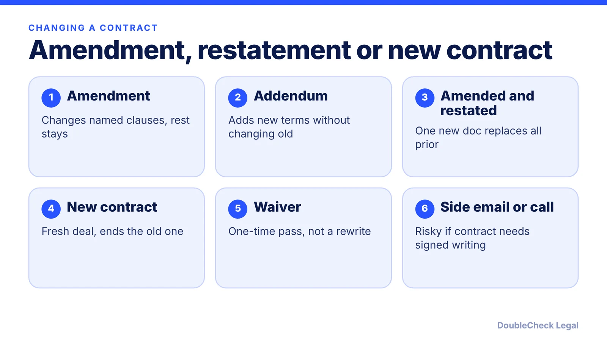
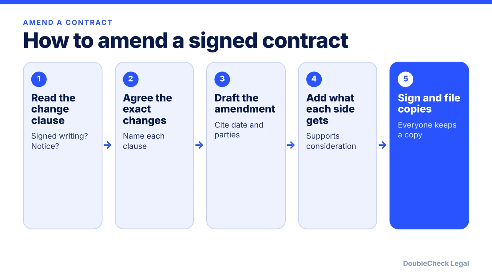

*Contract amendment vs new contract: how to change a signed agreement, with validity checks, drafting tips and guidance on when to restate, as of November 2026.*

**Key takeaways:**

- Use an amendment for a few changes; restate or start fresh when many terms change or amendments pile up.
- An amendment is generally enforceable when all parties agree and sign and the contract procedure is followed.
- Check your contract no-oral-modification or signed-writing clause before changing anything by email.
- Rules on consideration vary; UCC 2-209 removes it for goods, and some states have statutes for signed written changes.

## 1. The quick answer

**Quick answer:** To change a signed agreement, use a written amendment when only a few terms change, and use an amended and restated agreement or a new contract when many terms change or several amendments have piled up. Per UpCounsel and Rocket Lawyer, an amendment is generally enforceable when all parties agree and sign and any procedure in the original contract is followed. Always check the original for a clause that says how changes must be made.

The common mistake is changing terms by email or conversation when the contract requires a signed writing. In some states and for some contracts, that change may not hold.

## 2. Amendment vs addendum vs restatement vs new contract

These terms are used loosely, so say what you mean in the document itself.

- **Amendment.** Per UpCounsel (updated August 28, 2025), an amendment changes existing terms such as a deadline or an obligation. Only the clauses named change; the rest of the contract stays in effect.
- **Addendum.** UpCounsel describes it as adding entirely new provisions without altering original clauses, for example a confidentiality clause.
- **Amended and restated agreement.** A law firm guide from Heritage Law describes this as a complete new document, usually titled "Amended and Restated [Agreement Name]", stating that it supersedes the original and all prior amendments while preserving rights and obligations already accrued.
- **New contract.** A fresh agreement, often used when the deal changes fundamentally or the parties change. Rocket Lawyer (published April 19, 2026) says amending suits small changes, while a new or restated contract suits many changes at once, several prior amendments, or a document that is hard to follow.
- **Waiver.** One side agrees not to enforce a term on one occasion. It is not a rewrite, and it may be retractable. Under UCC 2-209, a failed modification can still operate as a waiver, and a party can retract a waiver affecting future performance by notice, unless the other side relied on it.

**Rule of thumb:** count the changes. UpCounsel suggests considering a new contract after about five amendments. Heritage Law says restatement is often better with two or more prior amendments or changes touching many sections. Neither is a legal rule, just a practical signal.

## 3. What makes a change valid

A change is more likely to hold when you cover these points.

1. **Mutual agreement.** UpCounsel says all parties must agree to the wording, and one party cannot change a contract alone.
2. **Follow the contract own change clause.** Many contracts say amendments must be in a signed writing. A New York First Department decision from January 31, 2013 (*Nassau Beekman v. Ann/Nassau Realty*), described by Pillsbury, relied on General Obligations Law section 15-301 to hold that an unsigned agreement could not change a contract barring oral changes, and treated partial performance as a narrow exception only if conduct was unequivocally referable to the modification. Other states differ, so this is an example, not a national rule.
3. **Consideration, where required.** Under traditional common-law doctrine, per Cornell LII, a duty a party already owes does not count as consideration for a modification, so the change can be set aside. Two exceptions we verified: for sales of goods, UCC 2-209(1) says a modification needs no consideration; and New York General Obligations Law 5-1103 says a signed written modification is not invalid for lack of consideration. Many other states have similar rules, but do not assume yours does. A simple fix is for each side to give or receive something in the amendment, such as a revised price or date.
4. **Statute of frauds.** UCC 2-209(3) says a modified contract within the statute of frauds must still meet it. If the original needed a signed writing, assume the change does too.
5. **Authority.** Confirm the signer can bind the company. Heritage Law also suggests checking whether lender, insurer or customer consents are required before you sign.

Electronic signatures can work, subject to the contract terms and the law; see [electronic signatures and the ESIGN Act](/blog/electronic-signatures-esign-act-contracts/). For the base requirements, see [what makes a contract legally binding](/blog/what-makes-a-contract-legally-binding/).

## 4. What a good amendment says

Per UpCounsel, an amendment should be titled as such, name the original parties, include the original contract date, identify the exact clause being changed, and be signed and dated by all parties with each receiving a copy. Add these safeguards:

- **Effective date.** Say whether the change applies from signing or retroactively.
- **Exact replacement text.** Write "Section 4.2 is deleted and replaced with the following" rather than describing the change loosely.
- **Ratification.** State that all other terms remain in full effect.
- **Conflict rule.** Say that the amendment controls if it conflicts with the original.
- **Related documents.** Update statements of work, order forms, notice addresses and insurance certificates so they match, as Heritage Law suggests. See [master services agreements and SOWs](/blog/master-services-agreement-and-sow-small-business/).
- **Accrued rights.** Say whether past breaches, unpaid amounts and claims are preserved or released. A release changes more than the schedule, so read it closely.

Watch your original merger clause. It may say the written contract is the whole deal, which can make informal side promises hard to enforce; see [entire agreement (merger) clauses explained](/blog/entire-agreement-merger-clause-explained-what-it-wipes-out/). Also check whether the change touches transfer rights ([assignment clauses](/blog/assignment-clause-explained-can-your-contract-be-transferred/)), renewal ([auto-renewal clauses](/blog/auto-renewal-clauses-business-contracts/)) or payment terms ([late payment fees and net 30](/blog/late-payment-fees-net-30-payment-terms-clause-small-business/)).

## 5. When to amend, restate, or start over

Choose by how much changes and how risky it is.

- **Amend** for a narrow fix: a new end date, a revised rate, a swapped exhibit.
- **Amend and restate** when changes are many or the paper trail is confusing, and you want one source of truth. Heritage Law warns this can reopen points both sides considered settled.
- **Start a new contract** when parties, scope or risk change so much that the old terms no longer fit, or when you want a clean exit from the old deal. Check how to end the old one; see [how to terminate a contract early](/blog/how-to-terminate-a-contract-early-termination-clause/) and [how to void or cancel a contract](/blog/how-to-void-or-cancel-a-contract-grounds-and-limits/).
- **Be careful with redlines from the other side.** See [reviewing customer contract redlines](/blog/review-customer-contract-redlines/).

You can handle a simple date or price change yourself if the contract is short and the other side agrees. Get an attorney to check when the change affects liability caps, indemnities, IP, exclusivity, payment security, or when the contract is large or governed by another state. AI can help you compare versions and draft a first amendment; it can miss a no-oral-modification clause or a consent requirement, so verify it. See [AI contract review: what to check](/blog/ai-contract-review-what-to-check-before-signing/) and [how to verify an AI-generated legal document](/blog/verify-ai-generated-legal-document/). To pass a draft to counsel, see [handing off an AI-drafted document to an attorney](/blog/hand-off-an-ai-drafted-legal-document-to-an-attorney-package/).

## Where DoubleCheck fits

[DoubleCheck](https://www.contactdoublecheck.com) helps businesses and founders start legal work with AI, verify it, and, when professional advice is warranted, connect with an independent attorney, including for immigration questions. Attorney availability and practice areas vary. Attorneys on DoubleCheck are independent professionals; an attorney-client relationship forms only if an attorney accepts your engagement.

**Sources:** [UpCounsel, how to amend a contract (updated August 28, 2025)](https://upcounsel.com/how-to-amend-a-contract); [Rocket Lawyer, amend contract or create new one (April 19, 2026)](https://www.rocketlawyer.com/q-and-a/answer/amend-contract-or-create-new-one); [Rocket Lawyer, best way to update multiple contract terms](https://www.rocketlawyer.com/q-and-a/answer/best-way-to-update-multiple-contract-terms); [Heritage Law, amendments vs restatements](https://www.heritagelawwi.com/contract-amendments-vs-restatements-in-wisconsin-which-approach-fits-your-deal); [NY Senate, UCC 2-209](https://www.nysenate.gov/legislation/laws/UCC/2-209); [NY Senate, GOL 5-1103](https://nysenate.gov/legislation/laws/GOB/5-1103); [Cornell LII, pre-existing duty doctrine](https://law.cornell.edu/wex/pre-existing_duty_doctrine); [Pillsbury, NY court enforces no oral modification clause (2013)](https://pillsburylaw.com/en/news-and-insights/new-york-appellate-court-enforces-no-oral-modification-clause.html).

## FAQ

**What is the difference between a contract amendment and a new contract?**

An amendment changes named terms and leaves the rest in effect, per UpCounsel. A new contract replaces the deal. For many changes or several prior amendments, Rocket Lawyer and Heritage Law point toward a new or restated document.

**Can you change a signed contract by email?**

Sometimes, but check the original. If it requires a signed writing for changes, an email or call may not work, and some states enforce that clause strictly. If email can count as a signed record under the contract and law, say so in the amendment.

**Does a contract amendment need consideration?**

It depends. Under traditional common law, per Cornell LII, a duty already owed is not consideration for a modification. UCC 2-209(1) says a modification of a goods contract needs none, and New York GOL 5-1103 covers signed written modifications.

**What is an amended and restated agreement?**

It is a complete new document that supersedes the original and prior amendments while preserving accrued rights, per Heritage Law. It suits many changes, but it can reopen points both sides thought were settled.

**When should I get a lawyer to review a contract amendment?**

When the change touches liability, indemnity, IP, exclusivity or payment security, when the contract is large or governed by another state, or when you are unsure whether the contract requires a signed writing for changes.

---

*General information only. This article is not legal, tax, investment, or accounting advice.*
