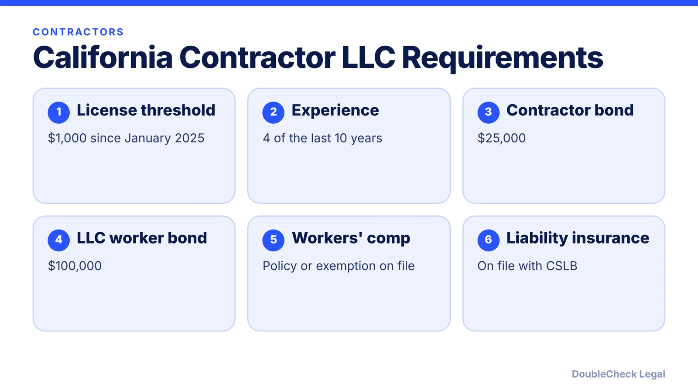
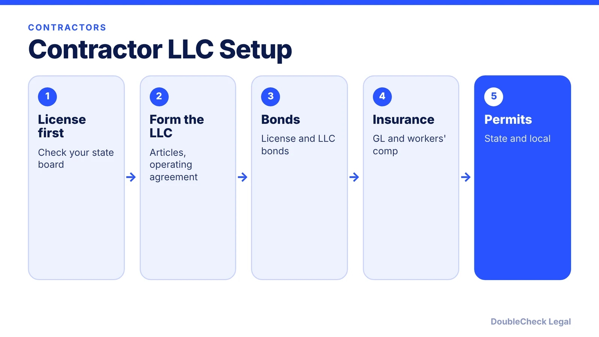

*Starting a contracting business? The license and bonds matter as much as the LLC. Here is the California example.*

**Key takeaways:**

- California's contractor license threshold is $1,000 since January 1, 2025, per the CSLB.
- The CSLB requires a $25,000 contractor bond; LLC contractors also need a $100,000 worker bond per the CSLB.
- Contractors with employees must show workers' comp; those without file an exemption.
- Rules vary a lot by state; check your state licensing board.

## 1. The quick answer

**Quick answer:** Contractors often form an LLC for liability protection, but the license comes first. In California, the CSLB says an LLC can hold a contractor license, the qualifying individual needs four years of journey-level or higher experience in the last ten, and a $25,000 contractor bond is required before licensure. LLC contractors also need a $100,000 LLC employee/worker bond, per the CSLB. Other states differ widely.

## 2. The California license rules

The CSLB says the license threshold rose from $500 to $1,000 under AB 2622, effective January 1, 2025, and unlicensed work up to $1,000 is allowed only if no laborers are hired and no building permit is required. A licensee can be an individual, partnership, corporation, LLC, or joint venture. The CSLB says an LLC license also requires a $100,000 surety bond, in addition to the $25,000 contractor bond, that protects employees or workers harmed by the LLC's failure to pay wages or benefits. Older CSLB guides list $500 and $15,000 and are outdated.

## 3. Insurance and workers' compensation

The SBA describes general liability, commercial property, and products liability as common business coverages and notes that workers' compensation is required for businesses with employees. Contractors should also ask an insurance professional about commercial auto, equipment, and completed-operations coverage. CSLB records show contractors with employees must show proof of workers' comp, and those without file an exemption. Business Insurance reports that S.B. 1455 delays until January 1, 2028 the requirement, created by S.B. 216, that contractors carry workers' comp coverage even without employees. Verify current rules with the CSLB.

## 4. Liability and structure

The SBA says an LLC protects from personal liability in most instances, while a sole proprietor has no separation, and construction is commonly regulated at state, county, and city levels. Keep personal and business money apart and follow your [operating agreement](/blog/llc-operating-agreement-with-ai/). Compare structures in [sole proprietor vs. LLC](/blog/sole-proprietor-vs-llc-solo-founder/) and see [how to start an LLC in California](/blog/how-to-start-an-llc-in-california-step-by-step/).

## Where DoubleCheck fits

[DoubleCheck](https://www.contactdoublecheck.com) helps businesses and founders start legal work with AI, verify it, and, when professional advice is warranted, connect with an independent attorney, including for immigration questions. Attorney availability and practice areas vary. Attorneys on DoubleCheck are independent professionals; an attorney-client relationship forms only if an attorney accepts your engagement.

**Sources:** [CSLB press release](https://www.cslb.ca.gov/Resources/PressReleases/2024/AB2622.FINAL.pdf); [CSLB: Before applying](https://www.cslb.ca.gov/Contractors/Applicants/Contractors_License/Exam_Application/Before_Applying_For_License.aspx); [CSLB: Licenses for LLCs](https://www2.cslb.ca.gov/About_Us/LLC.aspx); [CSLB industry bulletin on workers' comp](https://cslb.ca.gov/Resources/IndustryBulletins/2022/Industry_Bulletin_WC_update.pdf); [Business Insurance: Governor signs bill delaying contractor comp mandate](https://www.businessinsurance.com/california-governor-signs-bill-to-delay-comp-mandate-for-contractors/); [SBA: Get business insurance](https://legacy.sba.gov/business-guide/launch-your-business/get-business-insurance); [SBA: Choose a business structure](https://www.sba.gov/business-guide/launch-your-business/choose-business-structure).

## FAQ

**Can an LLC hold a contractor license in California?**

Yes. The CSLB says a licensee can be an individual, partnership, corporation, LLC, or joint venture.

**What bonds does a California contractor LLC need?**

The CSLB requires a $25,000 contractor bond, and the CSLB says an LLC license also requires a $100,000 employee/worker bond.

**Do I need a license for small jobs?**

In California the threshold is $1,000 since 2025, with limits on laborers and permits. Other states differ.

**Does an LLC replace insurance?**

No. The SBA lists general liability and workers' comp among common business coverages, and contractor rules vary by state.

---

*General information only. This article is not legal, tax, investment, or accounting advice.*
