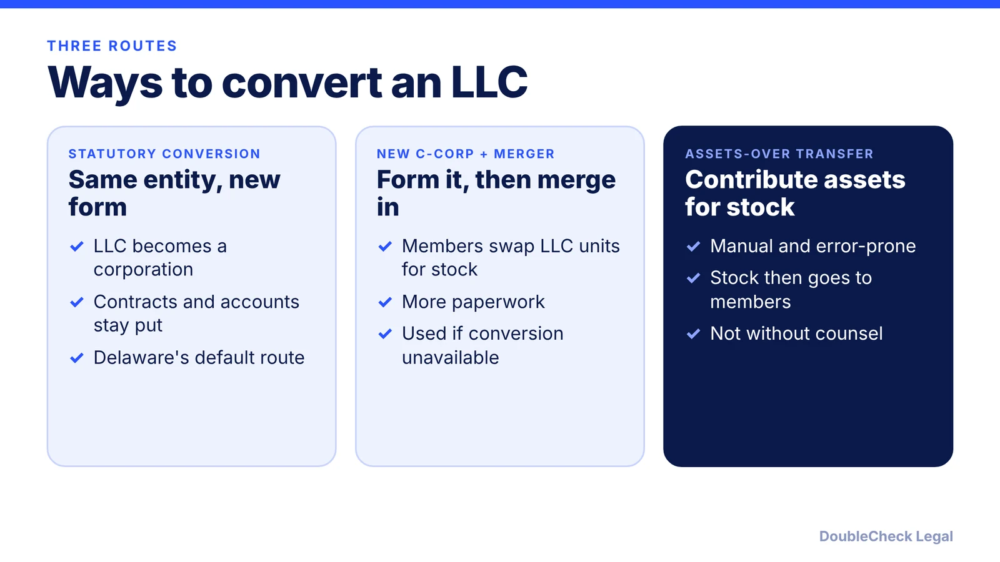
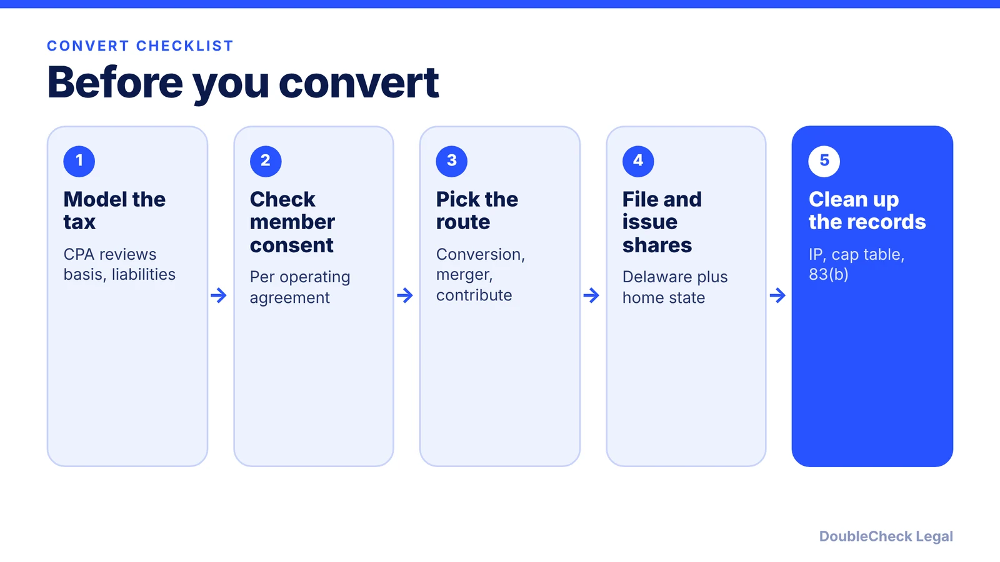

*Investors want preferred stock, and only a corporation can issue it. Here are the routes, the tax traps, and when to convert.*

**Key takeaways:**

- Venture investors buy preferred stock, so LLCs usually convert before a priced round.
- Routes: statutory conversion, forming a new C-corp and merging or contributing, or an assets-over transfer.
- Tax can arise if liabilities exceed basis, members lose 80% control, or cash is received.
- The QSBS clock generally starts at conversion and 83(b) elections have a 30-day deadline; use a lawyer and a CPA.

## 1. The quick answer

**Quick answer:** If you plan to raise venture money, investors typically buy preferred stock, which only corporations issue, so an LLC usually converts to a Delaware C-corp before a priced round, per Terms.law. There are three routes: a statutory conversion, forming a new C-corp and moving the business into it by merger or contribution, or an assets-over transfer. Conversions can be tax-free, but liabilities above basis, loss of control, or cash received can create tax, so model it with a CPA and attorney first.

## 2. Statutory conversion vs. forming a new C-corp

Per [Rho](https://www.rho.co/blog/convert-llc-to-c-corp), a **statutory conversion** (Delaware's default) turns the LLC into a corporation without interrupting its existence, so contracts, bank accounts, and property stay with the company. A **statutory merger** means forming a new C-corp and merging the LLC into it, with members exchanging LLC interests for stock; it takes more paperwork and is used where statutory conversion is not available. An **assets-over transfer** has the LLC contribute its assets and liabilities to a new corporation for stock and then distribute the stock to members; Rho calls it manual and error-prone and advises against it without counsel.

[SeedLegals](https://seedlegals.com/us/resources/convert-llc-or-create-new-c-corp.md) says a new C-corp only suits a near-dormant LLC: recently formed, one founder, and no IP, customers, contracts, or team tied to it. Once the LLC holds anything valuable, it calls conversion the safer choice, in part to avoid claims that the LLC holds rights to the IP.

Practical steps for a Delaware statutory conversion, per Rho: members approve a plan of conversion and map LLC units to shares; file a certificate of conversion and a certificate of incorporation; adopt bylaws, appoint the board, and issue shares; then update the registered agent, notify the IRS, and handle 83(b) elections. Its fee figures were dated October 17, 2026, and Delaware lists them on its Division of Corporations site, so confirm current amounts there. Start with [how to incorporate a SaaS or AI startup as a Delaware C-corp](/blog/how-to-incorporate-saas-ai-startup-delaware-c-corp/) for what the new corporation needs.

## 3. Tax cautions and timing

Tax is the main reason to involve a CPA. Points reported by the sources:

- **Often tax-free if control stays.** Per Rho, conversions are generally tax-free under Section 351 if members control at least 80% of the corporation afterward, which is usually the case.
- **Liabilities and negative capital accounts.** Rho says gain can arise if LLC liabilities exceed the tax basis of its assets (Section 357(c)) or if members have negative capital accounts. Terms.law lists the same trap, plus appreciated assets above basis and receiving cash or other property.
- **New EIN.** SeedLegals says you will usually need a new EIN because the IRS treats the converted entity as new, unless the LLC already elected C-corp taxation. Confirm with your tax adviser.
- **Partnership records.** SeedLegals notes multi-member LLCs taxed as partnerships need capital account records.
- **QSBS clock.** Rho and Terms.law both say the holding period generally starts at conversion, not at LLC formation, so converting earlier generally helps. See [QSBS Section 1202 explained](/blog/qsbs-section-1202-explained-startup-founders/).
- **83(b) deadline.** For founder stock that vests, the election must be filed within 30 days of issuance, per Terms.law. See [83(b) election for founders](/blog/83b-election-startup-founders/).

Terms.law adds that conversion is taxable unless the rules are followed and that rushing a conversion is a top mistake.

## 4. Timing and a pre-fundraising checklist

Convert before diligence starts, not during it. Terms.law says to convert before fundraising talks begin and estimates two to three months for a full merger route; Rho says investors buy preferred stock, so conversions often need to close before a priced round.

Costs after conversion include Delaware annual report and franchise tax, per Rho (its page was dated October 17, 2026; check Delaware for current figures). Investors will also ask for clean corporate records; see the [due diligence checklist for startup fundraising](/blog/due-diligence-checklist-for-startup-fundraising/). If you are still choosing entity type, read [LLC vs. C-corp for startups](/blog/llc-vs-c-corp-startups/).

Rho recommends counsel when members have different economics, there are outstanding profits interests or convertible instruments, or the conversion is tied to a financing, as is an out-of-state LLC. An AI tool can help you list what to gather and what to ask, but the tax analysis and filings need a lawyer and a CPA.

## Where DoubleCheck fits

[DoubleCheck](https://www.contactdoublecheck.com) helps businesses and founders start legal work with AI, verify it, and, when professional advice is warranted, connect with an independent attorney, including for immigration questions. Attorney availability and practice areas vary. Attorneys on DoubleCheck are independent professionals; an attorney-client relationship forms only if an attorney accepts your engagement.

**Sources:** [Terms.law, LLC to C-Corp conversion guide](https://terms.law/DE-inc/llc-to-corp-conversion.html); [Rho, How to convert an LLC to a C corp](https://www.rho.co/blog/convert-llc-to-c-corp); [SeedLegals, Convert LLC or create new C-corp](https://seedlegals.com/us/resources/convert-llc-or-create-new-c-corp.md).

## FAQ

**Why convert an LLC to a C-corp before fundraising?**

Per Terms.law and Rho, investors buy preferred stock, which only corporations issue, so conversions often need to close before a priced round. Not every fundraise requires it, so confirm with your lawyer and investors.

**Is converting an LLC to a C-corp taxable?**

It can be tax-free, but not automatically. Per Rho, conversions are generally tax-free under Section 351 if members control at least 80% afterward, but gain can arise if liabilities exceed asset basis or capital accounts are negative. Get a CPA to model it.

**Should I convert my LLC or form a new C-corp?**

Per SeedLegals, a new C-corp suits only a near-dormant LLC with no IP, customers, contracts, or team; once the LLC holds anything valuable, conversion is safer. Per Rho, a merger route is used where statutory conversion is not available.

**When does the QSBS holding period start after conversion?**

Per Rho and Terms.law, it generally starts at conversion, not at LLC formation. See our QSBS guide and ask a tax adviser how the rules apply to you.

---

*General information only. This article is not legal, tax, investment, or accounting advice.*
