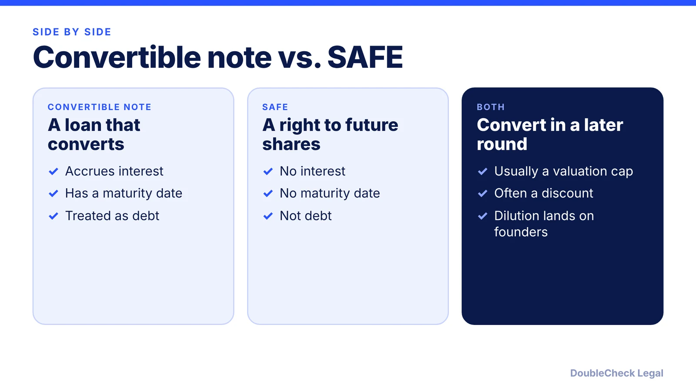
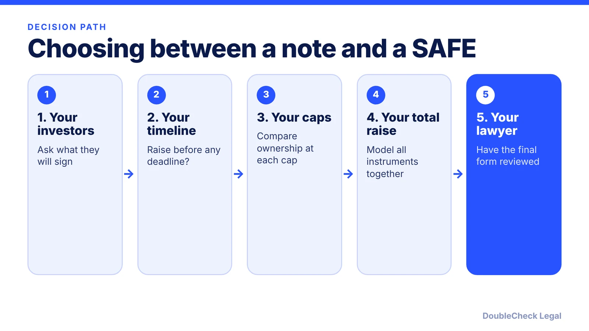

*Both turn early money into later equity, but one is a loan with a deadline and the other is not.*

**Key takeaways:**

- A convertible note is debt: it accrues interest and usually matures in one to two years (Haynes Boone).
- A SAFE has no interest and no maturity date, and is usually treated as a prepaid forward contract for tax.
- Both convert in a later qualifying round and most carry a valuation cap.
- Model the combined dilution of every note and SAFE before you sign anything.

## 1. The quick answer

**Quick answer:** A convertible note is a loan that converts into equity later; a SAFE is not debt. Per Haynes Boone, notes accrue interest and usually mature in one to two years, while SAFEs have neither interest nor a maturity date. Both convert in a future qualifying financing and most carry a valuation cap. SAFEs are simpler and cheaper to paper; notes give the investor creditor rights and a deadline, which can become your problem if you have not raised again by maturity.

## 2. The differences that matter

Per [Haynes Boone](https://www.haynesboone.com/news/publications/safes-and-convertible-notes):

- **Interest:** notes are "technically debt and accrue interest." SAFEs have no interest component.
- **Maturity:** notes usually run one to two years because of state banking and finance laws. If the company has not raised enough by then, the notes come due and can default if unpaid. SAFEs have no maturity date.
- **Tax treatment:** because notes are generally debt, the company can typically deduct the interest. SAFEs are usually treated as a prepaid forward contract for tax purposes.
- **Caps and discounts:** both can have them. Haynes Boone says "almost all convertible instruments today contain a valuation cap," and discounts usually range from 10% to 30%, often 20%.
- **Conversion:** both convert in the next financing that meets certain conditions. For notes, that financing has to close before maturity, and investors often also hold an optional conversion right.

The Y Combinator post-money SAFE adds a clean ownership formula (purchase amount divided by cap), covered in [SAFE note explained for founders](/blog/safe-note-explained-for-founders/). The SAFE also pays the greater of the purchase amount or as-converted value in a liquidity event, per the [YC Safe User Guide](https://bookface-static.ycombinator.com/assets/ycdc/SAFE%20User%20Guide-a47c6588327d73aa2799e61ed7c2cae9f1a0ee9acfa9c43b62039dc06e715832.pdf).

## 3. Risks on each side

**Convertible note risks for founders**

- **A clock you did not choose.** If the maturity date arrives and no qualifying round has closed, the notes come due and can default if unpaid, per Haynes Boone. Know the maturity date and plan ahead of it.
- **Interest on top.** Interest accrues while the note is outstanding, so the amount owed grows; the note sets how accrued interest is treated.

**SAFE risks for founders**

- **Stacked dilution.** On the post-money form, every added SAFE dollar dilutes founders, not other SAFE holders. CRV notes that at the Series A all outstanding SAFEs convert together, which is when stacked caps and discounts show up on the cap table.
- **Pro rata and MFN side effects.** Pro rata rights can use up allocation a lead investor wants, per CRV, and an MFN can pull in better terms you gave a later investor.

**Where each is used.** Both are common in pre-seed and seed rounds that avoid negotiating a full valuation. A SAFE is the lighter document, with no interest or maturity date. Check what your investors actually expect before choosing, and see the existing comparison in [SAFE vs. convertible note](/blog/safe-vs-convertible-note-startups/).

## 4. How to choose and what to check

There is no universally better instrument. Use this order of questions:

Always model total dilution from every note and SAFE together, because conversion happens at the same priced round. A [term sheet](/blog/term-sheet-key-terms-explained/) for that round will set the new price, and a [cap table](/blog/cap-table-basics-for-first-time-founders/) shows the combined result. If an instrument departs from the standard form, review it before you sign ([SAFE review checklist](/blog/safe-review-before-you-sign/)).

## Where DoubleCheck fits

[DoubleCheck](https://www.contactdoublecheck.com) helps businesses and founders start legal work with AI, verify it, and, when professional advice is warranted, connect with an independent attorney, including for immigration questions. Attorney availability and practice areas vary. Attorneys on DoubleCheck are independent professionals; an attorney-client relationship forms only if an attorney accepts your engagement.

**Sources:** [Haynes Boone, SAFEs and Convertible Notes](https://www.haynesboone.com/news/publications/safes-and-convertible-notes); [Y Combinator, Safe User Guide](https://bookface-static.ycombinator.com/assets/ycdc/SAFE%20User%20Guide-a47c6588327d73aa2799e61ed7c2cae9f1a0ee9acfa9c43b62039dc06e715832.pdf); [Wilson Sonsini, Post-Money Safes](https://wsgr.com/publications/PDFSearch/Practitioner-Insight-Post-Money-web.html); [CRV, SAFE Agreements for Startups](https://www.crv.com/content/safe-agreements-for-startups); [Terms.law, SAFE Agreements](https://terms.law/Invest-USA/startup-investing/safe-agreements.html).

## FAQ

**Do convertible notes have an interest rate?**

Yes. Per Haynes Boone, notes are technically debt and accrue interest, while SAFEs have no interest component. The rate and how accrued interest is handled at conversion are set in the note, so read those terms.

**What happens if a convertible note matures before a priced round?**

Per Haynes Boone, if the company has not raised enough by maturity, the notes come due and can default if unpaid. What happens next depends on the note terms and the holder, so read those before you sign.

**Is a SAFE safer for founders than a note?**

It avoids a maturity date and interest, which removes the repayment clock. It does not avoid dilution: on the post-money form, each added SAFE dollar dilutes founders, per Wilson Sonsini.

**Do both instruments use valuation caps and discounts?**

Yes. Haynes Boone says almost all convertible instruments today contain a valuation cap, and discounts usually range from 10% to 30%. Which one applies, or both, depends on the document.

---

*General information only. This article is not legal, tax, investment, or accounting advice.*
