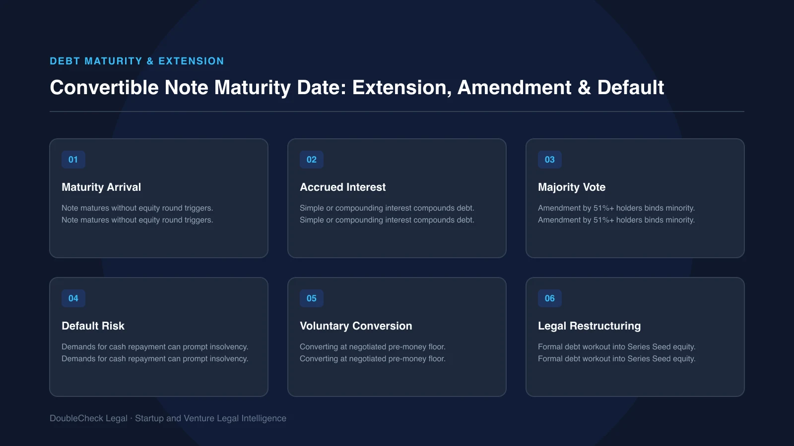
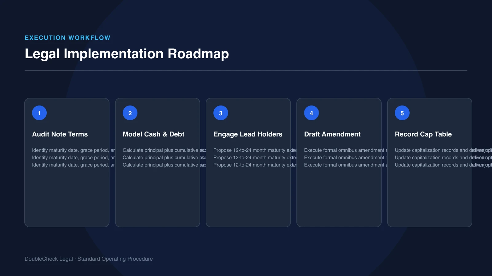

*A comprehensive legal analysis of convertible promissory note maturity mechanics, collective action amendment thresholds, voluntary conversion rights, default acceleration risks, and corporate workout strategies for venture-backed startups.*

**Key takeaways:**
- **No Automatic Conversion:** Convertible promissory notes are debt instruments; unless specified otherwise, reaching the maturity date does not automatically issue shares—it makes the debt callable.
- **Majority Amendment Power:** Most standard note purchase agreements permit a "Majority-in-Interest" (typically >50% or 66.7% of aggregate principal) to execute an omnibus maturity extension binding all holders.
- **Accrued Interest Compounding:** Unpaid interest accumulates over the typical 18-to-24 month lifespan, swelling the total debt balance converted in future equity rounds.
- **Insolvency & Fiduciary Exposure:** An unextended maturing note empowers any rogue creditor to file an involuntary bankruptcy petition or issue demand letters, creating fiduciary conflicts for startup directors.

## 1. The quick answer: Convertible note maturity mechanics

When a convertible promissory note hits its maturity date without an intervening "Qualified Financing" (such as a Series Seed or Series A round), the startup faces an immediate legal inflection point:

1. **The Debt Matures:** The principal amount, together with all accrued and unpaid interest, becomes an enforceable monetary liability immediately due and payable upon written demand.
2. **No Automatic Conversion:** Unlike a SAFE (Simple Agreement for Future Equity), which has no maturity date and represents a contingent equity right, a convertible note is bona fide debt governed by state commercial law and corporate statutes.
3. **Primary Resolution Paths:** Founders must actively pursue one of three options:
   - **Maturity Extension:** Negotiate an omnibus amendment extending maturity by 12 to 24 months.
   - **Voluntary Conversion:** Exercise an optional conversion clause allowing conversion into equity at the valuation cap.
   - **Refinancing / Workout:** Pay off the notes using alternative debt, new equity proceeds, or a structured restructuring.



## 2. In-depth legal analysis: The mechanics of convertible debt at maturity

Convertible notes serve as vital bridge instruments during pre-seed and seed stages. However, their debt structure exposes startups to legal and solvency vulnerabilities when fundraising takes longer than expected.

### A. The Debt-Versus-Equity Distinction
Under Delaware General Corporation Law (DGCL) and commercial law codes, noteholders are **creditors**, not shareholders. They have superior liquidation claims over common and preferred stockholders. If a startup runs out of runway and cannot repay a matured note, noteholders can:
- Issue formal legal notices of default;
- Accelerate the entire debt balance;
- Seek judicial liens against corporate bank accounts and intellectual property;
- Force the company into Delaware Chancery Court receivership or Chapter 7/11 bankruptcy proceedings.

### B. Collective Action Clauses and Majority-in-Interest
The single most critical legal clause in any note financing is the **Amendment and Waiver** provision. Standard institutional documentation provides:

```
"Any term of this Note and the other Notes issued under the Note Purchase Agreement may be amended or waived with the written consent of the Company and the holders of a Majority-in-Interest of the aggregate principal amount of all Notes then outstanding."
```

If this clause is present:
- **Binding Majority:** If 50.1% (or 66.7%, depending on definition) of the aggregate debt agrees to extend the maturity date by 18 months, that signature **legally binds 100% of the noteholders**, even an adversarial minority angel demanding cash.
- **Absence of Clause (Per-Note Consent):** If the notes were issued on standalone, uncoordinated forms without a master Note Purchase Agreement, each note must be individually amended. A single $25,000 angel investor can refuse to extend and demand immediate repayment, creating catastrophic holdout leverage.

### C. Calculating Accrued Interest and Conversion Dilution
Interest on convertible notes usually ranges from **4% to 8% per annum**, calculated as simple interest on a 365-day year basis. 

| Metric | Year 1 ($1,000,000 @ 6%) | Year 2 (Maturity @ 24 Mo) | Year 3 (After 1-Year Extension) |
|---|---|---|---|
| Principal | $1,000,000 | $1,000,000 | $1,000,000 |
| Accrued Interest | $60,000 | $120,000 | $180,000 |
| Total Debt Balance | $1,060,000 | $1,120,000 | $1,180,000 |
| Equivalent Equity Shares ($5M Cap) | 212,000 shares | 224,000 shares | 236,000 shares |

As shown above, delaying resolution adds substantial cap table dilution upon eventual equity conversion.

## 3. Step-by-step: How to execute a legally sound maturity extension



When maturity approaches (ideally 60 to 90 days prior), corporate leadership must follow a structured procedure:

### Step 1: Corporate and Cap Table Audit
Review every executed promissory note. Confirm:
- Original issuance date and stated maturity date;
- Applicable interest rate (simple vs compound);
- Whether an omnibus Note Purchase Agreement exists;
- Exact definition and voting threshold of "Majority-in-Interest."

### Step 2: Convene the Board of Directors
Under DGCL § 141, the Board of Directors must evaluate the company's financial condition. If the company cannot satisfy the maturing debt in the ordinary course of business, directors face insolvency considerations where fiduciary duties expand to include the entire enterprise, including creditors. The Board should adopt resolutions approving the proposed extension terms.

### Step 3: Negotiate Extension Concessions
Investors often request consideration in exchange for extending maturity:
- **Interest Rate Bump:** Increasing the coupon rate (e.g., from 5% to 7%);
- **Valuation Cap Reduction:** Lowering the future conversion cap as downside protection;
- **Warrant Coverage:** Issuing 10% to 20% warrant coverage to incentivize quick execution.

### Step 4: Execute an Omnibus Amendment and Waiver Agreement
Draft a single master document setting forth the new maturity date, attaching a revised note schedule. Obtain signatures from the company and the requisite majority of noteholders.

### Step 5: Formal Notice to Minority Holders
Deliver written notice of the executed amendment to all non-signing noteholders, referencing the contractual majority-amendment clause and confirming their updated maturity schedule.

## 4. Default scenarios and workout alternatives

If a startup cannot secure majority consent or raise equity, it enters a workout posture:

- **Voluntary Pre-Money Conversion:** Many notes provide that upon maturity, the holder or the company has the option to convert the principal and interest into a newly created series of Common Stock or Shadow Preferred Stock at the valuation cap.
- **Subordinated Debt Rollover:** Refinancing the existing notes into institutional venture debt or secondary bridge loans.
- **Assignment for the Benefit of Creditors (ABC):** If insolvency is unavoidable, a state-law ABC in Delaware or California provides a faster, private liquidation alternative to federal bankruptcy court.

## 5. Due diligence checklist: Reviewing convertible debt portfolios

Before closing any bridge round or extension, founders and legal teams should audit:
1. **Cross-Default Provisions:** Ensure default under one commercial contract does not trigger automatic acceleration of all convertible notes.
2. **Most-Favored Nation (MFN) Clauses:** Confirm that granting a lower cap or sweetener to an extending investor does not inadvertently trigger MFN repricing for prior seed notes.
3. **Usury Limits:** Verify that accrued interest plus fees does not violate state constitutional or statutory usury limits (e.g., California Civil Code § 1916-1).
4. **Investor Accreditation:** Maintain documentation confirming all noteholders remain accredited investors under SEC Rule 501.

## Where DoubleCheck fits

[DoubleCheck](https://www.contactdoublecheck.com) provides early-stage and venture-backed founders with AI-powered legal contract review and debt portfolio intelligence. DoubleCheck scans convertible promissory notes, extracts critical maturity dates, parses majority-amendment voting thresholds, and models cap table dilution scenarios, allowing corporate teams and their legal counsel to negotiate extensions with precision and confidence.

**Related reading:**
- [Convertible Note vs SAFE](/blog/convertible-note-vs-safe/)
- [Post-Money SAFE Conversion Mechanics & Dilution](/blog/post-money-safe-conversion-mechanics-cap-table-dilution/)
- [Cap Table Cleanup Before Series A Common Problems](/blog/cap-table-cleanup-before-series-a-common-problems/)
- [Term Sheet Key Terms Explained](/blog/term-sheet-key-terms-explained/)

**Sources:** [Delaware General Corporation Law § 141 (Board of Directors Powers & Fiduciary Duties)](https://delcode.delaware.gov/title8/c001/sc04/); [Uniform Commercial Code § 3-104 (Negotiable Instruments & Promissory Notes)](https://www.law.cornell.edu/ucc/3/3-104); [Securities and Exchange Commission (SEC) Regulation D Rule 506(b)](https://www.sec.gov/education/smallbusiness/exemptofferings/rule506b); [American Bar Association (ABA) Business Law Section, Model Convertible Note Financing Documents](https://www.americanbar.org/).

## FAQ

**What happens when a convertible promissory note reaches maturity?**

When a convertible note reaches its maturity date without a qualified financing, the note does not automatically convert into equity. Instead, the principal plus accrued interest becomes a legal debt obligation due and payable upon demand by the investor.

**Can an individual angel demand repayment if others agree to extend?**

It depends on the note amendment provisions. If the note purchase agreement contains a collective action clause allowing a majority-in-interest (typically 50.1% or 66.7% of note principal) to amend terms, a majority vote to extend maturity legally binds all minority noteholders.

**What is a corporate debt workout for startup convertible notes?**

A debt workout is a negotiated restructuring where noteholders agree to extend the maturity date, reduce interest, or voluntarily convert their outstanding debt into common or preferred equity at an agreed-upon valuation floor, avoiding formal insolvency.

**How is accrued interest handled during a note maturity extension?**

During an extension, companies typically agree to either let simple interest continue accruing, capitalize the accrued interest into the principal balance, or grant warrant coverage as compensation for the extended timeline.

**How can AI contract tools assist with convertible note extensions?**

AI contract tools rapidly parse across multiple disparate promissory notes, extracting maturity dates, interest compounding methods, majority amendment thresholds, and default notice covenants to create a unified debt audit.

---

*General information only. This article is not legal, tax, investment, or accounting advice.*
