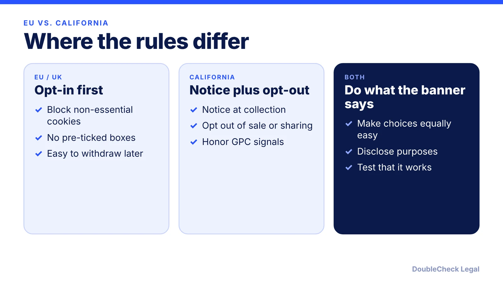
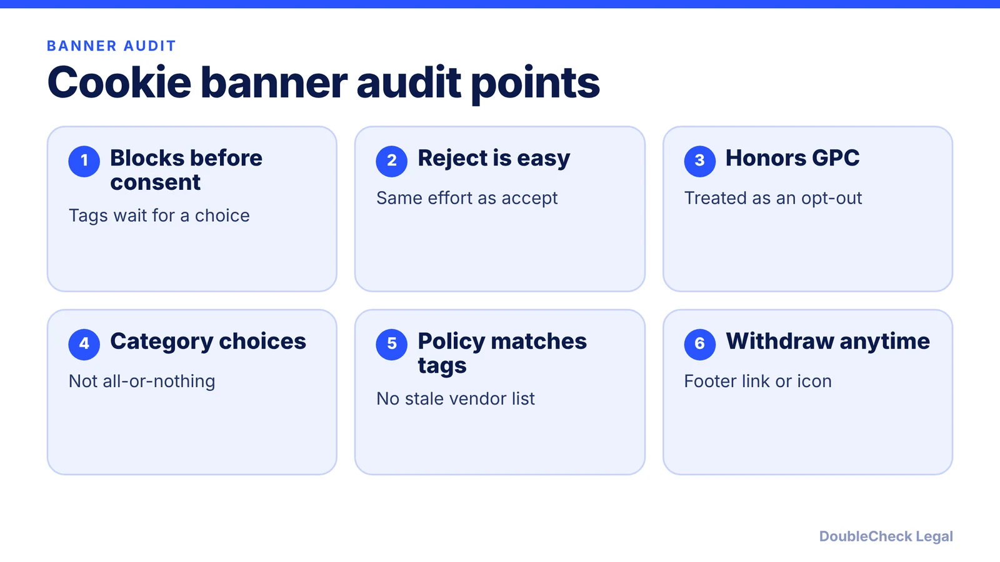

*Whether you need a cookie banner, and how it must behave, depends on where your visitors are.*

**Key takeaways:**

- EU and UK: non-essential cookies generally need prior, active, opt-in consent.
- California: notice plus opt-out of sale or sharing, and honor Global Privacy Control.
- Enforcement has targeted banners where refusing is harder than accepting or where the choice does not work.
- Inventory your trackers, make choices equal, and test the banner after every site change.

## 1. The quick answer

**Quick answer:** It depends on where your visitors are. In the EU and UK, non-essential cookies and similar trackers generally need prior, opt-in consent. In California, the CCPA/CPRA is mainly an opt-out regime: you give notice, offer a way to opt out of the sale or sharing of personal information, and honor signals like Global Privacy Control (GPC). A banner that makes refusing harder than accepting, or a "reject" button that does not work, is where enforcement has landed.

## 2. EU and UK: consent before non-essential cookies

Per [Termly's summary](https://termly.io/resources/articles/cookie-consent-requirements-for-website-owners/) of GDPR and ePrivacy rules:

- Non-essential cookies cannot be set before consent, and the consent must be an active choice with no pre-checked boxes.
- Users should be able to choose by category and to withdraw or change consent later, for example through a footer link.
- Strictly necessary cookies (login, security, shopping cart) generally do not need consent but should still be disclosed.
- A cookie policy should explain each cookie's purpose and duration and name relevant third parties.
- The UK follows the same core approach under UK GDPR and PECR.

The European Data Protection Board's 2020 consent guidelines, as summarized by [Elvinger Hoss](https://elvingerhoss.lu/publications/edpbs-updated-guidelines-consent-under-gdpr-cookies-and-scrolling), say scrolling or swiping does not count as consent, and that "cookie walls" that block access unless you accept non-essential cookies do not produce valid consent. The CJEU's *Planet49* ruling, cited there, held a pre-ticked box is not valid consent.

Termly lists GDPR fines of up to EUR 20 million or 4% of annual global turnover, and notes France's regulator fined TikTok EUR 5 million in 2023 for making refusal difficult. Whether the GDPR reaches your US business is covered in [GDPR for US startups](/blog/gdpr-for-us-startups/).

## 3. California and other US states: notice and opt-out

Per Termly, the CCPA/CPRA does not require prior opt-in consent for cookies. It does require a notice at or before collection, the ability to opt out of the sale or sharing of personal information, a "Do Not Sell or Share" link where applicable, and, as Termly puts it, businesses should honor opt-out signals like GPC. Termly lists Virginia, Colorado, and Connecticut laws as including similar transparency and opt-out requirements. Thresholds and details differ by state, so check which laws apply to you in [CCPA/CPRA compliance for small business](/blog/ccpa-cpra-compliance-small-business/) and the [state privacy law checklist](/blog/state-privacy-laws-2027-small-business-checklist/).

Recent enforcement, per [Coblentz Patch Kessler](https://www.coblentzlaw.com/news/cppa-enforcement-actions-key-lessons-from-honda-todd-snyder-and-healthline/):

- **Honda (CPPA, March 2025), $632,500.** "Accept All" took one click, while opting out meant toggling each category and confirming. The agency found this asymmetry violated design requirements. Honda also did not apply GPC opt-outs to known account users.
- **Todd Snyder (CPPA, May 2025), $345,178.** A defect made the banner disappear for 40 days, so users could not opt out, and GPC signals were not honored during the outage. The company was faulted for not monitoring its third-party privacy tools.
- **Healthline (California AG, July 2025), $1.55 million.** The banner appeared to disable advertising cookies but did not effectively do so, which the AG called deceptive.

The lesson is operational: your banner must actually control your tags, treat accept and decline evenly, and be monitored.

## 4. A practical setup for a small site

1. **Inventory your trackers.** List every cookie, pixel, and SDK, who sets it, and why. Marketing tags are the usual surprise.
2. **Classify.** Strictly necessary versus analytics, advertising, and social.
3. **Choose your regions.** If you serve EU or UK visitors, use opt-in with blocking before consent. For US visitors, add opt-out controls and GPC handling.
4. **Design neutral choices.** "Accept" and "Reject" should be equally prominent, and the preference center easy to reach again.
5. **Match the policy.** Your [privacy policy](/blog/privacy-policy-generator-small-business/) and cookie notice should describe what the tags actually do.
6. **Test and monitor.** Test with and without GPC, in several browsers, after every site change. Todd Snyder shows what a silent failure looks like.

A consent tool vendor can help, but you remain responsible for how it is configured. Terms of service and policies work together; see [website terms of service](/blog/website-terms-of-service-saas-startups/).

## Where DoubleCheck fits

[DoubleCheck](https://www.contactdoublecheck.com) helps businesses and founders start legal work with AI, verify it, and, when professional advice is warranted, connect with an independent attorney, including for immigration questions. Attorney availability and practice areas vary. Attorneys on DoubleCheck are independent professionals; an attorney-client relationship forms only if an attorney accepts your engagement.

**Sources:** [Termly, Cookie Consent Requirements](https://termly.io/resources/articles/cookie-consent-requirements-for-website-owners/); [Elvinger Hoss, EDPB consent guidelines](https://elvingerhoss.lu/publications/edpbs-updated-guidelines-consent-under-gdpr-cookies-and-scrolling); [Coblentz, CPPA enforcement actions](https://www.coblentzlaw.com/news/cppa-enforcement-actions-key-lessons-from-honda-todd-snyder-and-healthline/).

## FAQ

**Do I need a cookie banner if I only serve US customers?**

Not necessarily an opt-in banner. Per Termly, the CCPA/CPRA does not require prior opt-in consent for cookies, but it requires notice and an easy opt-out of sale or sharing where applicable. Other state laws may add duties.

**Is scrolling or continued browsing consent?**

Not under EU rules. Per Elvinger Hoss's summary of EDPB guidelines, scrolling or swiping never meets the clear affirmative action requirement.

**What is Global Privacy Control?**

A browser signal that tells sites a visitor opts out of sale or sharing. Per Termly, businesses should honor it, and per Coblentz, California regulators faulted Honda and Todd Snyder for not applying GPC opt-outs properly.

**Can a cookie wall force people to accept?**

Under EDPB guidance, as summarized by Elvinger Hoss, access to a service must not depend on consent to cookies that are not necessary for it, so consent obtained from a cookie wall is not valid.

---

*General information only. This article is not legal, tax, investment, or accounting advice.*
