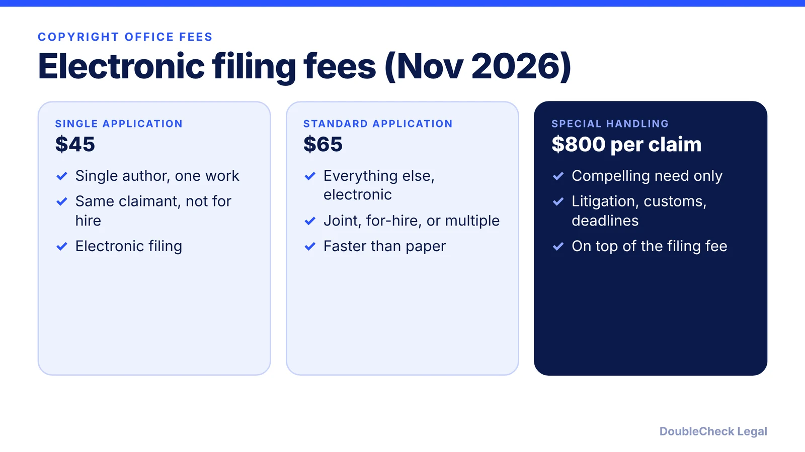
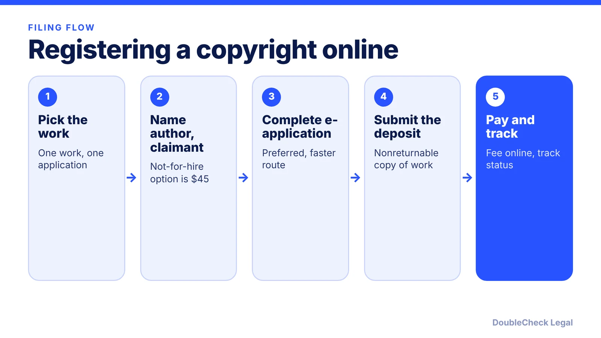

*Copyright registration is cheap compared with the remedies it can unlock, but timing decides what you can claim.*

**Key takeaways:**

- Electronic filing fees on the Copyright Office page: $45 (single author, one work, not for hire) or $65 (standard).
- A complete application needs the application, the fee, and a nonreturnable deposit copy.
- Registration is required to sue over a U.S. work; statutory damages and fees depend on registration timing (17 U.S.C. 412).
- Special handling costs $800 per claim and requires a compelling need.

## 1. The quick answer

**Quick answer:** You register a copyright with the U.S. Copyright Office by filing an application, a filing fee, and a deposit copy of the work, ideally online. As seen on the Copyright Office fee page in November 2026, electronic filing costs $45 for the single-author, one-work, not-for-hire option and $65 for the standard application. Timing matters: per Fish & Richardson, registration is a prerequisite to suing over a U.S. work, and statutory damages and attorney's fees generally require registration before the infringement began or within three months of first publication.

## 2. Why register

Per [Fish & Richardson's summary of the benefits](https://www.fr.com/insights/seven-benefits-of-copyright-registration/):

- **Right to sue.** Registration is a prerequisite to filing an infringement lawsuit over a U.S. work, and the registration generally must be granted, not just applied for.
- **Statutory damages and fees.** They are available only for infringement that began after registration took effect. Willful infringement can raise statutory damages to as much as $150,000.
- **Evidence.** If you register before publication or within five years after, the certificate is prima facie evidence that the copyright is valid.
- **Customs.** Registered copyrights can be recorded with U.S. Customs and Border Protection, which can exclude, detain, or seize infringing imports.

The statute behind the damages rule is [17 U.S.C. 412](https://www.govinfo.gov/link/uscode/17/412): no statutory damages or fees for infringement of a published work that began before registration, unless registration is made within three months after first publication.

For which protection fits what, see [trademark vs. copyright vs. patent](/blog/trademark-vs-copyright-vs-patent-startups/).

## 3. How to file

Per the Copyright Office's [Circular 4 on fees](https://www.copyright.gov/circs/circ04.pdf), a complete application has three parts: the filing fee, a nonreturnable deposit (a copy or copies of the work), and the application itself. Electronic registration is the preferred route and offers faster processing, status tracking, and online payment. Generally each work needs its own application, fee, and deposit, though multiple works can sometimes share one application.

1. Decide what you are registering (a software release, a course, a photo set, a book).
2. Identify the author and the claimant. The $45 option is limited to a single author, same claimant, one work, not for hire.
3. Choose the electronic application.
4. Upload or send the deposit.
5. Pay the fee and keep the confirmation.

**Other fees on the same circular:** paper forms are $125, so file online unless you have a reason not to. Special handling ($800 per claim) is for a compelling need tied to pending or prospective litigation, customs matters, or contract or publishing deadlines. Fees can change, so confirm on the [Copyright Office fee page](https://copyright.gov/about/fees.html) before you file.

## 4. Small-business angles

- **Time it early.** Because remedies turn on dates, register soon after publishing something valuable, such as a course, a template library, software, or a catalog.
- **Check who owns it first.** Work created by employees and contractors raises ownership questions; see [confidentiality and IP assignment agreements](/blog/confidentiality-ip-assignment-agreements-startups/).
- **AI-assisted work.** Registration questions for AI-generated material are covered in [AI-generated content and copyright](/blog/ai-generated-content-copyright-solo-business/).
- **Brand names are different.** Names and logos are trademark questions, not copyright; see the [IP comparison](/blog/trademark-vs-copyright-vs-patent-startups/).
- **Budget.** Multiply the per-work fee by the number of works you plan to file, and have an attorney check ownership on anything high value.

If a work is being copied now, the options turn on your registration status and dates, which is a good moment to talk to an IP attorney.

## Where DoubleCheck fits

[DoubleCheck](https://www.contactdoublecheck.com) helps businesses and founders start legal work with AI, verify it, and, when professional advice is warranted, connect with an independent attorney, including for immigration questions. Attorney availability and practice areas vary. Attorneys on DoubleCheck are independent professionals; an attorney-client relationship forms only if an attorney accepts your engagement.

**Sources:** [U.S. Copyright Office, Fees](https://copyright.gov/about/fees.html); [U.S. Copyright Office, Circular 4: Copyright Office Fees](https://www.copyright.gov/circs/circ04.pdf); [17 U.S.C. 412 (GovInfo)](https://www.govinfo.gov/link/uscode/17/412); [Fish & Richardson, Seven Benefits of Copyright Registration](https://www.fr.com/insights/seven-benefits-of-copyright-registration/).

## FAQ

**How much does it cost to register a copyright?**

As seen on the U.S. Copyright Office fee page, electronic filing is $45 for a single author, same claimant, one work, not for hire, and $65 for the standard application. Paper forms are $125 per Circular 4. Fees can change, so check the page.

**Do I have to register before I can sue for infringement?**

For a U.S. work, generally yes. Per Fish & Richardson, registration is a prerequisite to filing an infringement lawsuit, and the registration generally must be granted, not just applied for.

**When does registration affect damages?**

Under 17 U.S.C. 412, statutory damages and attorney's fees are barred for infringement of a published work that began before registration, unless registration was made within three months after first publication.

**What do I send with the application?**

A nonreturnable deposit, which is a copy or copies of the work, along with the filing fee, per the Copyright Office's Circular 4. Generally each work needs its own application, fee, and deposit.

---

*General information only. This article is not legal, tax, investment, or accounting advice.*
