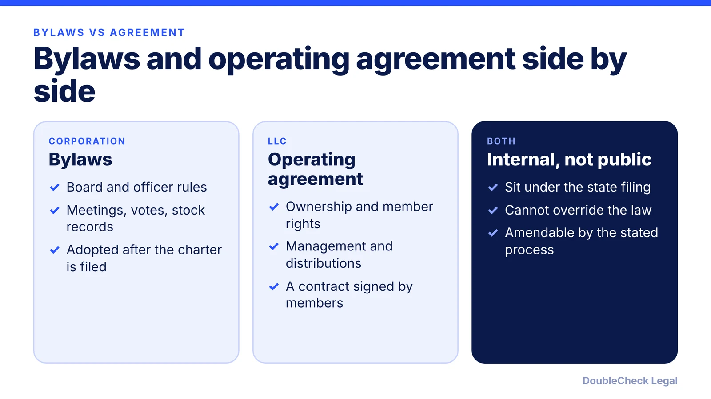
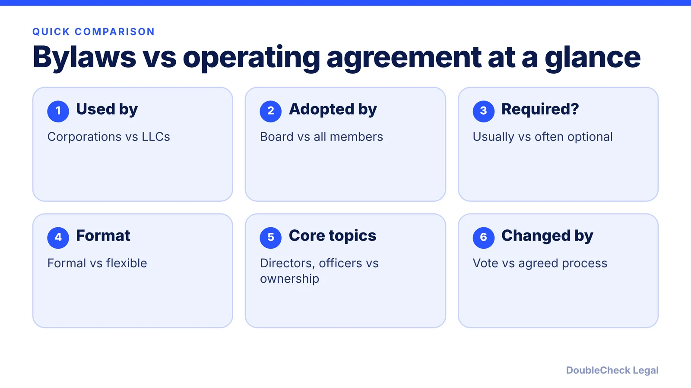

*Bylaws govern corporations and operating agreements govern LLCs; this explains what each covers and how to tell which one you need, as of November 2026.*

**Key takeaways:**

- Bylaws are for corporations; an operating agreement is for LLCs.
- Bylaws are usually required for corporations, while an operating agreement is often optional but recommended.
- Both are internal and sit below the public state filing.
- Check that the document is signed, matches your state filing and is updated before investors, loans or new owners.

## 1. The quick answer

**Quick answer:** Corporate bylaws vs operating agreement comes down to entity type. Bylaws are the internal rulebook for a corporation: how directors and officers are chosen, how meetings and votes work, and how stock and records are handled. An operating agreement is the internal contract for an LLC: who owns what, how the business is managed, how profit is split and what happens when a member leaves. Corporations typically adopt bylaws, while FindLaw says an operating agreement is not required in every state but is recommended. Either way, the document sits below the public filing (articles or certificate) and cannot override the law.

If you are choosing between the two, you are really choosing between a corporation and an LLC. See [LLC vs C corp for startups](/blog/llc-vs-c-corp-startups/) for that decision.

## 2. What corporate bylaws cover

Bylaws belong to corporations (C corporations and S corporations, which are a tax status of a corporation). Per FindLaw, they are an internal governing document adopted after the corporation is formed and are not filed with a state agency. Typical contents include director and officer roles, shareholder rights, meetings, quorum and voting, stock issuance and transfer, record-keeping and amendment procedures. In Delaware, DGCL section 109 addresses who may adopt and amend bylaws.

Delaware is a useful example because so many startups incorporate there. Per the text of Delaware General Corporation Law section 109 (as reproduced by Justia, which warns it may not be the most current version):

- Incorporators, initial directors named in the certificate, or the board can adopt bylaws before the corporation receives payment for stock.
- After stock payment, stockholders entitled to vote hold the power to adopt, amend or repeal bylaws, and the certificate of incorporation can also give that power to the directors without removing the stockholders' power.
- Bylaws may contain any provision that is not inconsistent with law or the certificate, about the corporation's business, how its affairs are conducted, and the rights or powers of the corporation, its stockholders, directors, officers or employees.

Other states have their own corporate statutes, so confirm your state's rule. In practice, a bylaws document usually answers questions such as:

- How many directors, and how are they elected or removed?
- Who are the officers and what can they sign?
- How are meetings called, how much notice is required and what counts as a quorum?
- How is stock issued and recorded?
- How are the bylaws amended?

Bylaws work together with the public charter. If the two conflict, the charter and the law generally win, which is why Delaware's text speaks of provisions "not inconsistent" with the certificate. For what goes into that charter, see [Delaware certificate of incorporation: authorized shares and par value](/blog/delaware-certificate-of-incorporation-what-to-put-in-authorized-shares-par-value/).

## 3. What an LLC operating agreement covers

An operating agreement is the contract members sign to set their own rules. Per FindLaw, it is not filed with the state and is typically kept in the business's records. It covers ownership percentages and capital contributions, member rights and voting, allocation of profits and losses, management structure and default rules for events such as a member's death. Delaware's LLC Act (section 18-1101) reflects the policy of giving maximum effect to freedom of contract in LLC agreements.

The flexibility is real. Delaware's LLC Act, section 18-1101, states a policy of giving maximum effect to the principle of freedom of contract and to the enforceability of LLC agreements, and allows an LLC agreement to expand, restrict or eliminate fiduciary duties, but not the implied covenant of good faith and fair dealing. Other states differ, and a flexible document is only as good as its drafting. A vague or missing agreement leaves your state's default rules to fill the gaps.

A useful operating agreement for a startup or small business answers:

- **Who owns what:** percentages, capital contributions, and how additional contributions work.
- **Who decides:** member-managed or manager-managed, which decisions need a vote, and the voting threshold.
- **How money moves:** profit allocation, distributions and tax distributions. Tax treatment matters here; see [multi-member LLC taxes: partnership return and K-1](/blog/multi-member-llc-taxes-partnership-return-k-1-explained/).
- **What happens at an exit:** transfers, buyouts, death or disability, and dissolution. See [buy-sell agreements for small business partners](/blog/buy-sell-agreement-small-business-partners/).
- **How to change it:** amendment rules and adding members; see [how to add a member to an LLC](/blog/how-to-add-a-member-to-an-llc/).

For drafting help, see [LLC operating agreement with AI](/blog/llc-operating-agreement-with-ai/) and [startup LLC operating agreement clauses](/blog/startup-llc-operating-agreement-clauses-investors-vesting-and-conversion/).

## 4. Side-by-side: where the two documents differ

The core differences, drawing on FindLaw and the statutes cited below:

- **Entity:** bylaws for corporations; an operating agreement for LLCs.
- **Legal requirement:** corporations typically adopt bylaws; per FindLaw an operating agreement is not required in every state but is recommended. Check your state, because some states do require or expect one.
- **Who is bound:** per FindLaw, bylaws are adopted by the incorporators or the board, and individual directors are not named parties. An operating agreement is a contract all members sign.
- **Style:** bylaws tend to follow a standard corporate structure, while an operating agreement can be tailored to the members.
- **Amendments:** bylaws are changed by board or shareholder vote, per the same source. An operating agreement follows whatever process the members wrote, from unanimous consent to majority.
- **Public filing:** neither is generally filed with the state, but both depend on the public charter that is.

Corporations also commonly use separate documents, such as stock purchase agreements and board approvals, so bylaws are not the whole picture. See [issuing a founder stock purchase agreement](/blog/issue-founder-stock-purchase-agreement/) and [corporate minutes and board consents](/blog/corporate-minutes-and-board-consents-small-corporation-records/).

**A common mix-up.** Some people search for LLC bylaws. LLCs do not have bylaws in the legal sense because they have members rather than shareholders; FindLaw compares the operating agreement to a corporation's bylaws as the document that guides the entity. If an LLC elects to be taxed as a corporation or an S corporation, it is still an LLC under state law. Its governing document is generally still an operating agreement, though a tax election can affect what the agreement should say. Confirm with a CPA and an attorney.

## 5. What to do if you have neither, or the wrong one

Many small businesses end up with a template that does not fit. Use this checklist.

- **Confirm your entity type** on your state filing: articles of incorporation or a certificate for a corporation, articles of organization or a certificate of formation for an LLC.
- **Find the document.** If you formed through an online service, look for a bylaws or operating agreement file in your records. A form that was generated is not the same as a form that was adopted, so check whether it was signed or approved.
- **Check it against the state filing.** Share counts, officer titles and management structure should match what the state has on record.
- **Update before an event.** New owners, a fundraise, a loan, a sale or a bank account opening often triggers a request for these documents. See [how to open a business bank account for an LLC or corporation](/blog/how-to-open-a-business-bank-account-llc-corporation-documents/).
- **Keep records.** For corporations, keep minutes and consents. For LLCs, keep written member decisions even if the state does not require meetings.

Co-founder issues belong in a separate or combined agreement. See [co-founder agreement for startups](/blog/co-founder-agreement-startups/) and [how to write a partnership agreement](/blog/how-to-write-a-partnership-agreement/).

**Self-handle or get an attorney to verify?** A single-owner LLC with simple facts may be comfortable starting from a template and asking AI to summarize what it says. Add an attorney when there are two or more owners, investors expected, a spouse or family member involved, any unequal contributions, vesting, or a planned conversion to a corporation. Those are the points where default rules and template language are most likely to produce results the owners did not intend. See [do I need a lawyer to start an LLC](/blog/do-i-need-a-lawyer-to-start-an-llc-diy-ai-or-attorney/) and [how to verify an AI-generated legal document](/blog/verify-ai-generated-legal-document/). As of November 2026, this is general information, and state corporate and LLC laws vary.

## Where DoubleCheck fits

[DoubleCheck](https://www.contactdoublecheck.com) helps businesses and founders start legal work with AI, verify it, and, when professional advice is warranted, connect with an independent attorney, including for immigration questions. Attorney availability and practice areas vary. Attorneys on DoubleCheck are independent professionals; an attorney-client relationship forms only if an attorney accepts your engagement.

**Sources:** [FindLaw, Writing corporate bylaws](https://www.findlaw.com/smallbusiness/incorporation-and-legal-structures/writing-corporate-bylaws.html); [FindLaw, What is an LLC operating agreement](https://www.findlaw.com/smallbusiness/business-operations/what-is-an-llc-operating-agreement.html); [Nolo, Corporations vs. LLCs](https://www.nolo.com/legal-encyclopedia/corporations-vs-llcs-29025.html); [Delaware General Corporation Law section 109 (Justia reproduction, may not be current)](https://law.justia.com/codes/delaware/title-8/chapter-1/subchapter-i/section-109/); [Delaware Code, LLC Act section 18-1101](https://delcode.delaware.gov/title6/c018/sc11/). Not fetched: the official Delaware Code page for DGCL section 109 did not include the text. Confirm your state statute.

## FAQ

**What is the difference between corporate bylaws and an operating agreement?**

Per FindLaw, bylaws govern corporations (directors, officers, meetings, stock) while an LLC operating agreement covers ownership, member rights and management. Corporations typically adopt bylaws; FindLaw says not all states require an operating agreement but recommends having one.

**Do LLCs have bylaws?**

Not in the legal sense. LLCs have members rather than shareholders and offer flexibility in management structure, per Nolo, so the operating agreement is the governing document. People sometimes say LLC bylaws when they mean the operating agreement.

**Is an operating agreement required for an LLC?**

It depends on the state. Per FindLaw, not all states require an operating agreement, but having one is recommended, and without one state default rules generally fill the gaps. Check your state, and ask an attorney if you have more than one member.

**Who can change corporate bylaws?**

Per Delaware General Corporation Law section 109, after stock payment the stockholders entitled to vote hold the power to adopt, amend or repeal bylaws, and the certificate can also give that power to the directors. Other states differ, so confirm your own rule.

**Do I need both bylaws and an operating agreement?**

Usually no: a corporation uses bylaws and an LLC uses an operating agreement. If your business changes from one entity type to the other, you generally need new governing documents, so ask a CPA and attorney before you convert.

---

*General information only. This article is not legal, tax, investment, or accounting advice.*
