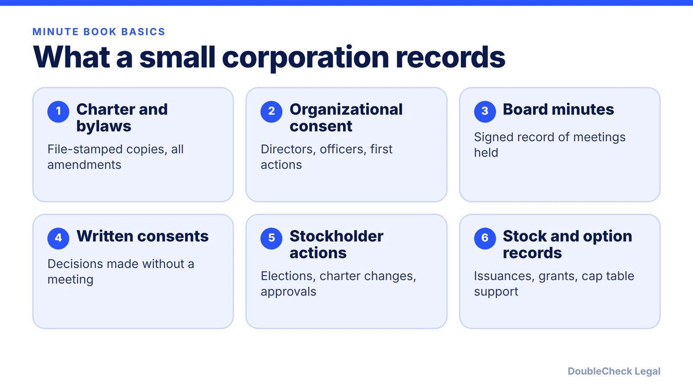
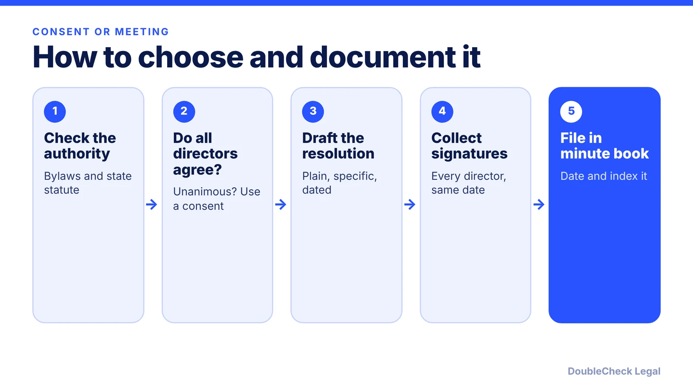

*How to keep corporate minutes and board consents for a small corporation, with Delaware and California consent rules and a simple minute book routine, as of November 2026.*

**Key takeaways:**

- Minutes record a meeting; board consents record decisions made without one, and neither is filed with the state.
- Delaware and California generally require every director to sign a board written consent, so one opposing director means holding a meeting.
- Missing records can complicate diligence and weaken liability protection arguments, so keep a signed, dated minute book.
- State rules and your bylaws control, and AI drafts should be checked before anyone signs.

## 1. The quick answer

**Quick answer:** Corporate minutes and board consents are the written record of what a corporation's directors and shareholders decided and when. For a small corporation, the practical rule is simple: record formal decisions (issuing stock, electing officers, granting options, borrowing money, approving big contracts) in a signed document, and keep it in one minute book. Where directors act without a meeting, many states, including Delaware and California, generally require every director to consent in writing. Rules differ by state, so check your statute and bylaws.

## 2. What corporate minutes and board consents actually are

Minutes and consents do the same job in two different ways.

- **Minutes** record a meeting. Per Cooley GO, minutes record the board's discussions and set out the formal resolutions adopted at each meeting; one person is designated secretary of the meeting and prepares them, the board approves them at a later meeting, and they go into the minute book. Useful minutes note the date and place, who attended or was absent, the matters discussed and any vote results.
- **Written consents** record a decision made without a meeting. Per Cooley GO, actions taken outside a live meeting by the board require unanimous written consent, meaning every board member signs.

Neither is filed with the state. They sit with your internal records, next to the charter, [bylaws](/blog/corporate-bylaws-vs-operating-agreement-what-each-covers/) and stock ledger.

A related point: minutes are not the same as bylaws or an operating agreement. Bylaws set the rules for how the corporation runs. Minutes and consents show you followed them. If you are not sure which governing document you need, see [corporate bylaws vs operating agreement](/blog/corporate-bylaws-vs-operating-agreement-what-each-covers/).

If your entity is an LLC, many states do not require formal minutes the way they do for corporations, and the paper trail is usually your operating agreement plus written member decisions. See [LLC operating agreements](/blog/llc-operating-agreement-with-ai/) for that side.

## 3. Do small corporations have to keep minutes and written consents?

The honest answer is that it depends on your state and your bylaws, and it is a gap many small owners miss.

State corporation statutes and your bylaws set the meeting and record-keeping rules, and they differ by state, including for S corporations (an S election is a tax status, not a different corporate form). Read your own state corporation statute and bylaws, and keep minutes and consents even where the statute is light.

Why founders keep them even where the statute is light:

- **Liability protection.** Missing or stale records make it harder to show that decisions followed corporate formalities. If someone asks a court to disregard the corporate entity, observing formalities is one factor courts may consider, and the outcome depends on state law and the facts. Habits that keep the company separate from you are covered in [bank account and commingling habits](/blog/llc-startup-bank-account-commingling-liability-protection-habits/).
- **Diligence.** Per Cooley GO, proof of board approval is requested for things like a credit line or a seed round, and option grants over the years need support. Gaps can mean past actions must be recreated and ratified, which may raise legal fees. See the [due diligence checklist for startup fundraising](/blog/due-diligence-checklist-for-startup-fundraising/) and the [Series A diligence checklist](/blog/series-a-legal-due-diligence-checklist/).
- **Authority.** A bank, landlord or investor may ask for a resolution that shows who can sign.

You do not need transcripts. A short, dated, signed record of what was decided is the target.

## 4. Board consent vs meeting: when a written consent is enough

A written consent works when everyone agrees and the board does not need to talk. A meeting works when there is a real discussion or disagreement.

**Delaware.** Under DGCL Section 141(f), per DLA Piper (published July 31, 2025), a board may act without a meeting if all directors consent in writing or by electronic transmission, and no director can abstain or fail to deliver consent. If one director opposes, hold a meeting. A signed PDF, an e-signature such as DocuSign, or an email indicating approval can serve as the consent, per the same article. See [electronic signatures and the ESIGN Act](/blog/electronic-signatures-esign-act-contracts/) for the general rules.

**California.** Per Corporations Code Section 307(b), all board members must consent in writing, and an interested or common director counts only if they abstain in writing and the required disclosures are made and included in the consent. The written consents must be filed with the minutes of the board proceedings. The statute text addresses electronic transmission for meeting participation but not in the written-consent subdivision, so confirm current practice before relying on email approvals there.

**Stockholders.** Delaware Section 228 lets stockholders act by written consent unless the certificate of incorporation says otherwise. Consents must be dated and delivered within 60 days of the earliest-dated consent, and the corporation must promptly notify non-consenting stockholders when action is not unanimous.

## 5. How to keep corporate minutes and board consents for a small corporation, step by step

A small-company routine does not need to be heavy.

1. **Start with an organizational consent.** Per Cooley GO, the minute book usually begins with the file-stamped charter, the bylaws, and an organizational consent or signed organizational meeting minutes, plus any action by the sole incorporator appointing directors.
2. **Hold an annual review.** Once a year, approve officer elections, review stock and option records, and ratify actions taken during the year.
3. **Write a consent for each major decision.** Per Cooley GO, matters needing documented authorization include officer elections, stock issuances, option grants, credit arrangements and changes to authorized shares.
4. **Match records to your cap table.** Every issuance in the stock ledger should trace to a board approval. See [cap table basics](/blog/cap-table-basics-for-first-time-founders/), [issuing founder stock](/blog/issue-founder-stock-purchase-agreement/) and [stock options and 409A valuations](/blog/stock-options-409a-valuation-startups/).
5. **Index and store.** Keep a table of contents and store signed copies in one shared folder, not in email threads.
6. **Fix gaps early.** If something was done without paper, a lawyer can often help document and ratify it before diligence starts.

If you have a board, [how to set up a startup board of directors](/blog/how-to-set-up-a-startup-board-of-directors/) covers who sits on it and how it should operate. Also note that in a conflict situation, such as a controlling stockholder transaction, process matters more; see [Delaware SB 21 and controlling stockholders](/blog/delaware-sb-21-controlling-stockholder-startups/).

## 6. Common mistakes, and where AI helps

Common problems when a small corporation falls behind:

- Stock issued with no board approval on file.
- A consent that is missing one director signature, which can defeat the written-consent route in states that require unanimity.
- Signature pages with no dates.
- Copying a template that cites another state or an entity type you do not have.
- Treating the record as an afterthought and writing it years later.

AI can help you draft a first version of a consent, turn meeting notes into minutes, or build a checklist from your bylaws. It can also quietly get the details wrong, for example by citing the wrong state rule or inventing a clause. Check any AI draft against your charter, bylaws and state statute before anyone signs. The [verification guide for AI-generated legal documents](/blog/verify-ai-generated-legal-document/) and the [hand-off package for an attorney](/blog/hand-off-an-ai-drafted-legal-document-to-an-attorney-package/) show a practical way to do that.

When to involve an attorney: before a financing, before a sale of the company, when directors disagree or a conflict exists, or when a large gap needs ratifying. For choosing one, see [how to choose a good lawyer](/blog/how-to-choose-good-lawyer/) and [when to hire a lawyer](/blog/when-to-hire-lawyer-small-business/).

## Where DoubleCheck fits

[DoubleCheck](https://www.contactdoublecheck.com) helps businesses and founders start legal work with AI, verify it, and, when professional advice is warranted, connect with an independent attorney, including for immigration questions. Attorney availability and practice areas vary. Attorneys on DoubleCheck are independent professionals; an attorney-client relationship forms only if an attorney accepts your engagement.

**Sources:** [Cooley GO, maintain a corporate minute book](https://www.cooleygo.com/maintain-corporate-minute-book/); [DLA Piper, board action meetings vs written consents (July 31, 2025)](https://www.dlapiper.com/insights/publications/accelerate/formation/board-action-meetings-vs-written-consents); [California Corporations Code Section 307](https://california.public.law/codes/corporations_code_section_307); [Delaware Code Title 8, Subchapter VII (Section 228)](https://delcode.delaware.gov/title8/c001/sc007/index.html).

## FAQ

**Do small corporations have to keep minutes and written consents?**

It depends on the state and your bylaws. State corporation statutes and your bylaws set the meeting and record-keeping rules, and they differ by state. Even where the statute is light, Cooley GO says actions should be documented to show proper board and stockholder authorization under the charter and bylaws. Check your state statute.

**Does a board written consent have to be unanimous?**

Generally yes. Per DLA Piper (July 31, 2025), Delaware requires all directors to consent in writing or electronically under Section 141(f), and California Corporations Code Section 307(b) requires all board members to consent in writing. Rules vary by state.

**What should a small corporation keep in its minute book?**

Per Cooley GO: the file-stamped charter and amendments, bylaws, an organizational consent, signed board minutes, written consents, and stockholder actions, plus a current list of officers and directors.

**Can corporate minutes help protect my personal assets?**

They can help show that decisions followed corporate formalities. Per Cooley GO, records show proper authorization for corporate actions, and missing records can mean past actions must be recreated and ratified later. If someone asks a court to disregard the corporate entity, observing formalities is one factor courts may look at, not a guarantee.

**Can I use AI to write corporate minutes or board consents?**

AI can draft a first version or turn notes into minutes. Verify it against your charter, bylaws and state law before signing, and ask an attorney to review anything tied to financing, stock issuances or a sale.

---

*General information only. This article is not legal, tax, investment, or accounting advice.*
