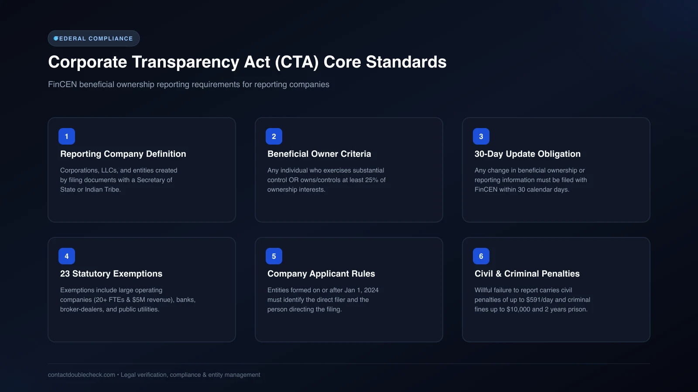
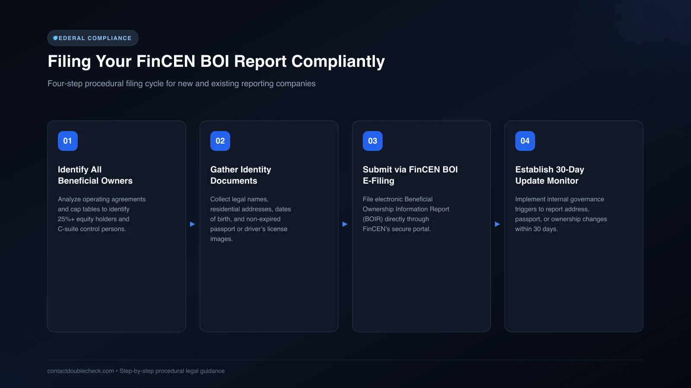

*Compliance and governance guide to the Corporate Transparency Act (CTA) and Financial Crimes Enforcement Network (FinCEN) Beneficial Ownership Information (BOI) reporting, as of November 2026. General information, not legal advice.*

**Key takeaways:**

- All domestic LLCs, corporations, and statutory business entities formed with a Secretary of State are presumed "Reporting Companies" unless qualifying for one of 23 statutory exemptions.
- Beneficial owners are defined as any individuals who directly or indirectly exercise "substantial control" or own/control at least 25% of ownership interests.
- Any change in beneficial ownership or reported information (such as an address change or updated driver's license) must be reported to FinCEN within **30 calendar days**.
- Small businesses and startups are the primary target; large companies with 20+ full-time employees and $5M+ in revenue are exempt.
- Willful non-compliance triggers civil fines up to $591/day and criminal penalties up to two years in federal prison.

## 1. The quick answer

**Quick answer:** The **Corporate Transparency Act (CTA, 31 U.S.C. § 5336)**, administered by the U.S. Department of the Treasury's Financial Crimes Enforcement Network (**FinCEN**), requires millions of small businesses, corporations, and limited liability companies to submit electronic **Beneficial Ownership Information (BOI) Reports**. 

Unless a business qualifies for one of **23 specific statutory exemptions** (such as the Large Operating Company exemption requiring 20+ full-time U.S. employees and $5M+ in gross receipts), the entity must disclose the full legal name, date of birth, residential address, and unique identifying number (with passport or driver's license image) for **every individual who owns at least 25% of the company or exercises "substantial control"** over its governance.

Critically, compliance is not a one-time event. Whenever an executive moves residence, a passport expires and renews, an investor joins the cap table, or a C-suite officer changes, the company has an unyielding **30-day deadline** to submit an updated report through the FinCEN BOI E-Filing system.

For state transparency comparisons, review [New York LLC Transparency Act beneficial ownership](/blog/new-york-llc-transparency-act-beneficial-ownership/) and [beneficial ownership report BOI 2026](/blog/beneficial-ownership-report-boi-2026/).

## 2. Who is a reporting company under FinCEN regulations?

Under 31 CFR § 1010.380(c), the CTA establishes two categories of reporting companies:

1. **Domestic Reporting Company:** Any corporation, limited liability company (LLC), or other statutory entity created by the filing of a document with a Secretary of State or similar office under the law of a State or Indian tribe.
2. **Foreign Reporting Company:** Any entity formed under the law of a foreign country that has registered to do business in any U.S. State or Indian tribe by filing a document with a Secretary of State.

**Non-Reporting Entities:** Sole proprietorships, general partnerships, and unincorporated associations that do *not* file formation documents with a state Secretary of State are not reporting companies.

## 3. Identifying beneficial owners and substantial control

Under FinCEN regulations (31 CFR § 1010.380(d)), a **beneficial owner** is any individual who, directly or indirectly:
- Exercises **substantial control** over the reporting company; OR
- Owns or controls at least **25 percent** of the ownership interests of the reporting company.

### The Substantial Control Test:
An individual exercises substantial control if they satisfy any of four criteria:
1. **Senior Officers:** Serving as President, Chief Executive Officer (CEO), Chief Operating Officer (COO), Chief Financial Officer (CFO), or General Counsel.
2. **Appointment Authority:** Holding authority to appoint or remove any senior officer or a majority of the board of directors.
3. **Substantial Decision-Maker:** Directing, determining, or having substantial influence over important decisions affecting the company (such as reorganizations, major contracts, expenditures, or equity issuances).
4. **Catch-All Control:** Exercising any other form of substantial control over the reporting company.

Under this rule, a startup CEO who owns 0% equity is still a mandatory reportable beneficial owner due to substantial control.

### The 25% Ownership Calculation:
Ownership interests include equity shares, stock, membership units, capital or profits interests, voting rights, and convertible debt instruments (SAFEs, convertible notes, and stock options) calculated on a fully diluted basis.

## 4. The 23 exemptions: Large Operating Company rules

The CTA provides 23 narrow statutory exemptions under 31 U.S.C. § 5336(a)(11)(B). Most exemptions cover heavily regulated industries: banks, credit unions, broker-dealers, public utilities, tax-exempt 501(c)(3) non-profits, and publicly traded companies reporting under the SEC Exchange Act.

### The Primary Small Business Exemption: Large Operating Company
For traditional operating commercial businesses, the **Large Operating Company exemption** (Exemption #21) is the primary exemption. An entity qualifies *only if* it meets all three conditions simultaneously:
1. Employs **more than 20 full-time employees** in the United States (excluding independent contractors and 1099 vendors);
2. Maintains an **operating physical presence at a physical office** in the United States (cannot be a shared virtual address, P.O. box, or registered agent office); AND
3. Reported **more than $5,000,000 in gross receipts or sales** on its federal income tax return for the previous year (Form 1120, Form 1065, etc.).

Because early-stage tech startups and small local businesses rarely have 20+ full-time employees and $5M+ in revenue, virtually all startups are subject to mandatory BOI reporting.

## 5. The mandatory 30-day update and correction rules

The most frequent source of legal liability is the ongoing updating obligation under 31 CFR § 1010.380(a)(2):

- **30-Day Window for Changes:** If there is *any change* in the information reported regarding the reporting company or its beneficial owners, the company must file an **updated BOIR within 30 calendar days** after the date the change occurred.
- **Common Update Triggers:**
  - A beneficial owner changes their primary residential home address.
  - A beneficial owner renews an expired driver’s license or passport and receives a new document number.
  - An executive officer resigns, is terminated, or is appointed.
  - An angel investor or venture capital firm acquires 25% or more of company equity interests.
  - A reporting company changes its legal name or principal business street address.
- **FinCEN Identifier Solution:** Beneficial owners can submit their personal identity details directly to FinCEN to obtain a unique 12-digit **FinCEN Identifier**. Reporting companies can then simply input the individual’s FinCEN ID on the corporate BOIR. When the individual changes addresses, they update their personal FinCEN profile, automatically updating all affiliated corporate reports and eliminating company administrative overhead.

## 6. Penalties for non-compliance and corporate governance

The CTA establishes harsh civil and criminal penalties under 31 U.S.C. § 5336(h) for willful failure to report complete or updated beneficial ownership information, or willfully filing false or fraudulent information:

- **Civil Penalties:** Fines of up to **$591 per day** (adjusted annually for federal inflation) for each day the violation continues unabated.
- **Criminal Penalties:** Criminal fines of up to **$10,000** and imprisonment for **up to two years** in federal prison.
- **Officer and Filer Liability:** FinCEN guidance affirms that both the reporting company and individual corporate officers responsible for compliance can be held personally liable for willful non-filing.

## Where DoubleCheck fits

[DoubleCheck](https://www.contactdoublecheck.com) provides businesses, founders, and corporate secretaries with automated compliance management, beneficial ownership tracking, and governance verification. When navigating CTA exemptions, complex multi-entity holding structures, or FinCEN filing questions, DoubleCheck connects you directly with experienced corporate attorneys.

**Related reading:**
- [Beneficial Ownership Report (BOI) 2026 Guide](/blog/beneficial-ownership-report-boi-2026/)
- [New York LLC Transparency Act: Beneficial Ownership Rules](/blog/new-york-llc-transparency-act-beneficial-ownership/)
- [Corporate Minutes and Board Consents for Small Corporations](/blog/corporate-minutes-and-board-consents-small-corporation-records/)
- [How to Incorporate a SaaS AI Startup in Delaware](/blog/how-to-incorporate-saas-ai-startup-delaware-c-corp/)

**Sources:** [Financial Crimes Enforcement Network (FinCEN), Beneficial Ownership Information Reporting Home](https://www.fincen.gov/boi); [Electronic Code of Federal Regulations, 31 CFR § 1010.380 (Reports of Beneficial Ownership Information)](https://www.ecfr.gov/current/title-31/subtitle-B/chapter-X/part-1010/subpart-C/section-1010.380); [United States Code, 31 U.S.C. § 5336 (Corporate Transparency Act)](https://www.law.cornell.edu/uscode/text/31/5336); [FinCEN, Small Entity Compliance Guide (Beneficial Ownership Information)](https://www.fincen.gov/boi/small-entity-compliance-guide); [U.S. Department of the Treasury, Anti-Money Laundering and Beneficial Ownership Regulations](https://home.treasury.gov/).

## FAQ

**Who must file a BOI report under the Corporate Transparency Act?**

All domestic corporations, LLCs, and statutory business entities created by filing documents with a Secretary of State, as well as foreign entities registered to do business in the U.S., must file unless exempt.

**What is the Large Operating Company exemption under the CTA?**

An entity qualifies as an exempt Large Operating Company if it employs more than 20 full-time employees in the U.S., maintains an operating physical office in the U.S., and reported more than $5,000,000 in gross receipts on its prior federal tax return.

**Who qualifies as a beneficial owner under FinCEN rules?**

Under 31 CFR § 1010.380(d), any individual who directly or indirectly exercises substantial control over the reporting company OR owns or controls at least 25% of the entity’s ownership interests.

**How quickly must companies report changes in beneficial ownership?**

Reporting companies must file an updated BOI report with FinCEN within 30 calendar days of any change to previously reported company or beneficial owner information, including address or passport updates.

**What are the penalties for failing to file a BOI report?**

Willful failure to file, or willfully providing false information, carries civil penalties of up to $591 per day (inflation-adjusted) and criminal fines up to $10,000 and up to two years imprisonment.

---

*General information only. This article is not legal, tax, investment, or accounting advice.*
