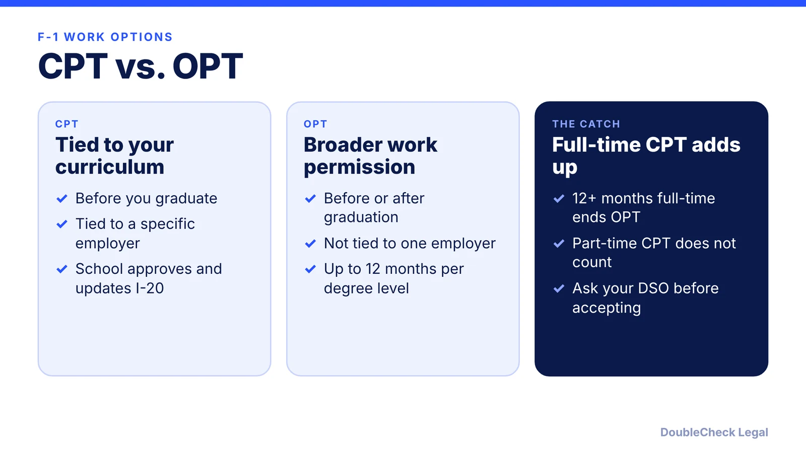
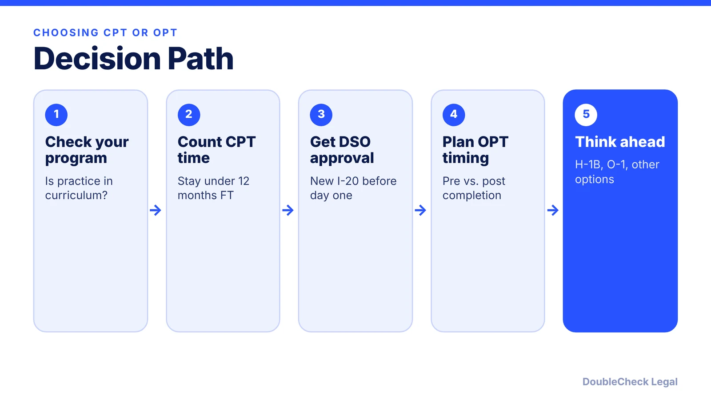

*CPT and OPT both let F-1 students work, but they follow different rules, and heavy CPT use can cost you OPT.*

**Key takeaways:**

- CPT is tied to your curriculum and used before graduation; OPT can be used before or after.
- Per Berardi Immigration Law, 12 months or more of full-time CPT makes you ineligible for OPT; part-time CPT does not.
- Your DSO approves CPT and issues a new I-20; it is employer-specific.
- Rules vary by school, so confirm with your DSO before accepting an offer.

## 1. The quick answer

**Quick answer:** Curricular Practical Training (CPT) is work authorization tied to your degree program, used before you graduate and approved by your school. Optional Practical Training (OPT) is broader, can be used before or after graduation, and is not tied to one employer. The trap: per Berardi Immigration Law, 12 months or more of full-time CPT makes you ineligible for OPT, while part-time CPT does not affect OPT eligibility.

## 2. How CPT works

Per Berardi Immigration Law, to be eligible you must generally have been enrolled for at least one full academic year, though graduate students may receive CPT in their first semester if the program requires it. Your designated school official (DSO) approves CPT and issues a new Form I-20, and you typically need an offer letter or a signed agreement from the employer.

Per Cleveland State University's international office, CPT is an internship, practicum or co-op that is part of your major's curriculum, paid or unpaid, and must be completed before graduation. Some schools require course credit. Full-time CPT is 20 or more hours a week; part-time is fewer (Berardi).

Because CPT is employer-specific, a new employer means a new authorization before you start. Rules differ by school, and some programs limit CPT to a single semester-long course, so your DSO's policy is the one that governs.

## 3. How OPT works, and how CPT can affect it

Per Berardi, you can receive up to 12 months of OPT at each education level, before or after graduation. Time used as pre-completion OPT is deducted from post-completion OPT. Graduates of STEM degrees may apply for a 24-month extension, which CPT does not qualify for. While school is in session, OPT work is limited to 20 hours a week.

The key interaction:

- **Under 12 months of full-time CPT:** OPT eligibility remains.
- **12 months or more of full-time CPT at one level:** you lose OPT at that level (Berardi; Cleveland State says the same, which is why it authorizes CPT only where it is needed to graduate).
- **Part-time CPT:** does not reduce OPT.

Before accepting a long full-time CPT, ask your DSO to add up your total so far. Founders should also read our guide to [F-1 OPT and STEM OPT for startups](/blog/f1-opt-stem-opt-start-your-own-startup/), because working for your own company raises separate questions.

## 4. Startups, universities, and next steps

Berardi's comparison page does not address owning a company, and universities set their own CPT policies, so ask your DSO whether CPT can ever be used with a student-founded company at your school. Do not assume it can. For OPT-era founders, the details around E-Verify, pay, and the I-983 are covered in our [OPT startup guide](/blog/f1-opt-stem-opt-start-your-own-startup/).

Longer term, students who plan to stay in the U.S. often compare an [H-1B cap filing](/blog/h1b-weighted-lottery-wage-levels-explained/), the [O-1A](/blog/o-1a-visa-for-startup-founders-evidence/), and other [founder visa options](/blog/us-visa-options-for-startup-founders-compared/). Choosing CPT and OPT well keeps those options open. If a status or authorization question is unclear, talk to your DSO first and an immigration attorney for anything beyond school policy.

## Where DoubleCheck fits

[DoubleCheck](https://www.contactdoublecheck.com) helps businesses and founders start legal work with AI, verify it, and, when professional advice is warranted, connect with an independent attorney, including for immigration questions. Attorney availability and practice areas vary. Attorneys on DoubleCheck are independent professionals; an attorney-client relationship forms only if an attorney accepts your engagement.

**Sources:** [Berardi Immigration Law, CPT vs. OPT](https://berardiimmigrationlaw.com/what-is-the-difference-between-cpt-opt/); [Cleveland State University CISP](https://www.csuohio.edu/node/20719).

## FAQ

**Is CPT or OPT better?**

Neither is better in general. CPT is limited to work that is part of your curriculum before graduation, and OPT is broader and not employer-specific. The better choice depends on your program, timing, and how much full-time CPT you have already used.

**Does CPT reduce my OPT?**

Only if you reach 12 months or more of full-time CPT. Per Berardi Immigration Law, you are then ineligible for OPT. Part-time CPT does not affect OPT eligibility.

**How soon can I get CPT?**

Per Berardi, you must generally have been enrolled for one full academic year, with an exception for graduate programs that require CPT in the first semester. Your school's policy governs.

**Can I use CPT for my own startup?**

The sources reviewed do not address it, and schools set their own policies. Ask your DSO and an immigration attorney before assuming it is allowed.

---

*General information only. This article is not legal, tax, investment, or accounting advice.*
