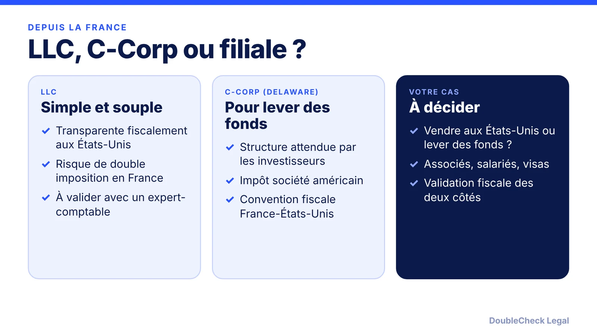
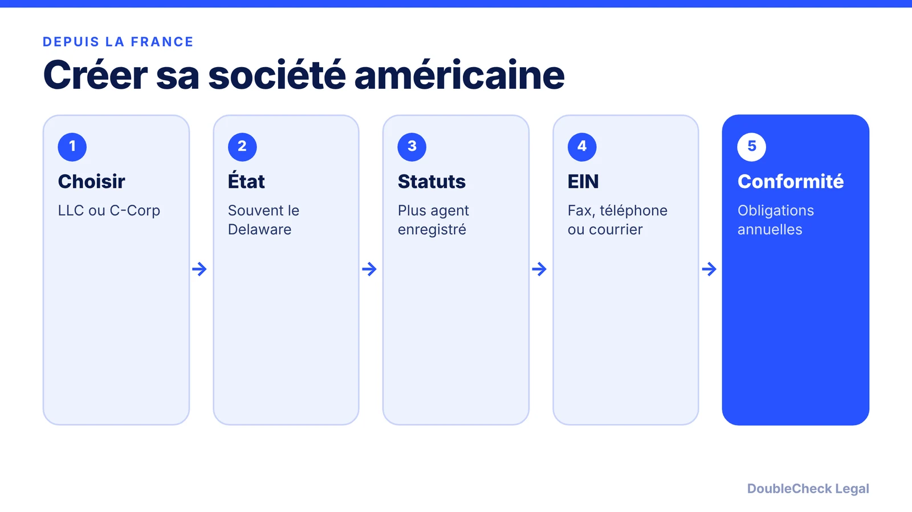

*Entrepreneur en France ? Voici comment créer une société américaine, choisir entre LLC et C-Corp, obtenir l'EIN et ce qu'il faut faire valider côté fiscal.*

**Points clés :**

- On peut créer une société américaine depuis la France sans résider aux États-Unis.
- La C-Corp du Delaware est la structure habituelle pour lever des fonds ; la LLC demande une vérification fiscale en France.
- L'EIN se demande par fax, téléphone ou courrier si l'on n'a pas de présence aux États-Unis.
- Faites valider la fiscalité par un expert-comptable français et un CPA américain.

## 1. La réponse rapide

**Réponse rapide :** Depuis la France, vous pouvez créer une société américaine sans résider aux États-Unis. Les choix courants sont la **LLC** (simple, mais attention à son traitement fiscal en France) et la **C-Corp du Delaware** (la structure habituelle pour lever des fonds auprès d'investisseurs américains). Vous aurez besoin d'un agent enregistré aux États-Unis et d'un numéro EIN, obtenu par fax, téléphone ou courrier si vous n'avez pas de numéro de sécurité sociale américain.

## 2. LLC ou C-Corp : le point fiscal français

Selon l'analyse de Hayot Expertise (cabinet français), une LLC à associé unique est transparente fiscalement aux États-Unis, mais cette transparence ne s'applique pas automatiquement en France : il existe un risque de double imposition ou de requalification (article 209 B du CGI est cité). Pour les levées de fonds auprès d'investisseurs américains, la C-Corp du Delaware est la structure habituelle. Hayot mentionne aussi la convention fiscale France-États-Unis du 31 août 1994, avec une retenue sur dividendes de 15 %, ramenée à 5 % au-delà de 10 % de détention.

Ces points sont des résumés de sources secondaires. Faites-les valider par un expert-comptable en France et un CPA aux États-Unis avant de choisir. Comparez aussi les structures dans [LLC vs. C corp for startups](/blog/llc-vs-c-corp-startups/) (en anglais).

## 3. Les étapes aux États-Unis

1. **Choisir l'État** (souvent le Delaware) : [guide du Delaware](/blog/how-to-incorporate-in-delaware-step-by-step/) (en anglais).
2. **Désigner un agent enregistré** avec une adresse américaine ([exigences](/blog/delaware-registered-agent-requirements/)).
3. **Déposer les statuts** auprès de l'État.
4. **Obtenir l'EIN** auprès de l'IRS. Sans numéro de sécurité sociale, utilisez le formulaire SS-4 par fax, téléphone ou courrier ([détails](/blog/get-ein-without-ssn-foreign-founder/), en anglais). L'IRS indique que la demande en ligne n'est pas ouverte aux demandeurs sans présence aux États-Unis.
5. **Respecter les obligations annuelles**, dont le formulaire 5472 pour une LLC détenue par un étranger ([voir](/blog/start-us-company-as-non-us-resident/)).

## 4. Obligations côté France

Hayot cite aussi des démarches françaises, comme des déclarations à la Banque de France et le formulaire 3916 pour un compte à l'étranger. Les obligations dépendent de votre situation et évoluent : demandez à un professionnel français. Créer une société aux États-Unis ne vous donne pas de visa : voir [O-1A](/blog/o-1a-visa-for-startup-founders-evidence/) ou [EB-1A](/blog/eb-1a-vs-o-1-founder-which-path/) (en anglais).

## Où DoubleCheck intervient

[DoubleCheck](https://www.contactdoublecheck.com) aide les entrepreneurs à démarrer leurs démarches juridiques avec l'IA, à les vérifier et, lorsqu'un avis professionnel est utile, à les mettre en relation avec un avocat indépendant. La disponibilité et les domaines de pratique des avocats varient. Les avocats sur DoubleCheck sont des professionnels indépendants ; une relation avocat-client ne naît que si un avocat accepte votre mission.

**Sources :** [Hayot Expertise](https://hayot-expertise.fr/blog/ouvrir-societe-usa-llc-c-corp-filiale-arbitrage-2026); [IRS Form SS-4 instructions](https://www.irs.gov/instructions/iss4); [Loeb & Loeb](https://www.loeb.com/en/insights/publications/2021/03/obligations-to-file-form-5472-for-foreign-owned-disregarded-entities).

## FAQ

**Peut-on créer une société américaine sans résider aux États-Unis ?**

Oui. Il faut généralement un agent enregistré américain et un EIN. Les formalités fiscales françaises et américaines restent à vérifier avec un professionnel.

**LLC ou C-Corp quand on est en France ?**

Selon Hayot Expertise, la C-Corp du Delaware convient aux levées de fonds, tandis que la LLC peut poser un risque de double imposition en France. Faites valider votre cas.

**Comment obtenir un EIN sans numéro de sécurité sociale ?**

Avec le formulaire SS-4 par fax, téléphone ou courrier, selon les instructions de l'IRS. La demande en ligne n'est pas ouverte sans présence aux États-Unis.

**Une société américaine donne-t-elle un visa ?**

Non. La création d'une société et le statut d'immigration sont distincts. Consultez un avocat en immigration.

---

*Informations générales uniquement. Cet article ne constitue pas un conseil juridique, fiscal, d'investissement ou comptable. La fiscalité française et américaine doit être validée par un expert-comptable français et un CPA américain.*
