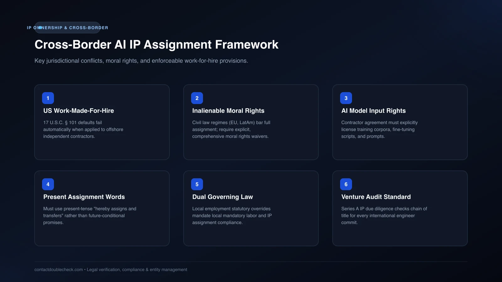
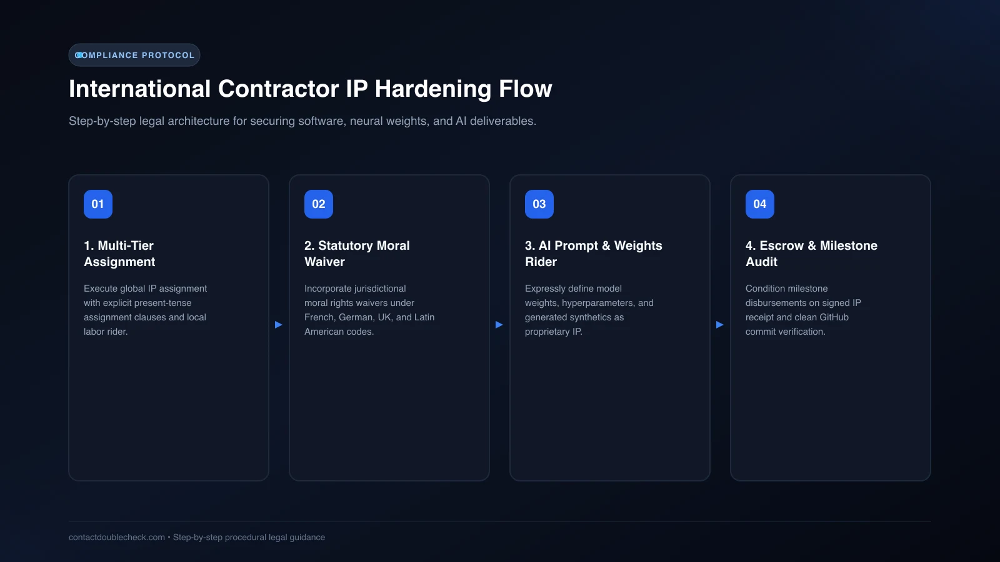

<div class="article-hero-banner mb-8">
  
</div>

## Does the US Work-Made-For-Hire Doctrine Apply to Offshore Remote Contractors?

The short answer is **no**. The United States **"work-made-for-hire" doctrine** codified under **17 U.S.C. § 101** does not automatically govern foreign developers writing code outside the territorial United States. While US founders frequently assume that standard boilerplate clauses designating contractor deliverables as "works made for hire" transfer full legal title to a Delaware corporation, foreign courts routinely disregard US statutory fictions when evaluating intellectual property created within their borders.

Under international private law and the **Berne Convention for the Protection of Literary and Artistic Works (Article 5(2))**, the initial ownership of a copyrightable work is generally determined by the law of the country where the work was originated and authored. When a software engineer in Argentina, Poland, India, or the United Kingdom writes code, fine-tunes a Large Language Model (LLM), or structures an automated pipeline, local statutory defaults grant immediate, unencumbered initial copyright ownership to that individual engineer—regardless of what an American master services agreement states.

```
Cross-Border IP Transfer Architecture

┌───────────────────────────────────────────────┬───────────────────────────────────────────────┐
│ United States Statutory Framework (17 U.S.C.)  │ Civil Law & Foreign Jurisdictions (Berne)     │
├───────────────────────────────────────────────┼───────────────────────────────────────────────┤
│ • Works made for hire vest in corporate entity│ • Initial copyright vests exclusively in auth │
│ • Common law treats IP as alienable property  │ • "Moral rights" are non-transferable/inalien │
│ • "Agrees to assign" creates breach remedies   │ • Executory promises fail without formal deed │
│ • State-specific labor covenants apply        │ • Mandatory local employment overrides control│
└───────────────────────────────────────────────┴───────────────────────────────────────────────┘
```

Without an affirmative, enforceable, present-tense assignment and a comprehensive waiver of moral rights compliant with local jurisprudence, tech startups carry severe **chain-of-title defects** that can cripple venture financings, acquisition due diligence, or cross-border enforcement actions.

---

## What Are Moral Rights and Why Do Civil Law Jurisdictions Bar Their Assignment?

In common law systems such as the United States and the United Kingdom, copyright is predominantly treated as an economic property right that can be freely bought, sold, licensed, or severed. In contrast, **civil law jurisdictions**—including the European Union (notably France and Germany) and Latin America—view copyright as an extension of the creator's human personality, separating the asset into:

1. **Economic Rights (*Droits Patrimoniaux*):** The right to commercially exploit, reproduce, distribute, and license the software or work.
2. **Moral Rights (*Droit Moral*):** The perpetual, inalienable right to claim authorship (*paternity*), to object to any distortion, mutilation, or modification of the work (*integrity*), and to withdraw the work from circulation (*divulgation*).

Under **Article L. 121-1 of the French Intellectual Property Code** and **Section 12 of the German Copyright Act (Urheberrechtsgesetz - UrhG)**, moral rights **cannot be transferred or assigned** under any circumstance. Any contractual provision purporting to "sell" or "assign" moral rights to a Delaware C-Corp is null and void *ab initio*.

```
Civil Law Copyright Division

               ┌─────────────────────────────────────────────────┐
               │         Foreign Author Intellectual Creation     │
               └────────────────────────┬────────────────────────┘
                                        │
           ┌────────────────────────────┴────────────────────────────┐
           ▼                                                         ▼
┌──────────────────────────────────────┐  ┌──────────────────────────────────────┐
│     Economic Rights (Patrimoniaux)   │  │       Moral Rights (Droit Moral)      │
├──────────────────────────────────────┤  ├──────────────────────────────────────┤
│ • Reproduce, translate, distribute   │  │ • Paternity (Credit Attribution)     │
│ • Fully transferable to US C-Corp    │  │ • Integrity (Bar unauthorized mods)  │
│ • Subject to valid present assignment│  │ • STRICTLY INALIENABLE & UNASSIGNABLE│
│ • Requires distinct consideration    │  │ • MUST BE EXPRESSLY WAIVED CONTRACTU│
└──────────────────────────────────────┘  └──────────────────────────────────────┘
```

### The Strategic Threat to AI and Software Teams

If an offshore developer retains integrity and paternity rights, they could theoretically file an injunction against the US startup for:
- Refactoring, modularizing, or rewriting their source code without consent;
- Integrating their code into an automated AI fine-tuning corpus or training set;
- Distributing proprietary models without prominently displaying their individual name in software release notes or web headers.

To neutralize this catastrophic exposure, startup master contracts must mandate a **full, irrevocable, perpetual, worldwide waiver of moral rights** to the maximum extent permitted by applicable local laws, coupled with an explicit covenant not to sue for attribution or code alteration.

---

## The Critical Distinction: Present Assignment vs. Future Executory Promises

The Federal Circuit's landmark decision in **_Stanford University v. Roche Molecular Systems, Inc._ (563 U.S. 776, 2011)** established a strict operational rule that governs tech IP transactions:

- **Defective Language (Executory Promise):** *"Contractor agrees to assign, will assign, or shall assign all right, title, and interest in and to the deliverables."*  
  This language creates only a promise to transfer rights in the future. If the contractor subsequently breaches or sells the code elsewhere, the company holds only a claim for monetary damages—not actual ownership of the underlying patent or copyright.
- **Enforceable Language (Present Conveyance):** *"Contractor hereby unconditionally and irrevocably assigns, transfers, and conveys to Company, as of the moment of creation, all right, title, and interest in and to all Intellectual Property."*  
  This present-tense phrasing immediately vests equitable and legal title in the corporation upon creation, without requiring subsequent execution documents.

When dealing with international remote contractors, this US doctrine must be supplemented with localized conveyance standards. Many foreign jurisdictions require formal **notarization**, **deeds of transfer**, or **itemized schedules of assigned works** to achieve valid legal assignment.

---

## AI Model Weights, Prompts, and Neural Artifacts: Drafting the Assignment Rider

Modern artificial intelligence engineering involves technical artifacts that traditional software contractor agreements fail to capture. Standard agreements define "Work Product" as "source code, object code, documentation, and flowcharts." However, AI workflows generate non-traditional assets that require explicit contractual definition:

```
Comprehensive AI Deliverables Definition

┌───────────────────────────────────────┬─────────────────────────────────────────────────────────┐
│ Technical Deliverable                 │ Necessary Contractual Inclusion                         │
├───────────────────────────────────────┼─────────────────────────────────────────────────────────┤
│ Model Weights & Biases                │ Expressly classified as proprietary trade secrets       │
│ Hyperparameter Configurations         │ Defined as confidential engineering architectures       │
│ Fine-Tuning Scripts & Pipelines       │ Fully assigned as source code under copyright           │
│ Prompt Engineering Chains             │ Protected as proprietary creative expressions & methods │
│ Synthetic Training Datasets           │ Explicitly licensed, cleared, and transferred in full   │
│ Evaluation & Benchmark Datasets       │ Assigned alongside test harnesses and validation splits │
└───────────────────────────────────────┴─────────────────────────────────────────────────────────┘
```

If an international contractor utilizes local open-source models (e.g., Llama, Mistral) on their local workstation to generate proprietary fine-tuned checkpoints, your master agreement must verify that the contractor:
1. Did not breach commercial or research licenses of foundational models;
2. Assigns all delta weights and adapter layers (LoRA, QLoRA) exclusively to the company;
3. Warrants that no third-party copyrighted data contaminated the synthetic training inputs.

---

## Navigating Local Labor Laws and Employer of Record (EOR) Traps

Many US startups utilize **Employer of Record (EOR)** platforms such as Deel, Remote, or Oyster to hire international talent. While EORs handle payroll, statutory benefits, and local tax compliance, founders often overlook a critical vulnerability in the IP chain of title: **The Two-Tier Assignment Gap**.

```
The Two-Tier EOR Assignment Chain

┌───────────────────────────┐         Local Employment         ┌───────────────────────────┐
│    Offshore Developer     ├─────────────────────────────────►│     Local EOR Entity      │
│  (Author & First Owner)   │         Contractual Tier 1       │ (e.g., Deel UK / Remote)  │
└───────────────────────────┘                                  └─────────────┬─────────────┘
                                                                             │
                                              Global Services Agreement      │
                                                 Contractual Tier 2          ▼
                                                               ┌───────────────────────────┐
                                                               │  Delaware Startup C-Corp  │
                                                               │  (End Beneficiary Entity) │
                                                               └───────────────────────────┘
```

Under this structure, intellectual property must successfully transition through **two distinct contractual conduits**:
1. From the individual employee to the local foreign subsidiary of the EOR;
2. From the local foreign subsidiary to the Delaware parent company.

If the employment contract between the foreign engineer and the local EOR entity contains defective assignment language, lacks a moral rights waiver, or violates local statutory invention compensation laws (such as the **German Employee Invention Act / *Arbeitnehmererfindungsgesetz***), the Delaware C-Corp inherits a severed chain of title.

---

## Series A Venture Due Diligence: The 5-Point IP Audit Checklist

During Series A financing or an enterprise acquisition, legal auditors conduct rigorous due diligence on software ownership. The presence of even one unassigned foreign commit can halt an investment round.

```
Institutional Venture Audit Matrix

┌─────┬───────────────────────────────┬───────────────────────────────────────────────────────────┐
│ No. │ Audit Focus Area              │ Institutional Due Diligence Standard                      │
├─────┼───────────────────────────────┼───────────────────────────────────────────────────────────┤
│ 01  │ Git Commit Provenance         │ Cross-reference every committer handle against signed IP  │
│ 02  │ Present-Tense Language        │ Confirm "hereby assigns" in all PIIA and contractor docs  │
│ 03  │ Moral Rights Waiver           │ Confirm perpetual, worldwide moral rights waiver clauses  │
│ 04  │ Proof of Full Consideration   │ Reconcile invoice payments with completed bank releases   │
│ 05  │ Power of Attorney Rider       │ Ensure company holds right to execute IP filings globally │
└─────┴───────────────────────────────┴───────────────────────────────────────────────────────────┘
```

---

## Statutory Authorities and Benchmark Precedents

- **United States Copyright Act (17 U.S.C. §§ 101, 201):** Statutory framework governing works made for hire and exclusive rights ownership.
- **Berne Convention for the Protection of Literary and Artistic Works (Paris Act 1971):** International treaty establishing territoriality of initial copyright vesting.
- **_Board of Trustees of the Leland Stanford Junior University v. Roche Molecular Systems, Inc._, 563 U.S. 776 (2011):** Judicial standard for present vs. executory assignment of patent and IP rights.
- **French Intellectual Property Code (Code de la propriété intellectuelle, Art. L. 121-1 to L. 121-9):** Inalienable moral rights statutes.
- **German Copyright Act (Urheberrechtsgesetz - UrhG § 12, § 29):** Prohibition against total copyright conveyance and mandatory author moral protections.

<div class="article-steps-banner my-10">
  
</div>
