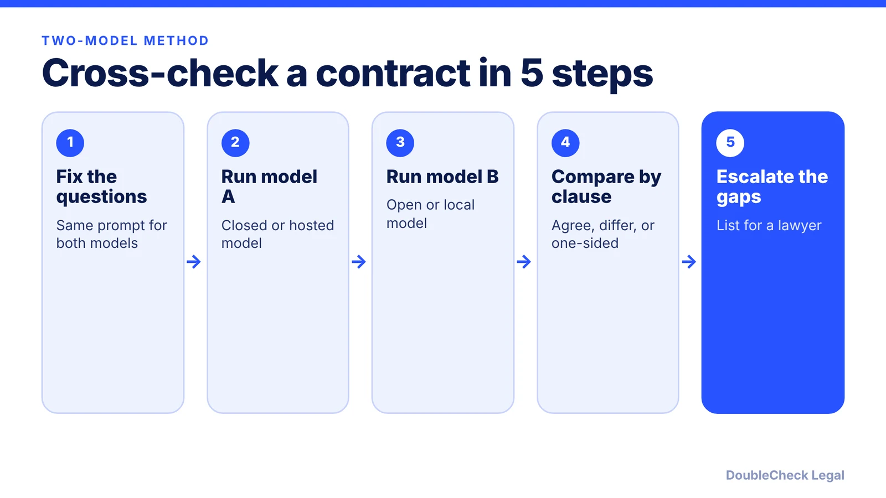
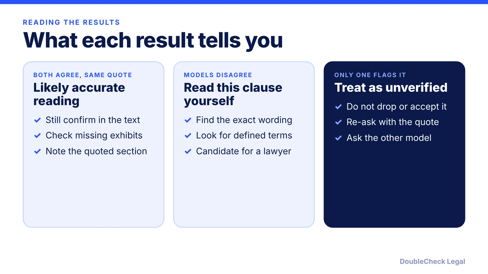

*Two models are a cheap second opinion, not a verdict. Here is a repeatable way to use them and when to bring in an attorney.*

**Key takeaways:**

- Give both models identical questions and ask each to quote the clause it relies on.
- Disagreement marks the clauses that most need a human; agreement is only a lead.
- Both models can be wrong together, so the contract text is the tiebreaker.
- Hand a lawyer the unresolved clauses, your goals and the tools you used.

## 1. The quick answer

**Quick answer:** To cross-check a contract with two AI models, give both the same contract and the same written questions, ask each for the clause text it relies on, then compare the answers side by side. Where the two agree and quote the same words, you have a lead worth confirming. Where they disagree, you have found the clauses that most need a human. Use one closed (hosted) model and one open-weight or local model if you can, because they are less likely to share the same blind spot, but treat agreement as a signal, not proof. Both can be wrong in the same way, and neither is your lawyer.

The method below takes about an hour for a typical vendor agreement and ends with a short list you can hand to an independent attorney. For background on the model types, see [open source vs closed source AI models](/blog/open-source-vs-closed-source-ai-models-which-should-you-use/) and [ChatGPT vs Claude vs Gemini for legal work](/blog/chatgpt-vs-claude-vs-gemini-legal-work/). Before pasting anything, read [what to redact before pasting a contract into AI](/blog/what-to-redact-before-pasting-a-contract-into-ai/).

## 2. The method, step by step

Keep it boring and repeatable. The goal is a comparison you can read in a table, not a debate between chatbots.

1. **Write the questions first.** For example: what do I owe and when, how can this end, what is capped or excluded, who owns what I create, what happens to my data, which clauses favor the other side. Paste the identical text into both models.
2. **Ask for quotes, not summaries.** Tell each model to quote the exact clause and section number behind every point. A claim with no quote is a claim to check yourself.
3. **Ask for uncertainty.** Request a list of anything the model could not determine from the text, such as terms that refer to a missing exhibit or to a law it cannot see.
4. **Run the second model cold.** Do not show it the first model's answer. If you do, you are testing agreement with a draft, not getting a second opinion.
5. **Compare clause by clause.** Mark each point as matching, conflicting, or raised by only one model.
6. **Read the contract yourself on the marked clauses.** The source text is the tiebreaker, not either model.

## 3. What disagreements mean, and what they do not

Disagreement is useful because it is cheap to spot. A vendor-written 2026 article from Suprmind (August 16, 2026), a company that sells a multi-model product, argues that disagreement between models should be read as a risk signal rather than noise, that high-divergence items should get human review, and that automated extractions cannot be trusted blindly. Treat that as one vendor's view, not a measured result; the article reports no error rates for contract work.

In practice, disagreements tend to fall into a few groups:

- **Different readings of the same words.** Often a defined term, a cross-reference or a carve-out. Read the definition section yourself.
- **Different assumptions about law.** One model assumes a general rule, the other another. Governing law and jurisdiction matter here; ask which state or country applies.
- **One model missed a clause.** Long documents are easy to skim. Re-run with the clause pasted alone.
- **Invented or misquoted text.** If a quote does not appear in the contract, discard the point. See [AI hallucinated citations in business use](/blog/ai-hallucinated-citations-business/).

The opposite case needs more caution. When both models agree, that is weaker evidence than it looks, because they may share training data, may share a bias toward "standard" terms, and cannot see facts that are not in the document (what was said on the sales call, what you actually plan to do). Agreement on a clause you do not understand is not the same as the clause being fine.

**Where this fits among your checks.** Cross-checking is one layer. Pair it with the three checks in [ChatGPT and Claude for legal work: 3 checks](/blog/chatgpt-claude-legal-work-3-checks/) and the steps in [how to verify an AI-generated legal document](/blog/verify-ai-generated-legal-document/).

## 4. Limits, and what to hand to a lawyer

**Limits to state plainly:**

- Two models can be wrong together. Neither knows your deal, your industry or your state unless you tell it.
- Output varies between runs. Re-asking the same question can change the answer, so save what each model said.
- A local model running on your own computer keeps the text on your machine, but may be smaller or less capable on long, complex contracts. Check the tool you use and the model license; see [running AI locally for privacy](/blog/run-ai-locally-for-privacy-ollama-lm-studio-small-business/) and [whether local AI is private enough for confidential documents](/blog/is-local-ai-private-enough-for-confidential-documents-limits/).
- Consumer chat accounts can have different data terms from business accounts. OpenAI's help page says content from consumer services may be used to train its models unless you opt out, and that it does not train on content from its business offerings (ChatGPT Team, Enterprise and API). Check the current terms of whichever tool you use. More in [uploading contracts to ChatGPT](/blog/uploading-contracts-to-chatgpt-confidentiality/).

**What to hand to a lawyer:** the contract, your two comparison lists (agree, conflict, one-sided), the clauses you could not resolve, your business goal and walk-away points, and a note of which tools you used. A short, ranked list lets an attorney spend time on judgment rather than re-reading the whole document; see [how much a lawyer charges to review a contract](/blog/how-much-does-a-lawyer-charge-to-review-a-contract/) and [the packaging checklist for AI-drafted documents](/blog/hand-off-an-ai-drafted-legal-document-to-an-attorney-package/).

**Handle it yourself vs. get an attorney.** Low-value, standard documents with reversible terms may be fine to review yourself with this method. Get an attorney to look when the contract is large, long-term, has uncapped liability, covers IP or equity, or when the two models disagree on something that matters.

## Where DoubleCheck fits

[DoubleCheck](https://www.contactdoublecheck.com) helps businesses and founders start legal work with AI, verify it, and, when professional advice is warranted, connect with an independent attorney, including for immigration questions. Attorney availability and practice areas vary. Attorneys on DoubleCheck are independent professionals; an attorney-client relationship forms only if an attorney accepts your engagement.

**Sources:** [Suprmind, Multi AI Platform Contract Clause Analysis (Aug. 16, 2026, vendor article)](https://suprmind.ai/hub/insights/multi-ai-platform-contract-clause-analysis/); [OpenAI Help, How your data is used to improve model performance](https://help.openai.com/en/articles/5722486-how-your-data-is-used-to-improve-model-performance); [NCBE Bar Examiner on ABA Formal Opinion 512 (July 29, 2024)](https://thebarexaminer.ncbex.org/article/fall-2024/generative-artificial-intelligence-tools/).

## FAQ

**Is it worth using two AI models to review a contract?**

Often yes as a cheap second look: where two models disagree, you learn which clauses to read closely. It does not make the output reliable on its own, because both can be wrong together, and a lawyer should check anything high-stakes.

**Should one of the two models be an open or local model?**

It can help, because different model families are less likely to share the same blind spots, and a local model can keep the text on your machine. Local models can be less capable on long contracts, so check quality on your own document.

**What do I do when the two models disagree?**

Read the exact clause and its definitions yourself, re-ask both models with that clause pasted alone, and put anything still unresolved on a list for an attorney.

**Does agreement between two models mean the contract is safe?**

No. Models can share training data and miss facts that are not in the document. Treat agreement as a reason to confirm, not as approval.

---

*General information only. This article is not legal, tax, investment, or accounting advice.*
