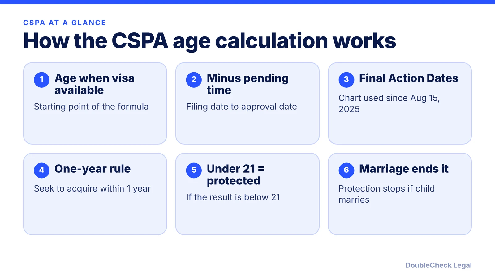
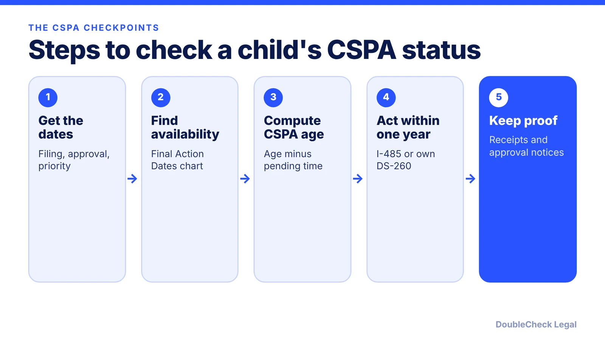

*Will your child age out of a green card case at 21? Here is how the CSPA age formula works and what changed in 2025.*

**Key takeaways:**

- CSPA age equals age when a visa becomes available minus the time the petition was pending.
- Since August 15, 2025, USCIS uses the Final Action Dates chart for CSPA, per Ogletree.
- The child must seek to acquire permanent residence within one year of visa availability.
- F2A children who age out convert to F2B and keep their priority date; F3 and F4 derivatives do not.

## 1. The quick answer

**Quick answer:** The Child Status Protection Act (CSPA) can keep a child "under 21" for green card purposes after they turn 21. Per the Policy Manual formula quoted by Lehigh Valley Immigration Lawyers: age when a visa becomes available, minus the time the petition was pending, equals CSPA age. Since August 15, 2025, USCIS measures visa availability using the Final Action Dates chart, not Dates for Filing, per Ogletree. The child must also seek to acquire permanent residence within one year.

## 2. The formula and which chart counts

Lehigh Valley Immigration Lawyers, quoting the USCIS Policy Manual, gives the formula: **age at time of visa availability minus pending time equals CSPA age.** Pending time runs from the petition filing to its approval.

The availability date matters. Per the same page, it is the later of the approval date or the first day of the month when the Final Action Dates chart shows the priority date as current. USCIS Policy Alert PA-2025-15, effective August 15, 2025, returned the calculation to Final Action Dates. Ogletree adds that:

- Requests filed on or after August 15, 2025 follow the new policy.
- Adjustment applications pending before that date keep the February 14, 2023 guidance, which allowed Dates for Filing.
- Applications filed between February 14, 2023 and August 14, 2025 are adjudicated under the 2023 policy.
- Dependents whose priority dates are current only under Dates for Filing may lose CSPA protection.

Ahluwalia Law makes the practical point that filing early does not stop the age clock; CSPA age is measured when the Final Action Date is reached. Priority dates and charts are explained in our [visa bulletin guide](/blog/visa-bulletin-explained-priority-dates-eb-categories/).

**Illustration (hypothetical numbers):** a child is 20 years 6 months old when a visa becomes available. The petition was pending 8 months. CSPA age is 19 years 10 months, so the child is protected, if they also meet the one-year rule.

## 3. The one-year rule and what counts

The child must seek to acquire permanent residence within one year of visa availability, per Lehigh Valley. Actions that qualify, per that page:

- Properly filing Form I-485.
- Submitting the child's own DS-260.
- Paying the immigrant visa fee or the I-864 review fee.
- Having an I-824 filed for the child.

A parent's DS-260 covering only the parent does not count for the child. The page calls the extraordinary-circumstances exception (Matter of O. Vazquez) narrow and advises against relying on it. Put the one-year date on a calendar the day the visa becomes available.

## 4. Which categories it covers, and what happens if a child ages out

Per Lehigh Valley:

- **Immediate relatives** (a citizen's unmarried child): age is fixed on the I-130 filing date under INA 201(f), with no formula or one-year deadline, though marriage still ends eligibility.
- **F2A** (children of permanent residents): the formula applies. If CSPA age reaches 21 or older, the petition converts automatically to F2B with the same petitioner and the child keeps the original priority date.
- **Derivatives** on F1, F2B, F3, F4 and employment-based petitions: the formula applies to each child. For F3 and F4 derivatives, the page says automatic conversion and priority-date retention do not apply, so a new petition with a new priority date may be needed.

For employment-based families, children are usually derivatives on the parent's green card case. See the [H-1B to green card timeline](/blog/h-1b-to-green-card-timeline-tech-workers/), [PERM](/blog/perm-labor-certification-green-card-process/) and the [I-485 guide](/blog/i-485-adjustment-of-status-guide/). A child who ages out of H-4 status before the green card needs their own status plan; see [H-4 EAD](/blog/h-4-ead-spouses-of-h-1b/) for the spouse side.

Because each child has their own dates, and policy has shifted twice since 2023, an age-out risk is worth reviewing with [an immigration lawyer](/blog/how-to-find-good-immigration-lawyer-startup-founder/) well before the child's 21st birthday.

## Where DoubleCheck fits

[DoubleCheck](https://www.contactdoublecheck.com) helps businesses and founders start legal work with AI, verify it, and, when professional advice is warranted, connect with an independent attorney, including for immigration questions. Attorney availability and practice areas vary. Attorneys on DoubleCheck are independent professionals; an attorney-client relationship forms only if an attorney accepts your engagement.

**Sources:** [Ogletree on the Final Action Dates policy](https://ogletree.com/insights-resources/blog-posts/uscis-to-use-final-action-dates-chart-for-calculating-child-status-protection-act-age/); [Lehigh Valley Immigration Lawyers, CSPA 2026](https://www.lehighvalleyimmigrationlawyers.com/blog/cspa-aging-out-child-status-protection-act-2026); [Ahluwalia Law, F2A and CSPA](https://www.ahluwalialaw.com/f2a-september-2026-cspa-age/). The USCIS CSPA page did not load.

## FAQ

**How is CSPA age calculated?**

Per the Policy Manual formula quoted by Lehigh Valley Immigration Lawyers: age at the time of visa availability minus the time the petition was pending equals CSPA age. A result under 21 qualifies if the one-year rule is met.

**Which Visa Bulletin chart does USCIS use for CSPA?**

Final Action Dates, for requests filed on or after August 15, 2025, per Ogletree. Adjustment applications pending before that date keep the February 14, 2023 guidance.

**What is the one-year rule?**

The child must seek to acquire permanent residence within one year of visa availability, for example by filing Form I-485 or submitting their own DS-260, per Lehigh Valley Immigration Lawyers.

**What happens if my child ages out anyway?**

It depends on the category. Per Lehigh Valley, an F2A child converts to F2B and keeps the priority date, while F3 and F4 derivatives cannot keep it and may need a new petition. An attorney can review the specific dates.

---

*General information only. This article is not legal, tax, investment, or accounting advice.*
