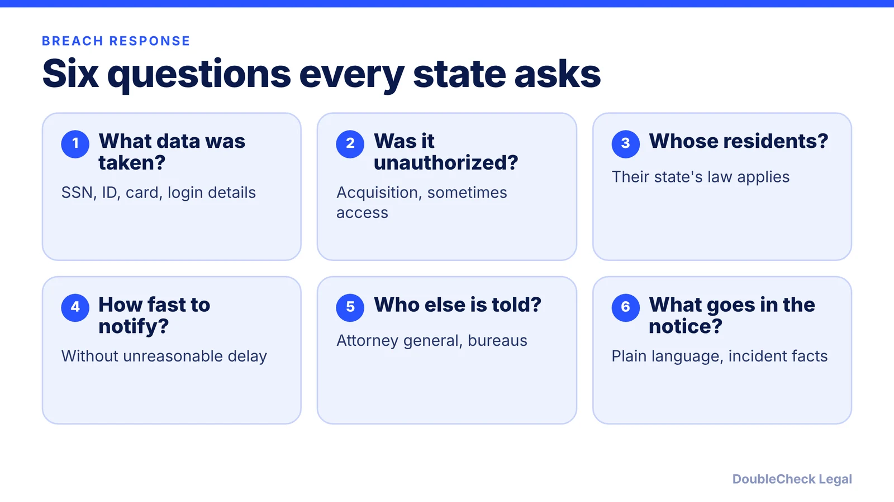
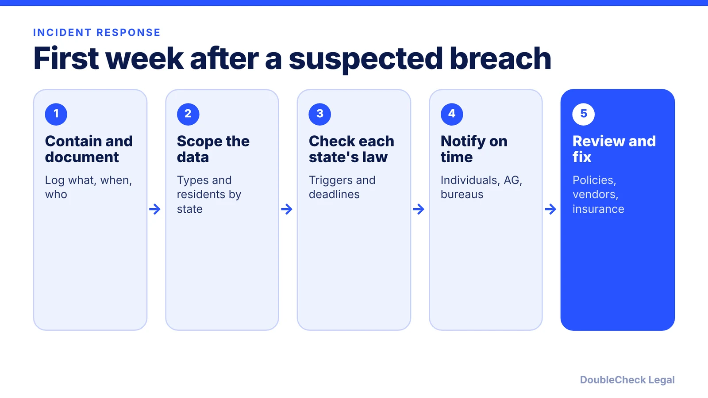

*Every state has a breach notification law, and yours depends on where your customers live. Here is the common structure and how to prepare as of November 2026.*

**Key takeaways:**

- All 50 states, D.C., and the territories have breach notification laws (NCSL, FTC); the applicable law follows the affected residents' states.
- Personal information usually means SSNs, ID numbers, or financial account data with access codes; some states add biometrics and logins.
- California requires resident notice within 30 days and AG notice within 15 days after that if more than 500 residents are affected (SB 446, signed October 3, 2025).
- Prepare now: data inventory, response plan, breach log, vendor terms.

## 1. The quick answer

**Quick answer:** Every state, D.C., Puerto Rico, and the U.S. Virgin Islands has a data breach notification law, per the FTC and NCSL. We did not find a general small-business exemption in the sources we reviewed, and the law that applies follows where the affected residents live, not where you are headquartered. Typical duties: tell affected people quickly and without unreasonable delay (some states set fixed windows), and notify a state attorney general when enough residents are affected. The FTC also advises contacting the credit bureaus if Social Security numbers were stolen. California now has a 30-day deadline.

## 2. What triggers the duty

Per the [FTC](https://www.ftc.gov/business-guidance/resources/data-breach-response-guide-business) and [NCSL](https://ncsl.org/research/telecommunications-and-information-technology/security-breach-notification-laws.aspx), every state has passed a law requiring notice of breaches involving personal information, each with its own rules. Under [California Civil Code section 1798.82](https://law.justia.com/codes/california/2022/code-civ/division-3/part-4/title-1-81/section-1798-82/) (the 2022 code text, so check for later amendments), personal information is a name plus an unencrypted Social Security number, government ID number, financial account or card number with any required access code, medical or health insurance information, or biometric identifier, and also a username or email address combined with a password or security question that allows access to an online account. Other states define it differently.

California's statute shows how the details work, and NCSL notes that state laws commonly include exemptions such as for encrypted information:

- The governing law follows each affected resident's state, so one incident can trigger several statutes.
- California treats encrypted data as outside the definition, but notice is still required if the unauthorized person also acquired the encryption key or credential and the business reasonably believes it could make the data readable.
- The FTC advises weighing state law, the type of information taken, and the likelihood of misuse when deciding how and when to notify, and coordinating timing with law enforcement.

Because the rules vary, check each applicable state's statute before acting.

## 3. Deadlines and who else to notify

The FTC says to notify affected people quickly, and some states set fixed windows, so check each applicable statute for its deadline.

**California is the best-documented example.** Per [Hunton Andrews Kurth](https://www.hunton.com/privacy-and-cybersecurity-law-blog/california-updates-data-breach-notification-timeline-requirements), Governor Newsom signed SB 446 on October 3, 2025. It requires notice to affected California residents within 30 calendar days of discovery, and notice to the Attorney General within 15 calendar days of notifying consumers when more than 500 California residents are affected. Hunton's post did not state an effective date, so confirm it on the chaptered text.

**Other notice duties** (check each state):
- AG or state agency notice thresholds vary by state. California's statute requires a sample notice to the Attorney General when more than 500 residents must be notified.
- The FTC says to contact Equifax, Experian, and TransUnion if Social Security numbers were stolen, or if a large group may be affected and you recommend fraud alerts or credit freezes.
- The FTC suggests considering at least a year of free credit monitoring or identity protection when financial data or Social Security numbers were exposed.

Federal and sector rules can apply on top. Under the [HHS Breach Notification Rule](https://www.hhs.gov/guidance/document/breach-notification-rule), HIPAA covered entities must notify affected individuals without unreasonable delay and no later than 60 days after discovering a breach.

## 4. Prepare before it happens

Penalties and enforcement vary by state. The FTC advises explaining what happened, what information was involved, what you are doing about it, and how people can reach you; some states prescribe specific notice content, so check each one.

A small-business prep list:

1. Know what personal data you hold and where (customer lists, payroll, HR files, AI tools).
2. Write a short incident response plan naming who decides and who calls counsel.
3. Keep a breach log of what happened, what data was involved, and who you notified and when.
4. Review vendor contracts for breach-notice terms, and see [business insurance types](/blog/business-insurance-types-small-business/).
5. Align public statements with your [privacy policy](/blog/privacy-policy-generator-small-business/), and see [state privacy laws](/blog/state-privacy-laws-2027-small-business-checklist/) and [CCPA/CPRA compliance](/blog/ccpa-cpra-compliance-small-business/).
6. Tighten account access; our [AI agent security checklist](/blog/ai-agent-gmail-slack-drive-security-checklist/) covers connected tools.

The first call after a real incident should be to an attorney.

**Related reading:** [Remote Work Policy Legal Checklist for Small Business: What to Cover Before You Allow It](/blog/remote-work-policy-legal-checklist-small-business/); [HIPAA for Small Business: When It Applies and the Basics](/blog/hipaa-small-business-when-it-applies-and-basics/); [Software License Agreement vs SaaS Agreement: Key Differences](/blog/software-license-agreement-vs-saas-agreement-differences/)

For biometric identification requirements, consult the [Illinois BIPA compliance guide for small business](/blog/illinois-bipa-biometric-privacy-small-business-compliance/).

## Where DoubleCheck fits

[DoubleCheck](https://www.contactdoublecheck.com) helps businesses and founders start legal work with AI, verify it, and, when professional advice is warranted, connect with an independent attorney, including for immigration questions. Attorney availability and practice areas vary. Attorneys on DoubleCheck are independent professionals; an attorney-client relationship forms only if an attorney accepts your engagement.

**Sources:** [FTC, Data Breach Response: A Guide for Business](https://www.ftc.gov/business-guidance/resources/data-breach-response-guide-business); [NCSL, Security Breach Notification Laws](https://ncsl.org/research/telecommunications-and-information-technology/security-breach-notification-laws.aspx); [California Civil Code section 1798.82 (Justia)](https://law.justia.com/codes/california/2022/code-civ/division-3/part-4/title-1-81/section-1798-82/); [HHS, Breach Notification Rule](https://www.hhs.gov/guidance/document/breach-notification-rule); [Hunton Andrews Kurth, California Updates Data Breach Notification Timeline Requirements](https://www.hunton.com/privacy-and-cybersecurity-law-blog/california-updates-data-breach-notification-timeline-requirements).

## FAQ

**Do small businesses have to follow data breach laws?**

Generally yes. The FTC and NCSL say every state, D.C., and the territories have laws requiring notice of breaches involving personal information, and California's statute applies to any business that owns or licenses computerized data including personal information of California residents. The law that applies follows where each affected person lives.

**How fast do I have to notify people after a breach?**

It depends on the state. The FTC says to notify affected people quickly, and some states set fixed windows, so check each applicable statute. California requires notice within 30 calendar days of discovery, per Hunton Andrews Kurth on SB 446.

**Do I have to tell the attorney general?**

Often, depending on state and number of residents. In California, notice to the Attorney General is due within 15 calendar days of notifying consumers when more than 500 residents are affected, per Hunton, and California Civil Code section 1798.82 requires a sample notice to the AG in that case. Check each state.

**What counts as personal information in a breach?**

Under California Civil Code section 1798.82, it includes a name plus an unencrypted Social Security number, government ID number, financial account or card number with its access code, medical or health insurance information, or biometric data, and a username or email with a password. Other states differ.

---

*General information only. This article is not legal, tax, investment, or accounting advice.*
