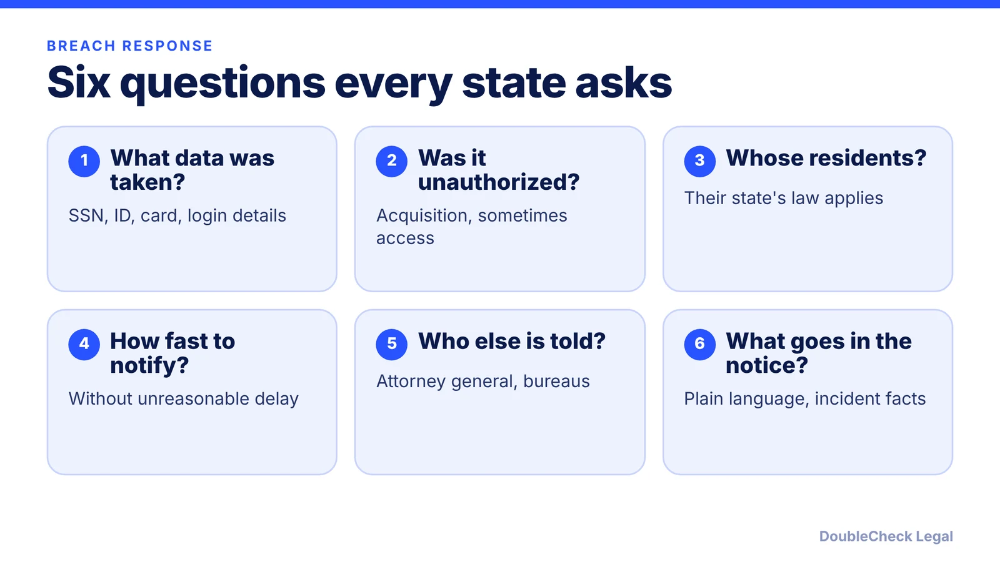
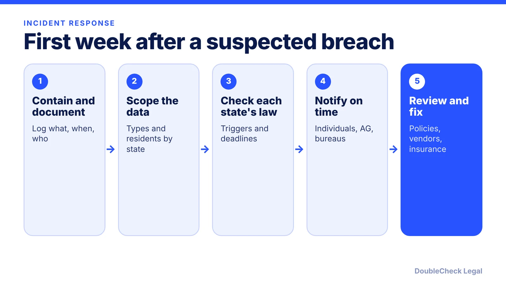

*Every state has a breach notification law, and yours depends on where your customers live. Here is the common structure and how to prepare as of November 2026.*

**Key takeaways:**

- All 50 states have breach notification laws; the applicable law follows the affected residents' states, per Beancount.
- Personal information usually means SSNs, ID numbers, or financial account data with access codes; some states add biometrics and logins.
- California requires resident notice within 30 days and AG notice within 15 days after that if more than 500 residents are affected (SB 446, signed October 3, 2025).
- Prepare now: data inventory, response plan, breach log, vendor terms.

## 1. The quick answer

**Quick answer:** All 50 states have data breach notification laws, and per Beancount's 2026 guide the territories and D.C. do too. There is no small-business exemption in the sources we reviewed, and the law that applies follows where the affected residents live, not where you are headquartered. Typical duties: tell affected people without unreasonable delay (some states set 30, 45, or 60 days), notify a state attorney general when enough residents are affected, and notify the credit bureaus for large incidents. California now has a 30-day deadline.

## 2. What triggers the duty

Per [Insureon](https://www.insureon.com/small-business-insurance/cyber-liability/data-breach-laws), all fifty states require businesses to notify individuals of a data security breach, each with its own rules; California was first, in 2002. Personal information likely includes Social Security numbers, driver's license or state ID numbers, and account or card numbers paired with a password or access code, and may also cover biometric data, usernames, email addresses, and passwords depending on the state.

[Beancount's 2026 guide](https://beancount.io/blog/2026/07/15/state-data-breach-notification-laws-2026-50-state-small-business-compliance-playbook-guide) adds:

- Company size does not exempt you, and the governing law follows each affected resident's state.
- Most states define a breach as unauthorized acquisition; a few require unauthorized access plus acquisition.
- The clock generally starts on discovery or notification of the breach, not when the intrusion began.
- Encrypted data is typically exempt only if the key was not also acquired.
- About half the states have a risk-of-harm exemption, which must be documented.

Because the rules vary, the guide says to check each applicable state's statute before acting.

## 3. Deadlines and who else to notify

Insureon says every state requires notice without unreasonable delay, and some set a fixed window, typically 30 to 60 days after discovery. Beancount describes a 30, 45, and 60-day tiering across states.

**California is the best-documented example.** Per [Hunton Andrews Kurth](https://www.hunton.com/privacy-and-cybersecurity-law-blog/california-updates-data-breach-notification-timeline-requirements), Governor Newsom signed SB 446 on October 3, 2025. It requires notice to affected California residents within 30 calendar days of discovery, and notice to the Attorney General within 15 calendar days of notifying consumers when more than 500 California residents are affected. Hunton's post did not state an effective date, so confirm it on the chaptered text.

**Other notice duties** (per Beancount, check each state):
- AG or state agency notice thresholds around 500 residents in California, Indiana, and others, and around 1,000 in New York and North Carolina.
- At 1,000 or more residents, notify Equifax, Experian, and TransUnion of the timing and scope, without personal data.
- Some states require credit monitoring offers (Insureon).

Federal and sector rules can apply on top. Insureon notes that HIPAA covered entities must notify affected individuals within 60 days of discovery, and New York's SHIELD Act requires safeguards such as designating employees to coordinate a security program.

## 4. Prepare before it happens

Penalties vary: Insureon says noncompliance could result in civil penalties and expensive lawsuits. Notices should be in plain language, and some states require the title "Notice of a Data Breach," plus details such as a description of the incident and data types involved.

A small-business prep list:

1. Know what personal data you hold and where (customer lists, payroll, HR files, AI tools).
2. Write a short incident response plan naming who decides and who calls counsel.
3. Keep a breach log. Beancount says retention is typically 3 years, drifting toward 5.
4. Review vendor contracts for breach-notice terms, and see [business insurance types](/blog/business-insurance-types-small-business/).
5. Align public statements with your [privacy policy](/blog/privacy-policy-generator-small-business/), and see [state privacy laws](/blog/state-privacy-laws-2027-small-business-checklist/) and [CCPA/CPRA compliance](/blog/ccpa-cpra-compliance-small-business/).
6. Tighten account access; our [AI agent security checklist](/blog/ai-agent-gmail-slack-drive-security-checklist/) covers connected tools.

The first call after a real incident should be to an attorney.

## Where DoubleCheck fits

[DoubleCheck](https://www.contactdoublecheck.com) helps businesses and founders start legal work with AI, verify it, and, when professional advice is warranted, connect with an independent attorney, including for immigration questions. Attorney availability and practice areas vary. Attorneys on DoubleCheck are independent professionals; an attorney-client relationship forms only if an attorney accepts your engagement.

**Sources:** [Insureon, Data Breach Laws](https://www.insureon.com/small-business-insurance/cyber-liability/data-breach-laws); [Beancount, State Data Breach Notification Laws 2026](https://beancount.io/blog/2026/07/15/state-data-breach-notification-laws-2026-50-state-small-business-compliance-playbook-guide); [Hunton Andrews Kurth, California Updates Data Breach Notification Timeline Requirements](https://www.hunton.com/privacy-and-cybersecurity-law-blog/california-updates-data-breach-notification-timeline-requirements).

## FAQ

**Do small businesses have to follow data breach laws?**

Yes in the sources reviewed. Insureon says all fifty states require businesses to notify individuals of a breach, and Beancount says company size does not exempt you. The law that applies follows where each affected person lives.

**How fast do I have to notify people after a breach?**

It depends on the state. Insureon says every state requires notice without unreasonable delay and some set windows, typically 30 to 60 days. California requires notice within 30 calendar days of discovery, per Hunton Andrews Kurth on SB 446.

**Do I have to tell the attorney general?**

Often, depending on state and number of residents. In California, notice to the Attorney General is due within 15 calendar days of notifying consumers when more than 500 residents are affected, per Hunton. Beancount lists other thresholds; check each state.

**What counts as personal information in a breach?**

Per Insureon, it likely includes Social Security numbers, driver's license or state ID numbers, and account or card numbers with a password or access code, and some states add biometric data, usernames, emails, and passwords.

---

*General information only. This article is not legal, tax, investment, or accounting advice.*
