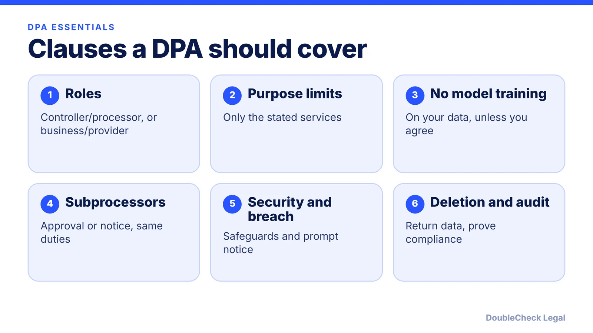
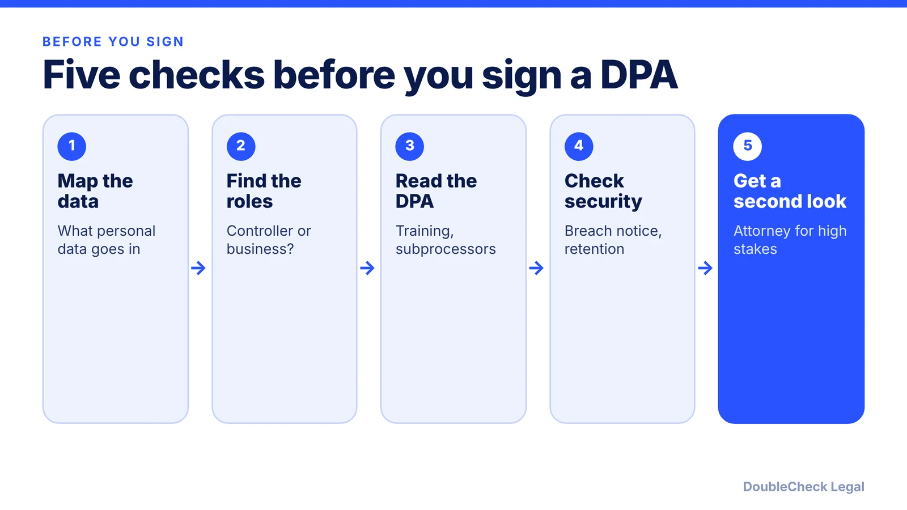

*A DPA limits what an AI vendor can do with customer and employee data. Here are the clauses to check before you sign.*

**Key takeaways:**

- A DPA is a contract limiting how a vendor handles personal data on your behalf; GDPR Art. 28 requires one with processors.
- California's CCPA regulations (11 CCR 7051) require specific service-provider terms, including no sale or sharing and named purposes.
- For AI tools, look for a bar on training with your data, a subprocessor list, breach notice, and deletion or return.
- Standard vendor DPAs are common; read them, and bring in an attorney for sensitive data or unclear transfers.

## 1. The quick answer

**Quick answer:** A data processing agreement (DPA) is a contract in which a vendor agrees to handle personal data only for you, only for stated purposes, and with specific protections. Under GDPR Article 28, processing by a processor "shall be governed by a contract," so if you use an AI vendor to process personal data of people in the EU, you need one. California's CCPA regulations (11 CCR 7051) require similar written terms when a business discloses personal information to a service provider. A small business needs a DPA whenever an AI tool will see customer, employee, or applicant data. A tool used only on your own non-personal content usually does not raise the issue.

## 2. What a DPA is and when you need one

Under GDPR terms, the business deciding why and how data is used is the **controller**; the vendor acting on its behalf is the **processor**. CCPA uses **business** and **service provider**. Per [GDPR Article 28](https://gdpr-info.eu/art-28-gdpr/), a controller should use only processors providing "sufficient guarantees," and the processing must be governed by a contract.

You will likely need a DPA when:

- You paste or upload **customer, client, employee, or applicant data** into an AI tool (support transcripts, resumes, HR files, CRM exports).
- An AI feature inside software you already use (a CRM, helpdesk, or meeting recorder) processes that data.
- You have EU/UK customers or staff (GDPR), or California consumers or employees (CCPA); see [GDPR for US startups](/blog/gdpr-for-us-startups/) and [CCPA/CPRA compliance for small businesses](/blog/ccpa-cpra-compliance-small-business/).

Two limits. Per [GDPRLocal](https://gdprlocal.com/?p=135441), sharing between two independent controllers falls outside Article 28. And per Article 28(10), a processor that determines the purposes and means of processing itself is treated as a controller for that processing, which is why purpose limits matter.

Many vendors publish a standard DPA you can accept or sign online. Read it rather than assuming it fits.

## 3. Key clauses to look for

**GDPR Article 28(3).** Per the [text of Article 28](https://gdpr-info.eu/art-28-gdpr/) and [GDPRLocal's summary](https://gdprlocal.com/?p=135441), the contract must include at least:

- Subject matter, duration, nature and purpose, types of data, and categories of data subjects.
- Processing **only on documented instructions** from the controller (including for transfers).
- **Confidentiality** commitments for people who handle the data.
- **Security** measures required by Article 32.
- Conditions for **sub-processors**: no other processor without prior specific or general written authorisation of the controller (Art. 28(2)).
- **Assistance** with data subject requests and with Articles 32 to 36 obligations.
- **Deletion or return** of all personal data at the controller's choice when the service ends.
- Information to show compliance, and allowing and contributing to **audits**.

**Breach notice.** Per [Article 33(2)](https://www.legislation.gov.uk/eur/2016/679/article/33/data.html), a processor must notify the controller "without undue delay" after becoming aware of a breach. The controller's own notice to the regulator is due within 72 hours where feasible (Art. 33(1)). Because your clock can start once you are aware, ask for a specific notice window in the contract, such as a set number of hours.

**CCPA service provider terms.** Per 11 CCR 7051(a), as shown by [Prighter](https://prighter.com/resources/laws/ccpa-regulations/sections/7051), the contract must:

- Bar the provider from **selling or sharing** the personal information.
- Name **specific business purposes** (broad references to the whole contract are not enough).
- Bar use or disclosure outside those purposes and outside the direct business relationship, including combining it with data from other sources unless expressly permitted.
- Require compliance and the same level of privacy protection, plus **reasonable security**.
- Give you the right to verify compliant use, such as audits or assessments, **at least every 12 months**.
- Require notice if the provider can no longer meet its obligations, and let you stop and remediate unauthorized use.

**AI-specific points.** Per [Knowlee](https://www.knowlee.ai/glossary/data-processing-agreement), a vendor's own explainer, many AI vendors' standard terms permit model improvement from customer data by default, so look for an explicit bar on training with your data and a **subprocessor list** (for example, a model provider behind the product). Also check how long prompts and outputs are retained.

## 4. Cross-border transfers, and when to get an attorney

If personal data leaves the EEA, the DPA should include or reference a transfer mechanism. Per Knowlee, options include Standard Contractual Clauses, Binding Corporate Rules, or transfer to an adequacy country. Which one fits your vendor and your data flows is a question for the vendor's documentation and, if stakes are high, a privacy attorney.

**Handle it yourself** when the data is low-sensitivity, the vendor offers a standard DPA, and you can confirm the clauses above in the document. **Get an attorney to look** when you handle sensitive data (health, children, employee records at scale), the vendor will not move on training or retention, you have EU customers and the transfer mechanism is unclear, or the vendor's terms conflict with commitments you made to your own customers.

Pair this with the [AI vendor contract checklist](/blog/ai-vendor-contract-checklist/), the [state privacy laws checklist](/blog/state-privacy-laws-2027-small-business-checklist/), and the guide on [uploading contracts to ChatGPT and confidentiality](/blog/uploading-contracts-to-chatgpt-confidentiality/). For a broader approach, see [using AI for legal work safely](/blog/small-business-ai-legal-work-safely/).

## Where DoubleCheck fits

[DoubleCheck](https://www.contactdoublecheck.com) helps businesses and founders start legal work with AI, verify it, and, when professional advice is warranted, connect with an independent attorney, including for immigration questions. Attorney availability and practice areas vary. Attorneys on DoubleCheck are independent professionals; an attorney-client relationship forms only if an attorney accepts your engagement.

**Sources:** [GDPR Article 28 (gdpr-info.eu)](https://gdpr-info.eu/art-28-gdpr/); [GDPR Article 33 (legislation.gov.uk)](https://www.legislation.gov.uk/eur/2016/679/article/33/data.html); [GDPRLocal, DPA contents](https://gdprlocal.com/?p=135441); [Prighter, 11 CCR 7051](https://prighter.com/resources/laws/ccpa-regulations/sections/7051); [Knowlee, DPAs for AI vendors](https://www.knowlee.ai/glossary/data-processing-agreement). The CCPA regulation text was read on a secondary site; confirm against the California Privacy Protection Agency's current regulations.

## FAQ

**Do I need a DPA to use ChatGPT or another AI tool at work?**

It depends on the data. If personal data of EU individuals goes in, GDPR Article 28 requires a contract with the processor, per the text of the Article. For California personal information, 11 CCR 7051 requires specified service-provider terms. If no personal data goes in, the DPA question usually does not arise.

**What is the difference between a controller and a processor?**

Per GDPR terms, the controller decides why and how personal data is processed; the processor processes it on the controller's behalf. Under Article 28(10), a processor that decides purposes and means itself is treated as a controller for that processing.

**Does a DPA stop an AI vendor from training on my data?**

Only if it says so. Per Knowlee, many AI vendors' standard terms permit model improvement from customer data by default, so look for an explicit prohibition on training unless you separately authorize it.

**How fast must a vendor tell me about a breach?**

Per GDPR Article 33(2), a processor must notify the controller without undue delay after becoming aware of a breach. The law gives no fixed hours for that step, so negotiate a specific window in the contract.

---

*General information only. This article is not legal, tax, investment, or accounting advice.*
