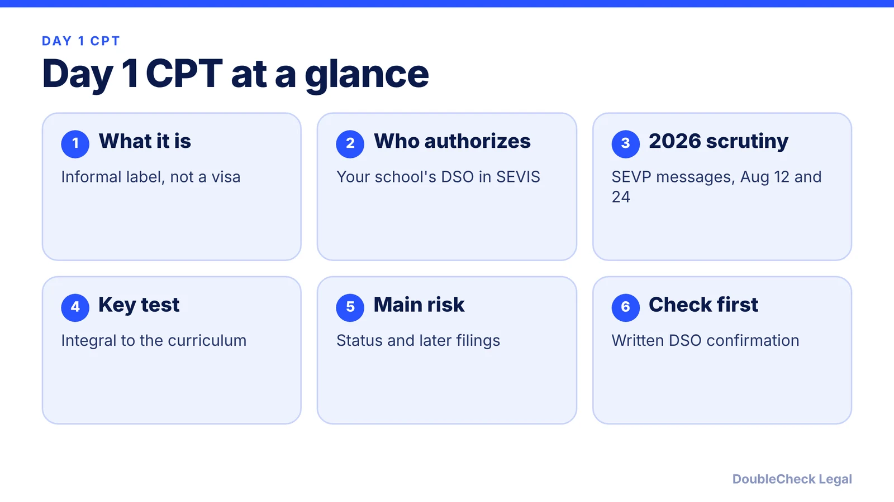
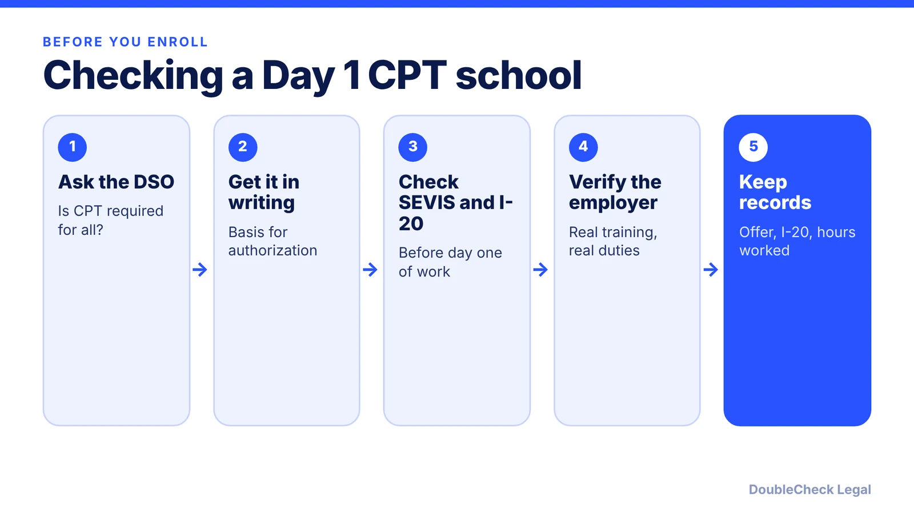

*What Day 1 CPT is, the 2026 scrutiny, and the risks to status and later filings, as of November 2026.*

**Key takeaways:**

- Day 1 CPT is an informal label; it uses the same CPT regulation as regular CPT.
- SEVP messages of August 12 and 24, 2026 narrowed the test to training integral to the curriculum, per ICEF.
- A lawsuit filed October 5, 2026 is pending; check NAFSA for any ruling.
- Ask your DSO for written confirmation before you enroll or start work.

## 1. The quick answer

**Quick answer:** "Day 1 CPT" is an informal label for schools that let F-1 students start off-campus Curricular Practical Training (CPT) at the beginning of a program, not after a year. As of November 2026, it is under heavy scrutiny. Per ICEF Monitor, ICE's Student and Exchange Visitor Program (SEVP) sent two broadcast messages on August 12 and 24, 2026 telling schools to authorize CPT only when it is an integral part of an established curriculum, and warning of possible loss of SEVP certification. Per NAFSA, the legal challenge is pending. If you are weighing a Day 1 CPT school, the risk is both to your status and to later filings.

## 2. What Day 1 CPT is and how it differs from regular CPT

CPT lets an F-1 student work in a field related to the degree while enrolled, authorized by the school's DSO in SEVIS and shown on the I-20. Per a student-advice article on Penn State's Smeal career site, Day 1 CPT lets eligible students start off-campus work at the start of their program instead of waiting a year; the term is informal, usually applies to select graduate programs, and part-time CPT is up to 20 hours a week and full-time up to 40. The same source says the placement must be related to the field and an integral part of the program.

**Regular CPT versus Day 1 CPT:**

- *Regular CPT:* typically after a first academic year, tied to a course, internship, or required practicum.
- *Day 1 CPT:* offered at the start of the program, only where the school treats the practical training as a core part of that degree.

Both use the same regulation. There is no separate "Day 1 CPT" visa or form. Per VisaServe, no regulation bans Day 1 CPT; the question is whether the training is genuinely necessary to the academic program. For how CPT compares with OPT, see [CPT vs OPT for F-1 students](/blog/cpt-vs-opt-f1-students/).

**Why some schools offer it.** The Smeal article says it helps students in one-year master's programs, who could otherwise not work off campus at all. ICEF Monitor describes the critique differently: a small group of schools for which CPT placements are central to the business model, and the warnings may be aimed at them. Both views are single-source and descriptive; they are not findings about any specific school.

## 3. The 2025-2026 scrutiny: what has happened so far

**What the guidance says.** Per [ICEF Monitor](https://monitor.icef.com/2026/09/us-government-warns-universities-to-limit-their-authorisation-of-curricular-practical-training-work-placements/), SEVP's two messages (August 12 and 24, 2026) say CPT should be authorized only when essential to degree completion, and that optional elective CPT does not meet the requirement. Per [VisaServe](https://visaserve.com/?p=11616), the messages cover DSO liability, SEVP can look past paperwork, and it set up an email channel for reporting suspected practical training fraud. Schools that abuse CPT may face SEVP and Homeland Security Investigations action, up to withdrawal of SEVP certification, per ICEF.

**Government position.** ICEF reports DHS says the CPT regulations themselves have not changed.

**School responses.** Per the [Daily Bruin](https://dailybruin.com/2026/08/25/ucla-pauses-some-international-students-work-authorizations-after-ice-memo.), UCLA paused some students' work authorizations after the August 12 memo. Per Amber Student's news summary, the University of Colorado Boulder now processes CPT only for students whose degree or major requires practical training, and Carnegie Mellon called the memos "extra-regulatory."

**Litigation.** Per [NAFSA](https://www.nafsa.org/legal-defense-CPT) (last updated October 8, 2026): NAFSA, the Association of American Universities, the Presidents' Alliance, and the Association of Independent Colleges and Universities in Massachusetts filed suit on October 5, 2026 in the District of Massachusetts, seeking a preliminary injunction. A hearing was set for November 6, 2026. This post has no ruling to report; check NAFSA for the current status. Separately, Global Immigration Blog says the September 14, 2026 injunction against DHS's fixed-period admission rule does not affect the CPT guidance.

I could not verify enforcement actions against specific Day 1 CPT schools or employers from a primary source, so none are named here.

## 4. Risks to status, H-1B and green card filings, and what to do

**Risks, as reported by the sources above:**

- **Authorization may be paused or withdrawn.** UCLA paused some authorizations, and ICEF says some institutions have paused or halted elective CPT and some students lost placements. VisaServe says students should not start CPT work until authorization shows in SEVIS and on an updated I-20.
- **School risk becomes student risk.** Withdrawal of a school's SEVP certification would bar it from enrolling international students, per ICEF.
- **OPT.** Per the Smeal article, full-time CPT of a year or more can end OPT eligibility, so it suggests keeping full-time CPT under 12 months total. Confirm with your DSO.
- **Later H-1B filings.** NAFSA reported Requests for Evidence in two F-1 to H-1B change-of-status cases where USCIS appeared to count CPT and OPT together. That is a small, reported sample. Global Immigration Blog advises not assuming Day 1 CPT will be available as a bridge after OPT or a lost H-1B lottery. See [H-1B lottery lost: alternatives](/blog/h-1b-lottery-lost-alternatives-international-students/) and [cap-gap](/blog/f-1-cap-gap-change-of-status-to-h-1b/).
- **Green card.** A clean status history matters in later filings such as [adjustment of status](/blog/i-485-adjustment-of-status-guide/); ask an attorney how a past CPT problem would be viewed.

## 5. When to ask your school and when to talk to an attorney

**Start with your DSO.** They authorize CPT and can tell you the school's current policy. Ask whether the practical training is required for every student in your program, since that is the standard SEVP's messages describe per Global Immigration Blog.

**Talk to an immigration attorney if:**

- your CPT was paused or your I-20 changed;
- you have worked, or plan to work, before authorization appears in SEVIS;
- you are planning an H-1B or green card filing after CPT and OPT;
- someone promises a guaranteed job or status for a fee. The Smeal article warns that some unaccredited schools market "illegal Day 1 CPT," so apply only to accredited institutions.

Related: [SEVIS and the I-20](/blog/sevis-i-20-explained-maintaining-f-1-status/), [OPT unemployment limits](/blog/opt-unemployment-limit-90-days-stem-opt/), [F-1 visa interview questions](/blog/f-1-visa-interview-questions-international-students-214b/), and [finding an immigration lawyer](/blog/how-to-find-good-immigration-lawyer-startup-founder/).

## Where DoubleCheck fits

[DoubleCheck](https://www.contactdoublecheck.com) helps businesses and founders start legal work with AI, verify it, and, when professional advice is warranted, connect with an independent attorney, including for immigration questions. Attorney availability and practice areas vary. Attorneys on DoubleCheck are independent professionals; an attorney-client relationship forms only if an attorney accepts your engagement.

**Sources:** [ICEF Monitor, Sept 2026](https://monitor.icef.com/2026/09/us-government-warns-universities-to-limit-their-authorisation-of-curricular-practical-training-work-placements/); [ICEF Monitor, Oct 2026](https://monitor.icef.com/2026/10/us-climate-of-uncertainty-continues-for-international-students-amid-legal-action-on-internships-and-a-proposed-70000-opt-fee/); [NAFSA CPT legal page](https://www.nafsa.org/legal-defense-CPT); [VisaServe](https://visaserve.com/?p=11616); [Daily Bruin](https://dailybruin.com/2026/08/25/ucla-pauses-some-international-students-work-authorizations-after-ice-memo.); [Amber Student](https://amberstudent.com/news/post/us-tells-universities-to-curb-curricular-practical-training); [Global Immigration Blog](https://www.globalimmigrationblog.com/2026/09/federal-court-blocks-dhs-f-1-j-1-fixed-period-admission-rule-curricular-practical-training-restrictions-remain/); [Penn State Smeal career site](https://careerconnections.smeal.psu.edu/blog/2025/09/18/what-is-day-1-cpt/).

## FAQ

**Is Day 1 CPT illegal?**

Not as a label. VisaServe says no regulation bans Day 1 CPT, but the training must be genuinely necessary to the academic program. Per ICEF, ICE has warned schools about CPT that is not integral to the curriculum.

**What did ICE say about CPT in August 2026?**

Per ICEF Monitor, SEVP sent broadcast messages on August 12 and 24, 2026 saying CPT should be authorized only when essential to degree completion, and that optional elective CPT does not qualify.

**Is there a court ruling on the CPT guidance?**

Per NAFSA's page updated October 8, 2026, a suit was filed October 5 and a preliminary injunction hearing was set for November 6. Check NAFSA for the current status.

**Can full-time CPT affect OPT?**

Per a Penn State Smeal career-site article, working full-time under CPT for a year or more can eliminate OPT eligibility. Confirm with your DSO and an attorney.

---

*General information only. This article is not legal, tax, investment, or accounting advice.*
