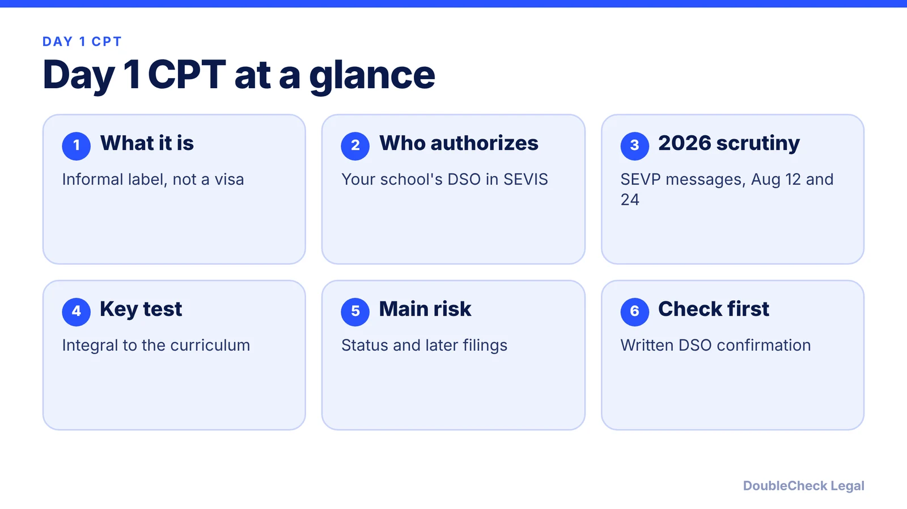
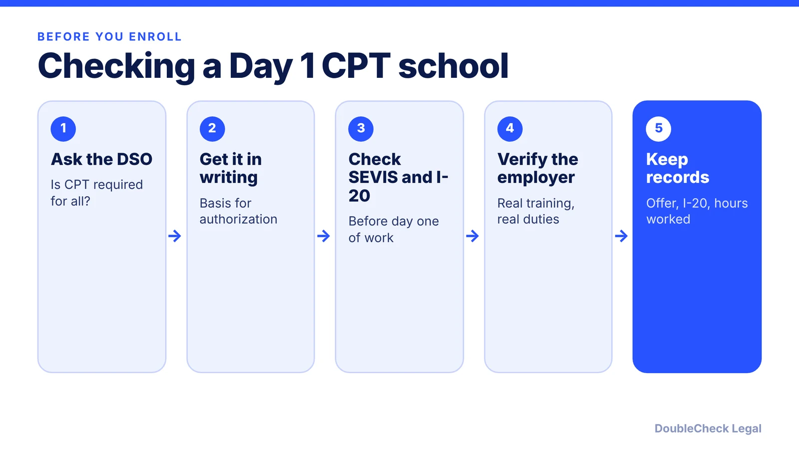

*What Day 1 CPT is, the 2026 scrutiny, and the risks to status and later filings, as of November 2026.*

**Key takeaways:**

- Day 1 CPT is an informal label; it uses the same CPT regulation as regular CPT.
- SEVP messages of August 12 and 24, 2026 narrowed the test to training mandatory for all students in the program, per NAFSA.
- A lawsuit filed October 5, 2026 led to a November 17, 2026 court order blocking enforcement of the new CPT requirements, per NAFSA; check NAFSA for updates.
- Ask your DSO for written confirmation before you enroll or start work.

## 1. The quick answer

**Quick answer:** "Day 1 CPT" is an informal label for schools that let F-1 students start off-campus Curricular Practical Training (CPT) at the beginning of a program, not after a year. As of November 2026, it is under heavy scrutiny. Per NAFSA, ICE's Student and Exchange Visitor Program (SEVP) sent two broadcast messages on August 12 and 24, 2026 that changed how CPT is administered, limiting it to practical experience that is mandatory for all students in a program, and threatening school officials with institutional penalties. Per NAFSA, a court granted a preliminary injunction and stay on November 17, 2026, blocking enforcement of the new requirements. If you are weighing a Day 1 CPT school, the risk is both to your status and to later filings.

## 2. What Day 1 CPT is and how it differs from regular CPT

CPT lets an F-1 student work in a field related to the degree while enrolled, authorized by the school's DSO in SEVIS and shown on the I-20. Per a student-advice article on Penn State's Smeal career site, Day 1 CPT lets eligible students start off-campus work at the start of their program instead of waiting a year; the term is informal, usually applies to select graduate programs, and part-time CPT is up to 20 hours a week and full-time up to 40. The same source says the placement must be related to the field and an integral part of the program.

**Regular CPT versus Day 1 CPT:**

- *Regular CPT:* typically after a first academic year, tied to a course, internship, or required practicum.
- *Day 1 CPT:* offered at the start of the program, only where the school treats the practical training as a core part of that degree.

Both use the same regulation. There is no separate "Day 1 CPT" visa or form. The question is whether the training is genuinely part of the academic program. For how CPT compares with OPT, see [CPT vs OPT for F-1 students](/blog/cpt-vs-opt-f1-students/).

**Why some schools offer it.** The Smeal article says it helps students in one-year master's programs, who could otherwise not work off campus at all. Critics point to schools that may use CPT mainly as a work pathway, but those are not findings about any specific school.

## 3. The 2025-2026 scrutiny: what has happened so far

**What the guidance says.** Per [NAFSA](https://www.nafsa.org/legal-defense-CPT), SEVP's two messages (August 12 and 24, 2026) made drastic changes to CPT, treating it as available only when the practical experience is mandatory for all students in the program, so an elective internship or practicum for course credit would be unavailable. NAFSA says the messages threatened Designated School Officials with severe institutional penalties and potential personal liability, and departed from the government's longstanding CPT interpretation.

**Government position.** Check the Department of Homeland Security and ICE for their current statements on CPT; this post does not rely on a primary government statement.

**School responses.** Per the [Daily Bruin](https://dailybruin.com/2026/08/25/ucla-pauses-some-international-students-work-authorizations-after-ice-memo.), UCLA paused some students' work authorizations after the August 12 memo. Other schools may have changed their CPT policies too, so ask your DSO.

**Litigation.** Per [NAFSA](https://www.nafsa.org/legal-defense-CPT): NAFSA, the Association of American Universities, the Presidents' Alliance on Higher Education and Immigration, and the Association of Independent Colleges and Universities in Massachusetts filed a complaint and a preliminary injunction motion on October 5, 2026 in the District of Massachusetts. The court heard arguments on November 6, and on November 17, 2026 it granted the preliminary injunction and stay, blocking enforcement of the new CPT requirements. Check NAFSA for the current status, since the government may seek further review.

I could not verify enforcement actions against specific Day 1 CPT schools or employers from a primary source, so none are named here.

## 4. Risks to status, H-1B and green card filings, and what to do

**Risks, as reported by the sources above:**

- **Authorization may be paused or withdrawn.** UCLA paused some authorizations. Students should not start CPT work until authorization shows in SEVIS and on an updated I-20; confirm with your DSO.
- **School risk becomes student risk.** If a school loses its SEVP certification it cannot enroll international students, so ask your DSO about the school's standing.
- **OPT.** Per the Smeal article, full-time CPT of a year or more can end OPT eligibility, so it suggests keeping full-time CPT under 12 months total. Confirm with your DSO.
- **Later H-1B filings.** Some F-1 to H-1B change-of-status cases may draw questions about how CPT and OPT are counted together; ask an attorney. Do not assume Day 1 CPT will be available as a bridge after OPT or a lost H-1B lottery. See [H-1B lottery lost: alternatives](/blog/h-1b-lottery-lost-alternatives-international-students/) and [cap-gap](/blog/f-1-cap-gap-change-of-status-to-h-1b/).
- **Green card.** A clean status history matters in later filings such as [adjustment of status](/blog/i-485-adjustment-of-status-guide/); ask an attorney how a past CPT problem would be viewed.

## 5. When to ask your school and when to talk to an attorney

**Start with your DSO.** They authorize CPT and can tell you the school's current policy. Ask whether the practical training is required for every student in your program, since that is the standard NAFSA says SEVP's messages describe.

**Talk to an immigration attorney if:**

- your CPT was paused or your I-20 changed;
- you have worked, or plan to work, before authorization appears in SEVIS;
- you are planning an H-1B or green card filing after CPT and OPT;
- someone promises a guaranteed job or status for a fee. The Smeal article warns that some unaccredited schools market "illegal Day 1 CPT," so apply only to accredited institutions.

Related: [SEVIS and the I-20](/blog/sevis-i-20-explained-maintaining-f-1-status/), [OPT unemployment limits](/blog/opt-unemployment-limit-90-days-stem-opt/), [F-1 visa interview questions](/blog/f-1-visa-interview-questions-international-students-214b/), and [finding an immigration lawyer](/blog/how-to-find-good-immigration-lawyer-startup-founder/).

## Where DoubleCheck fits

[DoubleCheck](https://www.contactdoublecheck.com) helps businesses and founders start legal work with AI, verify it, and, when professional advice is warranted, connect with an independent attorney, including for immigration questions. Attorney availability and practice areas vary. Attorneys on DoubleCheck are independent professionals; an attorney-client relationship forms only if an attorney accepts your engagement.

**Sources:** [NAFSA CPT legal page](https://www.nafsa.org/legal-defense-CPT); [Daily Bruin](https://dailybruin.com/2026/08/25/ucla-pauses-some-international-students-work-authorizations-after-ice-memo.); [Penn State Smeal career site](https://careerconnections.smeal.psu.edu/blog/2025/09/18/what-is-day-1-cpt/).

## FAQ

**Is Day 1 CPT illegal?**

Not as a label. The question is whether the training is genuinely part of the academic program. Per NAFSA, ICE messages in August 2026 said CPT is available only when the practical experience is mandatory for all students in the program.

**What did ICE say about CPT in August 2026?**

Per NAFSA, SEVP sent broadcast messages on August 12 and 24, 2026 that changed how CPT is administered, treating CPT as available only when the practical experience is mandatory for all students in the program. An elective internship or practicum for course credit would not qualify under that reading.

**Is there a court ruling on the CPT guidance?**

Per NAFSA's page updated October 8, 2026, a suit was filed October 5 and a preliminary injunction hearing was set for November 6. Check NAFSA for the current status.

**Can full-time CPT affect OPT?**

Per a Penn State Smeal career-site article, working full-time under CPT for a year or more can eliminate OPT eligibility. Confirm with your DSO and an attorney.

---

*General information only. This article is not legal, tax, investment, or accounting advice.*
