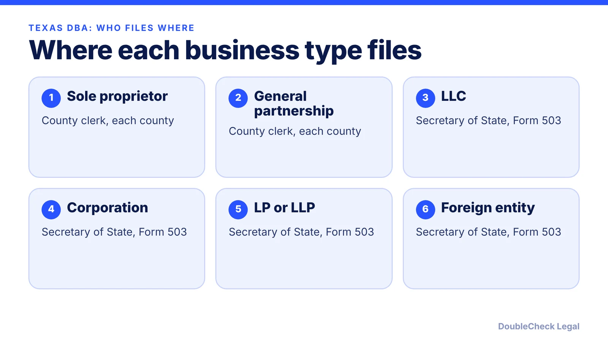
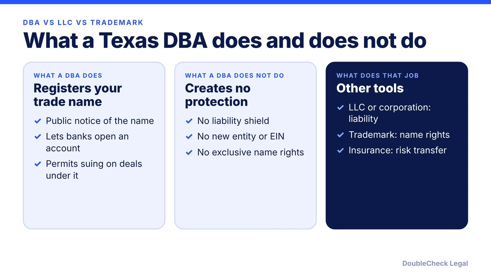

*Where each Texas business type files an assumed name, what it costs, how long it lasts, and what it does not protect.*

**Key takeaways:**

- Sole proprietors and general partnerships file with the county clerk; LLCs, corporations and other entities file Form 503 with the Texas Secretary of State.
- The Secretary of State lists a $25 fee and a term of up to ten years; county fees vary.
- Renewal means filing a new certificate; the state sends no reminders per LegalZoom.
- A DBA is only a name: no liability protection, no new entity, no exclusive name rights.

## 1. The quick answer

**Quick answer:** A DBA in Texas is called an assumed name. Sole proprietors and general partnerships file with the county clerk in each county where they do business; LLCs, corporations, limited partnerships, LLPs and foreign entities file Form 503 with the Texas Secretary of State, which lists a $25 fee and a term of up to ten years (Texas SOS instructions, checked November 2026). A DBA only registers a name. It does not create a company or protect your personal assets.

This is the complete Texas DBA guide for sole proprietors, LLCs and corporations. It is broader than the existing posts on [the Texas assumed name for sole proprietors](/blog/texas-assumed-name-dba-sole-proprietor/) and [the LLC assumed name certificate, county vs state filing and renewal](/blog/texas-llc-assumed-name-dba-certificate-county-state-filing-renewal/), which go deeper on each case. Fees and procedures can change, so confirm on the agency page before you file.

## 2. Who files where: sole proprietors, partnerships, LLCs and corporations

Texas moved entity filings to the state level on September 1, 2019. Per the Secretary of State's Form 503 instructions, HB 3609 eliminated the county-level filing requirement for entities, so a domestic or foreign corporation, LLC, limited partnership, LLP or other foreign filing entity that does business under a name other than its legal name files its assumed name certificate with the Secretary of State only.

**Sole proprietors and general partnerships** still file with the county. Lubbock County's clerk page lists sole proprietorships, general partnerships or joint ventures, estates and real estate investment trusts as county filers, and says filing is in each county where the business maintains an office, or, with no Texas office, each county where it conducts business. Grayson County's clerk page adds that partners must each be present to sign when filing in person.

**LLCs and corporations.** If your LLC or corporation sells under any name other than the exact legal name on its formation document, it files Form 503. The Secretary of State says the assumed name must differ from the legal name on file, or the certificate is rejected. Some county pages, such as Dallas County's FAQ, still describe corporations filing in each county; because the state page cites the 2019 change, rely on the state rule, and ask the county clerk if you are unsure. LegalZoom's 2026 guide (updated May 29, 2026) likewise advises confirming with the county.

**Do you need one at all?** If you operate as "Jane Smith" or under your exact LLC name, no DBA is needed. You need one when you use a different name on your sign, website or invoices. If you are still choosing between a sole proprietorship and an LLC, see [sole proprietor vs LLC for a solo founder](/blog/sole-proprietor-vs-llc-solo-founder/) and [consulting or freelance: LLC vs sole proprietor](/blog/consulting-freelance-llc-vs-sole-proprietor/). To form the LLC itself, see [how to start an LLC in Texas](/blog/how-to-start-an-llc-in-texas/) and [Texas certificate of formation fees and forms](/blog/texas-certificate-of-formation-fees-forms/).

## 3. Forms, cost, term and renewal

**State filers (LLCs, corporations, LPs, LLPs, foreign entities).** Per the Texas Secretary of State instructions:

- **Form:** Form 503, Assumed Name Certificate. File online through SOSPortal, by mail (P.O. Box 13697, Austin, TX 78711-3697) or in person (400 W. 15th St., Austin).
- **Fee:** $25. Online payments by ACH or credit card; the page says credit card payments include a convenience fee of $0.25 plus 2.25% of total fees.
- **What goes on it:** the assumed name; the exact legal entity name; entity type and file number (the number is recommended, not required); jurisdiction of formation; principal office address; duration; and the counties covered (all, all except named counties, or only named counties).
- **Who signs:** an officer, general partner, member, manager, representative or attorney in fact. An attorney in fact must include a statement of written authorization.
- **Term:** not to exceed ten years from the filing date.
- **Abandoning a name:** file Form 504 (LegalZoom and TRUiC both list a $10 fee).

**County filers (sole proprietors and general partnerships).** Fees are set by each county and are not uniform. As listed on county clerk pages when checked in November 2026: Grayson County $12.50 for one applicant, Lubbock County $23.00 plus $0.50 per additional owner, and Dallas County $24.00 plus $0.50 for each partner after the first. FindLaw (May 2025) gives a range of $15 to $50 depending on the county. Several counties require notarization or an acknowledgment, and Dallas County adds a $2.00 fee when a deputy takes it. Check your county clerk for the current figure, forms and ID rules. The certificate is generally valid for ten years unless it states a shorter period, per Lubbock and Grayson counties.

**Renewal.** There is no separate renewal form. The Secretary of State says renewal is done by filing a new certificate within six months of the original certificate's expiration; LegalZoom advises filing before expiration, which is the safer course, and notes that neither the state nor most counties send reminders. Put the expiration date on your calendar.

**Changes.** The Secretary of State states there is no procedure to amend an assumed name certificate. For a material change, such as a new legal entity name or form of business, file a new certificate within 60 days.

## 4. Bank accounts, contracts and name searches

**Bank account.** Most banks want to see the filed certificate before they open an account in a trade name. Dallas County's clerk page says most banks will not open a business checking account without a proper filing, and LegalZoom says you will likely need the certificate to open the account and may need it to sign contracts. A DBA does not need its own EIN, per TRUiC (September 2025); a sole proprietor can use their own SSN or an EIN, and an LLC or corporation uses its existing EIN. For keeping money separate, see [LLC startup bank account and commingling habits](/blog/llc-startup-bank-account-commingling-liability-protection-habits/).

**Name search.** State filers search SOSDirect; county filers check each county clerk's records. FindLaw lists a $1 Secretary of State name search. LegalZoom says Texas does not reject filings because of name conflicts, and that a clean search does not give you exclusive rights to the name. TRUiC notes that restricted words (for example Bank, Attorney or University) may need extra paperwork or a licensed professional.

**Consequences of skipping it.** Under Texas Business and Commerce Code section 71.201, noncompliance does not invalidate your contracts or stop you from defending a case, but until you file the required certificate you may not maintain an action in a Texas court tied to a transaction where you used the assumed name, and a court may make a noncompliant defendant pay certain costs of finding and serving them, including attorney's fees. The page we reviewed did not state criminal penalties in that section.

**Other registrations.** A DBA is not a license or tax registration. Check [business license requirements](/blog/business-license-requirements-small-business/) and, for entities, [the Texas franchise tax](/blog/texas-franchise-tax-llc-corporation/). Grayson County's page also notes many businesses need a sales tax permit from the State Comptroller.

## 5. What a DBA does and does not do

A DBA is a public notice that a person or entity is using a trade name. FindLaw says it "does not create a new entity or protect personal assets", and LegalZoom says a sole proprietor remains personally responsible for business debts and claims. TRUiC adds that registering a name does not stop others from registering the same name, and that a trademark is a separate process through the USPTO.

The common mix-up is thinking a DBA works like an LLC. A rental property or a consulting business run under a DBA is still your personal exposure. If liability is the concern, form an entity first and then, if needed, file an assumed name for it. Compare [LLC vs C corp for startups](/blog/llc-vs-c-corp-startups/), [incorporating in Texas vs Delaware](/blog/incorporate-in-texas-vs-delaware-for-a-texas-based-startup/) and [LLC formation cost by state](/blog/llc-formation-cost-california-texas-florida-new-york/).

## 6. Mistakes to avoid and when to ask a lawyer

- **Filing in the wrong place.** An LLC files with the state; a sole proprietor files with each county.
- **Filing only one county** when you operate in several.
- **Letting the ten-year term lapse** because no one sends reminders.
- **Using the DBA before the legal name is shown** on contracts and invoices where your counterparty needs it; many founders add "Legal Name d/b/a Trade Name".
- **Assuming a DBA protects your assets** or your brand.
- **Ignoring name rules** for restricted words.

You can usually file a simple assumed name yourself, and AI is useful for organizing which entity files where and for drafting your checklist. Consider a lawyer when you have partners, an operating agreement, a brand you want to protect, a regulated profession, or multiple entities using one name. DoubleCheck is not a law firm; it helps you prepare and verify first. See [do I need a lawyer to start an LLC](/blog/do-i-need-a-lawyer-to-start-an-llc-diy-ai-or-attorney/).

## Where DoubleCheck fits

[DoubleCheck](https://www.contactdoublecheck.com) helps businesses and founders start legal work with AI, verify it, and, when professional advice is warranted, connect with an independent attorney, including for immigration questions. Attorney availability and practice areas vary. Attorneys on DoubleCheck are independent professionals; an attorney-client relationship forms only if an attorney accepts your engagement.

**Sources:** [Texas Secretary of State, Form 503 instructions](https://www.sos.texas.gov/corp/instructions/503.shtml); [Lubbock County Clerk](https://www.lubbockcounty.gov/department/division.php?fDD=2-27); [Grayson County Clerk](https://www.co.grayson.tx.us/page/cclk.assumeNEW); [Dallas County Clerk FAQ](https://www.dallascounty.org/government/county-clerk/recording/assumed-names/faqs.php); [Tex. Bus. & Com. Code section 71.201 via Texas Public Law](https://texas.public.law/statutes/tex._bus._&_com._code_section_71.201); [LegalZoom, How to file a DBA in Texas (May 29, 2026)](https://usaa.legalzoom.com/articles/file-a-dba-in-texas); [FindLaw, how to get a DBA in Texas (May 2025)](https://www.findlaw.com/smallbusiness/starting-a-business/how-to-get-a-dba-in-texas.html); [TRUiC, DBA Texas (Sept 2025)](https://howtostartanllc.com/dba/dba-texas).

## FAQ

**Do LLCs and corporations file a Texas DBA with the county or the state?**

With the Texas Secretary of State on Form 503. The Secretary of State instructions say HB 3609 eliminated the county-level filing for entities effective September 1, 2019. Confirm with your county clerk if a county page says otherwise.

**How much does a DBA cost in Texas?**

The Secretary of State lists a $25 filing fee for entities. County fees for sole proprietors and partnerships vary: county pages checked in November 2026 list figures such as $12.50 in Grayson County, $23 in Lubbock County and $24 in Dallas County.

**How long does a Texas DBA last and how do I renew it?**

Up to ten years from filing. There is no renewal form; per the Secretary of State you file a new certificate within six months of the original expiration, and LegalZoom advises filing before it expires.

**Does a DBA protect my personal assets in Texas?**

No. FindLaw says a DBA does not create a new entity or protect personal assets, and LegalZoom says a sole proprietor stays personally responsible for business debts. An LLC or corporation is what provides a liability shield.

**Do I need a DBA to open a business bank account in Texas?**

If the account is in a trade name, usually yes. Dallas County says most banks will not open a business checking account without a proper filing, and LegalZoom says the certificate will likely be needed. Ask your bank what it requires.

---

*General information only. This article is not legal, tax, investment, or accounting advice.*
