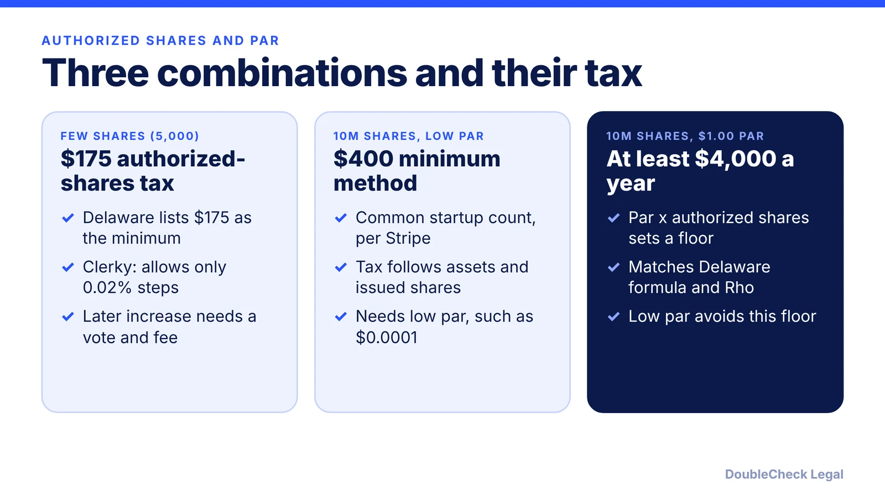

*The lines that cost money in a Delaware charter are the share count and par value. Here is what each does, as of November 2026.*

**Key takeaways:**

- Section 102(a) requires name, registered agent, purpose, stock details and incorporator.
- Authorized shares and par value feed franchise tax and the filing fee.
- Delaware lets you pay the lower of two methods; the cap is $200,000.
- Changing shares later takes an amendment, usually a board and stockholder vote, plus a fee.

## 1. The quick answer

**Quick answer:** A Delaware certificate of incorporation must state the corporation name, the registered office and registered agent, the purpose, the total authorized shares with their par value (or a no-par statement), and the incorporator, per Delaware General Corporation Law section 102(a). If you authorize more than one class, it must also give each class share count and rights. The choices that cost money are authorized shares and par value, because they feed the annual franchise tax and the filing fee. As of November 2026, Delaware lists a $175 minimum under the authorized shares method and a $400 minimum under the assumed par value capital method, with the lesser tax owed and a $200,000 cap.

This post is about what to type into each line and what each choice does later. For the full filing process see the [Delaware incorporation checklist](/blog/delaware-incorporation-requirements-checklist-what-you-need-to-file/) and [step-by-step guide](/blog/how-to-incorporate-in-delaware-step-by-step/).

## 2. Authorized shares: how many and what it costs

Authorized shares are the maximum the company may issue, not shares anyone owns (Wolters Kluwer, November 6, 2025). The gap between authorized and issued shares is room for option grants, later founders and priced rounds; Stripe (updated September 1, 2026) calls 10,000,000 a common starting point.

Delaware's own franchise tax page (last modified April 2021) sets two methods, and you pay the lower:

- **Authorized shares method:** $175 for 5,000 shares or fewer, $250 for 5,001 to 10,000, plus $85 for each additional 10,000 shares or part of it. Delaware's examples: 10,005 shares is $335 and 100,000 shares is $1,015.
- **Assumed par value capital method:** $400 per $1,000,000 of assumed par value capital (rounded up), with a $400 minimum. The inputs are total gross assets, issued shares and authorized shares.
- **Cap:** the tax is never less than $175 or more than $200,000.

Applying Delaware's first formula to 10,000,000 authorized shares gives $85,165, the figure Wolters Kluwer also prints. That is why the second method matters: Stripe says it usually gives a much smaller bill for early-stage companies with few assets and few issued shares. Delaware says corporations owing $5,000 or more make estimated payments (40% June 1, 20% September 1, 20% December 1, remainder March 1). More detail is in [Delaware franchise tax for startups](/blog/delaware-franchise-tax-startups/).

**Should you authorize only 5,000 shares to hit the $175 minimum?** Clerky says some advisors suggest it but most startup attorneys recommend against it, because it limits issuances to 0.02% increments and would likely need a costly split later. Stripe adds that raising the authorized number needs a certificate of amendment, usually board approval then a stockholder vote, plus a state fee.

## 3. Par value, classes of stock and the other lines

**Par value.** Wolters Kluwer describes par value as the minimum price at which a share can be sold, not market value. It says no-par shares can raise franchise tax, and that the incorporation filing fee depends on both authorized shares and par value. Clerky says startups almost always pick $0.0001 or $0.00001, and that a higher par raises the minimum fair market value per share, which reduces the worth of equity compensation. Rho (October 2026) gives an example: $1.00 par on 10,000,000 authorized shares guarantees at least $4,000 a year, which matches Delaware's formula (authorized shares above the assumed par are multiplied by their par value).

**Classes.** Under section 102(a)(4), multiple classes must be listed with the number of shares in each and the designations, powers, preferences and rights. Clerky says startups typically start with one class of common stock and that incorporating with preferred stock for future investors is generally misguided, since its terms are negotiated later and the certificate would likely be amended anyway. Total authorized shares include every class.

**Registered agent.** Section 102(a)(2) requires the Delaware registered office and agent name. Clerky says the agent must be physically located in Delaware and should not double as your business address. See [Delaware registered agent requirements](/blog/delaware-registered-agent-requirements/).

**Optional lines.** Section 102(b)(7) lets the certificate limit directors and officers personal monetary liability to the company or stockholders, but not for loyalty breaches, bad faith, unlawful dividends or buybacks, improper personal benefit, or (for officers) claims brought by or for the corporation. Clerky also notes the effective date is immediate by default, and that some founders set a later date, often January 1, to avoid the current year franchise tax.

## 4. Changing it later, and who should review it

Decisions are easier to make than to undo. Delaware says changes to stock or par value must be reported with issued shares and gross assets within 30 days, and the tax is prorated by the days each version was in effect. Share increases need an amendment, as above, and investors often require one in a priced round. Plan the certificate with your cap table in mind: [cap table basics](/blog/cap-table-basics-for-first-time-founders/), [issuing founder stock](/blog/issue-founder-stock-purchase-agreement/) and [SAFEs](/blog/safe-note-explained-for-founders/).

**Handle yourself vs. get an attorney.** A single-class common stock company with a typical share count and low par is the kind of filing many founders do through a standard form or an AI-assisted checklist, provided they verify each line against Delaware sources ([verify AI-generated legal documents](/blog/verify-ai-generated-legal-document/)). Ask an attorney when you want preferred or dual-class stock, a public benefit corporation, unusual director or officer liability terms, a foreign-founder structure, or you are weighing [Delaware vs California](/blog/incorporate-california-vs-delaware-startup/) or reading [Delaware SB 21 for controlling stockholders](/blog/delaware-sb-21-controlling-stockholder-startups/).

**Related reading:** [Delaware incorporation cost, first year](/blog/delaware-incorporation-cost-breakdown-first-year-fees-and-ongoing-taxes/); [Corporate Bylaws vs Operating Agreement: What Each Covers](/blog/corporate-bylaws-vs-operating-agreement-what-each-covers/)

## Where DoubleCheck fits

[DoubleCheck](https://www.contactdoublecheck.com) helps businesses and founders start legal work with AI, verify it, and, when professional advice is warranted, connect with an independent attorney, including for immigration questions. Attorney availability and practice areas vary. Attorneys on DoubleCheck are independent professionals; an attorney-client relationship forms only if an attorney accepts your engagement.

**Sources:** [Delaware Code Title 8, Chapter 1 (section 102)](https://delcode.delaware.gov/title8/c001/sc01); [Delaware Division of Corporations, franchise tax calculation (last modified April 2021)](https://corp.delaware.gov/frtaxcalc/); [Wolters Kluwer (November 6, 2025)](https://www.wolterskluwer.com/en/expert-insights/delaware-incorporation-why-the-number-of-authorized-shares-matters); [Stripe (updated September 1, 2026)](https://stripe.com/resources/more/how-many-shares-should-a-startup-authorize-at-incorporation); [Clerky Handbook](https://handbooks.clerky.com/startup-incorporation/certificate-of-incorporation-contents); [Rho (October 2026)](https://www.rho.co/blog/delaware-franchise-tax).

## FAQ

**What goes in a Delaware certificate of incorporation?**

Per Delaware General Corporation Law section 102(a): the corporation name, the Delaware registered office and agent, the purpose, the total authorized shares and par value (with class rights if more than one class), and the incorporator. Initial directors are named only if the incorporator powers end at filing.

**How many authorized shares should a Delaware startup put in its certificate?**

Stripe (September 2026) calls 10,000,000 a common starting point, and Clerky says most startup attorneys advise against only 5,000. Franchise tax depends on the method, so confirm with Delaware and a professional before filing.

**What par value should I use in a Delaware certificate of incorporation?**

Clerky says startups almost always use $0.0001 or $0.00001. A high par can raise franchise tax, since $1.00 par on 10,000,000 authorized shares means at least $4,000 a year under Delaware formula, per Rho.

**Can I change authorized shares after I file?**

Yes, with a certificate of amendment. Per Stripe it typically needs board approval, then a stockholder vote, and a state fee. Delaware says stock or par changes must be reported within 30 days and the tax is prorated.

---

*General information only. This article is not legal, tax, investment, or accounting advice.*
