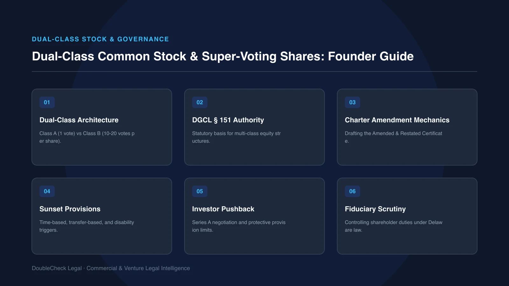
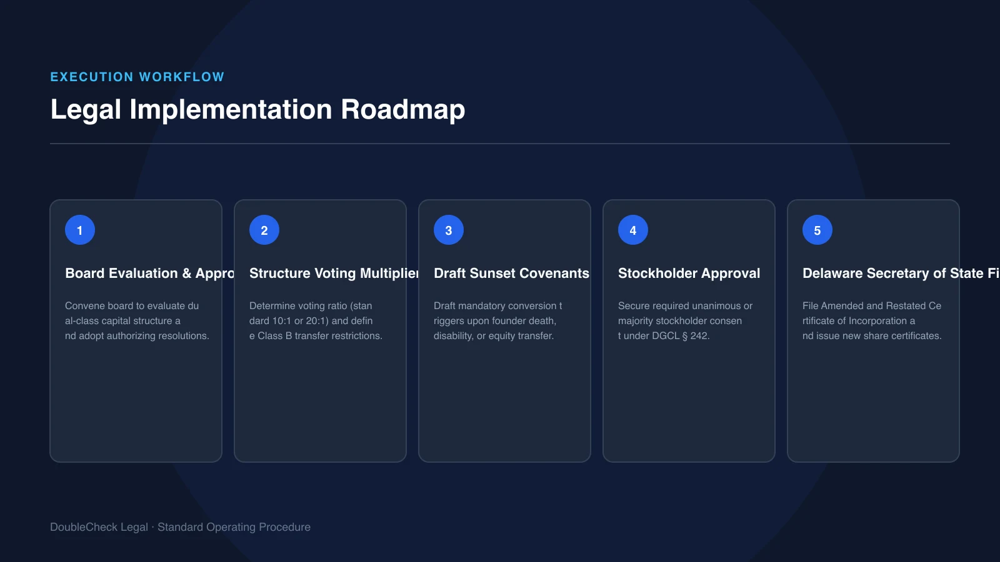

*A comprehensive legal analysis of dual-class equity structures under the Delaware General Corporation Law (DGCL), examining super-voting mechanics, sunset conversion triggers, founder board control, and venture capital negotiation.*

**Key takeaways:**
- **Founder Control Preservation:** Dual-class equity decouples economic ownership from corporate voting control, allowing founders to maintain voting majorities even after significant dilution across Series A, B, and C rounds.
- **DGCL § 151 Foundation:** Delaware law provides maximum contractual flexibility for boards and shareholders to design bespoke voting rights in the Certificate of Incorporation.
- **Mandatory Sunset Provisions:** Institutional public investors and modern venture funds insist on transfer-based and time-based sunsets to ensure super-voting rights cannot be passed to heirs or held indefinitely.
- **Controlling Shareholder Fiduciary Duties:** Founders holding super-voting control become legal "controlling stockholders," subjecting certain conflicted transactions to Delaware’s strict *Entire Fairness* standard of judicial review.

## 1. The quick answer: How dual-class stock functions

A **dual-class common stock structure** establishes two distinct tiers of common equity:

1. **Class A Common Stock:** Standard common stock carrying **one (1) vote per share**, issued to employees, advisors, and general investors.
2. **Class B Common Stock:** Super-voting common stock carrying **ten (10) or twenty (20) votes per share**, issued exclusively to company founders.
3. **Economic Equality:** Both classes share identically in dividends and liquidation proceeds. The difference is purely political governance and board election authority.



## 2. In-depth legal analysis: The mechanics of DGCL § 151 and charter drafting

Structuring dual-class voting in a Delaware corporation requires formal amendments to the founding corporate documents.

### A. Statutory Authority Under Delaware General Corporation Law
Under **DGCL § 151(a)**:
> "Every corporation may issue 1 or more classes of stock or 1 or more series of stock within any class thereof, any or all of which classes may be of stock with par value or stock without par value and which classes or series may have such voting powers, full or limited, or without voting powers... as shall be stated and expressed in the certificate of incorporation."

This broad statutory authorization empowers founders to create super-voting stock, non-voting stock, or shares with conditional veto powers.

### B. Standard Charter Drafting Provisions
To establish dual-class stock, the corporation must file an Amended and Restated Certificate of Incorporation under DGCL § 242 containing specific voting and conversion clauses:

```
"Section 1. Voting Rights. Each holder of Class A Common Stock shall be entitled to one (1) vote for each share of Class A Common Stock held as of the applicable record date. Each holder of Class B Common Stock shall be entitled to ten (10) votes for each share of Class B Common Stock held as of the applicable record date."
```

### C. Sunset Provisions and Mandatory Conversion Triggers
Super-voting stock cannot be unconstrained. Market standards demand clear **sunset triggers**:

| Sunset Type | Trigger Mechanism | Market Standard |
|---|---|---|
| Transfer Sunset | Automatic conversion to Class A if transferred to third party | Universal; exempts only estate-planning trusts |
| Time-Based Sunset | Fixed expiration date following Initial Public Offering (IPO) | 7 to 10 years post-IPO |
| Status / Disability Sunset | Founder ceases to be active executive, dies, or is incapacitated | Conversion occurs 60 to 180 days post-departure |
| Minimum Holding Sunset | Founder equity falls below specific percentage of total stock | Drops to 1:1 if founder ownership falls below 5% or 10% |

```
"Section 2. Automatic Conversion. Each share of Class B Common Stock shall automatically convert into one (1) fully paid and nonassessable share of Class A Common Stock upon: (a) any Transfer, other than a Permitted Transfer to a Founder Trust; or (b) the date that is ninety (90) days following the date of the Founder's death or permanent disability."
```

## 3. Step-by-step: How to implement a dual-class structure in Delaware



Corporate counsel and founders must follow a strict legal sequence:

### Step 1: Board of Directors Resolution
Convene the Board of Directors under DGCL § 141. Adopt resolutions approving the reclassification of existing common stock into Class B Common Stock and creating Class A Common Stock, subject to shareholder vote.

### Step 2: Shareholder Approval under DGCL § 242
Under Delaware law, amending the charter to reclassify shares requires the affirmative vote of a majority of all outstanding voting shares, and in certain circumstances, a separate class vote of the affected common stock.

### Step 3: File the Amended & Restated Certificate of Incorporation
Submit the formal charter amendment to the Delaware Division of Corporations. Ensure the filing fee accounts for the aggregate authorized shares across both classes.

### Step 4: Issue Stock Certificates / Book-Entry Updates
Cancel existing original common stock certificates and issue new Class B Common Stock certificates carrying conspicuous legends detailing the super-voting rights and transfer restrictions.

### Step 5: Update the Corporate Bylaws
Synchronize the Bylaws to reflect the dual-class quorum calculations, board election thresholds, and stockholder meeting notice rules.

## 4. Delaware judicial scrutiny: Controlling stockholder fiduciary duties

Founders who achieve majority voting control through dual-class stock assume heightened legal responsibilities:
- **Controlling Stockholder Status:** Under Delaware law, a stockholder who owns a majority of voting power owes fiduciary duties to the minority shareholders.
- **The Entire Fairness Standard:** If a controlling founder negotiates a self-dealing transaction (such as a founder secondary liquidity sale or an acquisition of another business owned by the founder), the transaction will be reviewed under the onerous *Entire Fairness* standard unless sanitized by an independent special committee and majority-of-the-minority shareholder vote.

## 5. Due diligence checklist: Dual-class charter audit

1. **Verify Permitted Transferee Carve-Outs:** Ensure transfers to estate planning trusts, family LLCs, and philanthropic foundations do not accidentally trigger automatic conversion to Class A.
2. **Review Series A Protective Provisions:** Confirm whether incoming Preferred Stock protective vetoes supersede Class B super-voting rights on charter amendments, M&A, and debt.
3. **Audit Delaware Franchise Tax Calculations:** Verify whether authorized share counts will drastically inflate the annual Delaware franchise tax under the Authorized Shares Method vs Assumed Par Value Capital Method.
4. **SEC / Stock Exchange Compliance:** For late-stage startups planning an IPO, ensure the dual-class sunset clauses comply with NYSE and NASDAQ listing standards.

## Where DoubleCheck fits

[DoubleCheck](https://www.contactdoublecheck.com) provides founders, venture-backed executive teams, and corporate secretaries with AI-powered corporate governance analysis. DoubleCheck reviews Delaware charter amendments, audits dual-class transfer restrictions, models voting dilution across future financing rounds, and ensures governance terms balance founder control with institutional venture capital requirements.

**Related reading:**
- [Board Control & Protective Provisions: Series A Term Sheets](/blog/board-control-protective-provisions-series-a-term-sheets/)
- [Founder Secondary Sales: Legal Framework & Early Liquidity](/blog/founder-secondary-sales-legal-framework-series-a-liquidity/)
- [Cap Table Cleanup Before Series A Common Problems](/blog/cap-table-cleanup-before-series-a-common-problems/)
- [Texas Business Courts vs Delaware Chancery Court](/blog/texas-business-courts-vs-delaware-chancery-court-startups/)

**Sources:** [Delaware General Corporation Law § 151 (Classes and Series of Stock)](https://delcode.delaware.gov/title8/c001/sc05/); [Delaware General Corporation Law § 242 (Amendment of Certificate of Incorporation)](https://delcode.delaware.gov/title8/c001/sc08/); [Delaware Court of Chancery, In re Investors Bancorp, Inc. Stockholder Litigation](https://courts.delaware.gov/chancery/); [New York Stock Exchange (NYSE) Listed Company Manual, Section 313.00 (Voting Rights)](https://www.nyse.com/).

## FAQ

**What is dual-class common stock in a startup?**

Dual-class common stock is a corporate equity structure where common stock is divided into two classes: Class A Common Stock carrying one vote per share, and Class B Common Stock carrying super-voting rights (typically 10 to 20 votes per share), held exclusively by founders.

**Is dual-class common stock legal under Delaware corporate law?**

Yes. Delaware General Corporation Law (DGCL) § 151 explicitly authorizes corporations to create two or more classes of stock with such voting powers, full or limited, or without voting powers, as stated in the Certificate of Incorporation.

**What is a sunset provision in a dual-class stock structure?**

A sunset provision is an automatic conversion mechanism providing that super-voting Class B shares automatically convert into standard one-vote Class A shares upon specific triggers, such as the passage of time (e.g., 7-10 years post-IPO), founder death or disability, or transfer to third parties.

**Do venture capital investors accept dual-class stock in Series A?**

Traditional VCs often resist dual-class structures in early rounds unless the founder possesses extreme leverage (exceptional revenue growth, repeat-founder status, or competing term sheets). Most VCs require class protective provisions that limit founder vetoes.

**How can AI contract software assist with dual-class governance?**

AI software audits charter provisions, models voting control across future dilution rounds, verifies compliance with DGCL statutory voting requirements, and drafts customized transfer restriction clauses.

---

*General information only. This article is not legal, tax, investment, or accounting advice.*
