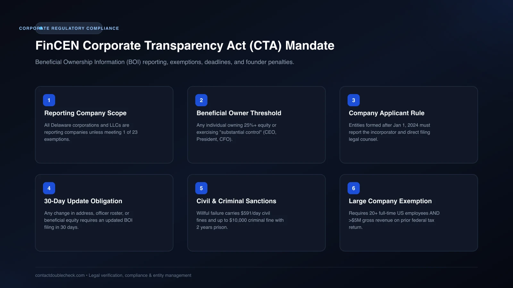
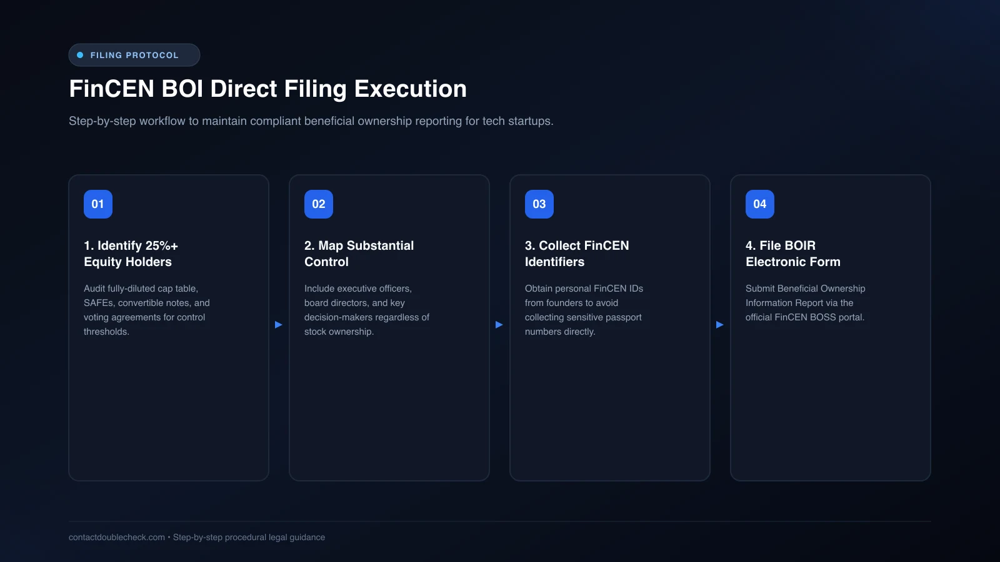

<div class="article-hero-banner mb-8">
  
</div>

## Which Startups Are Required to File Under the Corporate Transparency Act?

Enacted as part of the Anti-Money Laundering Act of 2020, the **Corporate Transparency Act (CTA)** codified under **31 U.S.C. § 5336** and administered by the U.S. Treasury's **Financial Crimes Enforcement Network (FinCEN)** requires millions of domestic and foreign legal entities to disclose their ultimate beneficial owners.

For venture-backed and bootstrapped tech startups, the default legal rule is clear: **Every domestic Delaware C-Corporation, Limited Liability Company (LLC), or statutory entity formed by filing a certificate with a Secretary of State is classified as a "Reporting Company."**

```
FinCEN Reporting Company Classification Tree

                    ┌──────────────────────────────────────────────┐
                    │  Delaware Entity Formed (Corp / LLC / LP)    │
                    └──────────────────────┬───────────────────────┘
                                           │
         ┌─────────────────────────────────┴─────────────────────────────────┐
         ▼                                                                   ▼
┌──────────────────────────────────────┐            ┌──────────────────────────────────────┐
│ Meets 1 of 23 Statutory Exemptions?  │            │ Fails to Meet All 23 Exemptions?     │
├──────────────────────────────────────┤            ├──────────────────────────────────────┤
│ • Large Operating Company:           │            │ CLASSIFIED AS REPORTING COMPANY:     │
│   (>20 US FTEs + >$5M Tax Revenue)   │            │ • Must submit initial BOIR to FinCEN │
│ • Registered Investment Adviser      │            │ • Report all 25%+ equity holders     │
│ • Bank, Credit Union, SEC Public Co  │            │ • Report all 'Substantial Control'   │
│ • Venture Capital Fund (Form ADV)    │            │ • 30-day ongoing update mandate      │
└──────────────────────────────────────┘            └──────────────────────────────────────┘
```

While established multinational enterprises qualify for the **Large Operating Company Exemption**, pre-revenue, seed, Series A, and Series B startups almost never meet the double threshold of having **more than 20 full-time US employees** and **over $5,000,000 in gross federal tax receipts**. Consequently, compliance is mandatory.

---

## Defining the "Beneficial Owner": Substantial Control vs. 25% Equity

FinCEN regulations establish two independent, alternative tests to identify a **Beneficial Owner**. If an individual meets *either* test, their personal identifiable information (PII) must be disclosed to the federal government.

```
Beneficial Ownership Determination Matrix

┌───────────────────────────────────────┬─────────────────────────────────────────────────────────┐
│ Test Category                         │ Qualifying Criteria & Startup Application               │
├───────────────────────────────────────┼─────────────────────────────────────────────────────────┤
│ Test 1: Substantial Control           │ Exercises senior executive authority, including:       │
│                                       │ • Chief Executive Officer (CEO)                         │
│                                       │ • President, Chief Operating Officer (COO), or CFO      │
│                                       │ • General Counsel or Chief Legal Officer                │
│                                       │ • Board Directors holding major governance rights       │
│                                       │ • Individuals holding veto power over major decisions   │
├───────────────────────────────────────┼─────────────────────────────────────────────────────────┤
│ Test 2: 25% Ownership Interest        │ Directly or indirectly owns or controls >= 25% of:     │
│                                       │ • Common and Preferred voting stock                     │
│                                       │ • Stock options and warrants (fully-diluted basis)      │
│                                       │ • Convertible notes and Post-Money SAFEs                │
│                                       │ • Profits interests or capital interests                │
└───────────────────────────────────────┴─────────────────────────────────────────────────────────┘
```

### The Convertible Instrument & SAFE Trap

Startups often miscalculate the 25% equity threshold by looking solely at issued common shares. Under **31 C.F.R. § 1010.380(d)(2)**, ownership interests must be calculated on a **fully-diluted basis**, treating all convertible notes, unexercised options, and SAFEs as if exercised or converted. If an angel investor or lead fund holds a convertible instrument that would convert into 25% or more of voting equity upon an anticipated financing cap, that investor may legally qualify as a beneficial owner.

---

## Reporting "Company Applicants": Rules for New Formations

For any entity created or registered on or after **January 1, 2024**, the startup must report up to two **Company Applicants**:

1. **Direct Filer:** The individual who directly submitted the document establishing the entity with the Secretary of State (e.g., a paralegal, lawyer, or corporate service agent).
2. **Direct Controller:** The individual who was primarily responsible for directing or controlling the filing of the formation document (e.g., the founder or supervising attorney).

Entities created prior to January 1, 2024, are exempt from reporting company applicants but must still fully report all beneficial owners.

```
Company Applicant Reporting Structure (Post-2024 Formations)

┌───────────────────────────────────────────────┬───────────────────────────────────────────────┐
│ Direct Filer                                  │ Direct Controller                             │
├───────────────────────────────────────────────┼───────────────────────────────────────────────┤
│ Individual who physically or electronically   │ Individual who directed or supervised the     │
│ submits Certificate of Incorporation to DE    │ filing decision (e.g., Lead Legal Counsel or  │
│ Division of Corporations (e.g., Paralegal)    │ Incorporator Founder)                         │
└───────────────────────────────────────────────┴───────────────────────────────────────────────┘
```

---

## The 30-Day Rolling Update Mandate: The Greatest Operational Vulnerability

The single most common compliance failure under the Corporate Transparency Act is not the initial filing, but the **ongoing obligation to report updates within 30 calendar days**.

Under **31 C.F.R. § 1010.380(a)(2)**, if there is **any change** with respect to required information previously submitted concerning a reporting company or its beneficial owners, the company must submit an updated report within **30 calendar days after the date on which the change occurred**.

```
Events Triggering the Mandatory 30-Day FinCEN Update Clock

┌───────────────────────────────┬─────────────────────────────────────────────────────────┐
│ Trigger Event                 │ Compliance Requirement                                  │
├───────────────────────────────┼─────────────────────────────────────────────────────────┤
│ Founder Changes Home Address  │ Updated BOIR required with new legal residential address │
│ Driver's License / Passport   │ Updated BOIR required if ID expires or number changes   │
│ Executive Officer Departure   │ Resignation of CEO, COO, or CFO requires updated filing │
│ Venture Financing Round       │ Dilution shifting investors above/below 25% threshold    │
│ Board Seat Reallocation       │ Appointment of new investor director exercising control │
│ Company Name or DBA Change    │ Filing an amended certificate or trade name registration│
└───────────────────────────────┴─────────────────────────────────────────────────────────┘
```

### Best Practice: The Personal FinCEN Identifier

To protect executive privacy and simplify corporate compliance, every founder and investor should obtain an individual **FinCEN Identifier (FinCEN ID)**. Once an individual registers directly with FinCEN, the startup submits only that individual's 12-digit FinCEN ID instead of storing and transmitting photocopies of passports, driver's licenses, and home addresses. If the individual moves, they update their own FinCEN ID profile, automatically fulfilling the startup's corporate update requirements.

---

## Penalties for Non-Compliance: Civil Fines and Criminal Liability

Congress established severe statutory penalties under **31 U.S.C. § 5336(h)** for willful failures:

```
Statutory Sanctions Matrix

┌───────────────────────────────┬─────────────────────────────────────────────────────────┐
│ Penalty Type                  │ Statutory Enforcement Magnitude                         │
├───────────────────────────────┼─────────────────────────────────────────────────────────┤
│ Civil Monetary Penalty        │ Up to $591 per day for each day the violation continues │
│                               │ (inflation-adjusted under the Federal Civil Penalties)   │
├───────────────────────────────┼─────────────────────────────────────────────────────────┤
│ Criminal Fines                │ Up to $10,000 fine upon conviction                      │
├───────────────────────────────┼─────────────────────────────────────────────────────────┤
│ Federal Imprisonment          │ Up to 2 years in federal prison for willful non-filing   │
└───────────────────────────────┴─────────────────────────────────────────────────────────┘
```

---

## Statutory Authorities and Benchmark References

- **Corporate Transparency Act, 31 U.S.C. § 5336:** Federal statutory beneficial ownership reporting requirements.
- **FinCEN Final Rule, 31 C.F.R. Part 1010 (§ 1010.380):** Beneficial ownership information reporting requirements.
- **Anti-Money Laundering Act of 2020 (AMLA):** Title LXIV of the William M. (Mac) Thornberry National Defense Authorization Act for Fiscal Year 2021.
- **FinCEN Small Entity Compliance Guide (Version 1.3):** Official administrative guidance on beneficial ownership thresholds and 23 exemptions.

<div class="article-steps-banner my-10">
  
</div>
