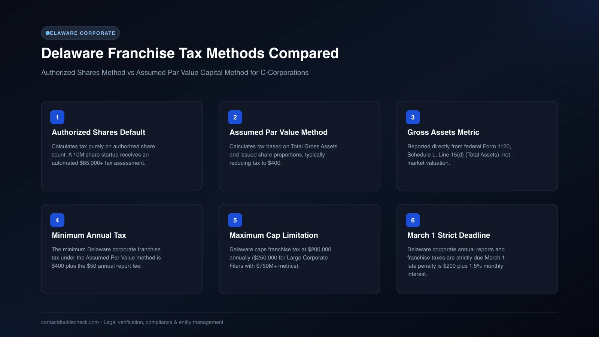
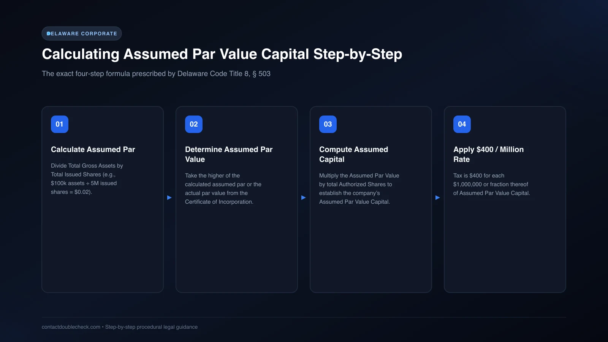

*Step-by-step guide to calculating Delaware corporate franchise tax using the Alternative Assumed Par Value Capital Method under Delaware General Corporation Law (8 Del. C. § 503), as of November 2026. General information, not legal advice.*

**Key takeaways:**

- Every January, Delaware mails astronomical tax notices (often $50,000 to $100,000+) to early-stage startups because automated systems default to the Authorized Shares Method.
- Startups can legally recalculate their tax using the Assumed Par Value Capital Method, reducing bills to the statutory minimum of $400 (plus the $50 annual report fee).
- The calculation requires two numbers: Total Gross Assets (from IRS Form 1120, Schedule L) and Total Issued Shares.
- Delaware corporate annual reports must be filed online through the Division of Corporations portal before March 1.
- Late filing results in an immediate $200 penalty and 1.5% monthly interest, threatening corporate good standing.

## 1. The quick answer

**Quick answer:** If your Delaware C-corporation received an annual franchise tax bill exceeding $50,000, **do not panic and do not pay it yet.** Delaware calculates corporate franchise tax under two alternative statutory methodologies: the **Authorized Shares Method** (the default automated assessment) and the **Assumed Par Value Capital Method** (8 Del. C. § 503). 

By inputting your company’s **Total Gross Assets** (reported on IRS Form 1120, Schedule L, Line 15d) and your **Total Issued Shares** into the Delaware Division of Corporations portal, the tax is recalculated based on real asset backing. For virtually all pre-revenue, seed, and early-stage venture-backed startups, this recalculation reduces an $85,000 assessment down to the legal minimum of **$400**, plus the standard $50 annual report filing fee, for a total annual cost of **$450**.

For broader Delaware entity governance, review [how to incorporate SaaS AI startups in Delaware](/blog/how-to-incorporate-saas-ai-startup-delaware-c-corp/) and [Delaware incorporation cost breakdown](/blog/delaware-incorporation-cost-breakdown-first-year-fees-and-ongoing-taxes/).

## 2. Authorized Shares vs Assumed Par Value Method

Delaware law provides two distinct methods to compute annual corporate franchise tax under Title 8, Section 503:

### The Authorized Shares Method (The Default Trap)
This method bases taxation strictly on the number of authorized shares declared in your Certificate of Incorporation:
- Up to 5,000 shares: $175
- 5,001 to 10,000 shares: $250
- Each additional 10,000 shares (or fraction): +$85

Standard startup formation practice incorporates with **10,000,000 authorized shares** of common stock (to accommodate founder equity, stock option pools, and future seed investor preferred stock). Under the Authorized Shares Method:
$$	ext{Tax} = $250 + left(rac{10,000,000 - 10,000}{10,000} 	imes $85
ight) = $250 + (999 	imes $85) = $85,165$$

The State of Delaware automatically prints this $85,165 number on your default annual tax statement.

### The Assumed Par Value Capital Method
Delaware allows any corporation to calculate tax based on its **Assumed Par Value Capital**. This method reflects the actual asset scale of the business, preventing paper share counts from penalizing asset-light startups. The minimum tax under this method is **$400**, and the maximum is **$200,000** ($250,000 for Large Corporate Filers).

## 3. The exact assumed par value calculation formula

Under 8 Del. C. § 503(a)(2), computing Assumed Par Value Capital follows a four-step statutory process:

1. **Calculate the Assumed Par Value:** Divide Total Gross Assets by Total Issued Shares.
$$	ext{Assumed Par} = rac{	ext{Total Gross Assets}}{	ext{Total Issued Shares}}$$
2. **Compare Against Stated Par Value:** Compare the calculated Assumed Par Value with the stated par value on your Certificate of Incorporation (typically $0.0001 or $0.00001). **Take whichever value is higher.**
3. **Calculate Assumed Par Value Capital:** Multiply the higher par value by the number of Authorized Shares for each share class.
$$	ext{Assumed Par Value Capital} = 	ext{Higher Par Value} 	imes 	ext{Authorized Shares}$$
4. **Compute the Tax:** Delaware charges **$400 for each $1,000,000** (or fraction thereof) of Assumed Par Value Capital. Round up to the next full million before multiplying.

## 4. Concrete example: Reducing $85,165 to $400

Let us examine a real-world tech startup scenario:
- **Authorized Shares:** 10,000,000 shares at $0.0001 stated par value.
- **Issued Shares:** 6,000,000 shares issued to founders.
- **Total Gross Assets:** $120,000 (cash in bank at December 31).

**Step 1: Calculate Assumed Par**
$$	ext{Assumed Par} = rac{$120,000}{6,000,000} = $0.02$$

**Step 2: Compare Par Values**
We compare the calculated $0.02 against the stated par value of $0.0001. Because $0.02 is higher, we use **$0.02**.

**Step 3: Calculate Assumed Capital**
$$	ext{Assumed Capital} = $0.02 	imes 10,000,000 	ext{ authorized shares} = $200,000$$

**Step 4: Compute the Franchise Tax**
Because $200,000 is under $1,000,000, it represents a single one-million-dollar bracket (rounded up to $1,000,000). 
$$	ext{Franchise Tax} = 1 	imes $400 = $400$$

Adding the mandatory $50 Annual Report filing fee yields a final payable amount of **$450**—eliminating $84,715 in phantom tax liability.

## 5. How to report Gross Assets from Form 1120

A critical compliance point is accurately extracting **Total Gross Assets**. Under 8 Del. C. § 503(h), Total Gross Assets is defined as the total assets reported on federal corporate income tax **Form 1120, Schedule L, Line 15, column (d)** (ending of tax year balance sheet).

- **First-Year Startups:** If your company was incorporated during the calendar year and has not yet completed its first federal Form 1120 filing by the March 1 Delaware deadline, Delaware instructions specify reporting total gross assets from your closing December 31 internal balance sheet.
- **Cash and IP:** Total assets includes bank cash, accounts receivable, and capital equipment. It does **not** mean your company's venture capital valuation. A startup that raised a $5M seed round on a $20M post-money valuation reports only its remaining cash balance (e.g., $4.2M gross assets), not $20,000,000.
- **Zero Assets Rule:** Even if your startup has $0 in bank assets, you report $0 (or $1). The statutory minimum tax of $400 will apply.

See [convert LLC to C-Corp before fundraising](/blog/convert-llc-to-c-corp-before-fundraising/) and [cap table basics for first-time founders](/blog/cap-table-basics-for-first-time-founders/).

## 6. Deadlines, penalties, and amended filings

- **March 1 Strict Deadline:** Delaware domestic corporations must submit their Annual Report and payment online through the Delaware Division of Corporations portal on or before March 1.
- **Statutory Penalties:** Missing the March 1 deadline incurs an immediate **$200 late penalty**, plus **1.5% monthly compound interest** on the outstanding balance.
- **Loss of Good Standing:** After two years of non-payment, Delaware administratively declares the corporation void and forfeits its charter, freezing corporate banking and invalidating liability shields.
- **Amended Filings:** If your company mistakenly paid the Authorized Shares Method in prior years, you can file an amended report with the Division of Corporations within three years to claim a tax credit or refund.

## Where DoubleCheck fits

[DoubleCheck](https://www.contactdoublecheck.com) helps founders manage multi-state entity compliance, track annual reporting obligations, and audit corporate governance documents. When corporate restructuring, amended charter filings, or investor due diligence questions emerge, DoubleCheck connects you directly with experienced corporate attorneys.

**Related reading:**
- [Delaware Incorporation Cost Breakdown: First-Year Fees and Ongoing Taxes](/blog/delaware-incorporation-cost-breakdown-first-year-fees-and-ongoing-taxes/)
- [How to Incorporate a SaaS AI Startup as a Delaware C-Corp](/blog/how-to-incorporate-saas-ai-startup-delaware-c-corp/)
- [Convert LLC to C-Corp Before Fundraising](/blog/convert-llc-to-c-corp-before-fundraising/)
- [Due Diligence Checklist for Startup Fundraising](/blog/due-diligence-checklist-for-startup-fundraising/)

**Sources:** [Delaware Code Title 8, Section 503 (Franchise Tax Calculation)](https://delcode.delaware.gov/title8/c005/index.html#503); [Delaware Department of State, Division of Corporations Franchise Tax Calculator](https://corp.delaware.gov/frtaxcalc/); [Delaware Division of Corporations, Annual Report and Tax Instructions](https://corp.delaware.gov/paytaxes/); [Internal Revenue Service, Instructions for Form 1120 (Schedule L Balance Sheet)](https://www.irs.gov/instructions/i1120); [Delaware Secretary of State, Corporate Fee Schedules](https://corp.delaware.gov/fee-schedule/).

## FAQ

**Why did Delaware send my startup an $85,000 franchise tax bill?**

Delaware’s automated assessment defaults to the Authorized Shares Method. If your Certificate of Incorporation authorized 10,000,000 shares, the state computer calculates $85,000+. Recalculating with the Assumed Par Value Capital Method routinely cuts the bill to the $400 minimum.

**What counts as Total Gross Assets under Delaware Code § 503?**

Per 8 Del. C. § 503, Total Gross Assets means those assets reported on the corporation’s federal income tax return on Form 1120, Schedule L, Line 15(d). If no return has been filed, use the total balance sheet asset value at calendar year-end.

**What is the filing deadline for Delaware C-Corps?**

Delaware corporations must file their Annual Report and pay franchise tax by March 1 annually. Late filings trigger a statutory $200 penalty plus 1.5% monthly compound interest.

**Does the Assumed Par Value method apply to Delaware LLCs?**

No. Delaware LLCs do not calculate share capital. LLCs pay a flat annual franchise tax of $300 due on June 1 each year.

**Can an early-stage company change its calculation method annually?**

Yes. Delaware explicitly permits corporations to compute their franchise tax using whichever statutory method results in the lower tax liability each reporting year.

---

*General information only. This article is not legal, tax, investment, or accounting advice.*
