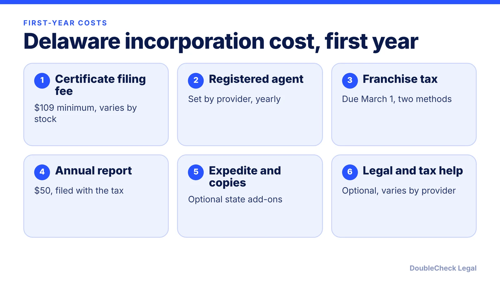
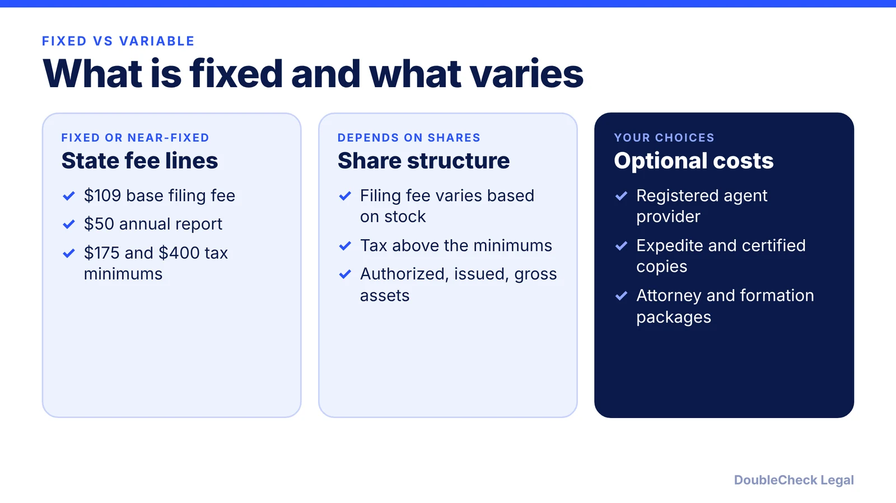

*A first-year Delaware incorporation cost breakdown for a C corporation: state fees, franchise tax methods, annual report and optional costs, as of November 2026.*

**Key takeaways:**

- Delaware lists a $109 filing fee for a stock corporation certificate (schedule revised August 1, 2026), and the schedule marks it as varying based on stock.
- Franchise tax has two methods; the state says to pay the lower result, and a startup often lands at the $400 minimum.
- The registered agent price is set by the provider, not the state, so check the renewal price.
- The filing fee and tax above the minimums depend on share structure; most other lines are fixed or optional.

## 1. The quick answer

**Quick answer:** As of November 2026, Delaware's fee schedule (revised August 1, 2026) lists a $109 filing fee for a stock corporation certificate of incorporation, and that figure is marked as varying based on stock. A typical first year adds a registered agent (priced by the provider, not the state), the annual report and franchise tax due by March 1, and optional extras such as expedited filing or certified copies. Per Rho (November 2026), a standard startup's recurring minimum is about $450 each March: $400 franchise tax under the assumed par value capital method plus the $50 annual report.

Some of that is fixed and some depends on how many shares you authorize and what your company owns. This post breaks it out for a Delaware C corporation, not an LLC. For the filing steps see [how to incorporate in Delaware step by step](/blog/how-to-incorporate-in-delaware-step-by-step/), and for a document checklist see [Delaware incorporation requirements](/blog/delaware-incorporation-requirements-checklist-what-you-need-to-file/).

## 2. State filing fees at formation

The state fee for forming a Delaware corporation is paid when you file the certificate of incorporation with the Division of Corporations. The Division's fee schedule (revised August 1, 2026) lists these items for a domestic stock corporation:

- **Certificate of incorporation:** $109, which the schedule marks as varying based on stock. The base amount covers a one-page document, and each additional page adds $9 in county recording fees.
- **Expedited service:** $50 for 24-hour and $100 for same-day, per the same schedule. One-hour and two-hour priority service are listed at $1,000 and $500 per request.
- **Certified copy:** $50 each, plus $2 per page.
- **Name reservation (120 days):** $75.
- **Certificate of good standing:** $50 for the short form and $175 for the long form.

Capitol Services reports that HB 400, signed May 21, 2026, raised several Delaware fee ceilings, with most increases effective August 1, 2026, and says currently published expedite fees remain in effect until the state publishes a new schedule. That is a reminder to check the live fee page on the day you file rather than rely on a blog post, including this one.

The only formation cost that scales with your share structure is the filing fee for a stock corporation. Rho (November 2026) says choosing no par value stock for 10,000,000 shares would raise the filing fee well above the minimum, so par value matters; that comparison is single-sourced here, so ask your filing service for a quote before you pick par. See [what to put in a certificate of incorporation: authorized shares and par value](/blog/delaware-certificate-of-incorporation-what-to-put-in-authorized-shares-par-value/).

## 3. Franchise tax: the two methods

Delaware franchise tax is the item most likely to surprise a new founder, because the default calculation can produce a very large number. The Division of Corporations describes two methods for stock corporations:

- **Authorized shares method:** $175 minimum for 5,000 shares or fewer, $250 for 5,001 to 10,000 shares, and $85 for each additional 10,000 shares or portion. 
- **Assumed par value capital method:** $400 minimum, and $400 per million dollars of assumed par value capital, or portion. Assumed par is total gross assets divided by total issued shares, applied to authorized shares, then rounded up to the next million if over $1 million.

The state says to pay the lower result, and the tax is never below $175 or above $200,000. Corporations owing $5,000 or more make estimated payments: 40% by June 1, 20% by September 1, 20% by December 1, with the remainder due March 1.

Here is what that means with the state's own formula. A company with 10,000,000 authorized shares would owe $250 plus $85 for each additional 10,000-share block. Applying that formula gives $85,165 under the authorized shares method, which is arithmetic from the published rule, as also shown by delawareinc.com. Under the assumed par value capital method, a startup with modest assets and issued shares often lands at the $400 minimum, which Rho and delawareinc.com both note. The point is that the notice you receive may show the higher figure; use the lower method.

What changes the number:

- **Authorized shares:** fixed by your certificate, but amendable later.
- **Total gross assets:** from Form 1120, Schedule L; they rise as you raise money.
- **Issued shares:** the denominator in the assumed par calculation.

See [Delaware franchise tax for startups](/blog/delaware-franchise-tax-startups/) for a longer walkthrough.

## 4. Annual report, registered agent and ongoing costs

**Annual report.** Rho and delawareinc.com both say the annual report fee for a corporation is $50, filed with franchise tax by March 1. Both also say missing the deadline triggers a $200 penalty plus 1.5% monthly interest, and Rho adds that good standing is lost until you catch up. Because the Division's franchise tax page did not state the fee or penalty in the text we could read, treat those two figures as secondary-source numbers and confirm them on the Division's fee page.

**Registered agent.** Delaware requires a registered agent named in the certificate. The state does not set the agent's price. Rho gives examples: Clerky lists a $125 first-year agent fee, and Stripe Atlas lists $100 a year after year one. Many formation packages bundle year one, so look at the renewal price before you buy. Changing agents later requires a certificate of change, which Rho says costs $50. See [Delaware registered agent requirements](/blog/delaware-registered-agent-requirements/).

**Recurring minimum.** Rho's figure is about $450 each March, plus the agent. A first-year budget that stays near the minimums will be well under what a loose reading of the authorized shares method would suggest, but you must choose and compute the lower method.

**Where you operate.** If the team works in another state, a foreign qualification there has its own fee and report, which varies by state and is not priced here. See [Delaware corporation doing business in California](/blog/delaware-corporation-doing-business-in-california/) and [incorporating in Texas vs Delaware for a Texas-based startup](/blog/incorporate-in-texas-vs-delaware-for-a-texas-based-startup/).

The IRS says you never have to pay a fee for an EIN, as quoted by Rho, so you should not pay a third party just for the number. See [how to incorporate a company in the US](/blog/how-to-incorporate-a-company-in-the-us/).

## 5. Fixed costs vs costs that depend on share structure

Splitting the budget this way makes it easier to compare formation quotes.

**Fixed or mostly fixed (set by the state or a flat price):**

- The $109 base filing fee and per-page recording fee.
- The $50 annual report fee.
- The $400 and $175 franchise tax minimums.
- Optional state add-ons such as expedite, copies and good standing certificates.

**Depends on share structure and finances:**

- The filing fee, which the schedule says varies based on stock.
- Franchise tax above the minimums, which depends on authorized shares, issued shares and gross assets.
- The cost of a later increase in authorized shares through an amendment, which requires a filing; ask for the current state fee before you plan one.

**Depends on your choices:**

- Registered agent provider and renewal price.
- Formation service packages and any attorney fees. Rho says its $400 includes attorney review of formation documents, and says other services do not break out attorney fees, so compare what is included.
- Founder stock paperwork, an 83(b) election and IP assignment. See [83(b) election for startup founders](/blog/83b-election-startup-founders/) and [issuing a founder stock purchase agreement](/blog/issue-founder-stock-purchase-agreement/).
- Whether you form as an LLC instead. Per Rho, a Delaware LLC certificate is $110 and the annual tax is a flat $400 due June 1, with no annual report. See [LLC vs C corp for startups](/blog/llc-vs-c-corp-startups/).

## 6. How to get the numbers right before you file

A short routine helps avoid a bad surprise in the first spring.

1. Pull the current Division fee schedule on the day you file.
2. Decide authorized shares and par value with a lawyer or a formation service that explains the tradeoff, and ask what the filing fee will be for that choice.
3. Put March 1 on the calendar, along with the estimated payment dates if your tax may reach $5,000.
4. Keep the figures you need for the lower-method calculation: gross assets from Form 1120 Schedule L and issued shares.
5. Ask the registered agent for the renewal price in writing.

AI can help you turn those steps into a budget sheet and a calendar, and can explain a notice in plain English. Verify its numbers against the Division of Corporations before you pay. Related: [how to prepare for a first meeting with a startup lawyer](/blog/how-to-prepare-for-first-meeting-with-startup-lawyer/) and [the incorporate-California-vs-Delaware decision](/blog/incorporate-california-vs-delaware-startup/).

## Where DoubleCheck fits

[DoubleCheck](https://www.contactdoublecheck.com) helps businesses and founders start legal work with AI, verify it, and, when professional advice is warranted, connect with an independent attorney, including for immigration questions. Attorney availability and practice areas vary. Attorneys on DoubleCheck are independent professionals; an attorney-client relationship forms only if an attorney accepts your engagement.

**Sources:** [Delaware Division of Corporations fee schedule, revised August 1, 2026](https://corpfiles.delaware.gov/Fee_Schedule/AugustFee2026.pdf); [Delaware Division of Corporations, franchise tax calculation](https://corp.delaware.gov/frtaxcalc/); [Delaware Division of Corporations, calculating franchise tax](https://corp.delaware.gov/?p=189); [Capitol Services, Delaware fee and annual tax changes (HB 400)](https://www.capitolservices.com/insights/legislative-articles/delaware-fee-and-annual-tax-changes/); [Rho, Delaware franchise tax explained (2026)](https://www.rho.co/blog/delaware-franchise-tax); [Rho, How to form a Delaware C corp (Nov. 5, 2026)](https://www.rho.co/blog/delaware-c-corp); [Rho, Delaware Division of Corporations guide (Oct. 17, 2026)](https://www.rho.co/blog/delaware-division-of-corporations); [Delaware Inc, Delaware franchise tax FAQ](https://delawareinc.com/delaware-franchise-tax). Not fetched: Wolters Kluwer annual report page (failed to load).

## FAQ

**How much does it cost to incorporate in Delaware?**

Delaware lists a $109 filing fee for a stock corporation certificate of incorporation in its fee schedule revised August 1, 2026, and marks it as varying based on stock. Add a registered agent, optional expedite fees and any formation or legal service you choose.

**What are the two Delaware franchise tax methods?**

Per the Delaware Division of Corporations, the authorized shares method has a $175 minimum and the assumed par value capital method has a $400 minimum. The state says to pay the lower result, with a $200,000 maximum.

**When is Delaware franchise tax due for a corporation?**

March 1 each year for the tax and annual report, per Rho and delawareinc.com. Corporations owing $5,000 or more make estimated payments on June 1, September 1 and December 1, per the Division of Corporations.

**What depends on my share structure?**

The filing fee, which the fee schedule marks as varying based on stock, and franchise tax above the minimums, which depends on authorized shares, issued shares and gross assets. Registered agent and optional services are separate choices.

**Do I need a lawyer to incorporate in Delaware?**

Not always, but a lawyer can help with authorized shares, par value and founder stock, which affect cost and later fundraising. A CPA or attorney should verify the tax calculation and filing details before you pay.

---

*General information only. This article is not legal, tax, investment, or accounting advice.*
