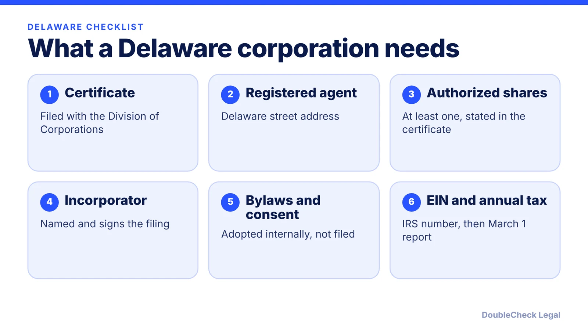
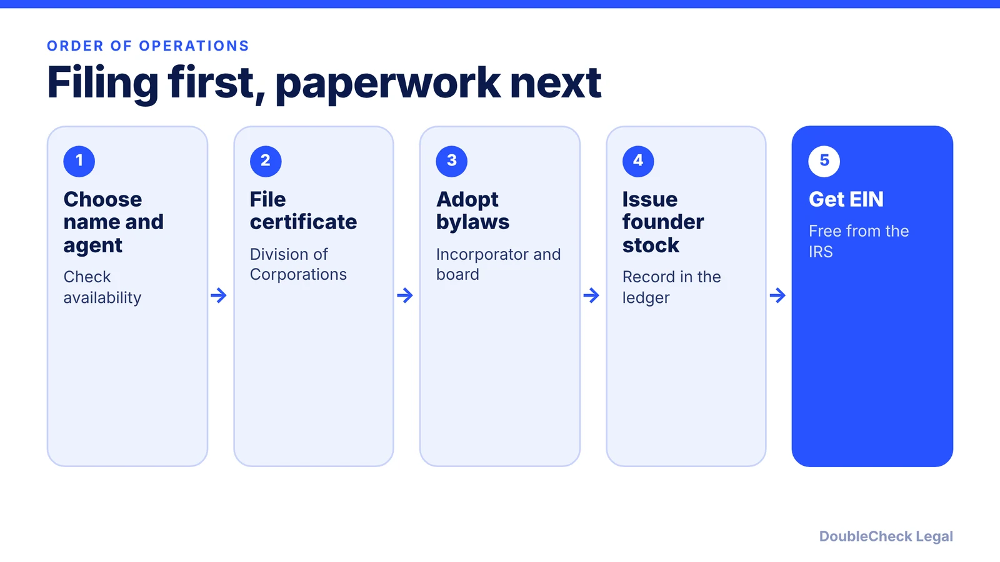

*A checklist of what Delaware requires, what you adopt internally, and what you owe every year.*

**Key takeaways:**

- Delaware requires a certificate of incorporation naming the corporation, registered agent and office, authorized shares and incorporator (per BizFilings and Nolo).
- Bylaws, initial consents and stock issuance are internal records, not state filings.
- An EIN is free from the IRS; the online tool needs a responsible party SSN or ITIN.
- Annual report and franchise tax are due March 1; other states may require foreign qualification.

## 1. The quick answer

**Quick answer:** To form a Delaware corporation, the state requires a certificate of incorporation filed with the Delaware Division of Corporations. Per Wolters Kluwer BizFilings and Nolo, it names the corporation, a Delaware registered agent and registered office, the number of authorized shares, and an incorporator who signs. Everything else on the checklist (bylaws, initial board consent, stock issuance, an EIN) happens after the filing or alongside it. Delaware also expects an annual report and franchise tax by March 1 each year, per the Division of Corporations. This post is a requirements checklist; for the order of operations, see our [step-by-step Delaware guide](/blog/how-to-incorporate-in-delaware-step-by-step/).

## 2. Required in the filing: the certificate of incorporation

Per Nolo, the certificate must include the corporation's name, the registered office street address and agent name, the number of authorized shares, the corporation's purpose, and the incorporator's name and mailing address. Wolters Kluwer BizFilings lists the same core items.

- **Registered agent.** A physical Delaware street address is required; BizFilings says P.O. boxes are not allowed. Nolo says the agent can be the corporation itself, a Delaware resident or entity, or an authorized out-of-state entity. See [Delaware registered agent requirements](/blog/delaware-registered-agent-requirements/).
- **Authorized shares.** The certificate must state them, with at least one authorized share (BizFilings). Authorizing shares is not issuing them. Clerky's handbook says a startup typically authorizes a single class of common stock, that 10 million is its default, and that par value is almost always $0.0001 or $0.00001. Raising the number later needs an amendment (BizFilings).
- **Incorporator.** Named in the certificate with an address, and signs it. Per Clerky, this is usually a founder, attorney or paralegal.
- **Directors.** At least one is required. Delaware has no residence or age requirement, and director names need not appear in the certificate (BizFilings).
- **Filing fee.** Nolo lists a minimum of $109 for the certificate, rising above certain share thresholds. Confirm the current fee schedule with the Division of Corporations before you file.

Clerky also cautions that adding preferred stock at formation is usually unnecessary because investor terms are negotiated later and the certificate would likely need amending anyway.

For SaaS and AI companies, see [how to incorporate a SaaS or AI startup in Delaware](/blog/how-to-incorporate-saas-ai-startup-delaware-c-corp/).

## 3. After filing: bylaws, consents, stock and EIN

These items are not filed with Delaware, but they are the usual next layer of the checklist.

- **Bylaws.** Nolo says Delaware law implies rather than explicitly requires them and strongly recommends having them; they are kept in your corporate records, not filed. DLA Piper notes they typically cover stockholder meetings and voting, board operations and officer roles.
- **Incorporator consent and initial board consent.** DLA Piper describes a sole incorporator consent that names the initial directors and adopts bylaws, then an initial board consent covering items such as electing officers, setting the fiscal year, authorizing bank accounts and approving indemnification agreements.
- **Issuing founder stock.** Record the shares and holders in your stock ledger (Nolo). Founder equity terms are a separate decision: see [co-founder agreements](/blog/co-founder-agreement-startups/), [vesting and cliffs](/blog/cofounder-vesting-cliff-explained/) and the [83(b) election](/blog/83b-election-startup-founders/).
- **EIN.** BizFilings says all corporations need one. Per the IRS, an EIN is free and is issued immediately online if approved, but the online tool requires the responsible party's SSN or ITIN and a principal place of business in the U.S. or a territory; otherwise apply by phone, fax or mail. The IRS also advises registering with the state first. Non-U.S. founders should read [starting a U.S. company as a non-U.S. resident](/blog/start-us-company-as-non-us-resident/).

## 4. Ongoing: franchise tax, annual report and other states

**Annual report and franchise tax.** Per the Delaware Division of Corporations, domestic corporations file the annual report and pay franchise tax for the prior year on or before March 1, online. The page lists a $175 minimum tax under the Authorized Shares Method and $400 under the Assumed Par Value Capital Method, a $50 annual report fee for non-exempt domestic corporations, and a late penalty of $200 plus 1.5% interest per month. Franchise tax is owed even if the company has no revenue (Nolo). Many startups are surprised by the size of an authorized-shares bill; read [Delaware franchise tax for startups](/blog/delaware-franchise-tax-startups/) before you pick a share count.

**Foreign qualification where you operate.** A Delaware corporation is a foreign corporation in every other state. DLA Piper lists authorizing qualification to do business in other states as a typical initial board consent item, and Harbor Compliance describes the result as a certificate of authority. What counts as doing business, and the fee, are set by each state, so check that state's agency. For the common California case, see [Delaware corporation doing business in California](/blog/delaware-corporation-doing-business-in-california/) and [California vs Delaware](/blog/incorporate-california-vs-delaware-startup/); for the LLC version, [foreign qualification explained](/blog/foreign-qualification-register-llc-in-another-state/).

**What to handle yourself and when to ask an attorney.** A plain one-class common stock company with founders you already trust is something many founders can assemble from the checklist above. Get an attorney to look when you have multiple founders with different contributions, plan to raise from investors soon, have non-U.S. owners, or want to change share terms. The overview is in [how to incorporate a company in the US](/blog/how-to-incorporate-a-company-in-the-us/).

## Where DoubleCheck fits

[DoubleCheck](https://www.contactdoublecheck.com) helps businesses and founders start legal work with AI, verify it, and, when professional advice is warranted, connect with an independent attorney, including for immigration questions. Attorney availability and practice areas vary. Attorneys on DoubleCheck are independent professionals; an attorney-client relationship forms only if an attorney accepts your engagement.

**Sources:** [Wolters Kluwer BizFilings, Delaware incorporation requirements](https://www.wolterskluwer.com/solutions/bizfilings/state-guides/delaware-incorporation-requirements); [Nolo, How to Form a Corporation in Delaware](https://www.nolo.com/legal-encyclopedia/how-form-corporation-delaware.html); [Delaware Division of Corporations, pay taxes](https://corp.delaware.gov/paytaxes); [Clerky, certificate of incorporation contents](https://handbooks.clerky.com/startup-incorporation/certificate-of-incorporation-contents); [DLA Piper, incorporation documents](https://www.dlapiper.com/insights/publications/accelerate/formation/the-incorporation-process-key-legal-documents); [IRS, apply for an EIN online](https://www.irs.gov/businesses/small-businesses-self-employed/apply-for-an-employer-identification-number-ein-online); [Harbor Compliance, foreign qualification](https://www.harborcompliance.com/foreign-qualification-delaware). The Division of Corporations incorporation form PDF did not load, so fee figures for the certificate are attributed to Nolo.

## FAQ

**What do you need to incorporate in Delaware?**

A certificate of incorporation filed with the Division of Corporations, listing the name, registered agent and office, authorized shares, purpose and incorporator (Nolo, BizFilings). Internal steps such as bylaws and a board consent follow.

**Do I need a Delaware address to incorporate there?**

You need a registered agent with a physical Delaware street address; P.O. boxes are not allowed (BizFilings). Your business itself does not need an office in Delaware.

**Are bylaws required in Delaware?**

Per Nolo, Delaware law implies rather than explicitly requires bylaws, and they are strongly recommended. They are not filed with the state.

**When are Delaware franchise tax and the annual report due?**

On or before March 1 for the prior year, per the Delaware Division of Corporations. Late filing carries a $200 penalty plus 1.5% monthly interest.

---

*General information only. This article is not legal, tax, investment, or accounting advice.*
