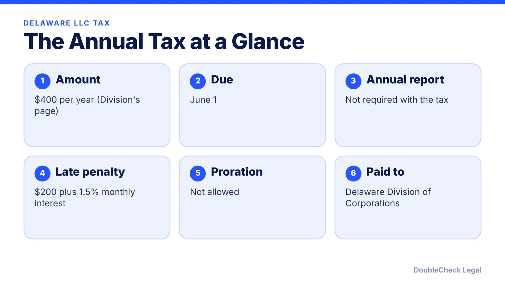
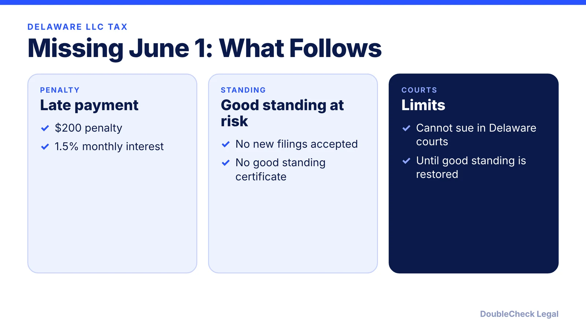
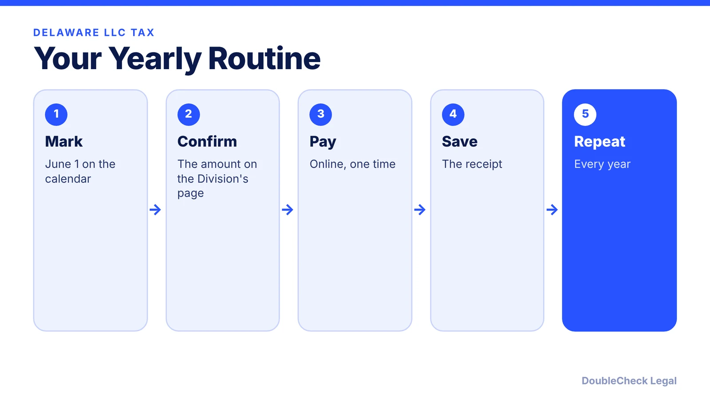

*Delaware LLCs have no annual report but they do have an annual tax. Here is the amount, the deadline, and the penalty.*

**Key takeaways:**

- Delaware's Division lists a $400 annual tax for LLCs, LPs, and GPs, due June 1, with no annual report.
- Late payment costs a $200 penalty plus 1.5% monthly interest.
- Pay via the Division's online application or your registered agent, and beware look-alike solicitations.
- Older guides may still show $300; use the Division's page.

## 1. The annual tax

A Delaware LLC owes an annual tax even though it files no annual report. On its LLC/LP/GP tax instructions page, the Delaware Division of Corporations lists **$400 per year** for domestic and foreign LLCs, LPs, and GPs formed or registered in Delaware, with no annual report required and no proration. The tax is due by **June 1**, and applies if the entity is active in the Division's records at any point during the current calendar year.

Some older guides still say $300. Wolters Kluwer's explainer shows that older figure. Use the Division's own page for the current amount.

## 2. How to pay

The Division lists an online "Pay LLC/LP/GP Tax" application, available daily from 8:00 a.m. to 11:45 p.m. Eastern. Payment options are ACH debit from a checking account (required for transactions over $5,000) and credit card. Submit only once to avoid duplicate charges.

## 3. What happens if you do not pay

Late payment incurs a $200 penalty plus 1.5% monthly interest on the tax and penalty, per the Division. Wolters Kluwer adds that the entity loses good standing, the Division will not file documents for it or issue a certificate of good standing, and it cannot sue in Delaware courts until restored.

## 4. Beware of look-alike solicitations

The Division warns entities to be wary of deceptive tax or annual report solicitations that do not come from the State or the entity's Delaware registered agent. Pay through the Division's site or your registered agent, not a mailer.

## 5. A yearly routine

If you are comparing states, see [LLC formation costs in California, Texas, Florida, and New York](/blog/llc-formation-cost-california-texas-florida-new-york/). Delaware corporations pay a different tax; read the [Delaware franchise tax guide](/blog/delaware-franchise-tax-startups/).

## Where DoubleCheck fits

[DoubleCheck](https://www.contactdoublecheck.com) is built for businesses that start legal work with AI. Bring your question or draft, use an AI-first workflow to understand and verify it, and when professional advice is warranted, you can connect with an independent attorney. Attorneys on DoubleCheck are independent professionals; an attorney-client relationship forms only if an attorney accepts your engagement.

**Sources:** [Delaware Division of Corporations: Pay LLC/LP/GP taxes](https://corp.delaware.gov/alt-entitytaxinstructions); [Wolters Kluwer: Delaware annual tax is due June 1](https://www.wolterskluwer.com/en/expert-insights/delaware-annual-tax-is-due-june-1).

## FAQ

**How much is the Delaware LLC annual tax?**

The Division's instructions page lists $400 per year. Some older guides show $300.

**When is the Delaware LLC tax due?**

June 1.

**Does a Delaware LLC file an annual report?**

No. The Division says no annual report is required with the tax.

**What is the penalty for paying late?**

$200 plus 1.5% monthly interest on the tax and penalty, per the Division.

---

*General information only. This article is not legal, tax, investment, or accounting advice.*
