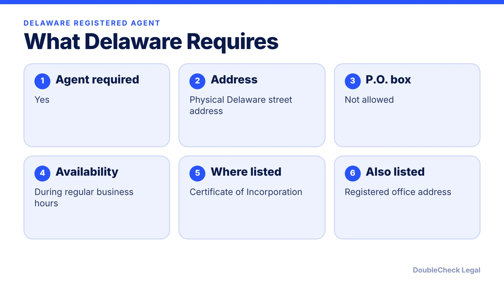
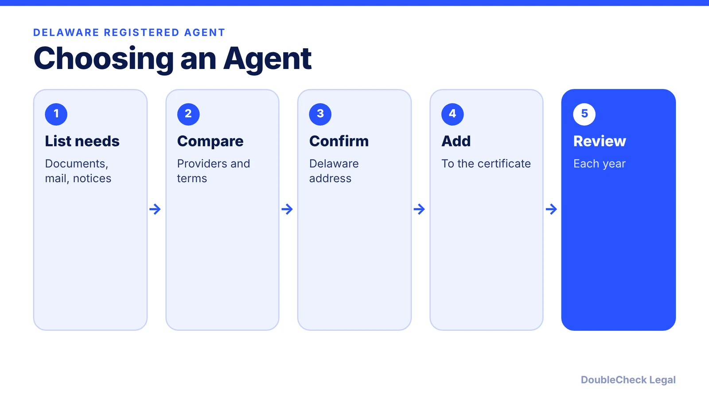
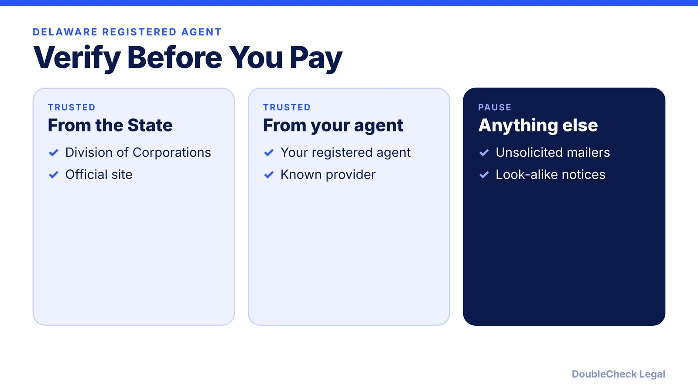

*Delaware requires a registered agent. Here is what the requirement means and how to avoid look-alike notices.*

**Key takeaways:**

- Delaware requires a registered agent with a physical Delaware street address.
- P.O. boxes are not allowed, and the agent must be available during business hours.
- The agent's name and the registered office address go in the Certificate of Incorporation.
- Be wary of solicitations that do not come from the State or your registered agent.

## 1. What the requirement is

A Delaware corporation must have a registered agent. According to Wolters Kluwer's guide, the agent must have a physical Delaware street address (no P.O. boxes) and be available at that address during regular Delaware business hours. The agent's name and the registered office address go in the Certificate of Incorporation.

## 2. Why founders pay attention

The registered agent is the point of contact for official mail and legal papers. If the agent is wrong or unavailable, you can miss notices that matter. Choose an agent you trust and keep their information current.

## 3. Beware look-alike solicitations

Delaware's Division of Corporations warns entities to be wary of deceptive tax or annual report solicitations that do not come from the State or the entity's Delaware registered agent. Pay taxes and reports through the Division's site or your agent.

## 4. Related steps

See [how to incorporate in Delaware step by step](/blog/how-to-incorporate-in-delaware-step-by-step/) and the [Delaware LLC annual tax](/blog/delaware-llc-annual-tax-june-1/). For other states' requirements, see [LLC formation costs across four states](/blog/llc-formation-cost-california-texas-florida-new-york/).

## Where DoubleCheck fits

[DoubleCheck](https://www.contactdoublecheck.com) is built for businesses that start legal work with AI. Bring your question or draft, use an AI-first workflow to understand and verify it, and when professional advice is warranted, you can connect with an independent attorney. Attorneys on DoubleCheck are independent professionals; an attorney-client relationship forms only if an attorney accepts your engagement.

**Sources:** [Wolters Kluwer: Delaware incorporation requirements](https://www.wolterskluwer.com/en/solutions/bizfilings/state-guides/delaware-incorporation-requirements); [Delaware Division of Corporations](https://corp.delaware.gov/alt-entitytaxinstructions).

## FAQ

**Do I need a registered agent in Delaware?**

Yes, per Wolters Kluwer's Delaware guide.

**Can my agent use a P.O. box?**

No. A physical Delaware street address is required.

**Where is the agent listed?**

The agent's name and registered office address appear in the Certificate of Incorporation.

**How do I avoid scam notices?**

Delaware warns about deceptive solicitations not from the State or your registered agent. Pay through the Division's site or your agent.

---

*General information only. This article is not legal, tax, investment, or accounting advice.*
