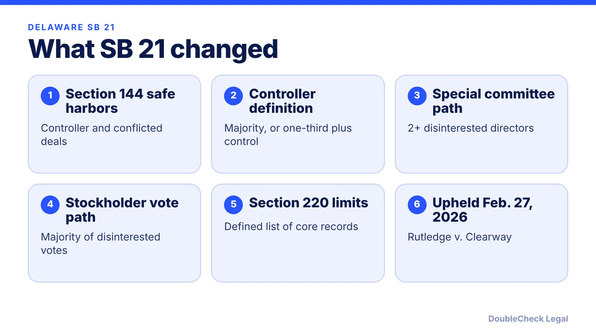
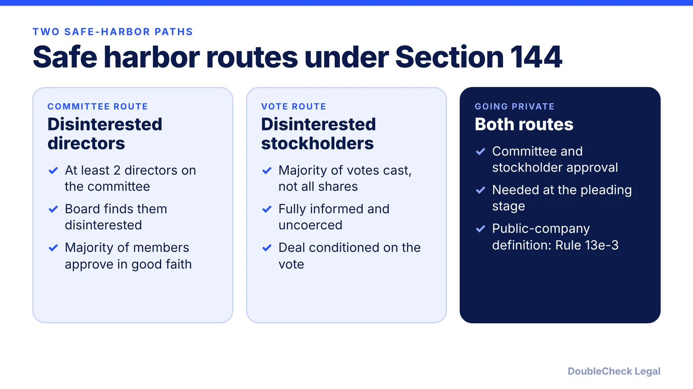

*What Delaware SB 21 changed for controlling stockholders and records demands, and where it stands as of November 2026.*

**Key takeaways:**

- SB 21, signed March 25, 2025, amended DGCL Sections 144 and 220.
- Controller deals can get safe harbors through a disinterested committee or a disinterested stockholder vote.
- A holder under a majority is a controller only with one-third of the vote plus managerial power.
- The Delaware Supreme Court upheld the amended Section 144 on February 27, 2026.

## 1. The quick answer

**Quick answer:** Delaware Senate Bill 21, signed March 25, 2025, rewrote two parts of the Delaware General Corporation Law: Section 144, which now offers safe harbors for transactions involving controlling stockholders and conflicted directors, and Section 220, which narrows what stockholders can demand to inspect. On February 27, 2026, the Delaware Supreme Court upheld the amended Section 144 in *Rutledge v. Clearway Energy Group*, so as of November 2026 the law is in force and constitutionally tested. For a startup with a founder or investor who holds a large voting block, it changes how related-party deals and stockholder records requests work.

## 2. What changed in Section 144

Before SB 21, transactions between a corporation and its controlling stockholder were often reviewed by Delaware courts under the demanding entire fairness standard. Per Gibson Dunn's summary, SB 21 created statutory safe harbors. Per Skadden, if a safe harbor is met, the transaction cannot be the subject of equitable relief or an award of damages for breach of fiduciary duty.

The two main paths, per Skadden and Gibson Dunn:

- **Special committee:** approval or recommendation by a committee of at least two directors the board has determined are disinterested, with a majority of the disinterested members approving in good faith.
- **Disinterested stockholder vote:** approval by a majority of the votes cast by disinterested stockholders, fully informed and uncoerced, with the deal conditioned on that vote.
- **Going-private deals:** need both paths to get the safe harbor at the pleading stage, per Gibson Dunn.

A separate safe harbor covers decisions where most directors are conflicted, such as director compensation. Gibson Dunn also reports that controllers and control-group members are exculpated from duty-of-care liability, with no opt-out.

## 3. Who counts as a controlling stockholder, and what happened to Section 220

Per Gibson Dunn, a holder of a majority of the voting power is a controlling stockholder. A holder with less is controlling only if it has both power functionally equivalent to a majority, through one-third of the voting power, and the power to exercise managerial authority over the business. For a startup, that means a founder or lead investor with 20% or 30% is not a statutory controller merely because of influence.

For public companies, a director is presumed disinterested if the board determined the director meets stock exchange independence rules, and rebutting that at the pleading stage takes "substantial and particularized facts," per Gibson Dunn. Many private startups have no exchange standard, so the committee path depends on a clear board determination.

Section 220 lets stockholders inspect books and records. Per Gibson Dunn, SB 21 limits the defined materials to items such as the charter, bylaws, stockholder minutes and consents, board and committee minutes and materials, annual financial statements, and director independence questionnaires. Directors' and officers' emails and texts are excluded. Demands must state their purpose and describe the records with reasonable particularity, and companies may impose confidentiality limits and redact unrelated material.

Founders who also hold stock as employees should read [how startup stock options and 409A valuations work](/blog/stock-options-409a-valuation-startups/) and the [term sheet key terms](/blog/term-sheet-key-terms-explained/) for where governance rights get negotiated.

## 4. Retroactivity, status, and what startups should do

SB 21 applies to all acts or transactions except pending litigation and inspection demands made on or before February 17, 2025, per Gibson Dunn. In *Rutledge v. Clearway Energy Group*, decided February 27, 2026, the Delaware Supreme Court rejected arguments that the amended Section 144 stripped the Court of Chancery of equitable jurisdiction or unconstitutionally applied retroactively, per Skadden and Debevoise.

Practical steps for a Delaware corporation:

- **Map your insiders.** Identify any stockholder near a majority, or near one-third with real managerial power.
- **Document related-party deals.** Founder loans, side agreements, and investor affiliate contracts are the typical candidates for committee or disinterested-vote approval.
- **Keep clean minutes.** Section 220 lists board minutes and materials as core records, so what you write down matters.
- **Do not assume a safe harbor is automatic.** Each path has conditions: disinterestedness, full information, and timing.

Choosing Delaware also carries tax and compliance costs; see [Delaware franchise tax for startups](/blog/delaware-franchise-tax-startups/) and [how to incorporate a SaaS or AI startup in Delaware](/blog/how-to-incorporate-saas-ai-startup-delaware-c-corp/). Applying the statute to a specific deal is a question for a corporate attorney, and [a startup lawyer's cost](/blog/how-much-does-a-startup-lawyer-cost/) is worth knowing before you ask.

## Where DoubleCheck fits

[DoubleCheck](https://www.contactdoublecheck.com) helps businesses and founders start legal work with AI, verify it, and, when professional advice is warranted, connect with an independent attorney, including for immigration questions. Attorney availability and practice areas vary. Attorneys on DoubleCheck are independent professionals; an attorney-client relationship forms only if an attorney accepts your engagement.

**Sources:** [Gibson Dunn on SB 21](https://www.gibsondunn.com/delaware-legislature-codifies-safe-harbors-for-controller-transactions-and-moderates-inspection-demands/); [Skadden on the Delaware Supreme Court decision](https://www.skadden.com/insights/publications/2026/03/delaware-supreme-court-upholds-constitutionality-of-sb21-provisions); [Debevoise](https://www.debevoise.com/insights/publications/2026/02/delaware-supreme-court-upholds-constitutionality).

## FAQ

**What is Delaware SB 21?**

It is a March 2025 amendment to the Delaware General Corporation Law that changed Section 144 (conflicted and controller transactions) and Section 220 (stockholder inspection rights). Gibson Dunn reports it was signed March 25, 2025.

**Did the Delaware Supreme Court uphold SB 21?**

Yes, in part. In Rutledge v. Clearway Energy Group, decided February 27, 2026, the court upheld the amended Section 144 against challenges that it stripped equitable jurisdiction and applied retroactively, per Skadden and Debevoise.

**Who is a controlling stockholder under SB 21?**

Per Gibson Dunn, a majority holder is a controller. A holder with less is one only if it has one-third of the voting power and the power to exercise managerial authority over the business.

**Does SB 21 affect startups that are not public?**

The amendments apply to Delaware corporations generally, so private startups are covered. Some features, such as the stock-exchange independence presumption, are written for public companies. Ask a corporate attorney how they apply to your cap table.

---

*General information only. This article is not legal, tax, investment, or accounting advice.*
