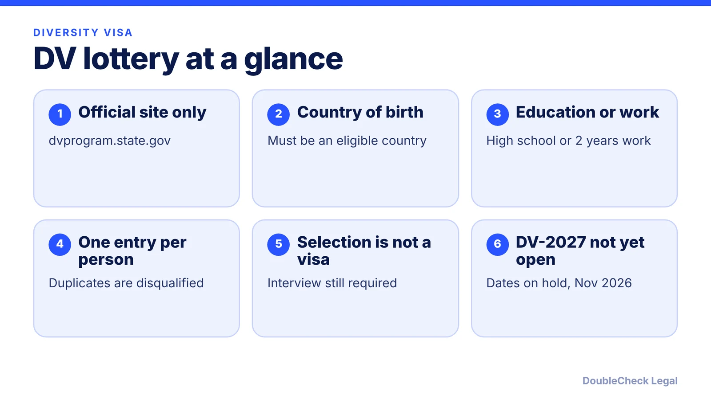
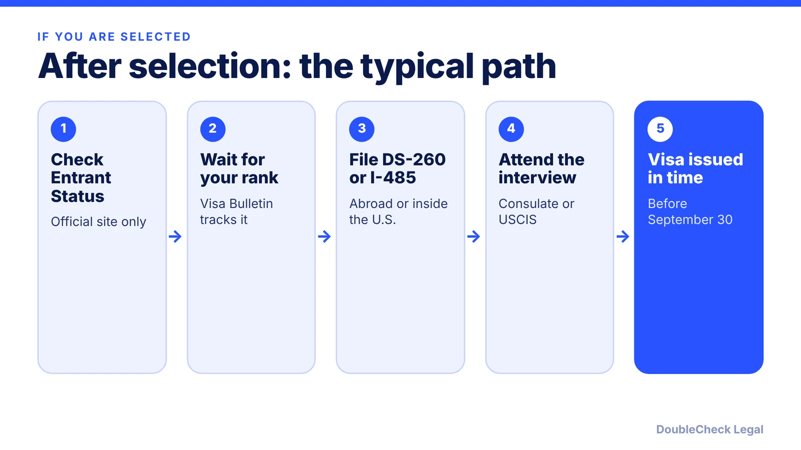

*How the Diversity Visa program works and where DV-2027 stands, as of November 2026.*

**Key takeaways:**

- DV-2027 registration had not opened as of November 2026; a court-ordered schedule was stayed on October 29, 2026.
- Enter only through the official State Department site, dvprogram.state.gov; the department does not notify winners by mail or email.
- You generally need an eligible birth country and a high school education or two years of qualifying work.
- Selection is only the start: you still need a visa number, a filing, an interview and approval before September 30 of the program year.

## 1. The quick answer

**Quick answer:** The Diversity Visa (DV) program, often called the green card lottery, makes up to 55,000 immigrant visas available each year by random selection, per the Cronista report on federal law. Entry is online only, at the State Department's official site, dvprogram.state.gov. As of November 2026, DV-2027 registration has not opened. A federal court ordered it to open by November 1, 2026, but per Headman Law Group the Ninth Circuit paused that order on October 29, 2026, and no entry dates have been announced. Selection is not a visa: you still need an interview and approval, and the State Department does not notify winners by mail or email.

## 2. Eligibility: who can enter the green card lottery

Per [Boundless](https://www.boundless.com/immigration-resources/diversity-visa-lottery), which covers the DV-2026 cycle, the main requirements are:

- **Country of birth.** You must be born in a country that sent fewer than 50,000 immigrants to the U.S. over the past five years. The eligible list changes from year to year. For DV-2026, Boundless lists excluded countries including Canada, China, India, Mexico, and the Philippines. The DV-2027 country list had not been published as of Gozel Law's October 29, 2026 update, so check the State Department's current list.
- **Education or work.** You need a high school education or equivalent, or two years of work experience within the past five years in a qualifying occupation.
- **Spouse or parent route.** If your own birth country is not eligible, you may qualify through your spouse's birth country or, in some cases, a parent's.
- **Age.** There is no minimum age, but most people under 18 will not meet the education or work requirement.

Per Headman Law Group, a travel ban (Proclamation 10998) took effect January 1, 2026 for 39 countries with no diversity visa exception. Being eligible to enter does not mean a visa can be issued, so check your country's status before relying on a selection.

**What entry requires.** Per [Gozel Law](https://www.gozellaw.com/blog/dv-lottery-2027) and the [Cronista](https://www.cronista.com/en/immigration/federal-law-still-sets-55000-visa-lottery-green-cards-a-year-but-no-one-has-been-selected-for-2027/), the proposed DV-2027 entry includes details from a valid passport and a scan of its biographic and signature pages, a color photo, family information, and a $1 nonrefundable registration fee paid electronically. Headman Law Group says the passport rule was published March 11, 2026 and took effect April 10, 2026. Only one entry per person is allowed. These details come from law firm and news reporting on a program that has not opened, so confirm them on the official site once entries open.

## 3. Where DV-2027 stands as of November 2026

This is the fast-moving part. Per [Headman Law Group](https://headmanlaw.com/insights/dv-2027-lottery-cancelled-court-case-dv-2028/) (published November 5, 2026):

- On November 5, 2025, the State Department said it would announce DV-2027 registration dates "as soon as practicable". Per the [State Department notice](https://travel.state.gov/content/travel/en/News/visas-news/changes-to-2027-dv-program-entry-period.html), the DV-2027 visa application period runs October 1, 2026 to September 30, 2027.
- In *Red Eagle Law, L.C. v. Rubio* (S.D. Cal.), the court granted a preliminary injunction on October 14, 2026, ordering registration to open by November 1 for 30 days with selectees notified by December 3.
- The Ninth Circuit stayed that order on October 29, 2026 while the appeal continues. Registration did not open on November 1.
- Headman says no DV-2027 or DV-2028 dates had been published as of November 5, 2026. A bill to end the program (H.R. 10896) was introduced October 22, 2026 and had only been referred to committee.

Visa issuance for DV-2026 selectees was also disrupted. Per Boundless, the program was paused as of December 18, 2025, and per Gozel Law a court ordered processing to resume in August 2026, though it has been slow.

**Bottom line:** do not assume a window is coming soon. Per [VisaVerge](https://www.visaverge.com/greencard/judge-ohta-sets-2027-green-card-lottery-opening-date-for-diversity-visa/), a site claiming DV-2027 registration is open now is not official.

## 4. Scams, what happens after selection, and when to get help

**Scams.** Diversity visa scams are common because people want to believe the lottery is easy. Use only dvprogram.state.gov and the Entrant Status Check there. Per Boundless, the State Department does not notify winners by mail or email, and anyone who claims to be able to improve your odds, guarantee selection, or collect an entry fee on the State Department's behalf is a red flag. Do not send passport scans or payment to third-party sites or messages. Keep your confirmation number, because you need it to check your result.

**After selection.** Per Boundless:

- Check results through the Entrant Status Check starting in early May of the following year in a normal cycle. DV-2027 timing is on hold.
- You receive a numerical rank, and you can follow the Visa Bulletin to see when you can apply (see [the Visa Bulletin explained](/blog/visa-bulletin-explained-priority-dates-eb-categories/)).
- If you are outside the U.S., you submit Form DS-260 to the National Visa Center, followed by a consular interview. If you are in the U.S. in a temporary status, you file Form I-485 instead (see [the I-485 guide](/blog/i-485-adjustment-of-status-guide/)).
- Visas must be issued by September 30 of the program year, and you must meet the same admissibility rules as any green card applicant.

Under Boundless, selected applicants pay the standard green card application fees; confirm amounts on the official site. Gozel Law lists a $330 diversity visa application fee for DV-2027, only if selected.

**When to handle it yourself and when to get a lawyer.** Entering is something most people can do on their own once it opens. Get an immigration attorney to review your case if you are selected, especially if you have past overstays, a criminal record, or inconsistent facts across documents, or if you are in the U.S. and thinking of adjusting status. Any inconsistency can lead to refusal, and you must never misstate facts to officials. See [overstays and unlawful presence](/blog/immigration-overstay-unlawful-presence-3-10-year-bars-explained/), [immigration lawyer fees](/blog/immigration-lawyer-fees-flat-fee-vs-hourly/), and [how many people immigrate each year](/blog/how-many-people-immigrate-to-the-us-each-year-green-cards-visas-data/).

## Where DoubleCheck fits

[DoubleCheck](https://www.contactdoublecheck.com) helps businesses and founders start legal work with AI, verify it, and, when professional advice is warranted, connect with an independent attorney, including for immigration questions. Attorney availability and practice areas vary. Attorneys on DoubleCheck are independent professionals; an attorney-client relationship forms only if an attorney accepts your engagement.

**Sources:** [State Department notice on DV-2027 entry period](https://travel.state.gov/content/travel/en/News/visas-news/changes-to-2027-dv-program-entry-period.html); [Headman Law Group, Nov 5, 2026](https://headmanlaw.com/insights/dv-2027-lottery-cancelled-court-case-dv-2028/); [Gozel Law](https://www.gozellaw.com/blog/dv-lottery-2027); [Cronista, Oct 22, 2026](https://www.cronista.com/en/immigration/federal-law-still-sets-55000-visa-lottery-green-cards-a-year-but-no-one-has-been-selected-for-2027/); [VisaVerge](https://www.visaverge.com/greencard/judge-ohta-sets-2027-green-card-lottery-opening-date-for-diversity-visa/); [Boundless](https://www.boundless.com/immigration-resources/diversity-visa-lottery). dvprogram.state.gov and the DV-2026 instructions PDF did not load for us, so eligibility details are attributed to secondary sources.

## FAQ

**Is the DV-2027 green card lottery open?**

As of November 2026, no. Per Headman Law Group, a court ordered registration to open by November 1, 2026, but the Ninth Circuit stayed that order on October 29, 2026, and no entry dates had been published. Check dvprogram.state.gov for current status.

**Who is eligible for the diversity visa lottery?**

Per Boundless, you must be born in an eligible country (one that sent fewer than 50,000 immigrants to the U.S. over five years) and have a high school education or equivalent, or two years of qualifying work experience in the past five years. You may also qualify through a spouse or, in some cases, a parent.

**How do I know if a diversity visa message is a scam?**

Per Boundless, the State Department does not notify winners by mail or email; you check only through the Entrant Status Check at dvprogram.state.gov. Treat any other site, message, or person who promises selection or asks for payment on the State Department behalf as a scam.

**What happens if I am selected?**

Per Boundless, you get a numerical rank, follow the Visa Bulletin, then file Form DS-260 with the National Visa Center if abroad or Form I-485 if in the U.S. in a temporary status, attend an interview, and have the visa issued before the program year ends on September 30.

---

*General information only. This article is not legal, tax, investment, or accounting advice.*
