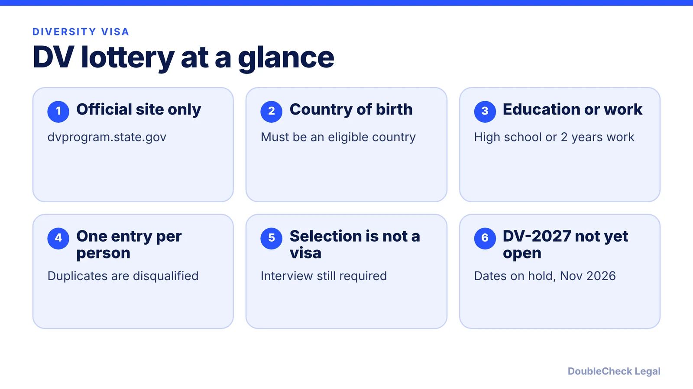
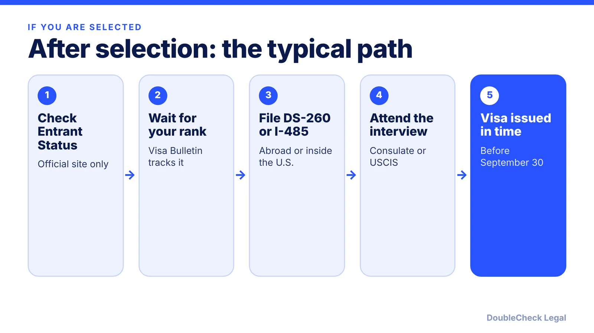

*How the Diversity Visa program works and where DV-2027 stands, as of November 2026.*

**Key takeaways:**

- DV-2027 registration had not opened as of November 2026; a court order to reopen it was stayed in late October 2026.
- Enter only through the official State Department site, dvprogram.state.gov; the department does not notify winners by mail or email.
- You generally need an eligible birth country and a high school education or two years of qualifying work.
- Selection is only the start: you still need a visa number, a filing, an interview and approval before September 30 of the program year.

## 1. The quick answer

**Quick answer:** The Diversity Visa (DV) program, often called the green card lottery, makes up to 55,000 immigrant visas available each year by random selection, per the State Department DV program instructions. Entry is online only, at the State Department's official site, dvprogram.state.gov. As of November 2026, DV-2027 registration has not opened. A federal court ordered the program reopened, but per Fragomen the Ninth Circuit paused that order in late October 2026, and the program remains halted while litigation continues. Selection is not a visa: you still need an interview and approval, and the State Department does not notify winners by mail or email.

## 2. Eligibility: who can enter the green card lottery

Per the State Department's [DV-2026 instructions](https://travel.state.gov/content/dam/visas/Diversity-Visa/DV-Instructions-Translations/DV-2026-Instructions-Translations/DV%202026%20Plain%20Language%20Instructions%20and%20FAQs.pdf), the most recent published instructions, the main requirements are:

- **Country of birth.** You must be born in a country that sent fewer than 50,000 immigrants to the U.S. over the past five years. The eligible list changes from year to year. The DV-2026 instructions list excluded countries including Canada, China, India, Mexico, and the Philippines. The DV-2027 country list had not been published when we last checked, so check the State Department's current list.
- **Education or work.** You need a high school education or equivalent, or two years of work experience within the past five years in a qualifying occupation.
- **Spouse or parent route.** If your own birth country is not eligible, you may qualify through your spouse's birth country or, in some cases, a parent's.
- **Age.** There is no minimum age, but most people under 18 will not meet the education or work requirement.

Travel restrictions and other country-specific measures can prevent a visa from being issued even after selection. Being eligible to enter does not mean a visa can be issued, so check your country's status with the State Department before relying on a selection.

**What entry requires.** Entry is online only, through the official State Department site. The DV-2027 entry instructions, including the photo, passport and fee requirements, had not been published when we last checked, so read the official instructions once entries open and do not rely on third-party summaries. Only one entry per person is allowed each cycle.

## 3. Where DV-2027 stands as of November 2026

This is the fast-moving part. Per the State Department [notice](https://travel.state.gov/content/travel/en/News/visas-news/changes-to-2027-dv-program-entry-period.html), the DV-2027 visa application period runs October 1, 2026 to September 30, 2027.

- In *Red Eagle Law, L.C. v. Rubio* (S.D. Cal.), the court granted a [preliminary injunction on October 14, 2026](https://www.courthousenews.com/wp-content/uploads/2026/10/redeagle-v-rubio-ruling-101426.pdf) ordering the State Department to announce and run a 30-day FY 2027 registration period.
- Per [Fragomen](https://www.fragomen.com/insights/united-states-ninth-circuit-stays-district-court-order-leaving-fy-2027-diversity-visa-lottery-program-halted-while-litigation-continues.html), the Ninth Circuit stayed that order in late October 2026 while the appeal continues, leaving the program halted while litigation continues.
- Because the status can change quickly, confirm the current position at dvprogram.state.gov before acting on any report, including this one.

Visa issuance for DV-2026 selectees was also affected; see the State Department's [update on the DV-2026 program](https://travel.state.gov/content/travel/en/News/visas-news/update-on-dv-program-2026.html) for current details.

**Bottom line:** do not assume a window is coming soon. Registration is only open when the State Department announces it at dvprogram.state.gov, so treat any site claiming DV-2027 registration is open now as not official.

## 4. Scams, what happens after selection, and when to get help

**Scams.** Diversity visa scams are common because people want to believe the lottery is easy. Use only dvprogram.state.gov and the Entrant Status Check there. Per the State Department DV-2026 instructions, the State Department does not notify winners by mail or email, and anyone who claims to be able to improve your odds, guarantee selection, or collect an entry fee on the State Department's behalf is a red flag. Do not send passport scans or payment to third-party sites or messages. Keep your confirmation number, because you need it to check your result.

**After selection.** Per the State Department DV-2026 instructions:

- Check results through the Entrant Status Check starting in early May of the following year in a normal cycle. DV-2027 timing is on hold.
- You receive a numerical rank, and you can follow the Visa Bulletin to see when you can apply (see [the Visa Bulletin explained](/blog/visa-bulletin-explained-priority-dates-eb-categories/)).
- If you are outside the U.S., you submit Form DS-260 to the National Visa Center, followed by a consular interview. If you are in the U.S. in a temporary status, you file Form I-485 instead (see [the I-485 guide](/blog/i-485-adjustment-of-status-guide/)).
- Visas must be issued by September 30 of the program year, and you must meet the same admissibility rules as any green card applicant.

Selected applicants pay visa application and related fees; confirm current amounts on the official State Department site.

**When to handle it yourself and when to get a lawyer.** Entering is something most people can do on their own once it opens. Get an immigration attorney to review your case if you are selected, especially if you have past overstays, a criminal record, or inconsistent facts across documents, or if you are in the U.S. and thinking of adjusting status. Any inconsistency can lead to refusal, and you must never misstate facts to officials. See [overstays and unlawful presence](/blog/immigration-overstay-unlawful-presence-3-10-year-bars-explained/), [immigration lawyer fees](/blog/immigration-lawyer-fees-flat-fee-vs-hourly/), and [how many people immigrate each year](/blog/how-many-people-immigrate-to-the-us-each-year-green-cards-visas-data/).

## Where DoubleCheck fits

[DoubleCheck](https://www.contactdoublecheck.com) helps businesses and founders start legal work with AI, verify it, and, when professional advice is warranted, connect with an independent attorney, including for immigration questions. Attorney availability and practice areas vary. Attorneys on DoubleCheck are independent professionals; an attorney-client relationship forms only if an attorney accepts your engagement.

**Sources:** [State Department notice on DV-2027 entry period](https://travel.state.gov/content/travel/en/News/visas-news/changes-to-2027-dv-program-entry-period.html); [State Department, DV-2026 instructions](https://travel.state.gov/content/dam/visas/Diversity-Visa/DV-Instructions-Translations/DV-2026-Instructions-Translations/DV%202026%20Plain%20Language%20Instructions%20and%20FAQs.pdf); [State Department, update on DV program 2026](https://travel.state.gov/content/travel/en/News/visas-news/update-on-dv-program-2026.html); [Fragomen, Ninth Circuit stay](https://www.fragomen.com/insights/united-states-ninth-circuit-stays-district-court-order-leaving-fy-2027-diversity-visa-lottery-program-halted-while-litigation-continues.html); [Red Eagle Law v. Rubio, S.D. Cal. order of Oct 14, 2026](https://www.courthousenews.com/wp-content/uploads/2026/10/redeagle-v-rubio-ruling-101426.pdf). DV-2027 instructions had not been published, so eligibility details are taken from the DV-2026 instructions.

## FAQ

**Is the DV-2027 green card lottery open?**

As of November 2026, no. Per Fragomen, a federal court ordered the program reopened, but the Ninth Circuit stayed that order in late October 2026 and the program remains halted while litigation continues. Check dvprogram.state.gov for current status.

**Who is eligible for the diversity visa lottery?**

Per the State Department DV-2026 instructions, you must be born in an eligible country (one that sent fewer than 50,000 immigrants to the U.S. over five years) and have a high school education or equivalent, or two years of qualifying work experience in the past five years. You may also qualify through a spouse or, in some cases, a parent.

**How do I know if a diversity visa message is a scam?**

Per the State Department DV-2026 instructions, the State Department does not notify winners by mail or email; you check only through the Entrant Status Check at dvprogram.state.gov. Treat any other site, message, or person who promises selection or asks for payment on the State Department behalf as a scam.

**What happens if I am selected?**

Per the State Department DV-2026 instructions, you get a numerical rank, follow the Visa Bulletin, then file Form DS-260 with the National Visa Center if abroad or Form I-485 if in the U.S. in a temporary status, attend an interview, and have the visa issued before the program year ends on September 30.

---

*General information only. This article is not legal, tax, investment, or accounting advice.*
