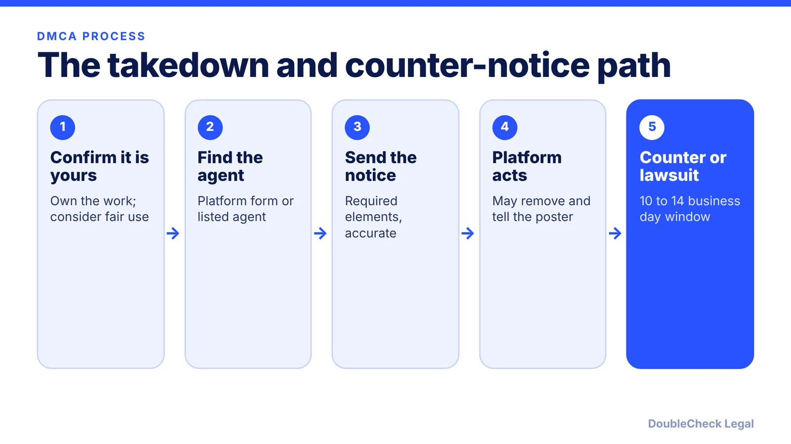
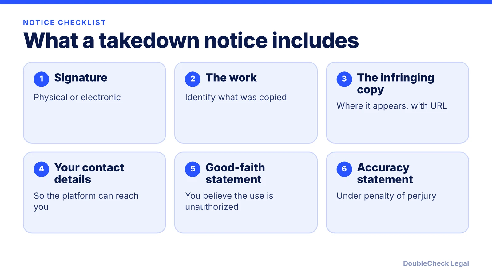

*A DMCA takedown notice, explained for small businesses: how to send one, how to respond, and what platforms must do, as of November 2026.*

**Key takeaways:**

- A notice needs six elements under 17 U.S.C. 512(c)(3), including a statement of accuracy under penalty of perjury.
- A counter-notice leads to restoration in 10 to 14 business days unless the sender files suit.
- Knowingly false notices or counter-notices can create liability under section 512(f).
- Hosting user content? Register a designated agent and keep a repeat-infringer policy.

## 1. The quick answer

**Quick answer:** A DMCA takedown notice is a written request, sent to a website or platform's designated agent, asking it to remove content that infringes your copyright. Under 17 U.S.C. 512(c)(3), it must include a signature, identification of your work, the location of the infringing material, your contact details, a good-faith statement, and a statement of accuracy and authority under penalty of perjury. If you receive one, you can usually send a counter-notice, and the platform must restore the material 10 to 14 business days later unless the sender files a lawsuit first. Small businesses use the process on both sides, so know the steps before you need them.

## 2. How to send a DMCA takedown notice

Before you send anything, confirm you own, or are authorized to act for the owner of, the copyrighted work. Registration is not required to send a notice, but see [copyright registration for small businesses](/blog/copyright-registration-small-business-how-to/) for why it matters if you later sue.

Section 512(c)(3)(A) lists what the notice must contain:

- A physical or electronic signature of a person authorized to act for the owner.
- Identification of the copyrighted work (or a representative list).
- Identification of the infringing material and enough information to locate it, such as direct URLs.
- Your contact information.
- A statement that you have a good-faith belief the use is not authorized by the owner, its agent, or the law.
- A statement that the notice is accurate and, under penalty of perjury, that you are authorized to act for the owner.

Send it to the platform's designated agent. Under 17 U.S.C. 512(c)(2), a provider that wants the safe harbor designates an agent with the U.S. Copyright Office, which runs a public DMCA Designated Agent Directory. Look the platform up there, and check whether it also publishes its own web form.

Two cautions. First, a notice that substantially fails the requirements cannot be used to show the provider knew of the infringement (512(c)(3)(B)), so sloppy notices often get ignored. Second, under 512(f), knowingly and materially misrepresenting that material is infringing creates liability for resulting damages, including costs and attorneys' fees. Think about fair use before you send, since a platform does not decide it for you. Not every copy of your content is infringement; see [trademark vs copyright vs patent](/blog/trademark-vs-copyright-vs-patent-startups/) if your issue is really a name or logo.

A takedown notice is not the same as a demand letter. If you want to send a stronger letter to the infringer, see [how to respond to a cease and desist letter](/blog/how-to-respond-cease-and-desist-letter/) for what the recipient sees.

## 3. How to respond if you receive a DMCA takedown notice

If a platform removes your content after a notice, you usually get a message saying so. Do not panic and do not repost the material right away.

1. **Read the notice.** Note who claims what work and which URLs are named.
2. **Decide if the claim is wrong.** Common reasons: you own or licensed the material, it is fair use, it is not copyrightable, or the sender is misidentifying it. Fair use weighs four factors (purpose and character, nature of the work, amount used, and market effect) and is a defense; platforms generally do not weigh it for you. See 17 U.S.C. 107 for the statutory factors.
3. **If the claim is right,** leave it down and fix the problem. Check whether you have a license you forgot about, and ask the sender whether they will withdraw.
4. **If the claim is wrong,** consider a counter-notice.

Under 512(g)(3), a counter-notice needs your signature, identification of the removed material and where it appeared, a statement under penalty of perjury that you believe in good faith the removal was a mistake or misidentification, your name, address and phone number, and your consent to the federal district court for your address and to accept service from the complainant. Under 17 U.S.C. 512(g)(2), the provider must forward your counter-notice and restore the material no sooner than 10 and no later than 14 business days after receiving it, unless it first learns the sender has filed a lawsuit.

The consent to federal jurisdiction is the part that surprises people: it means the sender can sue you. Weigh that before you file. If your content is core to your business, talk to an attorney first. Your platform's own rules may add steps, such as strikes on your account.

## 4. The platform side: designated agents and repeat infringers

If your small business hosts user content (reviews, uploads, a forum, a marketplace), the DMCA matters to you as a provider too.

- **Designate an agent.** Section 512(c)(2) says a provider gets the safe harbor only if it designated an agent to receive notices, made the designation public (including on its website), and filed it with the Copyright Office. Per the Copyright Office FAQ, the fee is $6 per designation, amendment or resubmission, and a designation expires three years after registration unless renewed. Separate legal entities such as a parent and subsidiary each need their own.
- **Adopt a repeat-infringer policy.** Section 512(i) requires a provider to adopt, reasonably implement and tell users about a policy for terminating repeat infringers in appropriate circumstances.
- **Follow the notice process.** Section 512(g)(2) conditions protection for takedowns on notifying the user, forwarding counter-notices and restoring material in the 10 to 14 business day window.

If you do not register, the Copyright Office says you risk losing section 512 safe harbor protections. Put the DMCA process in your website terms; see [website terms of service for SaaS startups](/blog/website-terms-of-service-saas-startups/) and the [terms and conditions generator guide](/blog/terms-and-conditions-generator-small-business/). Whether you count as a "service provider" is fact-specific, so ask a lawyer.

## 5. Common mistakes and when to bring in a lawyer

**Mistakes senders make:** sending notices for material they do not own, ignoring fair use, copying generic templates with missing elements, and using DMCA notices to remove criticism or competitor content. Section 512(f) exists for that.

**Mistakes recipients make:** deleting everything and saying nothing, reposting immediately, signing a counter-notice without understanding the jurisdiction consent, or missing the platform's own deadline.

**Handle it yourself when** the work is clearly yours, the infringement is a straight copy, and the platform has a simple form. **Bring in an attorney when** the other side may have a license or fair use claim, you got a notice for content central to your revenue, you are considering a counter-notice, the sender threatens a lawsuit, or AI-generated content is involved. See [AI-generated content and copyright](/blog/ai-generated-content-copyright-solo-business/), [when to hire a lawyer](/blog/when-to-hire-lawyer-small-business/) and [verify AI-generated legal documents](/blog/verify-ai-generated-legal-document/) before you send an AI-drafted notice or counter-notice, since both are sworn statements. For ongoing agreements with creators, see [independent contractor agreements](/blog/independent-contractor-agreement-what-to-include/) and [confidentiality and IP assignment](/blog/confidentiality-ip-assignment-agreements-startups/) so ownership is clear before disputes.

## Where DoubleCheck fits

[DoubleCheck](https://www.contactdoublecheck.com) helps businesses and founders start legal work with AI, verify it, and, when professional advice is warranted, connect with an independent attorney, including for immigration questions. Attorney availability and practice areas vary. Attorneys on DoubleCheck are independent professionals; an attorney-client relationship forms only if an attorney accepts your engagement.

**Sources:** [17 U.S.C. 512, Cornell LII](https://www.law.cornell.edu/uscode/17/512.html); [17 U.S.C. 107, Cornell LII](https://www.law.cornell.edu/uscode/text/17/107); [U.S. Copyright Office, DMCA Designated Agent Directory FAQ](https://copyright.gov/dmca-directory/faq.html); [Copyright Office blog, renew your DMCA agent registration (Oct. 17, 2019)](https://blogs.loc.gov/copyright/2019/10/it-may-be-time-to-renew-your-dmca-agent-registration/).

## FAQ

**What must a DMCA takedown notice include?**

Per 17 U.S.C. 512(c)(3)(A) (Cornell LII), it needs a signature, identification of the work, identification and location of the infringing material, your contact information, a good-faith belief statement, and a statement of accuracy and authority under penalty of perjury.

**How long does a DMCA counter-notice take to work?**

Per 17 U.S.C. 512(g)(2), the provider restores the material 10 to 14 business days after receiving a valid counter-notice, unless it first learns the sender has filed a court action against you.

**Do I need to register my work to send a DMCA takedown?**

The notice elements in 512(c)(3) do not mention registration. Registration matters mainly if you later sue. Ask an attorney how it affects your situation.

**Is there a penalty for a false DMCA takedown?**

Per 17 U.S.C. 512(f), anyone who knowingly and materially misrepresents that material is infringing, or that it was removed by mistake, is liable for resulting damages, including costs and attorneys fees.

**Do I need to register a DMCA agent for my website?**

If you want the section 512 safe harbor as a service provider, yes. The Copyright Office FAQ lists a $6 fee and a three-year expiration unless renewed. Check whether you qualify as a service provider with an attorney.

---

*General information only. This article is not legal, tax, investment, or accounting advice.*
