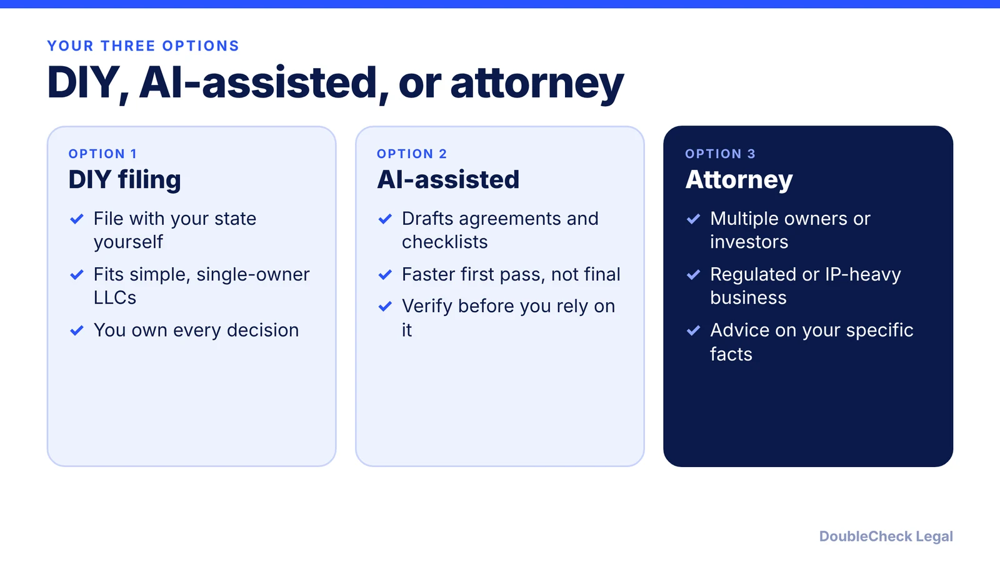
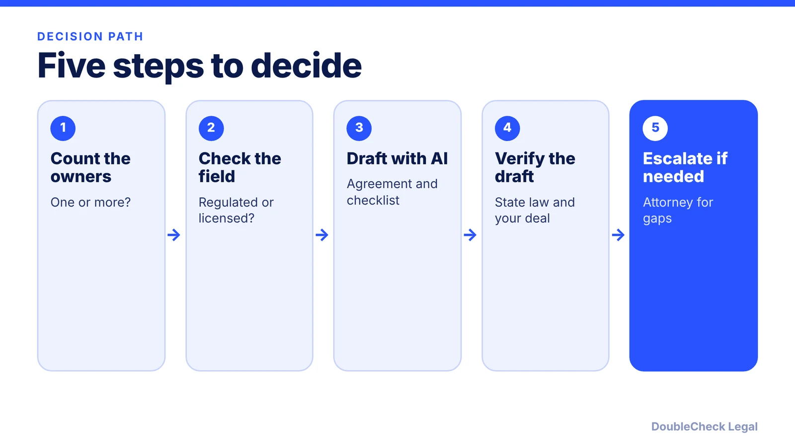

*You can form an LLC without a lawyer. The real question is which situations make one worth it.*

**Key takeaways:**

- No law requires a lawyer to form an LLC, per LegalZoom; DIY filing is often fine for simple single-owner businesses.
- AI can draft an operating agreement and checklists, but verify state rules, your actual deal, and tax choices.
- Multiple owners, investors, foreign owners, regulated professions, and existing IP or contracts are the main reasons to hire an attorney.
- Costs vary by state and lawyer, so get quotes and check your state's filing fee.

## 1. The quick answer

**Quick answer:** No, you do not need a lawyer to form an LLC. Per LegalZoom, "There are no laws that require you to use a lawyer to form an LLC," and you can file directly with your state, usually the Secretary of State. DIY filing is often fine for a simple, single-owner business. A lawyer becomes worth it when you have multiple owners, outside investors, a regulated profession, or complicated IP or contracts. AI can help you draft and prepare, but whatever it produces still needs checking against your state's rules and your situation.

## 2. When DIY filing is fine

Filing the formation document (called Articles of Organization or a Certificate of Formation in some states) is a form with a state fee. The state filing fee varies by state and your state's own page controls the actual fee; DIY costs only that fee, online services add a service fee, and an attorney charges for their time. See [which state to form in](/blog/best-state-to-form-an-llc-comparison/).

DIY tends to work when:

- You are the **only member** and not raising money soon.
- Your business is not a licensed profession and not in a heavily regulated field.
- You have no existing contracts, IP, or prior-employer issues that need sorting out.

Per the SBA, LLCs generally shield owners from personal liability, and an operating agreement is "widely recommended" even if your state does not require one. After filing, expect follow-on tasks: an EIN (per Ueni, citing the IRS, an EIN is free), an annual report (see [annual report requirements by state](/blog/annual-report-requirements-by-state-llc/)), and local permits (see [business license requirements](/blog/business-license-requirements-small-business/)). Our [incorporation guide](/blog/how-to-incorporate-a-company-in-the-us/) walks through the broader picture.

## 3. Where AI helps, and what to verify

AI is useful for the preparation work around formation:

- **A first draft of an operating agreement**, which you then compare against your state's LLC statute and your actual deal. See [LLC operating agreements with AI](/blog/llc-operating-agreement-with-ai/).
- **Checklists and plain-English explanations** of terms like member-managed versus manager-managed, capital contributions, and distributions.
- **Questions to bring to a professional**, so a paid consultation is shorter and more focused.

What to verify before you rely on it:

1. **Your state's rules.** Fees, names, and filing requirements are set by the state; check the Secretary of State page, not the AI's memory.
2. **Facts about your own deal.** Ownership percentages, who decides what, and what happens if someone leaves must match what the owners actually agreed.
3. **Tax choices.** Per the SBA, for non-standard arrangements, such as an LLC taxed as a corporation, "speak with a business counselor or an attorney."
4. **Confidentiality.** Do not paste sensitive information into a tool without understanding its terms; see [using AI for legal work safely](/blog/small-business-ai-legal-work-safely/).

AI output reads confidently whether or not it is right, so treat it as a draft, not as advice. See also [AI and small business lawyers](/blog/ai-lawyer-small-business/).

## 4. When an attorney is worth it

Per Swyft Filings, a lawyer makes the most sense with multiple owners, outside investors, or a regulated industry, and LegalZoom adds patents, multi-state operations, and the member-managed versus manager-managed and S corp choices. Common triggers:

- **Multiple members**, especially with uneven contributions or equity splits.
- **Investors or planned fundraising**, where an LLC may not be the right entity at all.
- **Foreign owners.** Tax and filing issues (for example [Form 5472 for foreign-owned LLCs](/blog/form-5472-foreign-owned-single-member-llc/)) and the EIN process differ. Per Ueni, applicants without an SSN or ITIN cannot use the IRS online EIN tool.
- **Regulated or licensed professions**, such as law, medicine, or accounting, which carry extra licensing rules.
- **Existing contracts or IP** that may belong to someone else, such as a former employer.

Cost matters, so ask for a **flat fee for a defined scope** (formation plus operating agreement review). Our guide on [startup lawyer costs, flat fee versus hourly](/blog/how-much-does-a-startup-business-lawyer-cost-flat-fee-vs-hourly/) covers the structures, and [how to tell if a lawyer is good](/blog/how-do-i-know-if-my-lawyer-is-good/) helps you choose. The hybrid approach, AI drafts and an attorney verifies, is the one DoubleCheck is built around.

## Where DoubleCheck fits

[DoubleCheck](https://www.contactdoublecheck.com) helps businesses and founders start legal work with AI, verify it, and, when professional advice is warranted, connect with an independent attorney, including for immigration questions. Attorney availability and practice areas vary. Attorneys on DoubleCheck are independent professionals; an attorney-client relationship forms only if an attorney accepts your engagement.

**Sources:** [LegalZoom, Do I need a lawyer to start an LLC](https://www.legalzoom.com/articles/do-i-need-a-lawyer-to-start-an-llc); [Swyft Filings](https://www.swyftfilings.com/blog/do-you-need-lawyer-llc/); [SBA, choose a business structure](https://www.sba.gov/business-guide/launch-your-business/choose-business-structure); [Ueni, EIN guide](https://ueni.com/blog/how-to-get-an-ein-number/).  the IRS EIN page was not fetched directly.

## FAQ

**Can I form an LLC myself without a lawyer?**

Yes. Per LegalZoom, no law requires a lawyer to form an LLC, and you can file directly with your state, usually the Secretary of State. A lawyer is optional and mostly useful for more complex setups.

**How much does a lawyer cost to form an LLC?**

Attorney formation costs depend on the state, the lawyer's experience and how complex your setup is, while DIY costs only the state filing fee. LegalZoom says fees can become a large share of startup costs. Get two or three quotes, ideally flat-fee, and check your state's own page for the filing fee.

**Can AI write my LLC operating agreement?**

It can produce a useful first draft, but you must check it against your state's LLC law and your owners' actual agreement. The SBA says an operating agreement is widely recommended even where not required.

**When should I definitely talk to an attorney?**

Per Swyft Filings, when you have multiple owners, outside investors, or a regulated industry. LegalZoom adds patents, multi-state operations, and tax-status choices such as S corp election.

---

*General information only. This article is not legal, tax, investment, or accounting advice.*
