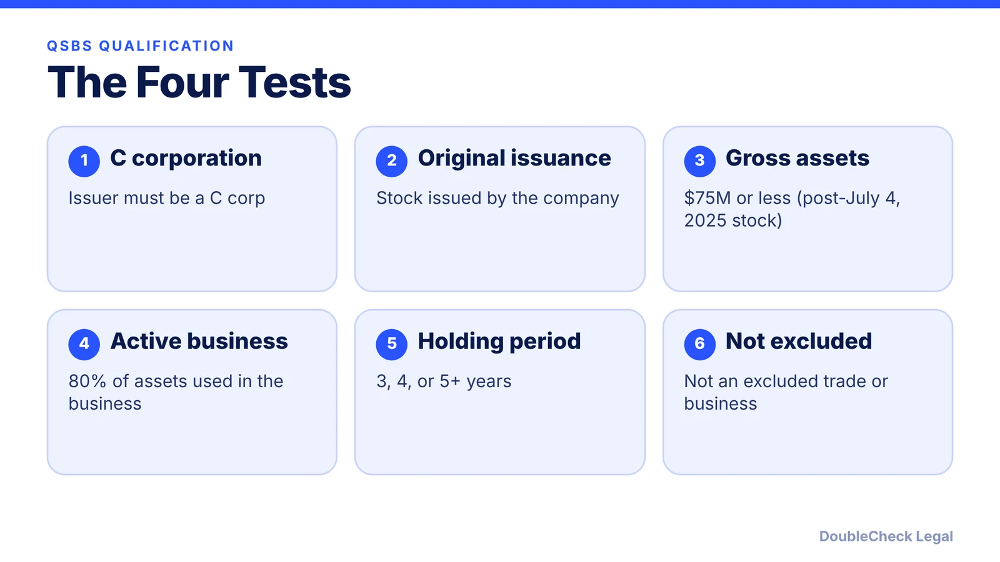
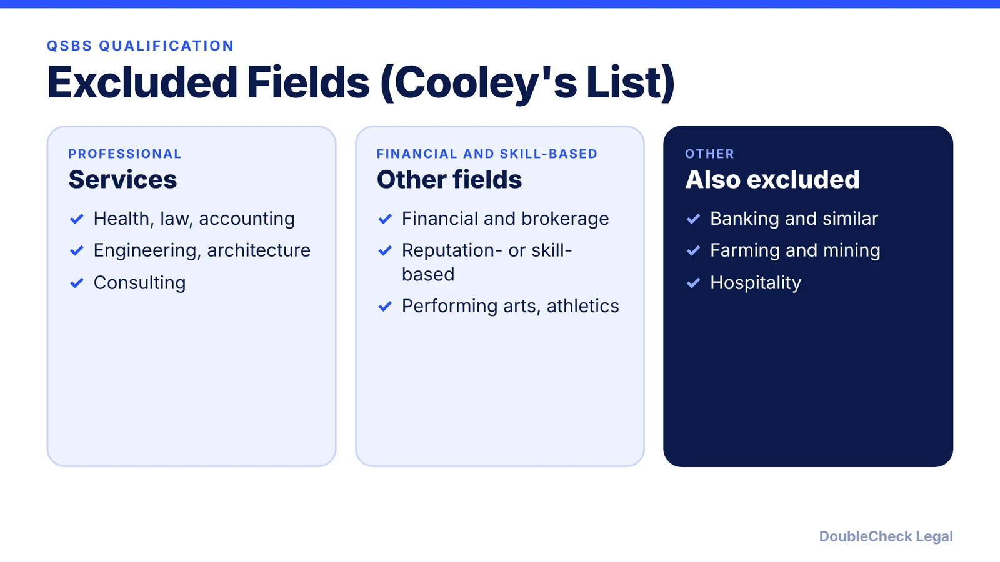
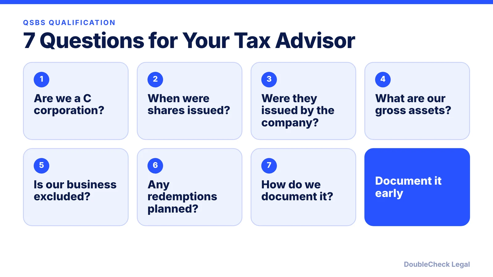

*Not every startup's stock is QSBS. Here is a checklist of the tests from a Cooley cheat sheet.*

**Key takeaways:**

- The issuer must be a C corporation, not an S corporation or other pass-through.
- Shares must be originally issued by the company.
- Gross assets must be $75 million or less for stock acquired after July 4, 2025.
- 80% of assets must be used in a qualified business; many service fields are excluded.

## 1. Four tests at a glance

Whether stock qualifies for QSBS depends on several tests. Cooley's cheat sheet lists them. Use this as a checklist to prepare questions for your tax advisor, and see [QSBS explained](/blog/qsbs-section-1202-explained-startup-founders/) for the exclusion numbers.

## 2. C corporation and original issuance

The issuer must be a **C corporation**. REITs, RICs, REMICs, DISCs, cooperatives, and pass-throughs such as S corporations are not eligible. The shares must be issued after August 10, 1993, in exchange for money, property other than stock, or services (excluding underwriting services).

## 3. The gross asset test

The company's aggregate gross assets, measured on an adjusted tax basis, must be at or below $75 million for stock acquired after July 4, 2025 ($50 million for older stock), at all times after August 10, 1993, and immediately after the issuance. The test includes cash or property contributed in that issuance, valued at fair market value.

## 4. The active business test

At least 80% (by value) of assets must be used in a qualified trade or business during substantially all of the holding period. Cooley lists excluded businesses including health, law, engineering, architecture, accounting, actuarial science, performing arts, consulting, athletics, financial and brokerage services, reputation- or skill-based businesses, banking and similar businesses, farming, mining, and hospitality.

Also: less than 10% of asset value can be real estate not used in the business, and less than 10% of net asset value can be portfolio stock or securities. A reasonable amount of working capital can count as active business assets, subject to limits.

## 5. Seven questions for your advisor

Pair this with [how to choose a good lawyer](/blog/how-to-choose-good-lawyer/) and [when to hire a lawyer](/blog/when-to-hire-lawyer-small-business/).

## Where DoubleCheck fits

[DoubleCheck](https://www.contactdoublecheck.com) is built for businesses that start legal work with AI. Bring your question or draft, use an AI-first workflow to understand and verify it, and when professional advice is warranted, you can connect with an independent attorney. Attorneys on DoubleCheck are independent professionals; an attorney-client relationship forms only if an attorney accepts your engagement.

**Sources:** [Cooley: Qualified small business stock cheat sheet](https://www.cooley.com/-/media/cooley/pdf/qualified-small-business-stock-cheat-sheet.pdf).

## FAQ

**Do S corporations qualify for QSBS?**

No. The issuer must be a C corporation, per Cooley.

**What is the gross asset limit?**

$75 million for stock acquired after July 4, 2025, and $50 million for older stock.

**Which businesses are excluded?**

Cooley lists fields including health, law, accounting, consulting, financial services, farming, mining, and hospitality.

**Can a redemption affect QSBS?**

Cooley cautions that significant redemptions, reorganizations, or conversions can compromise QSBS treatment.

---

*General information only. This article is not legal, tax, investment, or accounting advice.*
