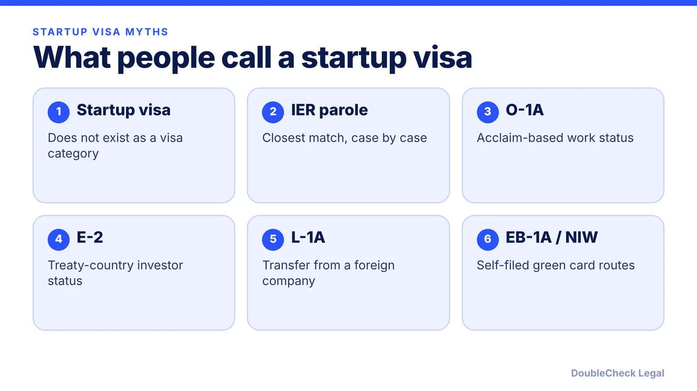
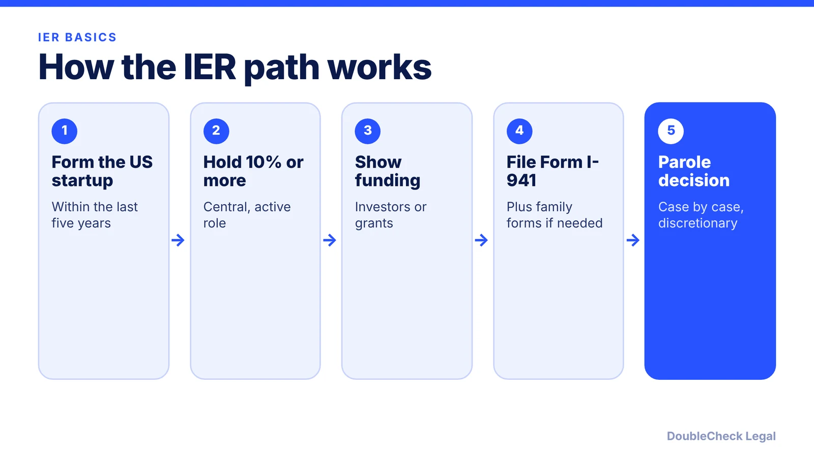

*No startup visa exists, but the International Entrepreneur Rule and several visas come close. Here is the status.*

**Key takeaways:**

- The US has no dedicated startup or entrepreneur visa (per NNU Immigration).
- The International Entrepreneur Rule is parole, not a visa, with no direct green card path.
- Sources from 2026 describe it as still in place; confirm on USCIS before relying on it.
- Founders usually use O-1A, E-2, L-1A, EB-1A, NIW or EB-5 instead.

## 1. The quick answer

**Quick answer:** No. The United States has no dedicated startup visa or entrepreneur visa. Per NNU Immigration, the US "does not currently offer a dedicated startup visa programme." The closest thing is the International Entrepreneur Rule (IER), which allows parole, a temporary permission to be in the US, for founders of recent US startups backed by qualified investors or government grants. It is not a visa and does not lead directly to a green card. Most founders use other categories: O-1A, E-2, L-1A, H-1B, EB-1A, the national interest waiver (NIW) or EB-5.

## 2. The International Entrepreneur Rule, status as of November 2026

The IER lets DHS grant parole case by case to founders of startups that would provide a significant public benefit. It was promulgated in January 2017, and Headman Law Group (July 22, 2026) says it was reinstated in mid-2021 after an intervening rescission attempt. Alma, in a page updated April 15, 2026, reports no 2026 rescission or new elimination effort, while calling the program's future uncertain. I could not load USCIS's own I-941 page, so confirm current status there before relying on it.

What the sources say about the rule:

- **Startup age and ownership.** Formed in the US within the previous five years (Headman, NNU); founder ownership of at least 10% at filing (Headman).
- **Funding.** For filings on or after October 1, 2024: $311,071 from qualified US investors or $124,429 from government grants or awards, per Mondaq and NNU. Earlier figures were $264,147 and $105,659. Alma expects the next adjustment October 1, 2027. A Headman page still shows the older numbers, so check USCIS before filing.
- **Duration.** Up to 30 months initially, with one further extension of up to 30 months (NNU, Headman).
- **Fees.** Form I-941 is $1,200 per Alma. Alma also lists a $1,000 parole fee under H.R. 1, effective October 16, 2025. Confirm amounts with USCIS.
- **Limits.** Not a path to permanent residence by itself (NNU). Headman reports processing of about 4 to 8 months and no premium processing. Alma says usage has been low, reporting "only a few dozen applications" since 2018, an undated figure.

Full details are in our [International Entrepreneur Rule guide](/blog/international-entrepreneur-rule-startup-parole-2026/).

## 3. What founders use instead

Since the IER is narrow and discretionary, founders usually pick from these. Each has its own guide.

- **O-1A.** Sustained acclaim, no investment. A US employer or agent files the petition (USCIS), so founders often use an agent or a company structure that supports it. Initial stay is up to three years. [O-1A evidence guide](/blog/o-1a-visa-for-startup-founders-evidence/).
- **E-2.** Nationals of treaty countries who invest substantially in a real business and own at least 50% or control it (NNU). [E-2 guide](/blog/e-2-treaty-investor-visa-for-founders/).
- **L-1A.** Managers or executives moving from a related foreign company, with one year abroad in the previous three (NNU). [L-1A for foreign founders](/blog/l-1a-visa-new-office-foreign-founders/).
- **EB-1A and NIW.** Self-filed green cards. See [EB-1A vs NIW](/blog/eb-1a-vs-niw-which-is-better-for-founders/) and the [NIW guide](/blog/niw-eb-2-national-interest-waiver-founders/).
- **EB-5.** $1,050,000, or $800,000 in a targeted employment area, with ten full-time US jobs required (NNU). [EB-5 requirements](/blog/eb-5-investor-visa-requirements-2026/).
- **Passport-specific:** [TN](/blog/tn-visa-canada-mexico-tech-professionals/) and [E-3](/blog/e-3-visa-australians/).

For a side-by-side overview, read [how to move to the US as an entrepreneur](/blog/how-to-move-to-the-us-as-an-entrepreneur-options-compared/) and the [founder visa comparison](/blog/us-visa-options-for-startup-founders-compared/).

## 4. Should you rely on the IER? When to get an attorney

The IER can fit a founder who already has a US company, real investor or grant backing and an ownership stake,, but parole decisions are discretionary and approval is never guaranteed. Compare it with alternatives before you spend filing fees: a track record may make O-1A stronger, a treaty passport may make E-2 simpler, and an existing foreign company may support L-1A.

**Handle yourself vs. get an attorney.** You can read the rules and gather facts alone. Get an attorney to check your plan when thresholds, ownership percentages or investor qualification matter, when you hold another status, or before any filing. Rule status can change, so ask them to confirm current USCIS and Federal Register positions. See [how to find a good immigration lawyer](/blog/how-to-find-good-immigration-lawyer-startup-founder/) and [immigration lawyer fees](/blog/immigration-lawyer-fees-flat-fee-vs-hourly/). Company setup is covered in [start a US company as a non-resident](/blog/start-us-company-as-non-us-resident/) and [how to incorporate](/blog/how-to-incorporate-a-company-in-the-us/).

## Where DoubleCheck fits

[DoubleCheck](https://www.contactdoublecheck.com) helps businesses and founders start legal work with AI, verify it, and, when professional advice is warranted, connect with an independent attorney, including for immigration questions. Attorney availability and practice areas vary. Attorneys on DoubleCheck are independent professionals; an attorney-client relationship forms only if an attorney accepts your engagement.

**Sources:** [NNU Immigration, US entrepreneur visa options](https://www.nnuimmigration.com/us-entrepreneur-visa/); [Headman Law Group, IER 2026](https://headmanlaw.com/insights/international-entrepreneur-rule-ier-parole-2026/); [Alma, IER news 2026](https://www.tryalma.com/learn/international-entrepreneur-rule-news); [Mondaq, IER threshold adjustments](https://www.mondaq.com/unitedstates/general-immigration/1501774/uscis-announces-adjustments-to-thresholds-in-international-entrepreneur-parole-rule); [NNU, new IER thresholds](https://www.nnuimmigration.com/?p=18328); [USCIS, O-1 visa](https://uscis.gov/o-1). USCIS I-941 and KKTP pages did not load.

## FAQ

**Is there a startup visa in the USA?**

No. NNU Immigration states the US does not currently offer a dedicated startup visa programme. The closest option is International Entrepreneur Rule parole, which is not a visa.

**Is the International Entrepreneur Rule still available in 2026?**

Sources dated 2026 describe it as in place: Headman Law Group (July 22, 2026) and Alma (April 15, 2026, reporting no 2026 rescission effort). I could not load the USCIS page, so verify current status with USCIS or an attorney.

**How much funding does IER parole require?**

For filings on or after October 1, 2024, Mondaq and NNU report $311,071 from qualified US investors or $124,429 from government grants or awards. Check USCIS for current figures before filing.

**What is the best alternative to a startup visa?**

It depends on your facts. O-1A needs sustained acclaim, E-2 needs a treaty-country passport and substantial investment, and L-1A needs an existing foreign company (per USCIS and NNU). An attorney can compare them for your case.

---

*General information only. This article is not legal, tax, investment, or accounting advice.*
