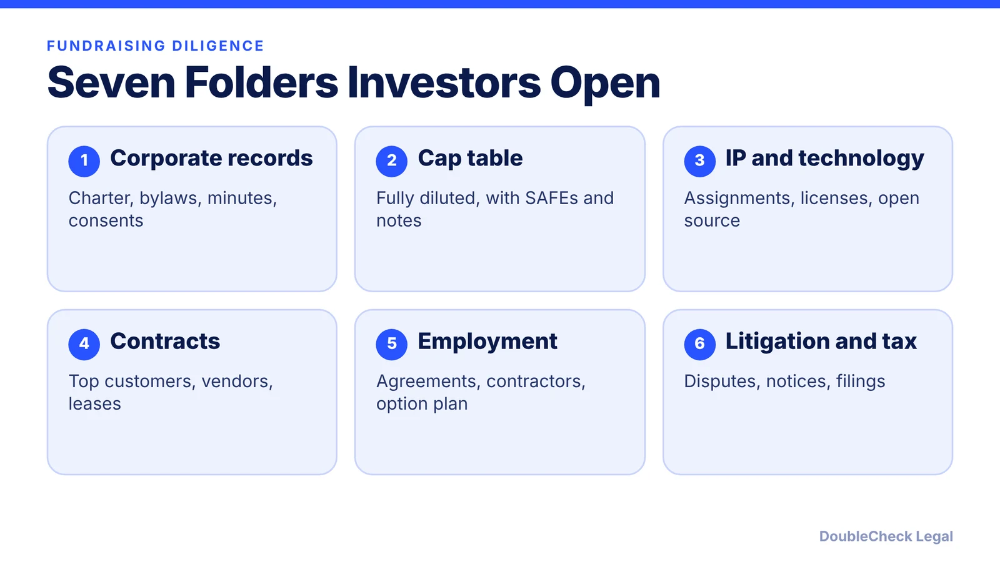
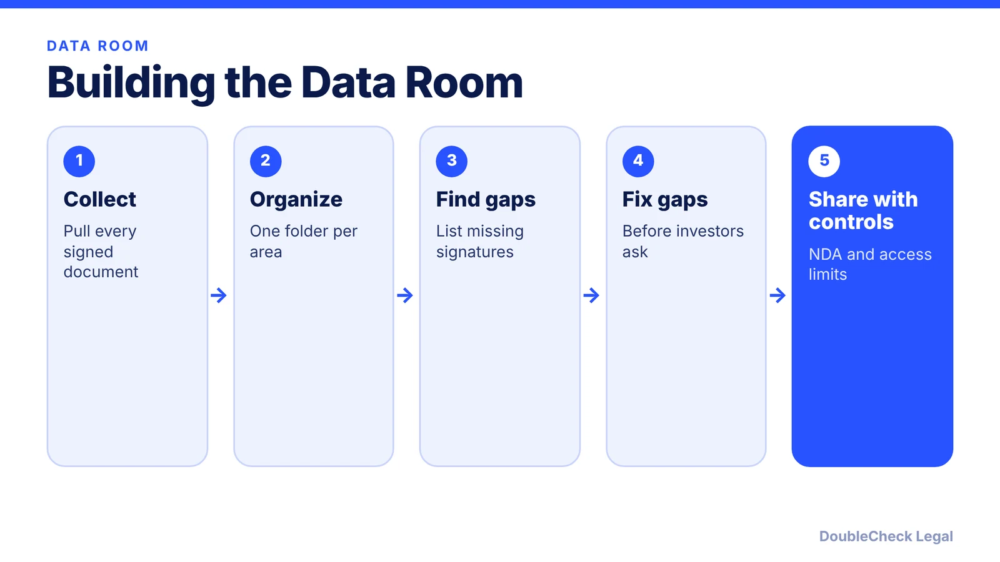

*Investors check your paperwork before they wire money. Here is what to have ready.*

**Key takeaways:**

- Prepare seven folders: corporate, cap table, IP, contracts, employment, litigation, financial and tax.
- Unsigned IP assignments and cap table mismatches are among the most common issues cited.
- Start 60 to 90 days before raising and fix gaps before investors find them.
- Organize one data room and label empty folders so nothing looks hidden.

## 1. The quick answer

**Quick answer:** Startup fundraising due diligence is the investor's review of your legal, financial, and technical records before money moves. Prepare seven folders: corporate records, cap table, IP and technology, contracts, employment, litigation, and financial and tax. Unsigned IP assignments and cap tables that do not match the paperwork are the most common problems. Start well before you raise, and build one organized data room.

## 2. Corporate records, cap table, and IP

**Corporate records.** A typical data room includes the certificate of incorporation, founders' agreement, investor rights agreements, recent board minutes, subsidiary structure, and officers and directors, plus shareholder agreements, equity grants, and SAFEs or notes. Investors look for clean ownership with no undocumented promises or conflicting side letters. Missing board consents for equity issuances are a common red flag.

**Cap table.** Prepare a fully diluted cap table, the option plan and grant detail, and every prior financing document such as SAFEs and convertible notes. It must match your stock ledger and signed documents. Start with [cap table basics](/blog/cap-table-basics-for-first-time-founders/) and, for options, [409A valuations](/blog/stock-options-409a-valuation-startups/). Founder vesting and the [83(b) election](/blog/83b-election-startup-founders/) come up often.

**IP and technology.** Signed IP assignment agreements from founders, employees, and early contractors are a common gap, and they are what show the company owns its core product. Also gather trademark and patent filings, an open-source license inventory, and security reports if you have them. See [confidentiality and IP assignment agreements](/blog/confidentiality-ip-assignment-agreements-startups/) and [AI-generated code and IP](/blog/ai-generated-code-ip-startup-founders/).

For a deeper line-by-line view, see our [Series A legal due diligence checklist](/blog/series-a-legal-due-diligence-checklist/).

## 3. Contracts, employment, litigation, financials

**Contracts.** Typical items are the top customer contracts, material vendor contracts, privacy policy and data processing agreements, insurance policies, and the NDA used in the process. Investors often look at change-of-control terms in particular. Review your own paper first with [reviewing customer contract redlines](/blog/review-customer-contract-redlines/).

**Employment.** Org chart, key employment agreements, contractor agreements, and the hiring plan, plus founder vesting, key-person dependencies, and contractor classification; see [employee vs. contractor classification](/blog/employee-vs-independent-contractor-classification-startups/).

**Litigation.** Consider labeling the folder explicitly ("Litigation - none to date") rather than leaving it out. Include pending or threatened disputes, filings, and insurance coverage; undisclosed litigation is a red flag.

**Financial, tax, and regulatory.** Financial model, year-to-date management accounts, debt schedule, and three years of tax returns, plus sales tax filings. Investors also check whether the data room matches the pitch deck.

## 4. What to expect and common red flags

**Timing.** Diligence generally takes longer and covers more documents in later rounds; your investors set their own process and timeline. Early rounds usually focus on the pitch deck, financial model, cap table, founders' agreement, and an NDA, with contracts and IP assignments added by Series A.

**Red flags to fix first:**

- Unsigned IP assignments
- Cap table inconsistencies
- Financials that contradict the pitch deck
- Undisclosed related-party transactions
- Heavy customer concentration in revenue
- Missing board consents for equity issuances
- Undisclosed litigation

**Practical tips.** Disclose known gaps early with a plan to fix them. Use consistent file names, NDA gates, and access controls. Fix problems before they are discovered, and make sure your [SAFE or convertible note terms](/blog/safe-review-before-you-sign/) are reflected in the cap table. If you are weighing instruments, see [SAFE vs. convertible note](/blog/safe-vs-convertible-note-startups/) and [startup funding stages](/blog/startup-funding-stages-pre-seed-to-series-b/).

**Related reading:** [Assignment Clause Explained: Can Your Contract Be Transferred?](/blog/assignment-clause-explained-can-your-contract-be-transferred/); [Corporate Minutes and Board Consents: Small Corporation Records Guide](/blog/corporate-minutes-and-board-consents-small-corporation-records/); [Option Pool Size and Dilution in a First Round Explained for Founders](/blog/option-pool-size-and-dilution-first-round-explained/); [Angel Investor Agreement: What to Expect and a Documents Checklist](/blog/angel-investor-agreement-what-to-expect-docs-checklist/); [Cap Table Cleanup Before Series A: Common Problems and How to Fix Them](/blog/cap-table-cleanup-before-series-a-common-problems/); [Open Source License Compliance for Startups: MIT, GPL, Apache and What to Check](/blog/open-source-license-compliance-startups-mit-gpl-apache-what-to-check/)

## Where DoubleCheck fits

[DoubleCheck](https://www.contactdoublecheck.com) helps businesses and founders start legal work with AI, verify it, and, when professional advice is warranted, connect with an independent attorney, including for immigration questions. Attorney availability and practice areas vary. Attorneys on DoubleCheck are independent professionals; an attorney-client relationship forms only if an attorney accepts your engagement.

**Sources:** This checklist reflects general market practice rather than a legal standard; for related authoritative references see the NVCA model documents (see [NVCA model documents explained](/blog/nvca-model-documents-priced-round-explained/)) and our [Series A legal due diligence checklist](/blog/series-a-legal-due-diligence-checklist/).

## FAQ

**What is due diligence in fundraising?**

It is the investor's review of your legal, financial, and technical records before closing a round. It typically covers corporate, cap table, IP, contracts, employment, and litigation records.

**What is the most common gap?**

Missing IP assignment agreements from founders and early contractors are a common gap.

**What should I put in a data room?**

A typical checklist includes corporate documents, a fully diluted cap table, IP assignments, top customer and vendor contracts, employment records, a litigation summary, financials, and tax filings.

**How long should I prepare?**

Start well before you raise. Timelines vary by round and investor.

---

*General information only. This article is not legal, tax, investment, or accounting advice.*
