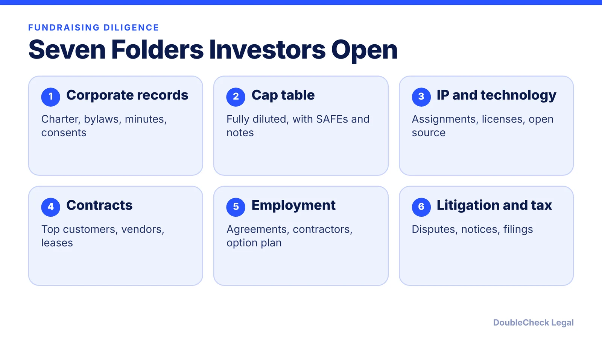
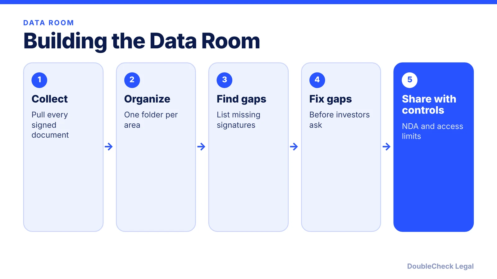

*Investors check your paperwork before they wire money. Here is what to have ready.*

**Key takeaways:**

- Prepare seven folders: corporate, cap table, IP, contracts, employment, litigation, financial and tax.
- Unsigned IP assignments and cap table mismatches are among the most common issues cited.
- Start 60 to 90 days before raising and fix gaps before investors find them.
- Organize one data room and label empty folders so nothing looks hidden.

## 1. The quick answer

**Quick answer:** Startup fundraising due diligence is the investor's review of your legal, financial, and technical records before money moves. Prepare seven folders: corporate records, cap table, IP and technology, contracts, employment, litigation, and financial and tax. Unsigned IP assignments and cap tables that do not match the paperwork are the most common problems. Start 60 to 90 days before you raise, according to Peony, and build one organized data room.

## 2. Corporate records, cap table, and IP

**Corporate records.** Papermark's data room checklist lists the certificate of incorporation, founders' agreement, investor rights agreements, board minutes (last 24 months), subsidiary structure, and officers and directors. Peony adds shareholder agreements, equity grants, and SAFEs or notes, and says investors look for clean ownership with no undocumented promises or conflicting side letters. Missing board consents for equity issuances are a flagged red flag.

**Cap table.** Prepare a fully diluted cap table, the option plan and grant detail, and every prior financing document such as SAFEs and convertible notes. It must match your stock ledger and signed documents. Start with [cap table basics](/blog/cap-table-basics-for-first-time-founders/) and, for options, [409A valuations](/blog/stock-options-409a-valuation-startups/). Founder vesting and the [83(b) election](/blog/83b-election-startup-founders/) come up often.

**IP and technology.** Papermark calls IP assignment agreements from founders and early contractors "the most common gap." Peony likewise names signed IP assignments from founders, employees, and contractors as what proves the company owns its core product. Also gather trademark and patent filings, an open-source license inventory, and security reports if you have them. See [confidentiality and IP assignment agreements](/blog/confidentiality-ip-assignment-agreements-startups/) and [AI-generated code and IP](/blog/ai-generated-code-ip-startup-founders/).

For a deeper line-by-line view, see our [Series A legal due diligence checklist](/blog/series-a-legal-due-diligence-checklist/).

## 3. Contracts, employment, litigation, financials

**Contracts.** Papermark lists the top 10 customer contracts, material vendor contracts, privacy policy and data processing agreements, insurance policies, and the NDA used in the process. Peony says investors look at change-of-control terms in particular. Review your own paper first with [reviewing customer contract redlines](/blog/review-customer-contract-redlines/).

**Employment.** Org chart, key employment agreements, contractor agreements, and the hiring plan (Papermark). Peony adds founder vesting, key-person dependencies, and contractor classification; see [employee vs. contractor classification](/blog/employee-vs-independent-contractor-classification-startups/).

**Litigation.** Papermark suggests labeling the folder explicitly ("Litigation - none to date") rather than leaving it out. Peony names pending or threatened disputes, filings, and insurance coverage, and lists undisclosed litigation among its red flags.

**Financial, tax, and regulatory.** Financial model, year-to-date management accounts, debt schedule, and three years of tax returns, plus sales tax filings (Papermark). Investors also check whether the data room matches the pitch deck, per Peony.

## 4. What to expect and common red flags

**Timing.** Peony, a company blog whose statistics it does not source, estimates seed diligence at about 1 to 3 weeks and roughly 30 to 50 documents, Series A at 4 to 8 weeks and 150 to 200 documents, and later rounds longer. Treat these as rough guides; your investors set their own process. Papermark stages what to share by round: at pre-seed and seed, mainly the pitch deck, financial model, cap table, founders' agreement, and an NDA, with contracts and IP assignments added by Series A.

**Red flags to fix first** (Peony):

- Unsigned IP assignments
- Cap table inconsistencies
- Financials that contradict the pitch deck
- Undisclosed related-party transactions
- One customer making up more than about 30% of revenue
- Missing board consents for equity issuances
- Undisclosed litigation

**Practical tips.** Disclose known gaps early with a plan to fix them. Use consistent file names, NDA gates, and access controls. Fix problems before they are discovered, and make sure your [SAFE or convertible note terms](/blog/safe-review-before-you-sign/) are reflected in the cap table. If you are weighing instruments, see [SAFE vs. convertible note](/blog/safe-vs-convertible-note-startups/) and [startup funding stages](/blog/startup-funding-stages-pre-seed-to-series-b/).

## Where DoubleCheck fits

[DoubleCheck](https://www.contactdoublecheck.com) helps businesses and founders start legal work with AI, verify it, and, when professional advice is warranted, connect with an independent attorney, including for immigration questions. Attorney availability and practice areas vary. Attorneys on DoubleCheck are independent professionals; an attorney-client relationship forms only if an attorney accepts your engagement.

**Sources:** [Papermark: Data room checklist 2026](https://www.papermark.com/blog/data-room-checklist-2026); [Peony: Startup due diligence guide](https://www.peony.ink/blog/startup-due-diligence-guide); [Incorpx: Due diligence checklist](https://www.incorpx.io/blog/due-diligence-checklist-startup-funding).

## FAQ

**What is due diligence in fundraising?**

It is the investor's review of your legal, financial, and technical records before closing a round. Peony describes legal review of corporate, cap table, IP, contracts, employment, and litigation records.

**What is the most common gap?**

Papermark calls missing IP assignment agreements from founders and early contractors the most common gap.

**What should I put in a data room?**

Papermark's checklist includes corporate documents, a fully diluted cap table, IP assignments, top customer and vendor contracts, employment records, a litigation summary, financials, and tax filings.

**How long should I prepare?**

Peony suggests starting 60 to 90 days before raising. Timelines vary by round and investor.

---

*General information only. This article is not legal, tax, investment, or accounting advice.*
