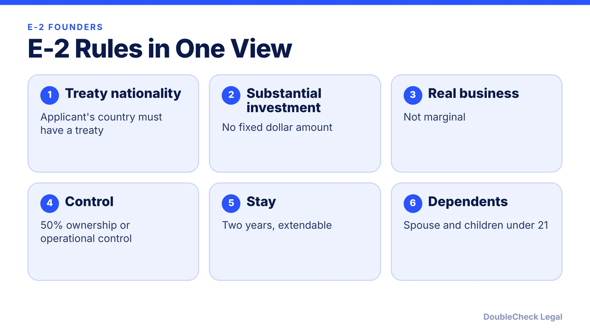
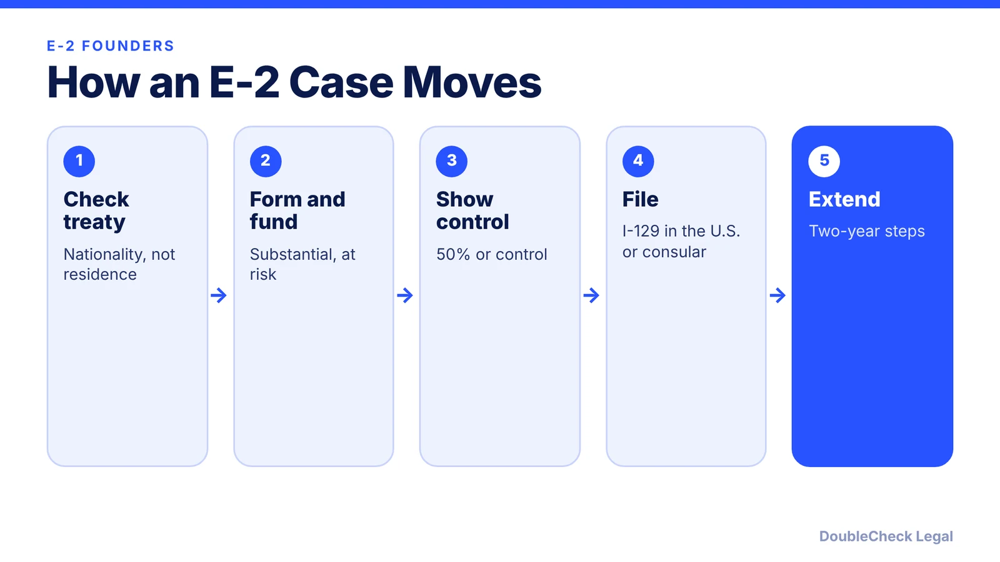

*Can a founder get a visa by investing in their own U.S. company? The E-2 may fit, if your country has a treaty.*

**Key takeaways:**

- E-2 requires treaty-country nationality, a substantial investment, and at least 50% ownership or operational control, per USCIS.
- There is no fixed minimum; the business must not be marginal.
- Initial stay is up to two years, with unlimited two-year extensions.
- Law firms list France as a treaty country and say India and mainland China are not.

## 1. The quick answer

**Quick answer:** The E-2 treaty investor visa lets a national of a treaty country invest a substantial amount in a real U.S. business and enter to develop and direct it. USCIS says you need at least 50% ownership or operational control, and the business cannot be marginal. There is no fixed minimum investment. The initial stay is up to two years, with extensions in two-year steps and no limit on the number.

## 2. Investment and the "not marginal" test

USCIS says the investment must be substantial in proportion to the cost of buying or starting the business: the cheaper the business, the larger the proportion expected. The enterprise must be able to generate more than a minimal living for you and your family, or have the capacity to do so within five years. Some law firms say investments above $100,000 are viewed more favorably, but that is practitioner opinion, not a rule. Form the company first ([how to incorporate](/blog/how-to-incorporate-a-company-in-the-us/)).

## 3. Which countries qualify

Treaty status follows nationality, not residence. Law-firm summaries list France as a treaty country and say India and mainland China are not (Taiwan is listed). Lehigh Valley Immigration Lawyers says treaty nationals must own at least 50% traced through every ownership layer, and that Portugal was added in March 2024 while the treaties with Ecuador and Bolivia ended. Check the State Department's treaty table before you plan.

## 4. Filing, family, and employees

Per USCIS, if you are in the U.S. you can change to or extend E-2 with Form I-129; if you are abroad, you apply for the visa through the State Department. Spouses in valid E-2 status are generally employment authorized incident to status, and children under 21 are included. E-2 employees must have the same nationality as the treaty-national employer and hold executive or supervisory duties, or have essential special skills. Compare [L-1A](/blog/l-1a-visa-new-office-foreign-founders/) and [O-1A](/blog/o-1a-visa-for-startup-founders-evidence/), and read [how to start a U.S. company from abroad](/blog/start-us-company-as-non-us-resident/).

## Where DoubleCheck fits

[DoubleCheck](https://www.contactdoublecheck.com) helps businesses and founders start legal work with AI, verify it, and, when professional advice is warranted, connect with an independent attorney, including for immigration questions. Attorney availability and practice areas vary. Attorneys on DoubleCheck are independent professionals; an attorney-client relationship forms only if an attorney accepts your engagement.

**Sources:** [USCIS E-2 treaty investors](https://www.uscis.gov/working-in-the-united-states/temporary-workers/e-2-treaty-investors); [Lighthouse](https://www.lighthousehq.com/blog/e2-treaty-countries); [Grape Law](https://www.grapelaw.com/blog/us-immigration/e-2-visa-countries-list-treaty-nations); [Lehigh Valley Immigration Lawyers](https://www.lehighvalleyimmigrationlawyers.com/blog/e-2-treaty-countries-list-investment-threshold-2026).

## FAQ

**How much do I need to invest for an E-2 visa?**

USCIS sets no fixed amount. The investment must be substantial relative to the cost of the business, and the business cannot be marginal.

**Can Chinese or Indian citizens get an E-2?**

Per law-firm country lists, India and mainland China are not E-2 treaty countries. Confirm on the State Department's treaty table.

**Can my spouse work on an E-2?**

USCIS says spouses in valid E-2 status are generally employment authorized incident to status.

**Does an E-2 lead to a green card?**

No. E-2 holders must intend to leave when status ends, per USCIS. Founders often explore other paths.

---

*General information only. This article is not legal, tax, investment, or accounting advice.*
