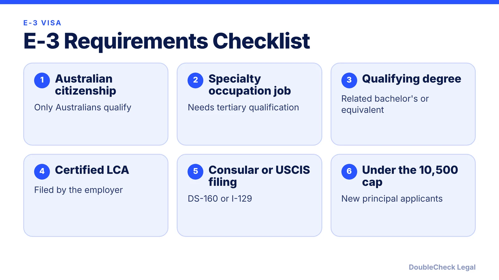
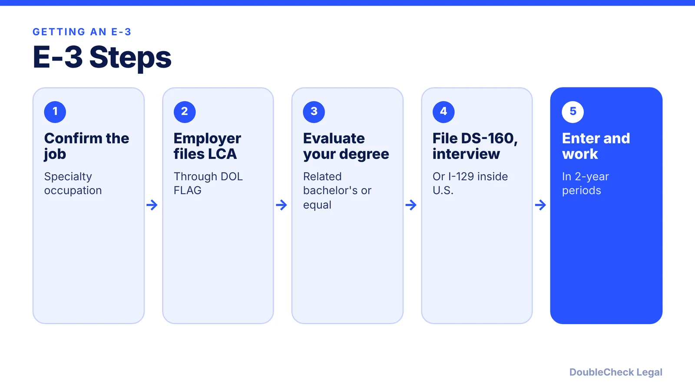

*Australian and working in tech? The E-3 skips the H-1B lottery, but it has its own cap, LCA and degree rules.*

**Key takeaways:**

- Only Australian citizens in specialty occupations requiring a tertiary qualification qualify.
- 10,500 new E-3 principal visas are available per fiscal year; there is no lottery, and demand has historically stayed below the cap per NNU Immigration.
- The employer files an LCA; you apply by DS-160 abroad or I-129 change of status inside the U.S.
- Two-year periods, renewable indefinitely; spouses can work.

## 1. The quick answer

**Quick answer:** The E-3 is a U.S. work visa reserved for Australian citizens in "specialty occupation" jobs that require a tertiary (bachelor's-level) qualification. There are 10,500 new E-3 principal visas available each fiscal year, but there is no lottery: employers do not take part in the H-1B registration process, and demand has historically stayed below the cap. The employer files a Labor Condition Application (LCA) with the Department of Labor, and status is granted in two-year periods that can be renewed. Spouses are entitled to work.

## 2. Who qualifies

Per Australia's Department of Foreign Affairs and Trade (DFAT), only Australians can apply, and the job must be a specialty occupation that requires a tertiary qualification and sponsorship by a U.S. employer. NNU Immigration adds that applicants generally need a U.S. bachelor's degree or higher in a directly related field, or an equivalent. An Australian degree can qualify with a proper evaluation, and professional experience can sometimes substitute, but that takes strong evidence. There is no official list of qualifying jobs: the role must require degree-level specialized knowledge, and the employer has to show the link.

For software engineers, data scientists and similar roles, that usually means a degree in computer science or a closely related field and a job description that actually requires it. Compare this with the [H-1B](/blog/startup-sponsor-h1b-employee-requirements/), which has the same specialty-occupation idea but a registration lottery.

## 3. The cap, the LCA, and how to apply

**The cap.** DFAT and NNU both state 10,500 per fiscal year. Per NNU, spouses and children do not count against it, returning principals staying with the original employer are generally exempt, and demand has historically stayed below the cap. NNU also warns that no lottery does not mean the visa is unlimited, so check with an attorney whether the cap is relevant this year.

**The LCA.** The employer files Form ETA-9035 or 9035E through the Department of Labor's FLAG system before you apply. NNU says it cannot be filed more than six months before the start date and DOL generally reviews it within seven working days. Certification does not confirm that the job qualifies as a specialty occupation.

**Applying.**
- From abroad: complete the DS-160, pay the visa fee and attend a consular interview. NNU says E-3 applicants are not eligible for routine interview waivers under rules effective October 1, 2025. Per DFAT, no separate I-129 petition is required.
- From inside the U.S.: eligible nonimmigrants can request a change of status with Form I-129. NNU notes filing does not authorize the new job to begin, and approval does not provide a visa stamp for later travel.

## 4. Duration, renewals, spouses, and why no lottery

**Duration.** Per DFAT, the visa can be renewed indefinitely in two-year increments, while H-1B is generally limited to six years. NNU adds that each extension requires continued eligibility and typically a new LCA. If you eventually want permanent residence, see our guide to [H-1B limits beyond six years](/blog/h-1b-6-year-limit-extensions-beyond-six-years/) for the comparison and the [green card timeline](/blog/h-1b-to-green-card-timeline-tech-workers/). Check with an attorney how E-3 interacts with a green card plan.

**Spouses.** DFAT says a spouse does not need to be Australian and is entitled to work in the U.S., unlike most H-1B spouses (see [H-4 EAD](/blog/h-4-ead-spouses-of-h-1b/)). NNU says qualifying spouses work incident to status without a separate EAD.

**Why not a lottery?** The E-3 sits outside the H-1B registration, so Australians skip the selection step. It is worth comparing it against the [weighted H-1B lottery](/blog/h1b-weighted-lottery-wage-levels-explained/) and other [visa options](/blog/us-visa-options-for-startup-founders-compared/).

## Where DoubleCheck fits

[DoubleCheck](https://www.contactdoublecheck.com) helps businesses and founders start legal work with AI, verify it, and, when professional advice is warranted, connect with an independent attorney, including for immigration questions. Attorney availability and practice areas vary. Attorneys on DoubleCheck are independent professionals; an attorney-client relationship forms only if an attorney accepts your engagement.

**Sources:** [DFAT, E-3 visas](https://www.dfat.gov.au/geo/united-states-of-america/Pages/e-3-visas-for-the-united-states); [NNU Immigration, E-3 guide 2026](https://www.nnuimmigration.com/?p=17942); [Fisher Phillips, E-3 for Australian citizens](https://www.fisherphillips.com/Cross-Border-Employer/E-3-Visa-for-Australian-Citizens).

## FAQ

**Is there a lottery for the E-3 visa?**

No. NNU Immigration says E-3 applicants skip H-1B registration, though it also notes that no lottery does not mean the visas are unlimited. The cap is 10,500 new principals a year.

**How long does E-3 status last?**

Two-year periods that can be renewed indefinitely, per DFAT, as long as you remain eligible. Extensions typically need a new LCA, per NNU.

**Can my spouse work on an E-3?**

Yes. DFAT says a spouse is entitled to work in the U.S. and need not be an Australian citizen. NNU says they work incident to status without a separate EAD.

**Does the E-3 need a USCIS petition?**

Not when you apply at a consulate abroad, per DFAT. If you are already in the U.S. and want to change to E-3, you file Form I-129 with USCIS, per NNU Immigration.

---

*General information only. This article is not legal, tax, investment, or accounting advice.*
